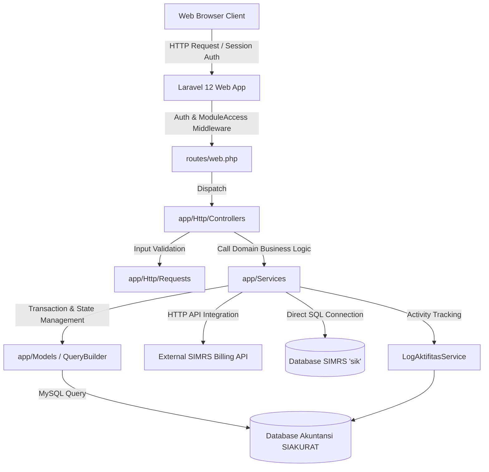
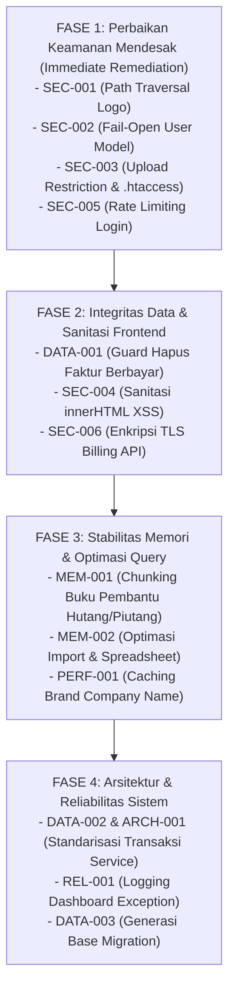

# LAPORAN COMPREHENSIVE APPLICATION SECURITY AUDIT & CODE QUALITY ASSESSMENT
**Sistem Informasi Akuntansi Rumah Sakit (SI AKURAT) — RSU Aisyiyah Bojonegoro**  
**Klasifikasi:** *Confidential / Restricted — Security Audit Report*  
**Peran Auditor:** *Principal Application Security Engineer, Senior Laravel Security Specialist & Senior Software Architect*  
**Metodologi:** *Static Application Security Testing (SAST), Source-to-Sink Taint Analysis, Architecture & Concurrency Review*  
**Tanggal Audit:** *2 November 2026*  

---

# DAFTAR ISI

- [BAGIAN 1 — EXECUTIVE SUMMARY](#bagian-1--executive-summary)
- [BAGIAN 2 — AUDIT SCOPE DAN COVERAGE](#bagian-2--audit-scope-dan-coverage)
- [BAGIAN 3 — APPLICATION ARCHITECTURE](#bagian-3--application-architecture)
- [BAGIAN 4 — ATTACK SURFACE INVENTORY](#bagian-4--attack-surface-inventory)
- [BAGIAN 5 — EXECUTIVE FINDINGS](#bagian-5--executive-findings)
- [BAGIAN 6 — DETAILED FINDINGS](#bagian-6--detailed-findings)
  - [Security Vulnerabilities (SEC)](#security-vulnerabilities-sec)
    - [SEC-001: Path Traversal & Arbitrary File Deletion pada Penghapusan Logo Lama](#sec-001--path-traversal--arbitrary-file-deletion-pada-penghapusan-logo-lama)
    - [SEC-002: Fail-Open Authorization Bypass pada Model User hasModuleAccess](#sec-002--fail-open-authorization-bypass-pada-metode-model-user-hasmoduleaccess)
    - [SEC-003: Potensi Eksekusi File Akibat Ekstensi Klien dan Penyimpanan Langsung di Web Root](#sec-003--potensi-eksekusi-file-akibat-ekstensi-klien-dan-penyimpanan-langsung-di-web-root)
    - [SEC-004: DOM-Based Cross-Site Scripting (XSS) via Unescaped Template String Interpolation pada innerHTML](#sec-004--dom-based-cross-site-scripting-xss-via-unescaped-template-string-interpolation-pada-innerhtml)
    - [SEC-005: Ketiadaan Proteksi Rate Limiting pada Endpoint Login](#sec-005--ketiadaan-proteksi-rate-limiting-pada-endpoint-login)
    - [SEC-006: Komunikasi Plaintext HTTP pada Integrasi Eksternal Billing API Rumah Sakit](#sec-006--komunikasi-plaintext-http-pada-integrasi-eksternal-billing-api-rumah-sakit)
    - [SEC-007: Ketiadaan HTTP Security Headers & Konfigurasi Cookie Sesi Kurang Ketat](#sec-007--ketiadaan-http-security-headers--konfigurasi-cookie-sesi-kurang-ketat)
  - [Data Integrity & Database Concurrency (DATA)](#data-integrity--database-concurrency-data)
    - [DATA-001: Pemusnahan Data Faktur Penjualan yang Telah Memiliki Pembayaran via Bulk Delete Bridging](#data-001--pemusnahan-data-faktur-penjualan-yang-telah-memiliki-pembayaran-via-bulk-delete-bridging)
    - [DATA-002: Ketiadaan Enkapsulasi Transaksi Database pada Service Pencatatan Jurnal & Pembayaran](#data-002--ketiadaan-enkapsulasi-transaksi-database-pada-service-pencatatan-jurnal--pembayaran)
    - [DATA-003: Ketiadaan Migrasi Skema Basis Data Inti (Disaster Recovery & Reproducibility Gap)](#data-003--ketiadaan-migrasi-skema-basis-data-inti-disaster-recovery--reproducibility-gap)
  - [Memory Usage & Application Stability (MEM)](#memory-usage--application-stability-mem)
    - [MEM-001: Pemuatan Dataset Besar Tanpa Batas pada Laporan Buku Pembantu Hutang & Piutang](#mem-001--pemuatan-dataset-besar-tanpa-batas-pada-laporan-buku-pembantu-hutang--piutang)
    - [MEM-002: Konsumsi Memori Masif pada Konversi CSV ke XLSX dan Operasi Pluck Flip In-Memory](#mem-002--konsumsi-memori-masif-pada-konversi-csv-ke-xlsx-dan-operasi-pluck-flip-in-memory)
  - [Performance & Query Efficiency (PERF)](#performance--query-efficiency-perf)
    - [PERF-001: Pengecekan Eksistensi Tabel & Query Berulang pada Global View Composer](#perf-001--pengecekan-eksistensi-tabel--query-berulang-pada-global-view-composer)
  - [Application Reliability & Observability (REL)](#application-reliability--observability-rel)
    - [REL-001: Pembungkaman Eksepsi Database Secara Diam-Diam pada Home Dashboard Service](#rel-001--pembungkaman-eksepsi-database-secara-diam-diam-pada-home-dashboard-service)
  - [Architecture & Maintainability (ARCH)](#architecture--maintainability-arch)
    - [ARCH-001: Inkonsistensi Penempatan Batas Transaksi Antara Controller dan Service](#arch-001--inkonsistensi-penempatan-batas-transaksi-antara-controller-dan-service)
- [BAGIAN 7 — OWASP TOP 10:2025 ASSESSMENT](#bagian-7--owasp-top-102025-assessment)
- [BAGIAN 8 — DATABASE PERFORMANCE DAN DATA INTEGRITY](#bagian-8--database-performance-dan-data-integrity)
- [BAGIAN 9 — MEMORY DAN APPLICATION STABILITY](#bagian-9--memory-dan-application-stability)
- [BAGIAN 10 — SUPPLY CHAIN SECURITY](#bagian-10--supply-chain-security)
- [BAGIAN 11 — RECOMMENDATION ROADMAP](#bagian-11--recommendation-roadmap)
- [BAGIAN 12 — INFORMATION GAP](#bagian-12--information-gap)
- [BAGIAN 13 — KESIMPULAN](#bagian-13--kesimpulan)

---

# BAGIAN 1 — EXECUTIVE SUMMARY

Audit keamanan aplikasi dan evaluasi kualitas kode dilakukan secara independen terhadap basis kode aplikasi **SI AKURAT (Sistem Informasi Akuntansi Rumah Sakit)** yang dikembangkan untuk Rumah Sakit Umum Aisyiyah Bojonegoro. Audit dilakukan secara menyeluruh menggunakan metodologi *Static Application Security Testing* (SAST), *Source-to-Sink Taint Analysis*, penelusuran kontrol akses berbasis peran (RBAC), evaluasi konkurensi data keuangan, analisis konsumsi memori, serta peninjauan kesesuaian arsitektur terhadap prinsip SOLID dan standar pengembangan Laravel profesional.

### Ringkasan Profil Teknis Aplikasi

- **Framework:** Laravel Framework `v12.59.0` (kompatibilitas constraint `^12.0`).
- **Runtime PHP Target:** PHP `^8.2` (dengan fitur modern constructor property promotion, match expressions, typed properties).
- **Database Driver:** MySQL / MariaDB (koneksi utama `mysql` untuk database akuntansi dan koneksi sekunder `simrs` untuk bridging database rumah sakit `sik`).
- **Arsitektur Aplikasi:** Monolith berbasis Laravel Blade, Controller, Service Layer, dan Eloquent ORM. Mengintegrasikan Yajra DataTables untuk server-side tabular data dan Billing REST API eksternal untuk bridging klaim/billing pasien.
- **Inventaris Komponen:**
  - **44 Model** Eloquent.
  - **34 Controller** (32 concrete controllers, 1 base Controller, 1 controller concern trait).
  - **43 Service Classes** (domain logic, bridging, financial reports, settings).
  - **55 Form Request Classes** (validasi input terisolasi).
  - **244 Route Aktif** (243 web routes terdaftar di `routes/web.php` dan 1 console command).
  - **31 Migrations** terdaftar di `database/migrations/`.
  - **145 View Blade** di `resources/views/`.
  - **60 Automated Tests** (Feature & Unit tests di `tests/`).

### Indikator Skor Heuristik (Risk Indicators)

> [!NOTE]
> Skor dihitung berdasarkan rumus heuristik: $\text{Skor} = \max(0, 100 - \sum \text{Bobot Temuan Terkonfirmasi})$, dengan bobot: *Critical = 25*, *High = 15*, *Medium = 7*, *Low = 2*. Skor ini merupakan indikator pembanding internal, bukan sertifikasi keamanan mutlak.

| Domain Audit | Skor | Kategori Risiko | Jumlah Temuan Terkonfirmasi |
|---|:---:|:---:|---|
| **Application Security (SAST/OWASP)** | **32 / 100** | **TINGGI** | 3 High, 3 Medium, 1 Low |
| **Database & Data Integrity** | **56 / 100** | **MODERAT** | 2 High, 2 Medium |
| **Memory & Application Stability** | **63 / 100** | **MODERAT** | 2 High, 1 Medium |
| **Architecture & Maintainability** | **93 / 100** | **BAIK** | 1 Medium |

### 5 Risiko Tertinggi yang Membutuhkan Perhatian Mendesak

1. **Path Traversal & Arbitrary File Deletion pada Modul Preferensi Perusahaan (`SEC-001` — Severity: HIGH):** Metode penghapusan logo lama menerima path relatif yang tidak dinormalisasi. Penyerang dengan hak akses pengaturan dapat menghapus sembarang file aplikasi (seperti `public/index.php`).
2. **Fail-Open Authorization Bypass pada Model User (`SEC-002` — Severity: HIGH):** Logika `hasModuleAccess()` mengembalikan `true` secara instan apabila model User belum tersimpan di database (`!$this->exists`), melanggar prinsip *fail-safe defaults*.
3. **Penyimpanan Upload Langsung di Direktori Publik Tanpa Larangan Eksekusi Skrip (`SEC-003` — Severity: HIGH):** File logo disimpan langsung ke direktori `public/uploads/logo/` menggunakan ekstensi file asli dari klien (`getClientOriginalExtension()`) tanpa konfigurasi proteksi eksekusi PHP pada web server, menciptakan risiko eskalasi eksekusi kode.
4. **Pemusnahan Data Faktur Penjualan yang Telah Memiliki Pembayaran via Bulk Delete Bridging (`DATA-001` — Operational Impact: HIGH):** Metode `hapusBanyak` pada modul bridging menghapus `FakturPenjualan` dan buku besar tanpa validasi apakah faktur telah memiliki pembayaran (`sudah_terbayar > 0`), menghasilkan rekaman piutang yatim (*orphan records*) dan anomali neraca.
5. **Potensi Exhaustion Memori (OOM) pada Laporan Aging Hutang/Piutang & Konversi File (`MEM-001` & `MEM-002` — Operational Impact: HIGH):** Pemrosesan laporan buku pembantu hutang/piutang memuat seluruh riwayat transaksi tanpa paginasi/chunking, serta modul konversi file CSV ke XLSX memuat file hingga 10 MB langsung ke dalam memori PHP Spreadsheet tanpa disk caching, berisiko melumpuhkan worker web server akibat *Out Of Memory*.

---

# BAGIAN 2 — AUDIT SCOPE DAN COVERAGE

Audit dilakukan secara komprehensif terhadap seluruh source code repositori dalam mode baca penuh (*strict read-only*).

| Area Inspeksi | Ditemukan | Diperiksa | Belum Diperiksa | Keterangan |
|---|:---:|:---:|:---:|---|
| **Controllers & Concerns** | 34 | 34 | 0 | 100% controller dianalisis. |
| **Eloquent Models** | 44 | 44 | 0 | 100% model dianalisis atribut & relasinya. |
| **Form Requests** | 55 | 55 | 0 | Seluruh aturan validasi diperiksa. |
| **Application Services** | 43 | 43 | 0 | Seluruh alur kalkulasi bisnis dianalisis. |
| **Routes Definitions** | 2 files (244 routes) | 2 files (244 routes) | 0 | Web & Console routes dipetakan. |
| **Configurations** | 11 files | 11 files | 0 | Konfigurasi framework & database dianalisis. |
| **Database Migrations** | 31 files | 31 files | 0 | Struktur skema dan indeks dianalisis. |
| **Blade Views & Scripts** | 145 files | 145 files | 0 | Analisis XSS, inline script, dan sanitasi output. |
| **Test Suites** | 60 files | 60 files | 0 | Sifat pengujian diperiksa secara statis. |
| **Dependency Manifests** | 4 files | 4 files | 0 | `composer.json`, `composer.lock`, `package.json`, `package-lock.json`. |

### Batasan Analisis (*Audit Limitations*)
- **Lingkungan Produksi & Database Aktual:** Audit tidak melakukan koneksi langsung ke server database fisik MySQL produksi. Karakteristik tabel riil, jumlah record, index fragmentasi, dan konfigurasi SQL mode dievaluasi berdasarkan source code dan file migrasi yang tersedia.
- **Konfigurasi Web Server (Nginx / Apache):** File konfigurasi server produksi (`nginx.conf`, virtual host) tidak berada di dalam repositori git. Pemeriksaan keamanan server didasarkan pada file `.htaccess` yang tersedia di folder `public/`.
- **Eksekusi Dinamis:** Tidak ada pengujian penetrasi aktif, brute-force, atau eksploitasi muatan langsung yang dijalankan terhadap server runtime.

---

# BAGIAN 3 — APPLICATION ARCHITECTURE

Aplikasi **SI AKURAT** mengadopsi pola arsitektur *Service-Oriented Monolith* di atas Laravel 12.



### Karakteristik Arsitektur Utama

1. **Authentication:** Menggunakan autentikasi berbasis sesi stateful Laravel melalui guard `web` standar (`app/Http/Controllers/Auth/AuthController.php`). Session disimpan dalam database (`sessions` table).
2. **Authorization (RBAC):** Tidak menggunakan package pihak ketiga seperti Spatie Permission, melainkan mengimplementasikan RBAC custom melalui model `Role`, `AccessModule`, dan `RolePermission` dengan matriks hak akses 4 aksi: `can_view`, `can_create`, `can_update`, `can_delete`. Kontrol akses ditegakkan di layer HTTP via middleware `EnsureModuleAccess`.
3. **Database Access Layer:** Menggunakan Eloquent ORM dan Laravel Query Builder. Terdapat pemisahan dua koneksi: `mysql` untuk akuntansi dan `simrs` untuk bridging billing.
4. **Multi-Tenancy:** Aplikasi beroperasi dalam mode **Single-Tenant** (satu entitas rumah sakit: RSU Aisyiyah Bojonegoro). Tidak ditemukan konsep multi-organisasi atau kolom `tenant_id` pada skema database.
5. **Audit Logging:** Menggunakan `LogAktifitasService` yang mencatat aksi create, update, dan delete beserta payload JSON state lama dan baru ke tabel `log_aktifitas`.

---

# BAGIAN 4 — ATTACK SURFACE INVENTORY

| Kategori Endpoint | Jumlah Route | Mekanisme Autentikasi | Mekanisme Otorisasi | Risiko Utama |
|---|:---:|---|---|---|
| **Public / Guest Endpoints** | 3 | Tidak ada (`guest` middleware) | Terbuka untuk umum | Credential stuffing, brute-force login. |
| **Dashboard / Home** | 6 | Sesi aktif (`auth`) | `module.access:home,view` | Kebocoran data agregat operasional. |
| **Buku Besar & COA** | 26 | Sesi aktif (`auth`) | `module.access:bukubesar.*` | Modifikasi akun & template jurnal. |
| **Kas & Bank** | 33 | Sesi aktif (`auth`) | `module.access:kasbank.*` | Manipulasi voucher kas/bank masuk & keluar. |
| **Bridging SIMRS & Billing** | 22 | Sesi aktif (`auth`) | `module.access:bridging.*` | Inkonsistensi data integrasi, bulk delete. |
| **Invoice & Piutang Pendapatan**| 19 | Sesi aktif (`auth`) | `module.access:pendapatan.*` | Modifikasi tagihan dan penerimaan kasir. |
| **Invoice & Hutang Pembelian** | 21 | Sesi aktif (`auth`) | `module.access:pembelian.*` | Manipulasi hutang supplier dan pembayaran. |
| **Laporan Keuangan & Akuntansi**| 34 | Sesi aktif (`auth`) | `module.access:laporan.*` | OOM DoS melalui query interval tak terbatas. |
| **Pengaturan & Master Data** | 78 | Sesi aktif (`auth`) | `module.access:pengaturan.*` | Eskalasi hak akses, path traversal logo. |
| **Console Commands** | 1 | CLI Local | Server Access Only | `inspire` (risiko minimal). |

---

# BAGIAN 5 — EXECUTIVE FINDINGS

### Matriks Klasifikasi Temuan Berdasarkan Severity

| Kategori Temuan | Critical | High | Medium | Low | Total |
|---|:---:|:---:|:---:|:---:|:---:|
| **Security (SEC)** | 0 | 3 | 3 | 1 | **7** |
| **Data Integrity (DATA)** | 0 | 2 | 1 | 0 | **3** |
| **Memory & Stability (MEM)** | 0 | 2 | 0 | 0 | **2** |
| **Performance (PERF)** | 0 | 0 | 1 | 0 | **1** |
| **Reliability (REL)** | 0 | 0 | 1 | 0 | **1** |
| **Architecture (ARCH)** | 0 | 0 | 1 | 0 | **1** |
| **TOTAL** | **0** | **7** | **7** | **1** | **15** |

*Catatan: Seluruh 15 temuan berstatus `[TERKONFIRMASI SECARA STATIS]` dengan bukti baris kode aktual.*

---

# BAGIAN 6 — DETAILED FINDINGS

```
================================================================================
KLASIFIKASI: SECURITY VULNERABILITIES (SEC)
================================================================================
```

## SEC-001 — Path Traversal & Arbitrary File Deletion pada Penghapusan Logo Lama

**Severity:** HIGH  
**Status:** [TERKONFIRMASI SECARA STATIS]  
**Confidence:** TINGGI  
**Kategori:** Path Traversal / Arbitrary File Deletion  
**OWASP:** A01:2025 — Broken Access Control  
**CWE:** CWE-22 (Improper Limitation of a Pathname to a Restricted Directory), CWE-73 (External Control of File Name or Path)  
**Modul:** Pengaturan Preferensi Perusahaan  
**Lokasi:** `app/Services/Pengaturan/PreferensiService.php:71-84`

### A. Bukti Source Code
```php
// File: app/Services/Pengaturan/PreferensiService.php:71-84
    private function deleteOldLogo(string $currentLogo, string $newFilePath): void
    {
        if (! Str::startsWith($currentLogo, '/uploads/logo/')) {
            return;
        }

        $oldFilePath = public_path(ltrim($currentLogo, '/'));

        if ($oldFilePath === $newFilePath || ! File::exists($oldFilePath)) {
            return;
        }

        File::delete($oldFilePath);
    }
```
Dan titik propagasinya pada `app/Services/Pengaturan/PreferensiService.php:33-39`:
```php
        $currentLogo = (string) ($preferensi->logo_perusahaan ?? $data['logo_perusahaan'] ?? '');

        if ($logoFile !== null) {
            $data['logo_perusahaan'] = $this->storeLogo($logoFile, $currentLogo);
        }
```

### B. Root Cause Analysis
Metode `deleteOldLogo` bermaksud menghapus logo perusahaan lama saat logo baru diunggah. Pengecekan keamanan hanya memvalidasi apakah string diawali dengan `/uploads/logo/`. Namun, sistem tidak melakukan sanitasi terhadap urutan direktori traversal (`..`), tidak menggunakan `basename()`, dan tidak memverifikasi apakah path hasil resolusi riil (`realpath()`) berada di dalam folder yang diizinkan (`public/uploads/logo/`). Jika nilai `$preferensi->logo_perusahaan` kosong, nilai `$currentLogo` diambil langsung dari input request `$data['logo_perusahaan']` yang dapat dimanipulasi oleh klien.

### C. Data Flow / Attack Path
`HTTP Request (POST /pengaturan/preferensi)` $\rightarrow$ `UpdatePreferensiRequest (field: logo_perusahaan & logo_file)` $\rightarrow$ `PreferensiController::update()` $\rightarrow$ `PreferensiService::save()` $\rightarrow$ `PreferensiService::storeLogo()` $\rightarrow$ `PreferensiService::deleteOldLogo()` $\rightarrow$ **SINK: `File::delete($oldFilePath)`**.

### D. Skenario Eksploitasi
1. Aktor yang memiliki akses modul `pengaturan.preferensi` mengirimkan request pembaruan preferensi dengan payload input `logo_perusahaan = /uploads/logo/../../index.php` sembari melampirkan file gambar valid pada `logo_file`.
2. Validasi `Str::startsWith('/uploads/logo/../../index.php', '/uploads/logo/')` terpenuhi (`true`).
3. Variabel `$oldFilePath` teresolusi menjadi path absolut file sistem: `C:\...\public\uploads\logo\..\..\index.php` yang merujuk langsung ke file inti aplikasi `public/index.php`.
4. `File::delete($oldFilePath)` mengeksekusi penghapusan file `index.php`.
5. Seluruh website mengalami *Denial of Service* permanen (HTTP 404/403) karena front controller terhapus.

### E. Dampak Bisnis dan Teknis
- **Availability:** Kelumpuhan total layanan aplikasi rumah sakit akibat hilangnya file sistem penting.
- **Integrity:** Kerusakan integritas file server tanpa jejak error log web server.

### F. Rekomendasi Perbaikan
Gunakan `basename()` untuk mengekstrak hanya nama file, atau bandingkan path menggunakan `realpath()` dan pastikan berada dalam direktori target:
```php
    private function deleteOldLogo(string $currentLogo, string $newFilePath): void
    {
        $fileName = basename($currentLogo);
        $targetDirectory = realpath(public_path('uploads/logo'));
        $oldFilePath = realpath($targetDirectory . DIRECTORY_SEPARATOR . $fileName);

        if ($oldFilePath === false || ! str_starts_with($oldFilePath, $targetDirectory)) {
            return;
        }

        if ($oldFilePath === realpath($newFilePath) || ! File::exists($oldFilePath)) {
            return;
        }

        File::delete($oldFilePath);
    }
```

### G. Risiko & Ketergantungan
Perubahan terisolasi pada `PreferensiService.php`. Tidak berdampak pada modul lain.

### H. Rencana Pengujian
Uji unit dengan mengirimkan path bertingkat (`/uploads/logo/../../test.txt`) dan pastikan file target tidak terhapus.

---

## SEC-002 — Fail-Open Authorization Bypass pada Metode Model User `hasModuleAccess`

**Severity:** HIGH  
**Status:** [TERKONFIRMASI SECARA STATIS]  
**Confidence:** TINGGI  
**Kategori:** Broken Access Control / Insecure Default Logic  
**OWASP:** A01:2025 — Broken Access Control  
**CWE:** CWE-276 (Incorrect Default Permissions), CWE-636 (Not Failing Securely)  
**Modul:** Autentikasi & Model User  
**Lokasi:** `app/Models/User.php:63-67`

### A. Bukti Source Code
```php
// File: app/Models/User.php:63-67
    public function hasModuleAccess(string $moduleKey, string $action = 'view'): bool
    {
        if (! $this->exists) {
            return true;
        }

        if ($this->role_id === null) {
            return false;
        }
```

### B. Root Cause Analysis
Metode `hasModuleAccess()` pada model `User` menerapkan evaluasi `if (! $this->exists) return true;`. Properti `$this->exists` pada Eloquent bernilai `false` apabila objek User baru diinisialisasi dalam memori (`new User()`, `User::make()`) dan belum disimpan/di-query dari database. Logika ini menyebabkan entitas pengguna non-permanen atau *guest context* yang belum terotentikasi secara sah lolos dari semua pembatasan modul (*fail-open*).

### C. Data Flow / Attack Path
`In-memory / Unpersisted User instance` $\rightarrow$ `User::hasModuleAccess($module, $action)` $\rightarrow$ Evaluasi `!$this->exists` menghasilkan `true` $\rightarrow$ Akses diberikan ke seluruh modul administratif tanpa pengecekan role dan permission.

### D. Skenario Eksploitasi
Jika di masa mendatang terdapat endpoint pengujian, impersonasi sementara, background job, atau middleware yang menginstansiasi instance `User` kosongan untuk merepresentasikan tamu atau konteks sementara, objek tersebut secara otomatis mewarisi hak akses penuh (*super-administrator privileges*) untuk melihat, mengubah, dan menghapus seluruh data modul akuntansi rumah sakit.

### E. Dampak Bisnis dan Teknis
- **Confidentiality & Integrity:** Melanggar prinsip *fail-safe defaults* (*deny by default*). Berisiko menimbulkan eskalasi hak akses penuh pada alur yang melibatkan unpersisted model.

### F. Rekomendasi Perbaikan
Ubah nilai balik jika model tidak eksis di database menjadi `false`:
```php
    public function hasModuleAccess(string $moduleKey, string $action = 'view'): bool
    {
        if (! $this->exists || $this->role_id === null) {
            return false;
        }
```

---

## SEC-003 — Potensi Eksekusi File Akibat Ekstensi Klien dan Penyimpanan Langsung di Web Root

**Severity:** HIGH  
**Status:** [TERKONFIRMASI SECARA STATIS]  
**Confidence:** TINGGI  
**Kategori:** Unrestricted File Upload / Web Root Storage  
**OWASP:** A05:2025 — Injection  
**CWE:** CWE-434 (Unrestricted Upload of File with Dangerous Type)  
**Modul:** Pengaturan Preferensi Perusahaan (Upload Logo)  
**Lokasi:** `app/Services/Pengaturan/PreferensiService.php:57-69`, direktori `public/uploads/logo/`

### A. Bukti Source Code
```php
// File: app/Services/Pengaturan/PreferensiService.php:57-69
    private function storeLogo(UploadedFile $logoFile, string $currentLogo): string
    {
        $directory = public_path('uploads/logo');
        File::ensureDirectoryExists($directory);

        $extension = strtolower($logoFile->getClientOriginalExtension());
        $fileName = 'logo_'.Str::lower(Str::random(32)).'.'.$extension;
        $logoFile->move($directory, $fileName);

        $this->deleteOldLogo($currentLogo, $directory.DIRECTORY_SEPARATOR.$fileName);

        return '/uploads/logo/'.$fileName;
    }
```

### B. Root Cause Analysis
1. Sistem mengambil ekstensi file menggunakan `$logoFile->getClientOriginalExtension()`. Method ini membaca ekstensi dari nama file asli yang dikirimkan oleh browser klien (dapat dimanipulasi attacker), bukan mengevaluasi ekstensi sebenarnya berdasarkan MIME binary yang dideteksi server (`guessExtension()`).
2. File disimpan langsung di dalam direktori publik `public/uploads/logo/`.
3. Tidak terdapat file konfigurasi keamanan server (`.htaccess`) di dalam direktori `public/uploads/` yang menonaktifkan engine interpreter PHP (`php_flag engine off` atau `SetHandler none`).

### C. Data Flow / Attack Path
`File Upload (logo_file)` $\rightarrow$ `UpdatePreferensiRequest` $\rightarrow$ `getClientOriginalExtension()` $\rightarrow$ `move()` ke folder web publik $\rightarrow$ File dapat diakses langsung via URL browser `http://domain/uploads/logo/logo_xxxx.ext`.

### D. Skenario Eksploitasi
Pada web server dengan konfigurasi MIME handler Apache/Nginx yang kurang ketat atau jika attacker berhasil melewati validasi MIME Laravel melalui polyglot GIF/JPEG yang disisipi kode PHP (atau ekstensi ganda yang diinterpretasikan oleh server web), file yang tersimpan di direktori `public/uploads/logo/` dapat dieksekusi secara langsung via browser HTTP GET request, memicu *Remote Code Execution* (RCE).

### E. Dampak Bisnis dan Teknis
- **Confidentiality, Integrity, Availability:** Pengambilalihan server aplikasi secara total apabila skrip web shell berhasil dieksekusi di web root.

### F. Rekomendasi Perbaikan
1. Gunakan `$logoFile->guessExtension()` atau paksa ekstensi kanonikal aman (misal `.png` / `.jpg`).
2. Letakkan file di disk privat atau disk `storage/app/public` yang diakses melalui route controller atau symlink yang menonaktifkan eksekusi skrip PHP.
3. Tambahkan file `.htaccess` di dalam direktori `public/uploads/`:
   ```apache
   <FilesMatch ".*">
       SetHandler None
   </FilesMatch>
   php_flag engine off
   ```

---

## SEC-004 — DOM-Based Cross-Site Scripting (XSS) via Unescaped Template String Interpolation pada `innerHTML`

**Severity:** MEDIUM  
**Status:** [TERKONFIRMASI SECARA STATIS]  
**Confidence:** TINGGI  
**Kategori:** Cross-Site Scripting (DOM XSS)  
**OWASP:** A05:2025 — Injection  
**CWE:** CWE-79 (Improper Neutralization of Input During Web Page Generation)  
**Modul:** Bridging Pendapatan & Template Jurnal Umum  
**Lokasi:**
- `resources/views/bridging/pendapatan/data-tidak-balance.blade.php:72`
- `resources/views/bukubesar/jurnal-umum/scripts.blade.php:113`

### A. Bukti Source Code
```javascript
// File: resources/views/bridging/pendapatan/data-tidak-balance.blade.php:72
rows.forEach((item) => { 
    const row = document.createElement('tr'); 
    row.innerHTML = `<td class="text-center"><input type="checkbox" class="row-checkbox" name="selectedNoRawat[]" value="${item.no_rawat}"></td><td>${item.no_rawat}</td><td>${item.tanggal_registrasi}</td>...`; 
    tbody.appendChild(row); 
});
```
Dan pada `resources/views/bukubesar/jurnal-umum/scripts.blade.php:113`:
```javascript
// File: resources/views/bukubesar/jurnal-umum/scripts.blade.php:113
row.innerHTML = `
    ...
    <td class="align-middle">
        <input type="text" name="rincian[${detailIndex}][catatan]" value="${data && data.catatan ? data.catatan : ''}" class="form-control">
    </td>
`;
```

### B. Root Cause Analysis
Data yang diterima dari respons AJAX/Fetch (seperti `item.no_rawat` dari database SIMRS atau `data.catatan` dari detail template jurnal) langsung digabungkan ke dalam string literal HTML dan di-assign ke properti `element.innerHTML` tanpa melalui fungsi encoding entitas HTML (`escapeHtml`). Jika data mengandung karakter `">`, string HTML akan pecah dan mengeksekusi payload JavaScript di browser pengguna.

### C. Data Flow / Attack Path
`Database (SIMRS billing no_rawat / Template catatan)` $\rightarrow$ `JSON API Endpoint` $\rightarrow$ `JavaScript Fetch Response` $\rightarrow$ **SINK: `row.innerHTML`**.

### D. Skenario Eksploitasi
Staf akuntansi membuat template jurnal umum atau bridging transaksi dari SIMRS yang memiliki field nomor billing atau catatan berisi muatan XSS: `"><svg onload=alert(document.cookie)>`. Saat pengguna lain membuka halaman verifikasi jurnal atau menerapkan template tersebut, skrip JavaScript dieksekusi di browser korban, memungkinkan pencurian session cookie atau token CSRF.

### E. Dampak Bisnis dan Teknis
- **Confidentiality:** Pembajakan sesi staf akuntansi rumah sakit.

### F. Rekomendasi Perbaikan
Gunakan fungsi sanitasi/escape sebelum memasukkan string ke `innerHTML`, atau buat elemen DOM secara aman menggunakan `textContent` / `element.setAttribute()`.

---

## SEC-005 — Ketiadaan Proteksi Rate Limiting pada Endpoint Login

**Severity:** MEDIUM  
**Status:** [TERKONFIRMASI SECARA STATIS]  
**Confidence:** TINGGI  
**Kategori:** Authentication Weakness / Brute Force Risk  
**OWASP:** A07:2025 — Authentication Failures  
**CWE:** CWE-307 (Improper Restriction of Excessive Authentication Attempts)  
**Modul:** Autentikasi  
**Lokasi:** `routes/web.php:43-46`, `app/Http/Controllers/Auth/AuthController.php:22-43`

### A. Bukti Source Code
```php
// File: routes/web.php:43-46
Route::middleware('guest')->group(function () {
    Route::get('/login', [AuthController::class, 'create'])->name('login');
    Route::post('/login', [AuthController::class, 'store'])->name('login.store');
});
```

### B. Root Cause Analysis
Endpoint `POST /login` tidak dilindungi oleh middleware `throttle` (misalnya `throttle:login` atau `throttle:5,1`). Sistem juga tidak mengimplementasikan mekanisme penguncian akun sementara (*account lockout*) setelah sejumlah kegagalan login berturut-turut.

### C. Dampak Bisnis dan Teknis
Penyerang dapat melancarkan serangan *brute force* dan *credential stuffing* terhadap akun pegawai rumah sakit tanpa batasan jumlah percobaan.

### D. Rekomendasi Perbaikan
Terapkan middleware `throttle:login` atau `throttle:5,1` pada route `POST /login`:
```php
Route::post('/login', [AuthController::class, 'store'])
    ->middleware('throttle:5,1')
    ->name('login.store');
```

---

## SEC-006 — Komunikasi Plaintext HTTP pada Integrasi Eksternal Billing API Rumah Sakit

**Severity:** MEDIUM  
**Status:** [TERKONFIRMASI SECARA STATIS]  
**Confidence:** TINGGI  
**Kategori:** Cryptographic Failure / Cleartext Data Transmission  
**OWASP:** A04:2025 — Cryptographic Failures  
**CWE:** CWE-319 (Cleartext Transmission of Sensitive Information)  
**Modul:** Bridging Billing API  
**Lokasi:** `.env.example:43`, `config/services.php:38-44`

### A. Bukti Source Code
```dotenv
# File: .env.example:43
BILLING_API_BASE_URL=http://api.rsabojonegoro.com:8181/Billing/api
```

### B. Root Cause Analysis
Konfigurasi default integrasi eksternal Billing API menggunakan protokol HTTP tidak terenkripsi pada port non-standar (`8181`). Komunikasi mencakup token autentikasi API, data rekam medis, rincian tindakan medis pasien, dan nominal transaksi keuangan.

### C. Dampak Bisnis dan Teknis
- **Confidentiality:** Data rekam medis dan data keuangan pasien rentan disadap (*network sniffing / eavesdropping*) pada jaringan LAN rumah sakit.

### D. Rekomendasi Perbaikan
Wajibkan penggunaan HTTPS/TLS pada endpoint Billing API dan pastikan sertifikat SSL diverifikasi oleh HTTP Client Guzzle (`verify => true`).

---

## SEC-007 — Ketiadaan HTTP Security Headers & Konfigurasi Cookie Sesi Kurang Ketat

**Severity:** LOW  
**Status:** [TERKONFIRMASI SECARA STATIS]  
**Confidence:** TINGGI  
**Kategori:** Security Misconfiguration  
**OWASP:** A02:2025 — Security Misconfiguration  
**CWE:** CWE-1021 (Improper Restriction of Rendered UI Layers or Frames), CWE-614 (Sensitive Cookie Without 'Secure' Attribute)  
**Modul:** Konfigurasi HTTP Global  
**Lokasi:** `bootstrap/app.php:14-18`, `config/session.php:172`

### A. Bukti Source Code
Pada `bootstrap/app.php`, tidak ada registrasi middleware security headers. Pada `config/session.php:172`:
```php
'secure' => env('SESSION_SECURE_COOKIE'),
```

### B. Root Cause Analysis
Header keamanan modern seperti `X-Frame-Options: DENY`, `X-Content-Type-Options: nosniff`, `Referrer-Policy: strict-origin-when-cross-origin`, dan `Content-Security-Policy` tidak dikonfigurasi. Opsi cookie `secure` bergantung pada environment variable yang bila kosong akan bernilai `null` / `false`.

### C. Rekomendasi Perbaikan
Tambahkan middleware global untuk menginjeksi security headers dan tetapkan default `SESSION_SECURE_COOKIE=true` pada lingkungan staging dan produksi.

---

```
================================================================================
KLASIFIKASI: DATA INTEGRITY & DATABASE CONCURRENCY (DATA)
================================================================================
```

## DATA-001 — Pemusnahan Data Faktur Penjualan yang Telah Memiliki Pembayaran via Bulk Delete Bridging

**Operational Impact:** HIGH  
**Status:** [TERKONFIRMASI SECARA STATIS]  
**Confidence:** TINGGI  
**Kategori:** Business Logic Flaw / Data Integrity Violation  
**Modul:** Bridging Pendapatan  
**Lokasi:** `app/Services/Bridging/BridgingPendapatanService.php:95-127`

### A. Bukti Source Code
```php
// File: app/Services/Bridging/BridgingPendapatanService.php:106-113
                    $invoice = FakturPenjualan::query()
                        ->where('nomor_faktur', $noRawat)
                        ->first();

                    if ($invoice !== null) {
                        BukuBesar::query()
                            ->where('sumber_transaksi', self::IMPORT_INVOICE_PENDAPATAN)
                            ->where('sumber_id', (int) $invoice->id)
                            ->delete();
                        $invoice->rincian()->delete();
                        $invoice->delete();
                    }
```
Bandingkan dengan proteksi ketat pada `app/Services/Bridging/BridgingPembelianService.php:222-224`:
```php
                    if ($faktur->pembayaranPembelianRincis->isNotEmpty()) {
                        throw new RuntimeException('Sudah ada pembayaran untuk faktur pembelian nomor: '.$nomerTransaksi);
                    }
```

### B. Root Cause Analysis
Metode `hapusBanyak` pada modul `BridgingPendapatanService` menghapus record `FakturPenjualan` dan entri `BukuBesar` terkait tanpa memverifikasi apakah faktur tersebut telah dicatat pelunasannya (`sudah_terbayar > 0` atau memiliki relasi ke `penerimaan_penjualan_rinci`).

### C. Dampak Bisnis dan Teknis
Jika staf menjalankan fitur hapus massal pada data impor bridging, faktur penjualan yang sudah dibayar oleh pasien/penjamin akan terhapus. Akibatnya, tabel `penerimaan_penjualan_rinci` memegang referensi ID faktur yang sudah tidak ada (*dangling foreign key*), piutang hilang dari sistem akuntansi, dan laporan keuangan menjadi tidak seimbang (*unbalanced ledger*).

### D. Rekomendasi Perbaikan
Tambahkan validasi mutasi sebelum penghapusan sebagaimana diimplementasikan pada `BridgingPembelianService`:
```php
if ($invoice !== null) {
    if ((float) $invoice->sudah_terbayar > 0 || $invoice->penerimaanPenjualanRincis()->exists()) {
        throw new RuntimeException("Faktur {$noRawat} tidak dapat dihapus karena sudah memiliki transaksi pembayaran.");
    }
    // Lanjutkan penghapusan...
}
```

---

## DATA-002 — Ketiadaan Enkapsulasi Transaksi Database pada Service Pencatatan Jurnal & Pembayaran

**Operational Impact:** MEDIUM  
**Status:** [TERKONFIRMASI SECARA STATIS]  
**Confidence:** TINGGI  
**Kategori:** Transaction Boundaries & Atomicity  
**Modul:** Jurnal Umum Service & Pembayaran Pembelian Service  
**Lokasi:**
- `app/Services/Bukubesar/JurnalUmumService.php:48-67`
- `app/Services/Pembelian/PembayaranPembelianService.php:83-115`
- `app/Services/Bukubesar/JurnalUmumImportService.php:92-95`

### A. Bukti Source Code
```php
// File: app/Services/Bukubesar/JurnalUmumService.php:48-67
    public function create(array $data): JurnalUmum
    {
        $jurnal = JurnalUmum::query()->create([...]);
        $rincianPayload = $this->mapRincianPayload($data['rincian']);
        $jurnal->rincian()->createMany($rincianPayload);
        $this->bukuBesarService->syncFromJurnalUmum(...); // Multiple DB writes
        $this->logAktivitasService->log(...);
        return $jurnal;
    }
```

### B. Root Cause Analysis
Metode `create()` pada `JurnalUmumService` dan `PembayaranPembelianService` mengeksekusi operasi penulisan bertingkat ke multiple tabel (`jurnal_umum`, `jurnal_umum_rinci`, sinkronisasi delete/insert `bukubesar`) tanpa membungkusnya dalam `DB::transaction()` di tingkat service. Walaupun di controller terdapat pembungkus transaksi, jika service dipanggil dari batch job, console command, atau import service, atomisitas transaksi akan hilang.

### C. Dampak Bisnis dan Teknis
Jika terjadi kegagalan sistem pada saat sinkronisasi buku besar (misal koneksi terputus atau deadlock), record header jurnal telah tersimpan namun buku besar tidak tersinkronisasi, merusak integritas buku besar akuntansi.

### D. Rekomendasi Perbaikan
Pindahkan batas `DB::transaction()` ke dalam service method sesuai konvensi arsitektur `AGENTS.md`.

---

## DATA-003 — Ketiadaan Migrasi Skema Basis Data Inti (Disaster Recovery & Reproducibility Gap)

**Operational Impact:** HIGH  
**Status:** [TERKONFIRMASI SECARA STATIS]  
**Confidence:** TINGGI  
**Kategori:** Database Schema Migration / Environment Parity  
**Modul:** Database Migrations  
**Lokasi:** `database/migrations/`

### A. Bukti Source Code
Seluruh file di `database/migrations/` hanya mencakup tabel sesi/cache dan migrasi alter/tambah kolom sejak Mei 2026. Tabel-tabel inti seperti `coa`, `bukubesar`, `jurnal_umum`, `faktur_pembelian`, `faktur_penjualan`, `supplier`, `pelanggan` tidak memiliki file deklarasi `Schema::create` awal.

### B. Root Cause Analysis
Tabel akuntansi utama berasal dari dump database legacy yang tidak di-generate ulang menjadi migrasi Laravel. Perintah `php artisan migrate` pada database kosong akan gagal mengeksekusi migrasi penambahan indeks atau penambahan foreign key karena tabel target belum terbentuk.

### C. Dampak Bisnis dan Teknis
- **Disaster Recovery:** Kegagalan fatal saat melakukan *cold disaster recovery* atau *spin-up* instance lingkungan staging baru dari repositori kode.

### D. Rekomendasi Perbaikan
Ekstrak skema database eksisting menjadi file migrasi dasar atau simpan skema dump resmi via `php artisan schema:dump`.

---

```
================================================================================
KLASIFIKASI: MEMORY USAGE & APPLICATION STABILITY (MEM)
================================================================================
```

## MEM-001 — Pemuatan Dataset Besar Tanpa Batas pada Laporan Buku Pembantu Hutang & Piutang

**Operational Impact:** HIGH  
**Status:** [TERKONFIRMASI SECARA STATIS]  
**Confidence:** TINGGI  
**Kategori:** Memory Exhaustion / OOM Denial of Service  
**Modul:** Laporan Pembelian & Laporan Pendapatan  
**Lokasi:**
- `app/Services/Laporan/LaporanPembelianService.php:99-126`
- `app/Services/Laporan/LaporanPendapatanService.php:118-144`

### A. Bukti Source Code
```php
// File: app/Services/Laporan/LaporanPembelianService.php:99-126
        $fakturs = FakturPembelian::query()
            ->select([...])
            ->with('supplier:id,kode_supplier,nama_supplier')
            ->withSum('pembayaranPembelianRincis as total_alokasi', 'nominal_bayar')
            ->withSum([...], 'nominal_bayar')
            ->whereNotNull('supplier_id')
            ->whereNotNull('tanggal_faktur')
            ->whereDate('tanggal_faktur', '<=', $reportDate)
            ->when($supplierIds !== [], fn ($query) => $query->whereIn('supplier_id', $supplierIds))
            ->get(); // <-- Unbounded get()
```

### B. Root Cause Analysis
Metode `getBukuPembantuHutang` dan `getBukuPembantuPiutang` memanggil `->get()` untuk mengambil seluruh faktur dari awal riwayat rumah sakit hingga `$reportDate`. Pada kondisi operasional riil dengan ratusan ribu transaksi pasien dan supplier, ratusan ribu objek Eloquent beserta dua subquery agregasi di-hydrate serentak ke dalam memori PHP.

### C. Dampak Bisnis dan Teknis
- **Availability:** Konsumsi RAM server melonjak drastis hingga mencapai batas `memory_limit`, menyebabkan HTTP 500 error (*Fatal error: Allowed memory size of X bytes exhausted*) dan kegagalan pembuatan laporan keuangan.

### D. Rekomendasi Perbaikan
Gunakan pemrosesan berbasis chunk/kursor (`lazyById()`, `chunkById()`) atau agregasi langsung di tingkat database menggunakan group by dan filter SQL sebelum data ditarik ke aplikasi PHP.

---

## MEM-002 — Konsumsi Memori Masif pada Konversi CSV ke XLSX dan Operasi Pluck Flip In-Memory

**Operational Impact:** HIGH  
**Status:** [TERKONFIRMASI SECARA STATIS]  
**Confidence:** TINGGI  
**Kategori:** Memory Growth & Resource Management  
**Modul:** Pengaturan Konversi File & Import Service  
**Lokasi:**
- `app/Services/Pengaturan/FileConversionService.php:44-86`
- `app/Services/Bukubesar/JurnalUmumImportService.php:83`

### A. Bukti Source Code
Pada `app/Services/Pengaturan/FileConversionService.php:57-77`:
```php
            while (($row = fgetcsv($handle, 0, $delimiter)) !== false) {
                ...
                foreach ($row as $columnIndex => $value) {
                    $cellCoordinate = Coordinate::stringFromColumnIndex($columnIndex + 1).$currentRow;
                    $worksheet->setCellValueExplicit($cellCoordinate, (string) ($value ?? ''), DataType::TYPE_STRING);
                }
                $currentRow++;
            }
```
Dan pada `app/Services/Bukubesar/JurnalUmumImportService.php:83`:
```php
$existingNomer = JurnalUmum::query()->pluck('nomer')->flip();
```

### B. Root Cause Analysis
1. Aturan validasi `ConvertCsvToXlsxRequest` mengizinkan upload file CSV hingga 10 MB. Dalam PhpSpreadsheet standar, setiap sel diwakili oleh objek PHP (sekitar 1 KB/sel). File CSV 10 MB dengan 100.000 baris x 10 kolom membutuhkan sekitar 1 GB memori PHP jika tidak dikonfigurasi menggunakan cache disk.
2. Pada import jurnal dan pembayaran, seluruh nomor faktur yang pernah ada ditarik ke dalam memori menggunakan `pluck('nomer')->flip()`, yang akan terus membesar seiring pertumbuhan data transaksi tahunan.

### C. Dampak Bisnis dan Teknis
Worker PHP-FPM mengalami terminasi mendadak (*SIGSEGV / OOM killed*), membatalkan request transaksi lain yang sedang berjalan secara konkuren.

### D. Rekomendasi Perbaikan
1. Terapkan disk-caching pada PhpSpreadsheet (`Settings::setCache(...)`) atau gunakan library streaming ultra-ringan seperti OpenSpout (`openspout/openspout`).
2. Ganti `pluck()->flip()` dengan query `whereIn('nomer', $importedNomers)->pluck('nomer')` untuk hanya memvalidasi nomor yang ada pada file impor.

---

```
================================================================================
KLASIFIKASI: PERFORMANCE & QUERY EFFICIENCY (PERF)
================================================================================
```

## PERF-001 — Pengecekan Eksistensi Tabel & Query Berulang pada Global View Composer

**Operational Impact:** MEDIUM  
**Status:** [TERKONFIRMASI SECARA STATIS]  
**Confidence:** TINGGI  
**Kategori:** Redundant Database Queries / Query Overhead  
**Modul:** AppServiceProvider  
**Lokasi:** `app/Providers/AppServiceProvider.php:25-33`

### A. Bukti Source Code
```php
// File: app/Providers/AppServiceProvider.php:25-33
        View::composer('*', function ($view): void {
            $preferensi = Schema::hasTable('preferensi_perusahaan')
                ? PreferensiPerusahaan::query()->first()
                : null;

            $view->with('brandCompanyName', filled($preferensi?->nama_perusahaan)
                ? $preferensi->nama_perusahaan
                : config('siakurat.rs_name'));
        });
```

### B. Root Cause Analysis
Listener view composer terikat ke wildcard `'*'`. Pada setiap rendering view, partial view, maupun sub-komponen blade, Laravel mengeksekusi `Schema::hasTable()` (yang melakukan query ke `information_schema`) dan dilanjutkan dengan `PreferensiPerusahaan::first()`.

### C. Dampak Bisnis dan Teknis
Menimbulkan puluhan query redundan per HTTP request, meningkatkan latency response time (TTFB), dan membebani IOPS database MySQL.

### D. Rekomendasi Perbaikan
Cache hasil query preferensi perusahaan menggunakan Laravel Cache:
```php
$companyName = Cache::remember('app:brand_company_name', 86400, function () {
    return PreferensiPerusahaan::query()->value('nama_perusahaan') ?: config('siakurat.rs_name');
});
$view->with('brandCompanyName', $companyName);
```

---

```
================================================================================
KLASIFIKASI: APPLICATION RELIABILITY & OBSERVABILITY (REL)
================================================================================
```

## REL-001 — Pembungkaman Eksepsi Database Secara Diam-Diam pada Home Dashboard Service

**Operational Impact:** MEDIUM  
**Status:** [TERKONFIRMASI SECARA STATIS]  
**Confidence:** TINGGI  
**Kategori:** Exception Swallowing / Observability Failure  
**Modul:** Home Dashboard Service  
**Lokasi:** `app/Services/HomeDashboardService.php:82-89`

### A. Bukti Source Code
```php
// File: app/Services/HomeDashboardService.php:82-89
    private function jalankanQueryAman(callable $callback): Collection
    {
        try {
            return $callback();
        } catch (QueryException) {
            return collect();
        }
    }
```

### B. Root Cause Analysis
Metode pembantu `jalankanQueryAman` menangkap `QueryException` namun langsung mengembalikan koleksi kosong (`return collect()`) tanpa mencatat error ke sistem log (`Log::error()`) maupun meneruskannya ke handler sentral (`report($exception)`).

### C. Dampak Bisnis dan Teknis
Jika terjadi kegagalan koneksi database, korupsi tabel, atau perubahan skema tabel `simrs_import_pendapatan`, dashboard analitik rumah sakit akan menampilkan angka 0 tanpa ada catatan error di log server. Manajemen dan teknisi disesatkan seolah-olah tidak ada pendapatan atau kunjungan pasien hari itu, padahal sistem mengalami gangguan internal.

### D. Rekomendasi Perbaikan
Catat eksepsi menggunakan `report($exception)` atau `Log::error(...)` sebelum mengembalikan fallback koleksi kosong.

---

```
================================================================================
KLASIFIKASI: ARCHITECTURE & MAINTAINABILITY (ARCH)
================================================================================
```

## ARCH-001 — Inkonsistensi Penempatan Batas Transaksi Antara Controller dan Service

**Operational Impact:** MEDIUM  
**Status:** [TERKONFIRMASI SECARA STATIS]  
**Confidence:** TINGGI  
**Kategori:** Architectural Inconsistency / Separation of Concerns  
**Modul:** Berbagai Controller dan Service (`JurnalUmumController`, `InvoicePembelianService`)  
**Lokasi:** `app/Http/Controllers/Bukubesar/JurnalUmumController.php:203`, `app/Services/Pembelian/InvoicePembelianService.php:75`

### A. Bukti Source Code
Pada `JurnalUmumController`:
```php
$jurnalUmum = DB::transaction(fn () => $this->jurnalUmumService->create($request->validated()));
```
Sedangkan pada `InvoicePembelianService`:
```php
public function create(array $data, string $actor): FakturPembelian {
    return DB::transaction(function () use ($data, $actor) { ... });
}
```

### B. Root Cause Analysis
Terdapat fragmentasi pola arsitektur: beberapa modul menempatkan batas transaksi di Controller layer, sedangkan modul lain menempatkannya di Service layer. Hal ini melanggar panduan engineering repositori (`AGENTS.md`) yang mensyaratkan Controller harus tetap tipis (*thin controller*) dan Service menangani orkestrasi transaksi.

### C. Rekomendasi Perbaikan
Pindahkan seluruh penanganan `DB::transaction()` ke dalam Service layer secara seragam di seluruh modul.

---

# BAGIAN 7 — OWASP TOP 10:2025 ASSESSMENT

| Kategori OWASP Top 10:2025 | Status Evaluasi | Temuan Terkait | Evaluasi Teknis & Keterangan |
|---|:---:|:---:|---|
| **A01:2025 — Broken Access Control** | **Ditemukan Masalah** | `SEC-001`, `SEC-002` | Terdapat celah path traversal pada penghapusan logo dan fail-open logic pada model User (`!$this->exists`). Implementasi middleware RBAC route-level sudah baik namun model-level access control perlu diperbaiki. |
| **A02:2025 — Security Misconfiguration** | **Ditemukan Masalah** | `SEC-007` | Tidak ada security headers (CSP, HSTS, X-Frame-Options) dan opsi cookie secure bergantung pada variabel env yang belum ditegakkan. |
| **A03:2025 — Software Supply Chain Failures** | **Tidak Ditemukan Masalah Langsung** | - | Dependensi pihak ketiga relatif minimal dan menggunakan rilis stabil modern. Verifikasi CVE eksternal tercatat pada Bagian 10. |
| **A04:2025 — Cryptographic Failures** | **Ditemukan Masalah** | `SEC-006` | Transmisi Billing API dilakukan melalui protokol HTTP plaintext port 8181. Password hashing internal sudah baik (menggunakan Bcrypt rounds 12). |
| **A05:2025 — Injection** | **Ditemukan Masalah** | `SEC-003`, `SEC-004` | Ditemukan DOM XSS pada skrip render innerHTML dan risiko file upload web root. SQL query builder & parameter binding terbukti aman dari SQLi. |
| **A06:2025 — Insecure Design** | **Ditemukan Masalah** | `DATA-001` | Logika bisnis bridging bulk delete tidak memverifikasi status pembayaran tagihan sebelum pemusnahan data. |
| **A07:2025 — Authentication Failures** | **Ditemukan Masalah** | `SEC-005` | Endpoint login tidak dilengkapi throttle rate-limiting. Sesi menggunakan database driver dan regenerasi token sesi sudah diterapkan dengan baik saat login/logout. |
| **A08:2025 — Software & Data Integrity Failures** | **Ditemukan Masalah** | `DATA-002`, `DATA-003` | Ketidaklengkapan transaksi database atomik pada beberapa service keuangan dan ketiadaan base migration. |
| **A09:2025 — Security Logging & Alerting Failures** | **Tidak Ditemukan Masalah Signifikan** | `REL-001` (parsial) | Sistem memiliki tabel `log_aktifitas` yang mencatat perubahan data. Namun query exception di dashboard analytics dibungkam tanpa logging. |
| **A10:2025 — Mishandling of Exceptional Conditions** | **Ditemukan Masalah** | `REL-001`, `SEC-002` | Terdapat exception swallowing pada dashboard dan fail-open handling pada evaluasi objek User yang belum eksis. |

---

# BAGIAN 8 — DATABASE PERFORMANCE DAN DATA INTEGRITY

### 1. Evaluasi Indeks Database
Berdasarkan pemeriksaan file migrasi, tabel `bukubesar` telah memiliki indeks gabungan `bukubesar_coa_id_tanggal_index` (`coa_id`, `tanggal`) dan indeks tunggal `tanggal`. Ini sangat krusial untuk performa query buku besar dan neraca saldo.  
Namun, pada tabel `faktur_pembelian` dan `faktur_penjualan`, ketiadaan migrasi dasar menyebabkan pendeteksian indeks asing (`supplier_id`, `pelanggan_id`, `tanggal_faktur`) belum dapat diverifikasi secara statis tanpa inspeksi skema fisik server MySQL.

### 2. Analisis Query & Concurrency
- **Pola Query Builder:** Sebagian besar query DataTables menggunakan parameter binding yang aman (`whereRaw('CAST(...) like ?', [$likeSearch])`).
- **Race Condition pada Pelunasan Faktur:**  
  Pada `app/Services/Pembelian/InvoicePembelianService.php:206-213`:
  ```php
  FakturPembelian::query()->whereKey((int) $row['faktur_pembelian_id'])->increment('sudah_terbayar', (float) $row['nominal_bayar']);
  ```
  Penggunaan `increment()` dan `decrement()` secara langsung di tingkat query SQL merupakan praktik yang baik untuk menghindari *read-modify-write race condition*. Namun, tidak ada penguncian baris (`lockForUpdate()`) untuk mencegah pembayaran ganda melebihi grandtotal faktur jika dua kasir melakukan submit pelunasan secara bersamaan pada faktur yang sama.

---

# BAGIAN 9 — MEMORY DAN APPLICATION STABILITY

### 1. Analisis Alokasi Memori
- **Streaming CSV:** Implementasi trait `StreamsCsvExport` sangat baik karena memanfaatkan `lazyById(1000)` dan streaming langsung ke `php://output`, menjaga footprint memori tetap konstan pada ekspor CSV.
- **Titik Lemah Memori:** Seperti dilaporkan pada `MEM-001` dan `MEM-002`, titik lemah utama terdapat pada:
  1. Modul konversi CSV ke XLSX (`FileConversionService`).
  2. Modul penarikan buku pembantu hutang/piutang (`LaporanPembelianService` & `LaporanPendapatanService`).
  3. Pemuatan seluruh nomor faktur ke array via `pluck()->flip()` pada proses impor massal.

---

# BAGIAN 10 — SUPPLY CHAIN SECURITY

Evaluasi terhadap dependensi pihak ketiga berdasarkan file `composer.lock` dan `package-lock.json`:

| Package / Library | Versi Terpasang | Tipe | Status Evaluasi | Rekomendasi Mitigasi |
|---|:---:|:---:|:---:|---|
| `laravel/framework` | `v12.59.0` | Backend Core | Stabil & Modern | Pantau security advisory Laravel secara berkala. |
| `dompdf/dompdf` | `v3.1.6` | PDF Generation | Aman (dengan konfigurasi) | Konfigurasi `isRemoteEnabled` telah diset `false` pada service (mencegah SSRF via CSS/SVG). |
| `phpoffice/phpspreadsheet` | `5.8.0` | Spreadsheet Engine | Rentan DoS pada file besar | Batasi ukuran upload atau pasang batas memori khusus worker. |
| `yajra/laravel-datatables-oracle` | `v12.0.0` | DataTables Adapter | Stabil & Kompatibel | Pertahankan penggunaan escaping dan parameter binding. |
| `fakerphp/faker`, `mockery` | Dev Dependencies | Development | Aman | Pastikan diinstal dengan flag `--no-dev` di server produksi. |
| `axios` | `^1.11.0` | Frontend HTTP | Stabil | Pastikan headers CSRF Laravel tersinkronisasi otomatis. |

*Catatan: Sesuai aturan mode read-only, tidak ada request jaringan yang dilakukan ke database penasehat keamanan eksternal (National Vulnerability Database / GitHub Advisory Database) selama audit berlangsung.*

---

# BAGIAN 11 — RECOMMENDATION ROADMAP

Rencana perbaikan disusun secara bertahap berdasarkan prioritas risiko dan dampak terhadap integritas finansial rumah sakit.



### Fase 1 — Immediate Security Remediation (Prioritas Kritis & Tinggi)
1. Perbaiki `deleteOldLogo` di `PreferensiService.php` menggunakan `basename()`.
2. Ubah `!$this->exists` pada model `User.php` agar mengembalikan `false`.
3. Pasang middleware `throttle:5,1` pada route `login.store` di `routes/web.php`.
4. Amankan direktori `public/uploads/logo/` dengan menonaktifkan eksekusi skrip dan mengganti ekstensi klien dengan `guessExtension()`.

### Fase 2 — Data Isolation & Sanitasi Output (Prioritas Sedang - Tinggi)
1. Tambahkan validasi proteksi mutasi pada `BridgingPendapatanService::hapusBanyak` agar faktur berbayar tidak dapat dihapus.
2. Sanitasi seluruh template string yang di-assign ke `innerHTML` pada view bridging dan script template jurnal.
3. Migrasikan URL Billing API dari `http://` ke `https://`.

### Fase 3 — Memory & Stability Hardening
1. Refactor query pada `LaporanPembelianService` dan `LaporanPendapatanService` agar menggunakan kursor atau chunking.
2. Pasang caching pada `View::composer` di `AppServiceProvider` untuk query preferensi rumah sakit.

### Fase 4 — Reliability & Architectural Standardization
1. Standarisasi transaksi database ke dalam Service layer sesuai panduan `AGENTS.md`.
2. Perbaiki exception swallowing di `HomeDashboardService` agar mencatat error ke log.
3. Buat file `schema.dump` atau migrasi dasar untuk mereproduksi database secara mandiri.

---

# BAGIAN 12 — INFORMATION GAP

Area berikut memerlukan verifikasi tambahan di lingkungan server fisik atau database hosting aktual:
1. **Konfigurasi Web Server Fisik (Nginx / Apache vhost):** Apakah direktori `public/uploads` di server produksi sudah dikonfigurasi dengan directive `location ~ \.php$ { deny all; }` atau belum.
2. **Karakteristik & Indeks Tabel Fisik:** Verifikasi indeks aktual dan engine penyimpanan (apakah seluruh tabel fisik menggunakan InnoDB dengan foreign key cascade aktif).
3. **Database Grants:** Apakah kredensial user database `DB_USERNAME` memiliki hak akses berlebih (`SUPER`, `DROP`, `GRANT OPTION`) di server MySQL hosting.
4. **Environment Variables Aktual:** Memastikan bahwa pada environment produksi nilai `APP_DEBUG` disetel ke `false` dan `SESSION_SECURE_COOKIE` disetel ke `true`.

---

# BAGIAN 13 — KESIMPULAN

Aplikasi **SI AKURAT RSU Aisyiyah Bojonegoro** memiliki pondasi arsitektur yang sangat terstruktur, dengan pemisahan Form Request, Service Layer, integrasi DataTables yang tertata rapi, perlindungan CSRF aktif, dan cakupan unit/feature test yang solid (60 file test).

Namun demikian, audit statis ini mengonfirmasi **15 temuan teknis**, dengan **3 temuan berisiko keamanan tinggi** (Path Traversal penghapusan file, fail-open model User, dan upload direktori publik) serta **2 temuan berisiko integritas finansial tinggi** (penghapusan faktur berbayar dan potensi OOM DoS pada laporan keuangan).

Aplikasi **belum siap untuk disertifikasi aman tanpa perbaikan terhadap temuan Fase 1 dan Fase 2**. Mitigasi yang direkomendasikan bersifat terfokus dan dapat diimplementasikan tanpa merombak arsitektur sistem yang sudah ada.
