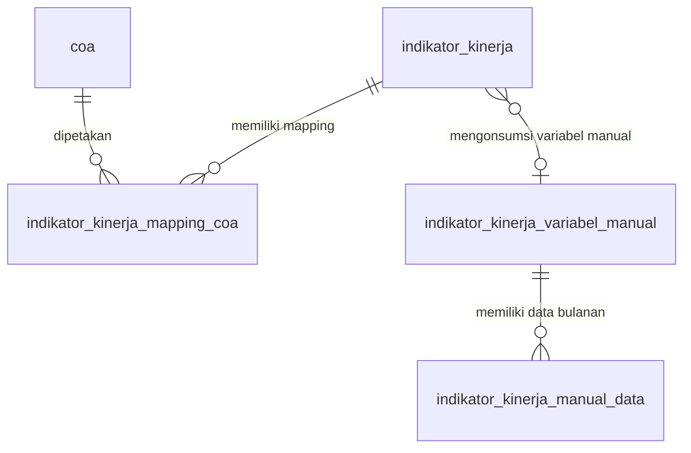

# Spesifikasi Desain: Modul Indikator Kinerja Eksekutif & Pengaturan

- **Tanggal Dokumen:** 2026-11-12 (Diperbarui Final: 2026-11-13)
- **Topik:** Sistem Dinamis Manajemen Indikator Kinerja Keuangan & Operasional RS, Dashboard Dedicated, Ringkasan Home Dashboard, dan Menu Pengaturan Fleksibel
- **Status Dokumen:** Approved Design Specification (Database VARCHAR + PHP 8.2 Backed Enums di Layer Aplikasi, Refined)

---

## 1. Latar Belakang & Urgensi Bisnis (The Why)

### 1.1 Konteks Tata Kelola Rumah Sakit (Early Warning System)
Pengelolaan rumah sakit modern menuntut keselarasan tinggi antara tiga pilar utama:
1. **Kualitas Pelayanan Klinis (Mutu & Keselamatan Pasien):** Ketersediaan obat esensial, kecukupan tenaga kesehatan, dan kepatuhan prosedur medis.
2. **Fungsi Sosial Kemanusiaan:** Alokasi dana bantuan sosial dan santunan pasien dhuafa sesuai amanah persyarikatan/keagamaan.
3. **Kesehatan & Keberlanjutan Finansial:** Pengendalian likuiditas arus kas, efisiensi beban operasional, serta margin surplus untuk reinvestasi sarana dan prasarana medis.

Dalam ekosistem rumah sakit, jajaran manajemen eksekutif (Direktur Utama, Direktur Keuangan, Badan Pembina Harian/Yayasan, Komite Medik, dan Satuan Pengawas Internal) memerlukan instrumen pemantauan berkala yang berfungsi sebagai **Early Warning System (EWS)**. Ketika terjadi anomali—seperti melonjaknya rasio beban pegawai, keterlambatan pencairan piutang klaim BPJS, atau membengkaknya persediaan obat—manajemen harus dapat mendeteksi sedini mungkin dan mengambil tindakan perbaikan sebelum mengganggu likuiditas dan pelayanan harian.

### 1.2 Masalah dan Keterbatasan Sistem Saat Ini (Problem Statement)
Meskipun SiAkurat telah memiliki modul Buku Besar, Jurnal Umum, dan Laporan Keuangan Neraca serta Laba Rugi, sistem saat ini masih memiliki celah fungsional bagi pengambil keputusan:
1. **Laporan Akuntansi Terlalu Detail dan Kurang Actionable:** Laporan Laba Rugi dan Neraca konvensional menyajikan ratusan baris angka nominal rupiah. Format ini sangat baik bagi akuntan dan auditor, namun sulit disimpulkan secara cepat oleh pimpinan eksekutif untuk menjawab: *Apakah performa rumah sakit hari ini berada dalam zona Sehat, Waspada, atau Kritis?*
2. **Ketiadaan Evaluasi Status Warna Otomatis (Red-Amber-Green / RAG):** Belum ada indikator visual berbasis warna yang membandingkan realisasi kinerja aktual terhadap target Rencana Bisnis dan Anggaran (RBA) maupun batas toleransi manajerial.
3. **Kalkulasi Rasio Masih Manual di Spreadsheet Eksternal:** Untuk mengetahui rasio-rasio vital seperti *Collection Period* (kecepatan pencairan piutang klaim) atau efisiensi farmasi, staf keuangan harus mengekspor data ke Excel dan menghitungnya secara manual. Proses ini memakan waktu, rawan salah hitung, dan tidak bisa dipantau secara langsung (*real-time*).
4. **Fragmentasi Data Akuntansi dan Data Operasional Non-Akuntansi:** Dua metrik penentu arus kas rumah sakit berada di luar buku besar:
   - **Kualitas Klaim JKN (% Lolos BAHV Pertama):** Dokumen resmi Berita Acara Hasil Verifikasi dari BPJS Kesehatan yang mengindikasikan mutu koding dan kelengkapan berkas klaim.
   - **Jumlah SDM Non-Organik:** Data riil ketenagakerjaan untuk menghitung produktivitas nakes/karyawan.  
   Sebelumnya, kedua data ini belum terintegrasi dengan sistem pelaporan keuangan.

---

## 2. Sasaran Proyek (Goals, Non-Goals, & Anti-Goals)

### 2.1 Goals
- Menghadirkan sistem monitoring eksekutif otomatis berbasis **11 Indikator Kinerja Kunci** (keuangan dan operasional) dengan evaluasi visual warna **RAG (Hijau, Kuning, Merah)** serta status **Netral (Abu-abu / N/A)**.
- Menampilkan strip ringkasan eksekutif 4 kotak status RAG di halaman utama (`/home`) dengan tautan CTA cepat menuju dashboard dedikasi.
- Menyediakan halaman dashboard dedikasi lengkap di `/dashboard/indikator-kinerja` dengan fitur:
  - Filter rentang tanggal dan pencarian indikator.
  - Switcher tampilan fleksibel: **Kartu Eksekutif** (*Card Grid*) vs **Tabel Rinci** (*Detailed Evaluation Table*).
  - Modal *drill-down* interaktif yang menampilkan definisi operasional, panduan acuan threshold, dan **grafik garis tren bulanan 12 bulan (Chart.js)**.
- Menyediakan menu konfigurasi mandiri bagi Superadmin di `/pengaturan/setting-indikator-kinerja`:
  - **Halaman Index (`index.blade.php`) dengan 2 Tab Navigasi**: Tab 1 (Manajemen Indikator) dan Tab 2 (Entri Data Manual Bulanan).
  - **Halaman Form Dedikasi (`create.blade.php` & `edit.blade.php`)**: Halaman tersendiri untuk menyusun parameter indikator dan tabel pemetaan akun COA secara leluasa, dengan alur otomatis redirect kembali ke tab asal pasca-simpan.
- Menjamin performa tinggi melalui *batch aggregation in-memory engine* dan pembungkus *safe division*.

### 2.2 Non-Goals
- Modul ini **bukan pengganti Laporan Keuangan formal** (Neraca, Laba Rugi, Arus Kas) yang tetap menjadi domain akuntansi murni.
- Modul ini **tidak melakukan sinkronisasi data balik ke SIMRS**. Data bridging hanya dibaca untuk agregasi analitik.
- Tidak menyajikan kalkulasi mutasi real-time tingkat per-detik; pembaruan data mengikuti transaksi buku besar yang telah tersimpan di SiAkurat.

### 2.3 Anti-Goals (Hal yang Dihindari)
- **Tidak boleh memperlambat loading Home Dashboard (`/home`):** Halaman depan SIMRS tidak boleh menjalankan kalkulasi buku besar yang berat secara penuh. Halaman `/home` hanya memanggil ringkasan cepat 4 kartu counter RAG.
- **Tidak boleh menghasilkan *Error 500* atau *Division by Zero*:** Saat penyebut bernilai 0 atau transaksi nihil, sistem tidak boleh crash atau salah memberi status Hijau; sistem harus mengembalikan status Netral (Abu-abu).
- **Tidak boleh mengunci skema database dengan MySQL Native ENUM:** Menghindari perlunya DDL query (`ALTER TABLE`) saat ada penambahan tipe atau peran baru di masa depan. Kolom database menggunakan `VARCHAR(30)` dan dikontrol melalui PHP 8.2 Backed Enums di layer aplikasi.
- **Tidak boleh membocorkan data strategis:** Informasi sensitif seperti EBITDA, margin laba, dan rasio beban SDM tidak boleh dapat dilihat oleh staf umum; akses harus diproteksi ketat melalui modul RBAC `AccessModuleRegistry`.

---

## 3. Komparasi Pendekatan Teknis (Implementation Approaches)

### 3.1 Pendekatan yang Dipertimbangkan

| Parameter | Pendekatan 1: Dedicated Service Terisolasi (`IndikatorKinerjaService`) | Pendekatan 2: Strategy Pattern Berjenjang | Pendekatan 3: Menggabungkan ke `LaporanKeuanganService` |
|---|---|---|---|
| **Struktur Kelas** | 1 Service utama yang terfokus dan kohesif | Belasan kelas kalkulator kecil + Interface | Menumpuk di file service yang sudah ada |
| **Separation of Concerns** | Sangat baik (domain indikator terpisah rapi) | Sangat baik secara teoritis | Buruk (mengotori laporan keuangan formal) |
| **Risiko Regresi** | **Nol** (kode baru terisolasi penuh) | Rendah | Tinggi (berisiko mengganggu Neraca/Laba Rugi) |
| **Kemudahan Pemeliharaan** | **Tinggi & Mudah Dirawat** | Rumit (*over-engineered*) | Rendah (file sudah > 2.100 baris) |
| **Kepatuhan AGENTS.md** | **100% Selaras** (Thin controller, fat service) | Melanggar prinsip *avoid over-engineering* | Melanggar Single Responsibility Principle |

### 3.2 Pendekatan Terpilih: Pendekatan 1 (Dedicated Service)
Dipilih **Pendekatan 1**. Arsitektur dibangun di atas satu service utama: `App\Services\IndikatorKinerja\IndikatorKinerjaService` yang melayani ketiga antarmuka (Home strip, Dashboard Dedicated, dan Menu Pengaturan) dengan controller tipis.

---

## 4. Arsitektur 3 Tipe Kalkulasi & Pemisahan Basis Sumber Data

Untuk menjaga sistem tetap sederhana bagi pengguna manusia sekaligus 100% fleksibel dan *bulletproof* secara arsitektur, sistem memisahkan **Bentuk Operasi Matematika** dengan **Deklarasi Sumber Data**.

### 4.1 Tiga Tipe Kalkulasi Dasar (`tipe_kalkulasi`)
1. **`RASIO`**: Bentuk pembagian standar `(Pembilang ÷ Penyebut) × 100%` (atau nominal Rupiah jika satuan Rupiah).
2. **`TURNOVER`**: Bentuk perputaran waktu `(Pembilang ÷ Penyebut) × Hari Riil Periode`.
3. **`MANUAL`**: Bentuk pembacaan nilai langsung dari tabel matriks data manual non-akuntansi bulanan.

### 4.2 Deklarasi Basis Sumber Data (`basis_pembilang` & `basis_penyebut`)
Tanpa perlu membuat tipe kalkulasi yang beranak-pinak, sistem cukup mendeklarasikan dari mana data ditarik:
- **`basis_pembilang`:**
  - `COA`: Menjumlahkan mutasi kredit/debet (untuk akun Laba Rugi) atau saldo akhir akumulatif per tanggal akhir periode (untuk akun Neraca) dari akun-akun COA yang dipetakan sebagai `pembilang` (dikurangi `pengurang`).
  - `SURPLUS`: Mengambil nilai **Laba Bersih (*Total Capaian Laba Rugi*)** periode berjalan sebagai nilai dasar pembilang, lalu menambahkan akun `Addition` (seperti penyusutan & penghapusan piutang pada EBITDA) dan mengurangkan akun `Deduction` (seperti bunga bank).
  - `NONE`: Digunakan jika `tipe_kalkulasi = 'MANUAL'`.
- **`basis_penyebut`:**
  - `COA`: Menjumlahkan mutasi kredit/debet dari akun-akun COA yang dipetakan sebagai `penyebut`.
  - `RBA`: Mengambil alokasi proporsional bulanan dari tabel `setting_rba` sesuai akun COA yang dipetakan sebagai pembilang.
  - `MANUAL`: Mengambil nilai bulanan (atau rata-rata periode) dari variabel manual non-akuntansi yang ditunjuk oleh `variabel_manual_id` (seperti data SDM non-organik).
  - `NONE`: Digunakan jika `tipe_kalkulasi = 'MANUAL'`.

---

## 5. Definisi Operasional & Pemetaan 11 Indikator Kunci

### 5.1 Matriks Konfigurasi 11 Indikator Baseline

| No | Indikator | Satuan | Tipe Kalkulasi | Basis Pembilang | Basis Penyebut | Pola Evaluasi | Ambang Batas Target |
|---|---|---|---|---|---|---|---|
| **1** | Capaian Pendapatan | `%` | `RASIO` | `COA` (`COA 4`) | `RBA` (`setting_rba`) | `HIGHER_IS_BETTER` | 🟢 ≥ 100% \| 🟡 90% - <100% \| 🔴 < 90% |
| **2** | EBITDA | `%` | `RASIO` | `SURPLUS` (+ `COA 706`, `909.03`) | `COA` (`COA 4`) | `HIGHER_IS_BETTER` | 🟢 > 22% \| 🟡 15% - 22% \| 🔴 < 15% |
| **3** | Profitabilitas | `%` | `RASIO` | `SURPLUS` | `COA` (`COA 4`) | `HIGHER_IS_BETTER` | 🟢 > 15% \| 🟡 10% - 15% \| 🔴 < 10% |
| **4** | Beban Pegawai | `%` | `RASIO` | `COA` (`COA 6`) | `COA` (`COA 4`) | `TARGET_BAND` | 🟢 20% - 25% \| 🟡 >25% - 30% \| 🔴 Fallback (<20% atau >30%) |
| **5** | Beban Farmasi | `%` | `RASIO` | `COA` (`COA 505`) | `COA` (`COA 405`) | `LOWER_IS_BETTER` | 🟢 ≤ 70% \| 🟡 >70% - 75% \| 🔴 > 75% |
| **6** | Beban Operasional | `%` | `RASIO` | `COA` (`COA 5`) | `COA` (`COA 4`) | `LOWER_IS_BETTER` | 🟢 ≤ 46% \| 🟡 >46% - 50% \| 🔴 > 50% |
| **7** | Collection Period | `Hari` | `TURNOVER` | `COA` (`COA 112`) | `COA` (`COA 4`) | `LOWER_IS_BETTER` | 🟢 < 40 Hari \| 🟡 40 - 60 Hari \| 🔴 > 60 Hari |
| **8** | Kualitas Klaim JKN | `%` | `MANUAL` | `NONE` | `NONE` (`bahv_jkn`) | `HIGHER_IS_BETTER` | 🟢 > 90% \| 🟡 85% - 90% \| 🔴 < 85% |
| **9** | Perputaran Persediaan | `Hari` | `TURNOVER` | `COA` (`113` exc `113.04`) | `COA` (`COA 4`) | `LOWER_IS_BETTER` | 🟢 ≤ 60 Hari \| 🟡 61 - 90 Hari \| 🔴 > 90 Hari |
| **10** | Beban Dana Sosial | `%` | `RASIO` | `COA` (`COA 905`) | `COA` (`COA 4`) | `HIGHER_IS_BETTER` | 🟢 ≥ 1% \| 🟡 0.5% - <1% \| 🔴 < 0.5% |
| **11** | Produktifitas Karyawan | `Juta/org/bln` | `RASIO` | `COA` (`COA 4` bulanan) | `MANUAL` (`sdm_non_organik`) | `HIGHER_IS_BETTER` | 🟢 > 22 Juta/org/bln \| 🟡 15 - 22 Juta \| 🔴 < 15 Juta |

### 5.2 Logika Evaluasi Status Warna (RAG + Netral)
1. 🟢 **Hijau (Baik / Efisien / Optimal):** Memenuhi standar target manajerial.
2. 🟡 **Kuning (Waspada):** Berada dalam batas toleransi peringatan dini, perlu perhatian operasional.
3. 🔴 **Merah (Kritis / Boros / Anomali):** Berada di zona bahaya, membutuhkan tindakan segera. Pada pola `TARGET_BAND`, nilai di luar band hijau dan kuning otomatis menjadi Merah (*fallback*).
4. ⚪ **Netral (Abu-abu / N/A):** Diberikan ketika data belum tersedia, penyebut bernilai 0, atau target RBA belum diatur, sehingga tidak memicu salah sinyal.

### 5.3 Aturan Khusus Perhitungan
1. **Normalisasi Periode & Skala Produktivitas Karyawan:**
   ```text
   Jumlah Bulan Periode = Hari Riil Periode ÷ 30.416 (atau jumlah bulan kalender tercakup)
   Rata-rata Pendapatan Bulanan = Pendapatan Operasional Periode ÷ Jumlah Bulan Periode
   Produktifitas Karyawan (Rp) = Rata-rata Pendapatan Bulanan ÷ Rata-rata Jumlah SDM Non-Organik Periode
   Produktifitas Karyawan (Juta) = Produktifitas Karyawan (Rp) ÷ 1.000.000
   ```
   *Catatan Standarisasi Skala:* Agar pengisian form dan visualisasi tetap natural dan ergonomis, nilai dengan satuan `Juta/org/bln` dihitung dalam nominal Rupiah penuh lalu dinormalisasi dengan membagi `1.000.000` di layer service. Ambang batas target disimpan di database sebagai angka natural desimal (misal: `22.00` untuk Rp 22 Juta, bukan `22000000.00`).
2. **Distribusi Akun Neraca vs Laba Rugi pada Indikator Turnover:**
   - Untuk akun bertipe Neraca / Aset (seperti Piutang `COA 112` pada *Collection Period* dan Persediaan `COA 113` pada *Perputaran Persediaan*), nilai pembilang dihitung sebagai **saldo akhir akumulatif sampai dengan tanggal akhir periode** (`SUM(mutasi) WHERE tanggal <= endDate`), konsisten dengan metode `ambilSaldoSampaiTanggal()` di `LaporanKeuanganService`.
   - Penyebutnya (Pendapatan Operasional `COA 4`) tetap dihitung berdasarkan **mutasi transaksi periode berjalan** (`whereBetween(tanggal, [startDate, endDate])`).
3. **Fallback Data Manual (*Latest Available Entry*):**
   Jika data bulan berjalan pada variabel manual (BAHV JKN atau kuota SDM) belum diinput oleh staf terkait, sistem secara otomatis mengambil data bulan terakhir yang tersedia disertai label info (*badge* kecil: *"Data per [Bulan/Tahun]"*).
4. **Penanganan Bulan Masa Depan pada Grafik Tren (*Future Unclosed Months*):**
   Untuk tahun berjalan, bulan-bulan setelah bulan aktual yang belum memiliki transaksi atau belum ditutup mengembalikan nilai `null` (bukan 0). Dengan demikian, garis Chart.js berhenti secara natural pada bulan berjalan tanpa menukik ke nol yang berisiko menimbulkan salah tafsir manajerial seolah-olah kinerja rumah sakit anjlok.

---

## 6. Arsitektur Database & Layer Aplikasi (Enums PHP 8.2)

Untuk menjamin skalabilitas tanpa migrasi DDL berulang, seluruh kolom pilihan di database disimpan menggunakan tipe `VARCHAR(30)`, sedangkan integritas tipe data dan nilai pilihan dikelola secara terpusat oleh **PHP 8.2 Backed Enums** di layer aplikasi Laravel.



### 6.1 Skema Tabel (DDL Bebas Native Enum)

> [!NOTE]
> Urutan migrasi DDL mendahulukan tabel master variabel non-akuntansi (`indikator_kinerja_variabel_manual`) sebelum `indikator_kinerja` untuk memastikan integritas *Foreign Key constraint* saat eksekusi migrasi.

```sql
-- 1. Master Variabel Non-Akuntansi (Dynamic Variable Registry)
CREATE TABLE indikator_kinerja_variabel_manual (
    id INT AUTO_INCREMENT PRIMARY KEY,
    kode VARCHAR(50) UNIQUE,
    nama VARCHAR(100),
    satuan VARCHAR(20),
    deskripsi TEXT NULL,
    created_at TIMESTAMP NULL,
    updated_at TIMESTAMP NULL
);

-- 2. Master Indikator
CREATE TABLE indikator_kinerja (
    id INT AUTO_INCREMENT PRIMARY KEY,
    kode VARCHAR(50) UNIQUE,
    nama VARCHAR(100),
    satuan VARCHAR(20) DEFAULT '%',
    tipe_kalkulasi VARCHAR(30) DEFAULT 'RASIO',
    basis_pembilang VARCHAR(30) DEFAULT 'COA' NULL,
    basis_penyebut VARCHAR(30) DEFAULT 'COA' NULL,
    variabel_manual_id INT NULL,
    definisi_operasional TEXT,
    urutan INT DEFAULT 0,
    status_aktif BOOLEAN DEFAULT TRUE,
    pola_evaluasi VARCHAR(30) DEFAULT 'HIGHER_IS_BETTER',
    target_hijau_min DECIMAL(15,2) NULL,
    target_hijau_max DECIMAL(15,2) NULL,
    target_kuning_min DECIMAL(15,2) NULL,
    target_kuning_max DECIMAL(15,2) NULL,
    target_merah_min DECIMAL(15,2) NULL,
    target_merah_max DECIMAL(15,2) NULL,
    created_at TIMESTAMP NULL,
    updated_at TIMESTAMP NULL,
    FOREIGN KEY (variabel_manual_id) REFERENCES indikator_kinerja_variabel_manual(id) ON DELETE SET NULL,
    INDEX (status_aktif, urutan)
);

-- 3. Mapping Akun COA Relasi Langsung
CREATE TABLE indikator_kinerja_mapping_coa (
    id INT AUTO_INCREMENT PRIMARY KEY,
    indikator_id INT,
    coa_id INT,
    peran VARCHAR(30) DEFAULT 'numerator',
    is_excluded BOOLEAN DEFAULT FALSE,
    created_at TIMESTAMP NULL,
    updated_at TIMESTAMP NULL,
    FOREIGN KEY (indikator_id) REFERENCES indikator_kinerja(id) ON DELETE CASCADE,
    FOREIGN KEY (coa_id) REFERENCES coa(id) ON DELETE CASCADE,
    INDEX (indikator_id, peran)
);

-- 4. Nilai Matriks Bulanan per Variabel Manual
CREATE TABLE indikator_kinerja_manual_data (
    id INT AUTO_INCREMENT PRIMARY KEY,
    variabel_id INT,
    tahun INT,
    bulan TINYINT,
    nilai DECIMAL(15,2) NULL,
    catatan VARCHAR(255) NULL,
    created_at TIMESTAMP NULL,
    updated_at TIMESTAMP NULL,
    FOREIGN KEY (variabel_id) REFERENCES indikator_kinerja_variabel_manual(id) ON DELETE CASCADE,
    UNIQUE KEY uk_variabel_tahun_bulan (variabel_id, tahun, bulan)
);
```

### 6.2 Backed Enums di Layer Aplikasi (`app/Enums/IndikatorKinerja/`)

Ditempatkan di namespace `App\Enums\IndikatorKinerja`:

```php
namespace App\Enums\IndikatorKinerja;

// 1. Satuan Indikator (Digunakan bersama untuk tabel indikator_kinerja dan indikator_kinerja_variabel_manual)
enum SatuanIndikator: string
{
    // Rasio & Persentase
    case PERSEN = '%';
    case KALI = 'Kali';
    case POIN = 'Poin';

    // Waktu & Durasi (EWS, Turnover, Respon Time, ALOS/TOI)
    case HARI = 'Hari';
    case JAM = 'Jam';
    case MENIT = 'Menit';

    // Finansial / Moneter
    case RUPIAH = 'Rp';
    case JUTA_RUPIAH = 'Juta Rp';

    // Kuantitas Entitas & Operasional RS (SDM, Pasien, Kapasitas Fasilitas, Klaim)
    case ORANG = 'Orang';
    case PASIEN = 'Pasien';
    case TEMPAT_TIDUR = 'TT';
    case DOKUMEN = 'Dokumen';

    // Satuan Majemuk Khusus Eksekutif
    case JUTA_PER_ORG_BLN = 'Juta/org/bln';

    public function label(): string
    {
        return match ($this) {
            self::PERSEN => 'Persentase (%)',
            self::KALI => 'Kali (Perputaran/Rasio)',
            self::POIN => 'Poin / Skor Indeks',
            self::HARI => 'Hari',
            self::JAM => 'Jam',
            self::MENIT => 'Menit',
            self::RUPIAH => 'Rupiah (Rp)',
            self::JUTA_RUPIAH => 'Juta Rupiah (Juta Rp)',
            self::ORANG => 'Orang (SDM / Karyawan)',
            self::PASIEN => 'Pasien / Kunjungan',
            self::TEMPAT_TIDUR => 'Tempat Tidur (TT / Kapasitas)',
            self::DOKUMEN => 'Dokumen / Berkas Klaim',
            self::JUTA_PER_ORG_BLN => 'Juta / Orang / Bulan',
        };
    }
}

// 2. Tipe Bentuk Kalkulasi
enum TipeKalkulasi: string
{
    case RASIO = 'RASIO';
    case TURNOVER = 'TURNOVER';
    case MANUAL = 'MANUAL';
}

// 3. Basis Sumber Data Pembilang
enum BasisPembilang: string
{
    case COA = 'COA';
    case SURPLUS = 'SURPLUS';
    case NONE = 'NONE';
}

// 4. Basis Sumber Data Penyebut
enum BasisPenyebut: string
{
    case COA = 'COA';
    case RBA = 'RBA';
    case MANUAL = 'MANUAL';
    case NONE = 'NONE';
}

// 5. Pola Evaluasi Nilai
enum PolaEvaluasi: string
{
    case HIGHER_IS_BETTER = 'HIGHER_IS_BETTER';
    case LOWER_IS_BETTER = 'LOWER_IS_BETTER';
    case TARGET_BAND = 'TARGET_BAND';
}

// 6. Peran Akun COA dalam Formula
enum PeranCoa: string
{
    case NUMERATOR = 'numerator';
    case DENOMINATOR = 'denominator';
    case ADDITION = 'addition';
    case DEDUCTION = 'deduction';

    public function label(): string
    {
        return match ($this) {
            self::NUMERATOR => 'Numerator (Pembilang)',
            self::DENOMINATOR => 'Denominator (Penyebut)',
            self::ADDITION => 'Addition (Penambah / Add-back)',
            self::DEDUCTION => 'Deduction (Pengurang)',
        };
    }
}

// 7. Status Hasil Evaluasi
enum StatusEvaluasi: string
{
    case HIJAU = 'hijau';
    case KUNING = 'kuning';
    case MERAH = 'merah';
    case NETRAL = 'netral';
}
```

### 6.3 Eloquent Model Casting
Model Eloquent memanfaatkan fitur native casts Laravel 12:

```php
// App\Models\IndikatorKinerja.php
protected function casts(): array
{
    return [
        'satuan' => SatuanIndikator::class,
        'tipe_kalkulasi' => TipeKalkulasi::class,
        'basis_pembilang' => BasisPembilang::class,
        'basis_penyebut' => BasisPenyebut::class,
        'pola_evaluasi' => PolaEvaluasi::class,
        'status_aktif' => 'boolean',
        'target_hijau_min' => 'decimal:2',
        'target_hijau_max' => 'decimal:2',
        'target_kuning_min' => 'decimal:2',
        'target_kuning_max' => 'decimal:2',
        'target_merah_min' => 'decimal:2',
        'target_merah_max' => 'decimal:2',
    ];
}

// App\Models\IndikatorKinerjaVariabelManual.php
protected function casts(): array
{
    return [
        'satuan' => SatuanIndikator::class,
    ];
}

// App\Models\IndikatorKinerjaMappingCoa.php
protected function casts(): array
{
    return [
        'peran' => PeranCoa::class,
        'is_excluded' => 'boolean',
    ];
}
```

### 6.4 Fitur Auto Leaf Resolver & Pengecualian Akun (*Exclude*)
Buku besar mencatat transaksi pada akun cabang terdalam (*Leaf*). Saat Superadmin memetakan akun induk (*Parent*) seperti `COA 6` (Biaya SDI) atau `COA 113` (Persediaan):
1. `IndikatorKinerjaService` secara otomatis mengekstrak seluruh leaf descendants via fungsi rekursif `kumpulkanLeafDescendantCoaIds()`.
2. Jika ada akun yang ditandai `is_excluded = true` (seperti `COA 113.04` Logistik RT), sistem secara otomatis menyaring keluar akun tersebut dari kumpulan leaf.

---

## 7. Desain Antarmuka Pengguna (UI & Interaction Flow)

### 7.1 Home Dashboard Utama (`/home`) — Opsi A (Executive Status Strip)
- Diletakkan di bawah filter tanggal dashboard utama.
- Menyajikan strip ringkas berisi identitas modul EWS, 4 kotak status RAG (Total, Hijau, Kuning, Merah), dan tombol CTA:
  `Lihat Dashboard Indikator Selengkapnya →` (membawa parameter rentang tanggal ke dashboard dedikasi).
- **Asynchronous AJAX Loading:** Strip ringkas dimuat secara asinkron via AJAX endpoint `GET /home/ringkasan-indikator?start_date=YYYY-MM-DD&end_date=YYYY-MM-DD`, konsisten dengan arsitektur grafik lain di `HomeController`.
- **Keunggulan:** Home dashboard tetap ringan, waktu load instan, dan terhindar dari beban kalkulasi buku besar yang berat pada siklus request awal.

### 7.2 Halaman Dedikasi Dashboard Indikator Kinerja (`/dashboard/indikator-kinerja`)
- **Filter Tanggal & Pencarian:** Input tanggal mulai dan selesai, tombol terapkan/reset, dan kolom pencarian nama indikator.
- **Header Counter:** 4 kartu status RAG komprehensif di bagian atas.
- **Switcher Tampilan:**
  1. **Mode Kartu Eksekutif (Card Grid):** Kartu indikator dengan border warna RAG, nilai besar, target perbandingan, dan tombol **[ Detail & Tren ]**.
  2. **Mode Tabel Rinci (Detailed Table):** Tabulasi komprehensif seluruh indikator untuk pelaporan manajerial formal.
- **Modal Drill-Down:**
  - Menampilkan deskripsi lengkap Definisi Operasional, acuan rumus, dan panduan target status.
  - **Grafik Tren Bulanan (Chart.js):** Menampilkan pergerakan nilai indikator sepanjang 12 bulan (Januari s.d. Desember) di tahun berjalan yang di-fetch via endpoint:
    `GET /dashboard/indikator-kinerja/{kode}/tren?tahun=YYYY`. Bulan masa depan yang belum berjalan mengembalikan `null` sehingga garis grafik tidak menukik ke 0.

### 7.3 Menu Setting Indikator Kinerja (`/pengaturan/setting-indikator-kinerja`)

#### 1. Halaman Utama / Index (`index.blade.php`)
- Memiliki **2 Tab Navigasi Utama**:
  - **Tab 1 — Manajemen Indikator:**
    - Menampilkan tabel master seluruh indikator (urutan, kode, nama, tipe kalkulasi, basis pembilang, basis penyebut, status aktif, dan ringkasan target RAG).
    - Tombol **[+ Tambah Indikator Baru]** mengarahkan pengguna ke halaman tersendiri (`create.blade.php`).
    - Tombol **Edit** pada masing-masing baris indikator mengarahkan ke halaman tersendiri (`edit.blade.php`).
    - Tombol **Hapus** (dengan konfirmasi modal) untuk menghapus indikator kustom (*cascade delete* ke mapping COA).
  - **Tab 2 — Entri Data Manual Bulanan:**
    - Tombol **[+ Tambah Variabel Baru]** (modal ringkas untuk mendaftarkan metrik non-akuntansi baru seperti BOR, IKM).
    - Filter tahun kalender dan tabel spreadsheet matriks 12 bulan (Januari s.d. Desember) yang menampilkan seluruh variabel manual terdaftar beserta kolom rata-rata tahunan.
    - Tombol simpan data matriks bulanan dengan feedback notifikasi instan.

#### 2. Halaman Tersendiri Tambah & Edit (`create.blade.php` & `edit.blade.php`)
- Form Create dan Edit ditempatkan pada **halaman tersendiri** (bukan modal) untuk memberikan ruang visual yang luas, nyaman, dan leluasa bagi Superadmin dalam mengatur parameter serta daftar akun COA.
- Dilengkapi tombol navigasi **[← Kembali ke Daftar Indikator]** dan tombol Simpan.
- Terdiri dari 4 Bagian Form yang Terstruktur:
  - *Bagian A: Identitas Dasar Indikator* (Nama Indikator, Kode/Slug, Satuan, Tipe Kalkulasi `[RASIO, TURNOVER, MANUAL]`, Definisi Operasional, Urutan Tampil, dan Status Aktif).
  - *Bagian B: Deklarasi Basis Sumber Data* (Jika tipe `RASIO` atau `TURNOVER`: radio pilihan Basis Pembilang `[Akun COA / Surplus Usaha]` dan Basis Penyebut `[Akun COA / Target RBA / Variabel Manual]`. Jika memilih Variabel Manual, muncul dropdown pilihan variabel manual).
  - *Bagian C: Parameter Ambang Batas Target (RAG)* (Dropdown Pola Evaluasi `[HIGHER_IS_BETTER, LOWER_IS_BETTER, TARGET_BAND]` dengan input batas angka Hijau, Kuning, Merah).
  - *Bagian D: Pemetaan Akun COA (Dynamic Mapping Table)* (Tabel dinamis interaktif: tombol tambah baris akun, pencarian akun COA dengan Select2/datalist, pilihan peran `PeranCoa` `[NUMERATOR, DENOMINATOR, ADDITION, DEDUCTION]`, checklist `Exclude`, dan tombol hapus baris).

#### 3. Alur Pasca-Simpan (*Post-Save Redirection Flow*)
- Setelah pengguna menekan tombol **Simpan** pada halaman `create.blade.php` atau `edit.blade.php`:
  - Controller memvalidasi input via Form Request (`StoreIndikatorKinerjaRequest` atau `UpdateIndikatorKinerjaRequest`).
  - Data master dan mapping COA disimpan dalam satu transaksi database (`DB::transaction`).
  - Sistem secara otomatis mengarahkan pengguna kembali (*redirect*) ke **Halaman Index pada Tab 1 (Manajemen Indikator)** via URL parameter `?tab=indikator` disertai pesan notifikasi (*flash message/toast*): *"Indikator kinerja berhasil disimpan/diperbarui"*.
  - Tab aktif dipertahankan menggunakan JavaScript URL tab switching (membaca parameter `?tab=...` atau state browser) sehingga pengguna tidak tersesat atau berpindah ke tab lain.

---

## 8. Hak Akses & Keamanan Sistem (RBAC)

Didaftarkan pada registry otorisasi SiAkurat (`App\Support\AccessModuleRegistry`):
1. **`dashboard.indikator-kinerja` (Aksi: `view`):** Hak akses membuka dan melihat dashboard indikator kinerja eksekutif beserta grafik tren.
2. **`pengaturan.setting-indikator-kinerja` (Aksi: `view`, `create`, `update`, `delete`):** Hak akses penuh mengelola master indikator, konfigurasi mapping COA, dan pencatatan matriks data manual bulanan.

---

## 9. Hal yang Didelegasikan ke Builder (What's Left to the Builder)

Aspek-aspek implementasi teknis berikut diserahkan sepenuhnya kepada implementer/builder:
1. Pemilihan nama class migrasi Laravel dan penataan seeder untuk 11 indikator awal dan mapping default.
2. Penamaan route internal sesuai konvensi resource Laravel (`dashboard.indikator-kinerja.*` dan `pengaturan.setting-indikator-kinerja.*`).
3. Pengaturan warna persis tema Tailwind / Bootstrap 5 agar senada dengan UI SiAkurat yang sudah berjalan.
4. Struktur komponen Blade views (`index.blade.php`, `create.blade.php`, `edit.blade.php`) dan partial modal drill-down.
5. Penyusunan Form Request class dengan aturan `Rule::enum(...)`: `StoreIndikatorKinerjaRequest`, `UpdateIndikatorKinerjaRequest`, dan `SimpanManualDataRequest`.

---

## 10. Rencana Verifikasi & Dokumentasi

1. **Unit Testing (`tests/Unit/IndikatorKinerjaServiceTest.php`):**
   - Menguji kebenaran formula matematika 11 indikator dengan dispatching `basis_pembilang` dan `basis_penyebut`.
   - Menguji fungsi *safe division* (memastikan penyebut nol menghasilkan status Netral).
   - Menguji logika *add-back* EBITDA dengan peran `Addition` dan `Deduction`.
   - Menguji *Auto Leaf Resolver* dan akun *Exclude*.
   - Menguji kalkulasi proporsional hari riil untuk Collection Period dan Perputaran Persediaan (`TURNOVER`).
   - Menguji normalisasi rata-rata bulanan untuk Produktivitas Karyawan (`RASIO` dengan penyebut `MANUAL`).
   - Menguji logika *fallback* data manual multi-bulan.
2. **Feature Testing (`tests/Feature/DashboardIndikatorKinerjaTest.php` & `tests/Feature/SettingIndikatorKinerjaTest.php`):**
   - Menguji proteksi otorisasi RBAC (hanya user dengan izin yang dapat mengakses).
   - Menguji endpoint JSON tren bulanan untuk Chart.js.
   - Menguji alur penyimpanan form modal terpadu indikator dan penyimpanan data bulanan.
3. **Dokumentasi Sistem:**
   - Membuat `dokumentasi/indikator-kinerja.md` dan `dokumentasi/pengaturan-setting-indikator-kinerja.md` sesuai konvensi di `AGENTS.md`.
   - Memperbarui `dokumentasi/fondasi/sistem-otorisasi.md` dan `dokumentasi/README.md`.
   - Menambahkan baris pemetaan modul baru pada tabel *Code → Documentation Mapping* di `AGENTS.md`.
