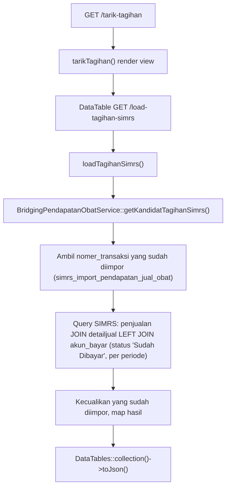
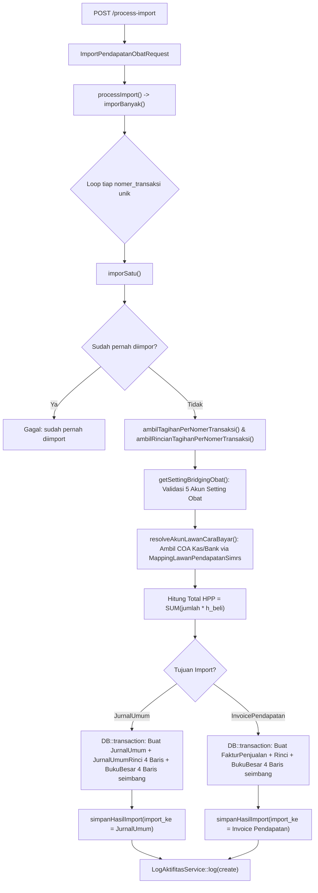
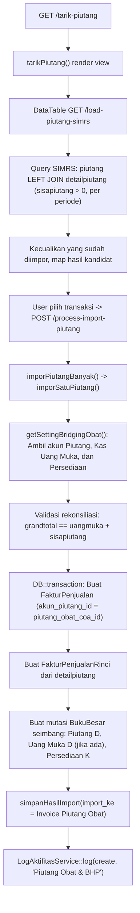
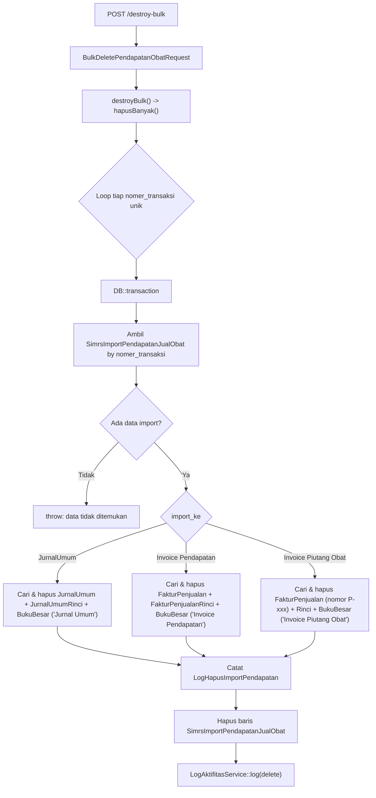

# Dokumentasi Modul Bridging — Pendapatan Obat

## Ringkasan Modul

Modul **Bridging Pendapatan Obat** digunakan untuk:

1. menarik kandidat tagihan penjualan obat & BHP dari SIMRS (`penjualan` dan `detailjual`),
2. mengimpor transaksi penjualan obat terpilih menjadi **Jurnal Umum** atau **Invoice Pendapatan**,
3. menarik piutang obat & BHP dari SIMRS (`piutang` dan `detailpiutang`) menjadi **Invoice Pendapatan**,
4. menghapus data hasil import secara massal beserta jurnal, faktur penjualan, dan mutasi Buku Besarnya.

> [!NOTE]
> Mulai versi ini, modul Bridging Pendapatan Obat **tidak lagi membaca tabel jurnal SIMRS** (`jurnal` dan `detailjurnal`). Akun lawan kas/bank diambil langsung dari Cara Bayar billing apotek via `MappingLawanPendapatanSimrs`, sedangkan akun Pendapatan, HPP, Persediaan, Piutang, dan Kas Uang Muka diambil dari konfigurasi terpusat di modul **Setting Akun Obat & BHP** (`setting_bridging_obats`).

Implementasi utama:

- `routes/web.php`
- `app/Http/Controllers/Bridging/BridgingPendapatanObatController.php`
- `app/Http/Requests/Bridging/ImportPendapatanObatRequest.php`
- `app/Http/Requests/Bridging/ImportPiutangObatRequest.php`
- `app/Http/Requests/Bridging/BulkDeletePendapatanObatRequest.php`
- `app/Services/Bridging/BridgingPendapatanObatService.php`
- `app/Models/Pelanggan.php`, `app/Models/FakturPenjualan.php`, `app/Models/FakturPenjualanRinci.php`
- `app/Models/SimrsImportPendapatanJualObat.php`, `app/Models/SettingBridgingObat.php`, `app/Models/MappingLawanPendapatanSimrs.php`
- `app/Models/JurnalUmum.php`, `app/Models/JurnalUmumRinci.php`, `app/Models/BukuBesar.php`, `app/Models/LogHapusImportPendapatan.php`

## Entry Point / API

| Method | Path | Route Name | Controller Method | Izin |
| --- | --- | --- | --- | --- |
| `GET` | `/bridging/pendapatan-obat` | `bridging.pendapatan-obat.index` | `index()` | view |
| `GET` | `/bridging/pendapatan-obat/load-imported-data` | `bridging.pendapatan-obat.load-imported-data` | `loadImportedData()` | view |
| `GET` | `/bridging/pendapatan-obat/tarik-tagihan` | `bridging.pendapatan-obat.tarik-tagihan` | `tarikTagihan()` | view |
| `GET` | `/bridging/pendapatan-obat/load-tagihan-simrs` | `bridging.pendapatan-obat.load-tagihan-simrs` | `loadTagihanSimrs()` | view |
| `GET` | `/bridging/pendapatan-obat/tarik-piutang` | `bridging.pendapatan-obat.tarik-piutang` | `tarikPiutang()` | view |
| `GET` | `/bridging/pendapatan-obat/load-piutang-simrs` | `bridging.pendapatan-obat.load-piutang-simrs` | `loadPiutangSimrs()` | view |
| `POST` | `/bridging/pendapatan-obat/process-import` | `bridging.pendapatan-obat.process-import` | `processImport()` | update |
| `POST` | `/bridging/pendapatan-obat/process-import-piutang` | `bridging.pendapatan-obat.process-import-piutang` | `processImportPiutang()` | update |
| `POST` | `/bridging/pendapatan-obat/destroy-bulk` | `bridging.pendapatan-obat.destroy-bulk` | `destroyBulk()` | delete |

## Validasi Request

`ImportPendapatanObatRequest`:
- `selectedNoTransaksi` wajib array minimal 1,
- `selectedNoTransaksi.*` wajib string maks 100,
- `jenisProses` hanya boleh `JurnalUmum` atau `InvoicePendapatan`.

`ImportPiutangObatRequest`:
- `selectedNoTransaksi` wajib array minimal 1 (item string maks 100).

`BulkDeletePendapatanObatRequest`:
- `selectedNoTransaksi` wajib array minimal 1 (item string).

---

## Alur 1: Tarik Kandidat Tagihan dari SIMRS

### Flowchart

### Algoritma

1. `getKandidatTagihanSimrs()` mengambil daftar `nomer_transaksi` yang sudah diimpor pada periode itu.
2. Query ke koneksi `simrs` mengambil header penjualan (`penjualan`) + agregasi subtotal dari `detailjual`, hanya status `Sudah Dibayar`.
3. Kode rekening cara bayar di-resolve otomatis: `COALESCE(NULLIF(p.kd_rek, ''), ab.kd_rek, p.nama_bayar)` dengan `nama_rekening = p.nama_bayar`.
4. Baris yang sudah pernah diimpor dikecualikan (`reject`), sisanya dipetakan ke array kandidat.

---

## Alur 2: Import Tagihan Obat ke Jurnal Umum atau Invoice Pendapatan

### Flowchart

### Algoritma

1. `imporBanyak()` melakukan perulangan untuk setiap `nomer_transaksi` unik dan memanggil `imporSatu()`.
2. Validasi awal: menolak tipe proses yang tidak didukung serta transaksi yang sudah pernah diimpor.
3. Mengambil data header `penjualan` dan item `detailjual` dari database SIMRS.
4. Memvalidasi `getSettingBridgingObat()`: jika salah satu dari 5 akun konfigurasi belum disetting, lempar `RuntimeException`.
5. Menentukan akun Kas/Bank via `resolveAkunLawanCaraBayar()`: mencari mapping dari `penjualan.kd_rek`, fallback ke lookup `akun_bayar.kd_rek`, dan dicocokkan ke `MappingLawanPendapatanSimrs`. Jika belum dimapping, lempar `RuntimeException`.
6. Menghitung HPP secara presisi: `SUM(detailjual.jumlah * detailjual.h_beli)`.
7. **Jalur Jurnal Umum**:
   - Buat header `JurnalUmum` dengan total nilai jurnal = `grandtotal + total_hpp`.
   - Baris 1: Debit Kas/Bank dari Cara Bayar (`grandtotal`).
   - Baris 2: Kredit Pendapatan Obat & BHP (`grandtotal`).
   - Baris 3 (jika HPP > 0): Debit HPP Obat & BHP (`total_hpp`).
   - Baris 4 (jika HPP > 0): Kredit Persediaan Obat & BHP (`total_hpp`).
   - Catat rincian `JurnalUmumRinci` dan mutasi `BukuBesar` (`sumber_transaksi = 'Jurnal Umum'`).
8. **Jalur Invoice Pendapatan**:
   - Cari atau buat `Pelanggan` bertipe `Obat & BHP` menggunakan nomor RM dan nama pasien.
   - Buat `FakturPenjualan` dengan `akun_piutang_id = null` dan `sudah_terbayar = grandtotal` (penjualan tunai lunas kasir).
   - Buat `FakturPenjualanRinci` untuk tiap barang obat.
   - Buat mutasi `BukuBesar` (`sumber_transaksi = 'Invoice Pendapatan'`): Debit Kas/Bank (`grandtotal`), Kredit Pendapatan Obat (`grandtotal`), Debit HPP Obat (`total_hpp`), Kredit Persediaan Obat (`total_hpp`).
9. Simpan rekam jejak ke `SimrsImportPendapatanJualObat`.
10. Catat aktivitas ke audit log via `LogAktifitasService::log('Bridging Pendapatan Obat', 'create')`.

---

## Alur 3: Tarik Piutang Obat & BHP ke Invoice Pendapatan

### Flowchart

### Algoritma

1. `getKandidatPiutangSimrs()` membaca data `piutang` SIMRS dengan `sisapiutang > 0` dan mengecualikan nomor nota yang sudah tercatat di `simrs_import_pendapatan_jual_obat`.
2. `imporPiutangBanyak()` memproses setiap nota secara atomik via `imporSatuPiutang()`.
3. Validasi setting obat via `getSettingBridgingObat()`: akun Piutang, Persediaan, dan Kas Uang Muka wajib terkonfigurasi.
4. Validasi rekonsiliasi: `grandtotal` (detail + ppn + ongkir) harus tepat sama dengan `uangmuka + sisapiutang` (toleransi Rp0,01).
5. Cari/buat master `Pelanggan` bertipe `Obat & BHP` menggunakan nomor RM dan nama pasien SIMRS.
6. Buat `FakturPenjualan` lokal:
   - Nomor faktur: `P-` + nomor nota piutang SIMRS (mencegah tabrakan nomor faktur).
   - `akun_piutang_id = setting->piutang_obat_coa_id`.
   - `grandtotal = $grandtotal`.
   - `sudah_terbayar = $tagihan['uangmuka']`.
7. Buat `FakturPenjualanRinci` mencatat rincian barang, satuan, batch, dan aturan pakai.
8. Buat mutasi `BukuBesar` (`sumber_transaksi = 'Invoice Piutang Obat'`):
   - Debit: `setting->piutang_obat_coa_id` sebesar `sisapiutang`.
   - Debit (jika `uangmuka > 0`): `setting->kas_uang_muka_coa_id` sebesar `uangmuka`.
   - Kredit: `setting->persediaan_obat_coa_id` sebesar `grandtotal`.
   - Total Debit dan Kredit dijamin tepat seimbang.
9. Simpan catatan import ke `simrs_import_pendapatan_jual_obat` dengan `import_ke = 'Invoice Piutang Obat'`.
10. Catat aktivitas via `LogAktifitasService::log('Bridging Pendapatan Obat', 'create')`.

---

## Alur 4: Hapus Massal

### Flowchart

### Algoritma

1. Untuk setiap nomor transaksi yang dipilih, seluruh operasi penghapusan dibungkus dalam `DB::transaction`.
2. Jika transaksi berasal dari:
   - `JurnalUmum`: menghapus `JurnalUmumRinci`, mutasi `BukuBesar` sumber `'Jurnal Umum'`, dan header `JurnalUmum`.
   - `Invoice Pendapatan`: menghapus `FakturPenjualanRinci`, mutasi `BukuBesar` sumber `'Invoice Pendapatan'`, dan header `FakturPenjualan`.
   - `Invoice Piutang Obat`: mencari nomor faktur berawalan `P-`, menghapus `FakturPenjualanRinci`, mutasi `BukuBesar` sumber `'Invoice Piutang Obat'`, dan header `FakturPenjualan`.
3. Mencatat log penghapusan pada `LogHapusImportPendapatan`.
4. Menghapus rekam jejak import dari `SimrsImportPendapatanJualObat`.
5. Mencatat log aktivitas ke `LogAktifitasService::log('Bridging Pendapatan Obat', 'delete')`.

---

## Fungsi yang Dipanggil

- `BridgingPendapatanObatController::index()/loadImportedData()/tarikTagihan()/loadTagihanSimrs()/processImport()/destroyBulk()`
- `BridgingPendapatanObatController::tarikPiutang()/loadPiutangSimrs()/processImportPiutang()`
- `BridgingPendapatanObatService::getQueryDataImport()/getKandidatTagihanSimrs()/imporBanyak()/hapusBanyak()`
- `BridgingPendapatanObatService::getKandidatPiutangSimrs()/imporPiutangBanyak()/imporSatuPiutang()`
- `BridgingPendapatanObatService::getSettingBridgingObat()` (public)
- `BridgingPendapatanObatService::imporSatu()/simpanHasilImport()/buatKeteranganJurnal()` (private)
- `BridgingPendapatanObatService::simpanInvoicePendapatanObat()/resolveAkunLawanCaraBayar()` (private)
- `BridgingPendapatanObatService::cariAtauBuatPelanggan()/ambilTagihanPerNomerTransaksi()/ambilRincianTagihanPerNomerTransaksi()` (private)
- `BridgingPendapatanObatService::ambilPiutangPerNota()/ambilRincianPiutang()/formatNominal()` (private)
- `BukuBesarService::resolvePeriode()` (static)
- `LogAktifitasService::log()`

---

## Catatan Penting Bisnis

- **Kemandirian Pencatatan Akuntansi**: Modul tidak lagi bergantung pada tabel `jurnal` dan `detailjurnal` SIMRS. Ini menghindari kegagalan import akibat keterlambatan atau ketidakkonsistenan jurnal otomatis di sisi SIMRS.
- **Cara Bayar Dinamis**: Akun kas/bank diambil langsung dari `penjualan.kd_rek` atau `penjualan.nama_bayar` kasir apotek yang dipetakan pada `MappingLawanPendapatanSimrs`.
- **HPP & Persediaan Otomatis**: Setiap penjualan obat yang memiliki harga beli (`h_beli`) langsung menghitung HPP dan mengurangi persediaan obat secara otomatis baik pada pembentukan Jurnal Umum maupun Invoice Pendapatan.
- **Setting Akun Terpusat**: Pengaturan 5 akun COA obat dikelola di menu Pengaturan > **Setting Akun Obat & BHP** (`SettingBridgingObat`).
- Lihat [Dokumentasi Modul Setting Akun Obat & BHP](pengaturan-setting-obat.md) dan [Integrasi SIMRS](fondasi/integrasi-simrs.md).
