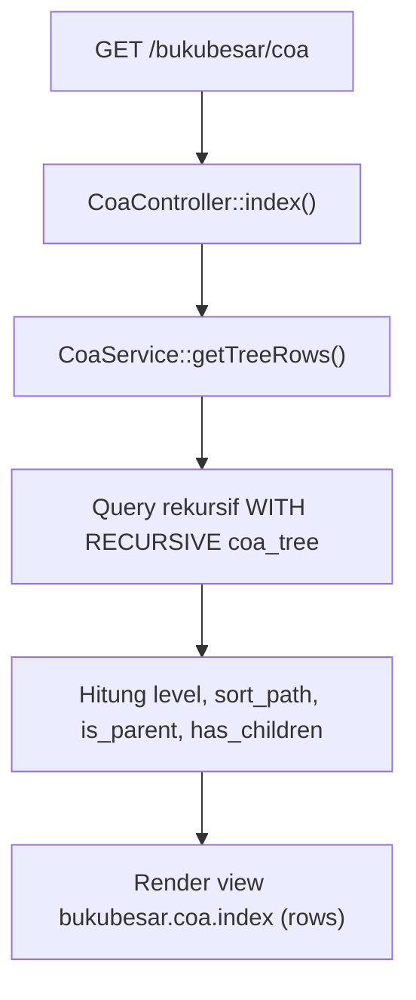
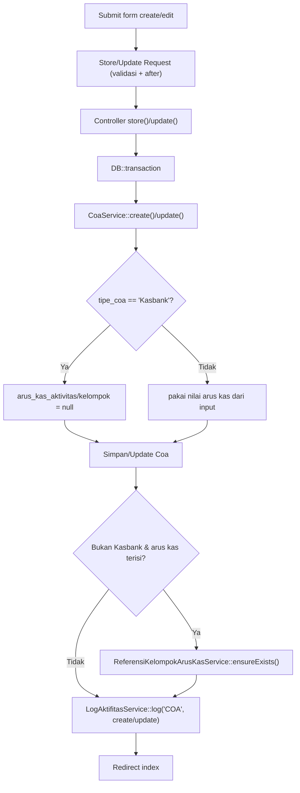
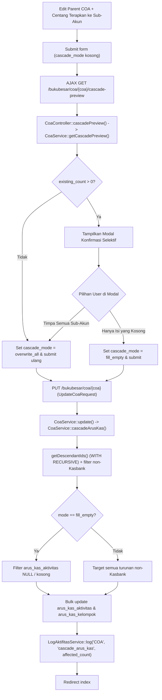
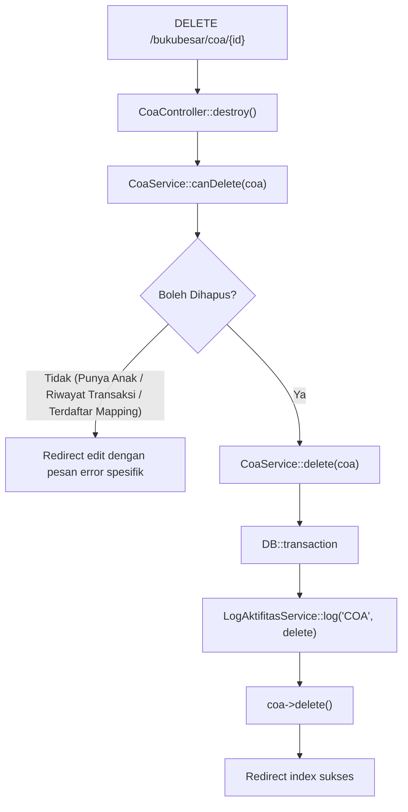

# Dokumentasi Modul Bukubesar — COA

## Ringkasan Modul

Modul **COA (Chart of Accounts)** digunakan untuk:

1. menampilkan daftar akun dalam struktur pohon (hirarki parent-child),
2. membuat, mengubah, dan menghapus akun,
3. menjaga integritas hirarki (mencegah siklus dan parent tidak valid).

Implementasi utama:

- `routes/web.php`
- `app/Http/Controllers/Bukubesar/CoaController.php`
- `app/Http/Requests/Bukubesar/StoreCoaRequest.php`
- `app/Http/Requests/Bukubesar/UpdateCoaRequest.php`
- `app/Services/Bukubesar/CoaService.php`
- `app/Models/Coa.php`, `app/Models/TipeCoa.php`, `app/Models/BukuBesar.php`

## Entry Point / API

| Method | Path | Route Name | Controller Method | Izin |
| --- | --- | --- | --- | --- |
| `GET` | `/bukubesar/coa` | `bukubesar.coa.index` | `index()` | view |
| `GET` | `/bukubesar/coa/{coa}/cascade-preview` | `bukubesar.coa.cascade-preview` | `cascadePreview()` | view |
| `GET` | `/bukubesar/coa/create` | `bukubesar.coa.create` | `create()` | create |
| `POST` | `/bukubesar/coa` | `bukubesar.coa.store` | `store()` | create |
| `GET` | `/bukubesar/coa/{coa}/edit` | `bukubesar.coa.edit` | `edit()` | update |
| `PUT` | `/bukubesar/coa/{coa}` | `bukubesar.coa.update` | `update()` | update |
| `DELETE` | `/bukubesar/coa/{coa}` | `bukubesar.coa.destroy` | `destroy()` | delete |

## Validasi Request

`StoreCoaRequest` / `UpdateCoaRequest` memvalidasi:

- `status_aktif` wajib integer `0` atau `1`,
- `parent_id` opsional, harus ada di `coa`; pada update tidak boleh sama dengan id akun itu sendiri,
- `tipe_coa` wajib string,
- `arus_kas_aktivitas` opsional, salah satu dari `operasi`/`investasi`/`pendanaan`; pada `UpdateCoaRequest` wajib diisi jika `cascade_to_children = 1` (`required_if:cascade_to_children,1`),
- `arus_kas_kelompok` opsional, wajib bila `arus_kas_aktivitas` diisi (`required_with:arus_kas_aktivitas`, maks 150),
- `cascade_to_children` *(khusus `UpdateCoaRequest`)* opsional boolean (`0`/`1`),
- `cascade_mode` *(khusus `UpdateCoaRequest`)* opsional, wajib diisi jika `cascade_to_children = 1` (`required_if:cascade_to_children,1`), salah satu dari `fill_empty` atau `overwrite_all`,
- `kode` wajib, maks 20, unik (ignore diri sendiri saat update),
- `nama` wajib, maks 100, unik (ignore diri sendiri saat update),
- `deskripsi` opsional.

Validasi tambahan (`after`):

- **Store & Update**: `parent_id` tidak boleh berupa akun daun yang sudah punya transaksi buku besar
  (`cannotBeSelectedAsParent`).
- **Update**: `parent_id` tidak boleh membentuk siklus hirarki (`wouldCreateHierarchyCycle`).

## Alur 1: Daftar COA (Pohon)

### Flowchart

### Algoritma

1. `index()` memanggil `getTreeRows()`.
2. Service menjalankan query MySQL rekursif (`WITH RECURSIVE`) untuk membangun pohon COA,
   menghitung `level`, `sort_path`, serta flag `is_parent`/`has_children`.
3. Baris hasil dikirim ke view untuk ditampilkan sebagai struktur hirarki.

## Alur 2: Buat / Ubah COA

### Flowchart

### Algoritma

1. Halaman create/edit menyediakan opsi parent (`getParentOptions()`), tipe (`getTipeOptions()`), serta referensi kelompok arus kas aktif (`getGroupedActive()`) yang dipasang sebagai chained Select2 dengan dukungan penambahan tag baru (disertai konfirmasi dialog pengguna). Pada form create, memilih `Parent Coa` otomatis mengisi pratinjau/pilihan `arus_kas_aktivitas` dan `arus_kas_kelompok` mengikuti atribut `data-aktivitas` dan `data-kelompok` dari akun induk.
2. `getParentOptions($excludeId)` mengecualikan akun itu sendiri beserta seluruh turunannya
   (`getDescendantIds()`), dan hanya menampilkan akun yang punya anak atau belum punya mutasi buku besar.
3. Pada create, `is_postable` diset `false`.
4. Bila `tipe_coa = 'Kasbank'`, kolom arus kas dipaksa `null`.
5. Jika `tipe_coa !== 'Kasbank'` dan kolom `arus_kas_aktivitas` serta `arus_kas_kelompok` terisi, service otomatis memanggil `ReferensiKelompokArusKasService::ensureExists($aktivitas, $kelompok)` untuk mendaftarkan tag baru ke tabel master referensi jika belum ada.
6. Pada update, hanya field yang berubah (`getDirty()`) yang dicatat pada log. Bila `cascade_to_children` aktif dan `cascade_mode` diisi, `CoaService::update()` memanggil `cascadeArusKas()` dalam transaksi yang sama.

## Alur 3: Pewarisan Arus Kas ke Sub-Akun (Kaskade)

### Flowchart

### Algoritma

1. **Preview Check (`getCascadePreview`)**:
   - Pada halaman edit COA yang memiliki sub-akun (`$hasChild = true`) dan bertipe non-`Kasbank` dengan `arus_kas_aktivitas` terisi, pengguna dapat mencentang opsi `cascade_to_children`.
   - Saat form disubmit tanpa `cascade_mode`, script frontend mencegah submit langsung dan memanggil `GET /bukubesar/coa/{coa}/cascade-preview`.
   - `CoaService::getCascadePreview()` mengambil seluruh ID turunan secara rekursif (`getDescendantIds()`), mengecualikan turunan bertipe `Kasbank` (`nonKasbankDescendantQuery()`), lalu menghitung `total_descendants`, `empty_count`, `existing_count`, serta mengambil hingga 5 contoh `existing_samples`.
2. **Modal Konfirmasi Selektif (*fill_empty* vs *overwrite_all*)**:
   - Jika `existing_count === 0` (belum ada sub-akun yang memiliki pemetaan arus kas), frontend otomatis mengisi `cascade_mode = 'overwrite_all'` dan langsung mengirim form.
   - Jika `existing_count > 0`, modal `#cascadeConfirmModal` ditampilkan beserta ringkasan jumlah dan daftar contoh sub-akun yang sudah terisi. Pengguna memilih **Hanya Isi yang Kosong** (`fill_empty`) atau **Timpa Semua Sub-Akun** (`overwrite_all`) sebelum form disubmit ke `PUT /bukubesar/coa/{coa}`.
3. **Query Update Rekursif dan Pengecualian Kasbank**:
   - Di dalam `DB::transaction`, setelah `CoaService::update()` menyimpan perubahan parent, `cascadeArusKas($coa, $mode)` memvalidasi mode (`overwrite_all` / `fill_empty`), memastikan parent bukan bertipe `Kasbank` dan memiliki `arus_kas_aktivitas`, lalu mengambil seluruh ID turunan melalui query SQL rekursif `WITH RECURSIVE coa_descendants`.
   - Query target dibangun via `nonKasbankDescendantQuery()` yang mengecualikan semua sub-akun bertipe `Kasbank` (case-insensitive) sehingga akun `Kasbank` tetap `NULL` dan tidak pernah tertimpa.
   - Pada mode `fill_empty`, query menambahkan filter `arus_kas_aktivitas IS NULL OR arus_kas_aktivitas = ''` sehingga pemetaan kustom pada sub-akun tetap dipertahankan; pada mode `overwrite_all`, seluruh turunan non-`Kasbank` diperbarui ke nilai `arus_kas_aktivitas` dan `arus_kas_kelompok` milik parent.
4. **Pencatatan Ringkasan Audit Log**:
   - Setelah bulk update selesai, `cascadeArusKas()` mencatat 1 entri ringkasan ke `log_aktifitas` melalui `LogAktifitasService::log('COA', 'cascade_arus_kas', null, ...)` yang memuat `parent_id`, `parent_kode`, `mode`, `aktivitas`, `kelompok`, dan `affected_count`.

## Alur 4: Hapus COA

### Flowchart

### Algoritma

1. Controller memanggil `CoaService::canDelete($coa)`:
   - Menolak jika akun memiliki akun turunan (`hasChildren()`).
   - Menolak jika akun memiliki riwayat transaksi keuangan / buku besar (`hasTransactions()`, mencakup `bukubesar`, `jurnal_umum_rinci`, `kasbank_penerimaan`, `kasbank_pembayaran`, faktur & tanda terima).
   - Menolak jika akun masih digunakan pada konfigurasi pemetaan akun sistem (`isReferencedInConfigurations()`, mencakup `mapping_pendapatan_*`, `mapping_coa_simrs`, `setting_rba`).
2. Jika tidak diizinkan, pengguna diredirect kembali ke halaman edit dengan pesan error spesifik; tombol hapus pada form edit juga otomatis dinonaktifkan (`disabled`).
3. Jika diizinkan, `CoaService::delete()` membungkus pencatatan log aktivitas dan operasi delete dalam `DB::transaction`.
4. Jika dipanggil di luar controller tanpa izin, `delete()` melemparkan `\DomainException`.

## Fungsi yang Dipanggil

- `CoaController::index()/cascadePreview()/create()/store()/edit()/update()/destroy()`
- `CoaService::getTreeRows()/getParentOptions()/getSelectableTransactionOptions()/getTipeOptions()`
- `CoaService::hasChildren()/cannotBeSelectedAsParent()/getDescendantIds()/wouldCreateHierarchyCycle()`
- `CoaService::getCascadePreview()/cascadeArusKas()`
- `CoaService::hasTransactions()/isReferencedInConfigurations()/canDelete()`
- `CoaService::create()/update()/delete()`
- `ReferensiKelompokArusKasService::getGroupedActive()/ensureExists()`
- `LogAktifitasService::log()`
- `Coa` scope: `active()/leaf()/activeLeaf()/selectableTransaction()`
- `TipeCoa::scopeActive()`

## Catatan Penting Bisnis

- Struktur COA bersifat **hirarkis**; akun induk tidak bisa dihapus selama punya turunan.
- Akun yang **memiliki riwayat transaksi keuangan / buku besar** atau **terdaftar pada mapping konfigurasi** tidak dapat dihapus demi integritas data keuangan historis.
- Akun daun yang **sudah punya transaksi buku besar** tidak boleh dijadikan parent.
- Perubahan parent tidak boleh membentuk **siklus** hirarki.
- Akun bertipe `Kasbank` tidak menyimpan klasifikasi arus kas (dikosongkan otomatis) dan **selalu dikecualikan** dari pewarisan arus kas (kaskade) agar tetap `NULL`.
- Pewarisan arus kas (kaskade) dari parent ke seluruh level sub-akun mendukung mode `fill_empty` (mempertahankan sub-akun yang sudah memiliki klasifikasi) dan `overwrite_all` (menimpa seluruh turunan non-`Kasbank`).
- Hanya akun **daun aktif** yang dapat dipilih pada input transaksi (lihat modul lain yang memakai
  `selectableTransaction()`).
- Lihat [Konvensi Buku Besar & COA](fondasi/konvensi-bukubesar-coa.md).
