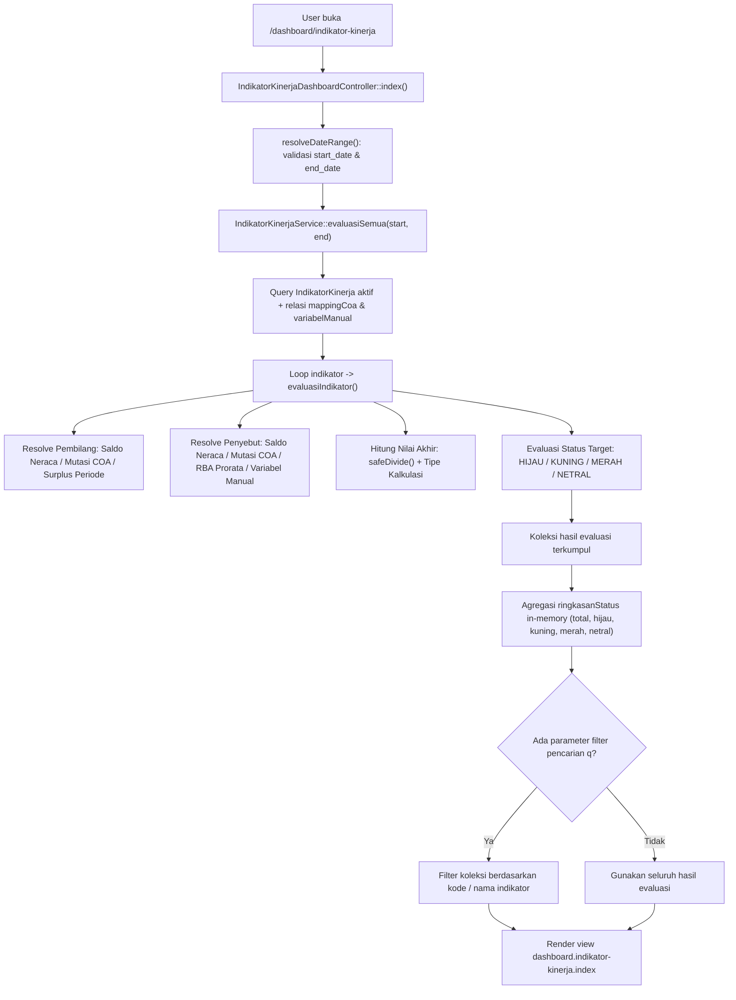
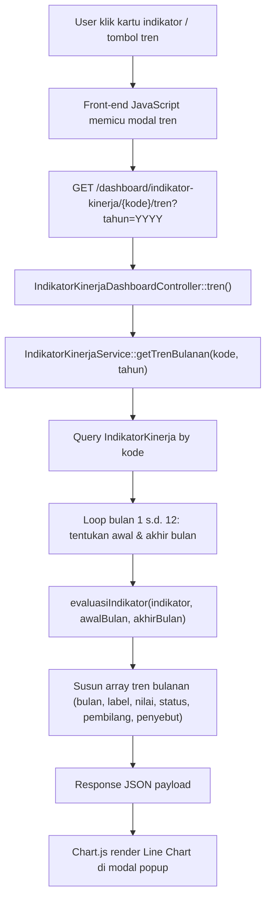

# Dokumentasi Modul Dashboard — Indikator Kinerja

## Ringkasan Modul

Modul **Dashboard Indikator Kinerja** menyajikan visualisasi performa keuangan dan operasional rumah sakit berbasis 11 indikator kinerja utama (KPI) rumah sakit: Capaian Pendapatan, EBITDA, Profitabilitas, Beban Pegawai, Beban Farmasi, Beban Operasional, Collection Period, Kualitas Klaim JKN, Perputaran Persediaan, Beban Dana Sosial, dan Produktifitas Karyawan.

Fitur utama meliputi:
1. Monitoring eksekutif status ketercapaian target indikator dengan visual badge warna (Hijau / Kuning / Merah / Netral).
2. Agregasi data pembilang dan penyebut otomatis dari mutasi Buku Besar / Saldo Neraca COA, RBA Anggaran, dan input data manual operasional.
3. Drill-down visual grafik tren bulanan selama 12 bulan menggunakan Chart.js melalui endpoint AJAX.
4. Filter interaktif berdasarkan rentang tanggal dan pencarian indikator in-memory.

Implementasi utama modul ini berada di:
- `routes/web.php`
- `app/Http/Controllers/Dashboard/IndikatorKinerjaDashboardController.php`
- `app/Services/IndikatorKinerja/IndikatorKinerjaService.php`
- `app/Models/IndikatorKinerja.php`
- `app/Models/IndikatorKinerjaMappingCoa.php`
- `app/Models/IndikatorKinerjaVariabelManual.php`
- `app/Models/IndikatorKinerjaManualData.php`
- `resources/views/dashboard/indikator-kinerja/index.blade.php`

---

## Entry Point / API

Seluruh endpoint di bawah ini diproteksi oleh middleware `auth` dan `module.access:dashboard.indikator-kinerja,view`.

| Method | Path | Route Name | Controller Method | Izin |
| --- | --- | --- | --- | --- |
| `GET` | `/dashboard/indikator-kinerja` | `dashboard.indikator-kinerja.index` | `index(Request $request)` | `dashboard.indikator-kinerja,view` |
| `GET` | `/dashboard/indikator-kinerja/{kode}/tren` | `dashboard.indikator-kinerja.tren` | `tren(Request $request, string $kode)` | `dashboard.indikator-kinerja,view` |

---

## Parameter Request

1. **Endpoint Dashboard (`/dashboard/indikator-kinerja`)**:
   - `start_date` / `dariTanggal`: Tanggal awal periode evaluasi (format `YYYY-MM-DD`, default: tanggal 1 bulan berjalan).
   - `end_date` / `sampaiTanggal`: Tanggal akhir periode evaluasi (format `YYYY-MM-DD`, default: tanggal hari ini).
   - `q`: Kata kunci pencarian kode atau nama indikator (opsional, pencarian case-insensitive).

2. **Endpoint Tren Bulanan (`/dashboard/indikator-kinerja/{kode}/tren`)**:
   - `{kode}`: Kode unik indikator kinerja (misal: `capaian_pendapatan`, `ebitda`, `collection_period`, `beban_pegawai`).
   - `tahun`: Tahun kalender 12 bulan yang akan dievaluasi (integer, default: tahun berjalan).

---

## Alur 1: Evaluasi & Tampilan Dashboard Eksekutif

Alur ini memuat seluruh data indikator kinerja aktif, menghitung nilai riil pembilang dan penyebut, mengevaluasi status warna target, dan menampilkan kartu metrik serta ringkasan eksekutif.

### Flowchart

### Algoritma

1. `IndikatorKinerjaDashboardController::index()` memanggil `resolveDateRange()` untuk memastikan tanggal awal dan akhir valid; jika parameter kosong atau tidak valid, sistem secara aman menggunakan fallback awal bulan s.d. hari ini.
2. Controller memanggil `IndikatorKinerjaService::evaluasiSemua($startDate, $endDate)`.
3. Service mengambil semua record `IndikatorKinerja` berstatus aktif beserta relasi `mappingCoa.coa` dan `variabelManual`.
4. Untuk setiap indikator:
   - Menghitung jumlah hari riil (`$hariRiil = start->diff(end)->days + 1`).
   - Mengambil seluruh leaf descendant COA IDs dengan fungsi memoized `kumpulkanLeafDescendantCoaIds()` untuk numerator dan denominator (termasuk filter akun eksklusi `is_excluded`).
   - Menghitung nilai pembilang: saldo per tanggal akhir jika bertipe `TURNOVER`, mutasi debet/kredit jika bertipe umum, atau surplus/defisit berjalan jika berbasis `SURPLUS`, ditambah mapping `ADDITION` dan dikurangi `DEDUCTION`.
   - Menghitung nilai penyebut: saldo neraca, mutasi COA, nilai target RBA proporsional (`ambilRbaCoa()`), atau nilai variabel manual operasional terdekat (`ambilNilaiManualTerakhir()`). Untuk indikator bertipe `TURNOVER`, pembagian dilakukan terhadap rata-rata harian (dikali jumlah hari riil periode).
   - Menghitung rasio melalui `safeDivide($pembilang, $penyebut)`. Jika penyebut bernilai nol atau null, nilai diset `null` dan status dievaluasi sebagai `NETRAL`.
   - Melakukan evaluasi ambang batas target melalui `evaluasiStatus()` berdasarkan `pola_evaluasi` (`HIGHER_IS_BETTER`, `LOWER_IS_BETTER`, `TARGET_BAND`) dan rentang target warna (`HIJAU`, `KUNING`, `MERAH`, `NETRAL`), dengan pembulatan 2 desimal untuk mencegah celah nilai pecahan (*fractional gap*).
5. Controller mengagregasikan `ringkasanStatus` secara in-memory dari koleksi evaluasi tanpa melakukan query database tambahan.
6. Bila parameter `q` diberikan, controller menyaring koleksi indikator berdasarkan kecocokan substring pada `kode` atau `nama` (case-insensitive).
7. Mengembalikan view `dashboard.indikator-kinerja.index` yang berisi widget ringkasan eksekutif, filter periode, dan kartu matriks indikator.

### Fungsi yang Dipanggil

- `IndikatorKinerjaDashboardController::index()`
- `IndikatorKinerjaDashboardController::resolveDateRange()`
- `IndikatorKinerjaService::evaluasiSemua()`
- `IndikatorKinerjaService::evaluasiIndikator()`
- `IndikatorKinerjaService::kumpulkanLeafDescendantCoaIds()`
- `IndikatorKinerjaService::ambilMutasiCoa()`
- `IndikatorKinerjaService::ambilSaldoNeracaCoa()`
- `IndikatorKinerjaService::ambilRbaCoa()`
- `IndikatorKinerjaService::ambilSurplusPeriode()`
- `IndikatorKinerjaService::ambilNilaiManualTerakhir()`
- `IndikatorKinerjaService::safeDivide()`
- `IndikatorKinerjaService::evaluasiStatus()`

---

## Alur 2: Drill-down Tren Bulanan 12 Bulan (AJAX)

Alur ini dipicu saat pengguna mengklik tombol atau kartu indikator pada dashboard untuk melihat visualisasi pergerakan kinerja sepanjang tahun berjalan.

### Flowchart

### Algoritma

1. Frontend memicu pemanggilan AJAX ke endpoint `dashboard.indikator-kinerja.tren` dengan menyertakan parameter `tahun`.
2. `IndikatorKinerjaDashboardController::tren()` menerima request dan meneruskan parameter ke `IndikatorKinerjaService::getTrenBulanan($kode, $tahun)`.
3. Service mencari record `IndikatorKinerja` berdasarkan kode. Jika tidak ditemukan, service melempar `ModelNotFoundException` (HTTP 404).
4. Service melakukan iterasi untuk setiap bulan $1$ sampai $12$ pada tahun terpilih:
   - Menghitung rentang tanggal awal bulan (`YYYY-MM-01`) dan akhir bulan (`YYYY-MM-t`).
   - Mengevaluasi indikator pada potongan waktu 1 bulan tersebut melalui `evaluasiIndikator()`.
   - Mengumpulkan data poin bulanan: nomor bulan, nama bulan singkat (Jan, Feb, ...), nilai riil hasil kalkulasi, badge status evaluasi, serta nominal pembilang dan penyebut.
5. Controller mengembalikan respons JSON berupa struktur tren bulanan beserta metadata indikator (kode, nama, satuan, batas target).
6. Script front-end menghancurkan instance Chart.js sebelumnya (jika ada) dan menggambar grafik garis interaktif yang menampilkan tren performa beserta garis ambang batas target.

### Fungsi yang Dipanggil

- `IndikatorKinerjaDashboardController::tren()`
- `IndikatorKinerjaService::getTrenBulanan()`
- `IndikatorKinerjaService::evaluasiIndikator()`

---

## Catatan Penting Bisnis

1. **Penanganan Pembagian dengan Nol (Safe Division)**:
   - Bila penyebut bernilai `0` atau data belum diinput, nilai indikator menjadi `null`. Nilai `null` ditampilkan sebagai tanda strip (`-`) dan statusnya adalah `NETRAL` (badge abu-abu), bukan error kalkulasi.
2. **Pencarian Rekursif Hierarki COA**:
   - Jika sebuah akun induk COA dipetakan pada indikator, sistem secara otomatis mengumpulkan seluruh akun anak (*leaf descendants*) yang postable menggunakan memoized tree (`getCachedCoaTree`) guna mencegah beban query berulang ke database.
   - Akun COA yang ditandai `is_excluded = true` secara eksplisit dikeluarkan dari daftar leaf descendant.
3. **Data Variabel Manual**:
   - Untuk indikator dengan penyebut berbasis `MANUAL`, sistem mencari data bulanan terakhir yang terisi pada atau sebelum tanggal akhir evaluasi (`ambilNilaiManualTerakhir()`). Jika tidak ada data yang terisi, rasio tidak dapat dihitung dan bernilai netral.
4. **Alokasi RBA Proporsional**:
   - Untuk penyebut berbasis `RBA`, sistem menghitung porsi target anggaran RBA secara proporsional sesuai jumlah bulan dalam rentang filter tanggal (`ambilRbaCoa()` dan `hitungAlokasiBulanPerTahun()`).
5. **Widget Home Dashboard**:
   - Ringkasan status indikator kinerja juga dapat ditampilkan pada halaman utama (Home) melalui endpoint JSON `/home/ringkasan-indikator` yang memanggil `IndikatorKinerjaService::getRingkasanStatus()`.
6. **Daftar 11 Indikator Kinerja Baseline & Variabel Manual**:
   - `capaian_pendapatan`: Capaian Pendapatan (`%`, `RASIO`, COA / RBA, `HIGHER_IS_BETTER`)
   - `ebitda`: EBITDA Margin (`%`, `RASIO`, SURPLUS + Addition / COA, `HIGHER_IS_BETTER`)
   - `profitabilitas`: Profitabilitas / NPM (`%`, `RASIO`, SURPLUS / COA, `HIGHER_IS_BETTER`)
   - `beban_pegawai`: Beban Pegawai (`%`, `RASIO`, COA / COA, `TARGET_BAND`: 20%-25% Hijau, 25%-30% Kuning)
   - `beban_farmasi`: Beban Farmasi (`%`, `RASIO`, COA / COA, `LOWER_IS_BETTER`)
   - `beban_operasional`: Beban Operasional (`%`, `RASIO`, COA / COA, `LOWER_IS_BETTER`)
   - `collection_period`: Collection Period (`Hari`, `TURNOVER`, COA / COA, `LOWER_IS_BETTER`)
   - `kualitas_klaim_jkn`: Kualitas Klaim JKN (`%`, `MANUAL`, Variabel Manual, `HIGHER_IS_BETTER`)
   - `perputaran_persediaan`: Perputaran Persediaan (`Hari`, `TURNOVER`, COA / COA, `LOWER_IS_BETTER`)
   - `beban_dana_sosial`: Beban Dana Sosial (`%`, `RASIO`, COA / COA, `HIGHER_IS_BETTER`)
   - `produktifitas_karyawan`: Produktifitas Karyawan (`Juta/org/bln`, `RASIO`, COA / Variabel Manual, `HIGHER_IS_BETTER`)
   - Variabel Manual: `lolos_bahv_pertama_jkn` (Persentase Lolos BAHV Pertama JKN, `%`) dan `sdm_non_organik` (Jumlah SDM Non Organik, `Orang`).
