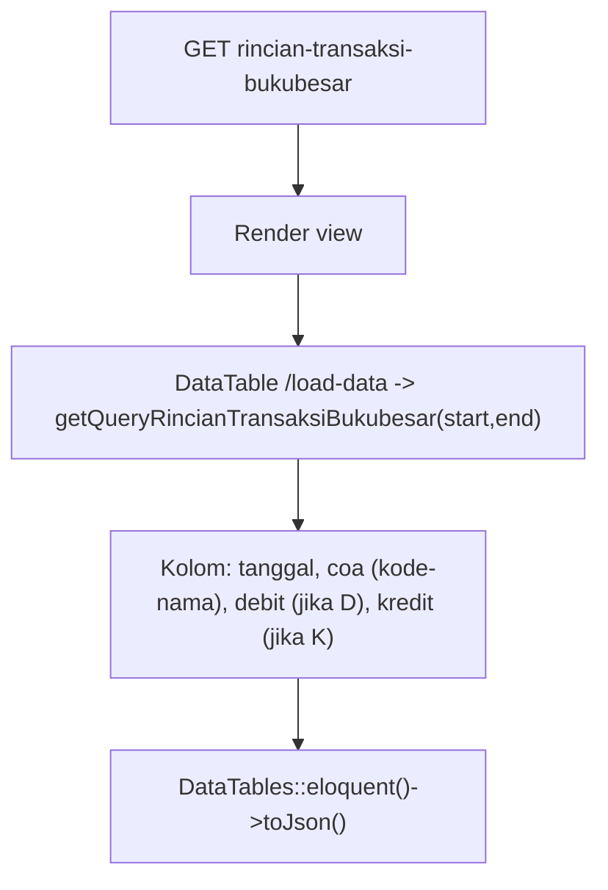
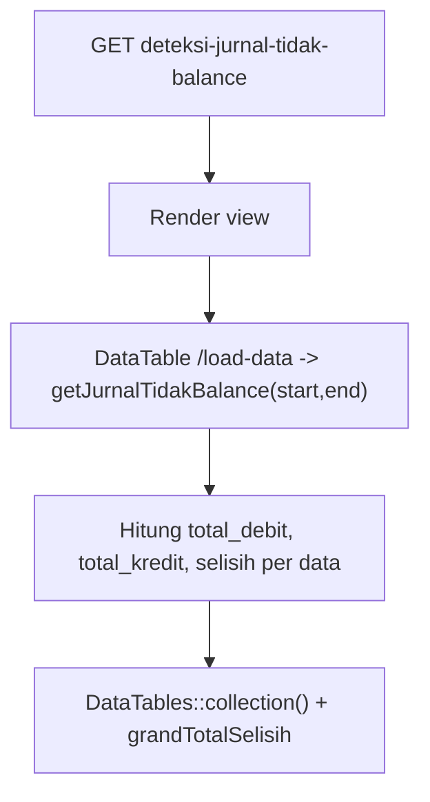
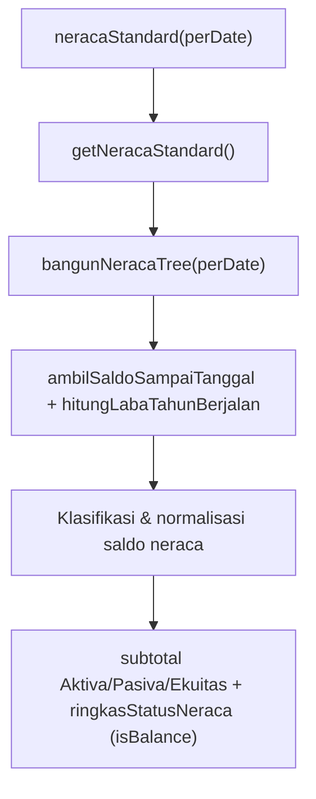
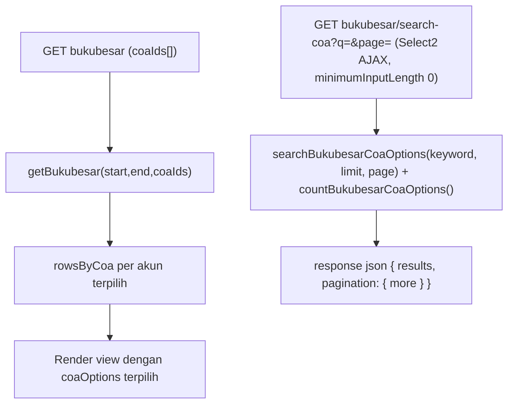
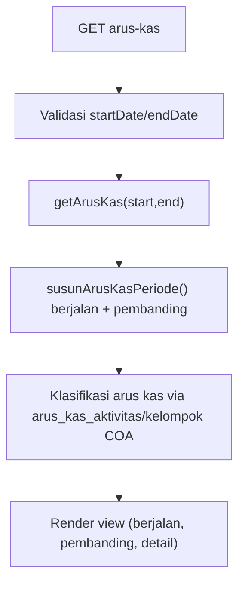
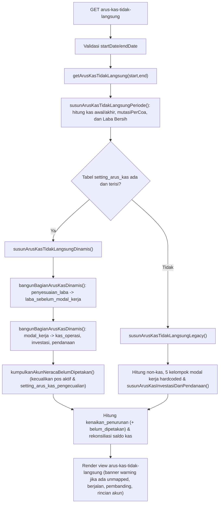

# Dokumentasi Modul Laporan — Keuangan

## Ringkasan Modul

Modul **Laporan Keuangan** menyajikan berbagai laporan akuntansi berbasis data Buku Besar dan COA
(read-only, hanya `view`):

1. Rincian transaksi buku besar,
2. Deteksi jurnal tidak balance,
3. Laba rugi (detil, standard, per parent COA, komparasi bulanan),
4. Neraca (standard, per parent COA, saldo, detil, rinci),
5. Buku besar per COA,
6. Arus kas (metode langsung dan metode tidak langsung).

Implementasi utama:

- `routes/web.php`
- `app/Http/Controllers/Laporan/LaporanKeuanganController.php`
- `app/Services/Laporan/LaporanKeuanganService.php`
- `app/Models/BukuBesar.php`, `app/Models/Coa.php`, `app/Models/TipeCoa.php`,
  `app/Models/JurnalUmum.php`, `app/Models/SettingRba.php`

## Entry Point / API

Semua endpoint memakai izin `laporan.keuangan,view`.

| Method | Path | Route Name | Controller Method |
| --- | --- | --- | --- |
| `GET` | `/laporan/keuangan` | `laporan.keuangan.index` | `index()` |
| `GET` | `/laporan/keuangan/rincian-transaksi-bukubesar` | `laporan.keuangan.rincian-transaksi-bukubesar` | `rincianTransaksiBukubesar()` |
| `GET` | `/laporan/keuangan/rincian-transaksi-bukubesar/load-data` | `laporan.keuangan.rincian-transaksi-bukubesar.load-data` | `loadRincianTransaksiBukubesar()` |
| `GET` | `/laporan/keuangan/deteksi-jurnal-tidak-balance` | `laporan.keuangan.deteksi-jurnal-tidak-balance` | `deteksiJurnalTidakBalance()` |
| `GET` | `/laporan/keuangan/deteksi-jurnal-tidak-balance/load-data` | `laporan.keuangan.deteksi-jurnal-tidak-balance.load-data` | `loadDeteksiJurnalTidakBalance()` |
| `GET` | `/laporan/keuangan/laba-rugi-detil` | `laporan.keuangan.laba-rugi-detil` | `labaRugiDetil()` |
| `GET` | `/laporan/keuangan/laba-rugi-standard` | `laporan.keuangan.laba-rugi-standard` | `labaRugiStandard()` |
| `GET` | `/laporan/keuangan/laba-rugi-per-parent-coa` | `laporan.keuangan.laba-rugi-per-parent-coa` | `labaRugiPerParentCoa()` |
| `GET` | `/laporan/keuangan/laba-rugi-komparasi-bulanan` | `laporan.keuangan.laba-rugi-komparasi-bulanan` | `labaRugiKomparasiBulanan()` |
| `GET` | `/laporan/keuangan/neraca-standard` | `laporan.keuangan.neraca-standard` | `neracaStandard()` |
| `GET` | `/laporan/keuangan/neraca-per-parent-coa` | `laporan.keuangan.neraca-per-parent-coa` | `neracaPerParentCoa()` |
| `GET` | `/laporan/keuangan/bukubesar` | `laporan.keuangan.bukubesar` | `bukubesar()` |
| `GET` | `/laporan/keuangan/bukubesar/search-coa` | `laporan.keuangan.bukubesar.search-coa` | `searchBukubesarCoa()` |
| `GET` | `/laporan/keuangan/neraca-saldo` | `laporan.keuangan.neraca-saldo` | `neracaSaldo()` |
| `GET` | `/laporan/keuangan/neraca-detil` | `laporan.keuangan.neraca-detil` | `neracaDetil()` |
| `GET` | `/laporan/keuangan/neraca-rinci` | `laporan.keuangan.neraca-rinci` | `neracaRinci()` |
| `GET` | `/laporan/keuangan/arus-kas` | `laporan.keuangan.arus-kas` | `arusKas()` |
| `GET` | `/laporan/keuangan/arus-kas-tidak-langsung` | `laporan.keuangan.arus-kas-tidak-langsung` | `arusKasTidakLangsung()` |

## Parameter Umum

- `resolveDateRange()` menentukan `startDate`/`endDate` (default awal bulan s.d. hari ini).
- Laporan berbasis titik waktu memakai `perDate` (default hari ini): neraca standard, per parent COA,
  saldo, detil.
- `getIdentitasLaporan()` menyediakan identitas laporan (nama RS, dll) untuk header laporan.

## Alur Sub-Laporan

### Rincian Transaksi Buku Besar

### Deteksi Jurnal Tidak Balance

### Laba Rugi (Detil / Standard / Per Parent COA / Komparasi Bulanan)

- `labaRugiDetil()` → `getLabaRugiDetil()`: baris laba rugi rinci per akun.
- `labaRugiStandard()` → `getLabaRugiStandard()`: bentuk agregat standar (parent-child).
- `labaRugiPerParentCoa()` (param `coaId`) → `getLabaRugiPerParentCoa()`: drill-down per parent COA.
- `labaRugiKomparasiBulanan()` (param `startDate`, `endDate`) → `getLabaRugiKomparasiBulanan()`: komparasi bulanan dengan persentase pertumbuhan horizontal antar-bulan (format Jurnal.id) untuk 5 pos laba rugi (Pendapatan, BPP, Beban Ops, Pendapatan Lain, Beban Lain) dan baris ringkasan (Laba Kotor, Laba Operasional, Laba Bersih).

Service melibatkan klasifikasi tipe (pendapatan vs biaya), agregasi subtree per akun daun, dan
integrasi anggaran **RBA** (`ambilRbaPerCoa`, `hitungAlokasiBulanPerTahun`) untuk pembanding.

### Neraca (Standard / Per Parent COA / Saldo / Detil / Rinci)

- `neracaStandard()` (param `perDate`) → `getNeracaStandard()`: aktiva/pasiva/ekuitas + status balance.
- `neracaPerParentCoa()` (param `perDate`, `coaId`) → `getNeracaPerParentCoa()`: drill-down hierarki subtree akun turunan dengan filter periode cut-off otomatis, tree toggle accordion, ringkasan saldo konsolidasi, serta ekspor Excel (.xlsx) dan Cetak/PDF.
- `neracaSaldo()` (param `perDate`) → `getNeracaSaldo()`.
- `neracaDetil()` (param `perDate`) → `getNeracaDetil()`.
- `neracaRinci()` (param `startDate`, `endDate`, `tipeCoa[]`) → `getNeracaRinci()`, dengan opsi tipe
  COA dari `getDaftarTipeCoaAktif()`.

### Buku Besar per COA

### Arus Kas (Metode Langsung)

### Arus Kas (Metode Tidak Langsung)

Laporan arus kas metode tidak langsung (*Indirect Method*) menyusun arus kas dari rekonsiliasi Laba Bersih, penyesuaian non-kas, perubahan modal kerja, serta aktivitas investasi dan pendanaan. Perhitungan mendukung dua mode:

1. **Mode Dinamis (`SettingArusKas`, Mode Utama)**: Aktif otomatis ketika tabel `setting_arus_kas` tersedia dan memiliki minimal satu record (`SettingArusKas::query()->exists()`).
   - **Laba (Rugi) Bersih Periode Berjalan**: Diperoleh dari mutasi akun leaf laba rugi aktif (`Pendapatan`, `Pendapatan lain`, `Beban`, `Beban lain`, `Beban Pokok Penjualan`).
   - **Penyesuaian Non-Kas** (`kelompok_bagian = 'penyesuaian_laba'`): Seluruh pos aktif pada bagian ini dihitung sesuai `sifat_pos` via `hitungDampakDanPerubahanPos()`. Khusus pos dengan `sifat_pos` Laba Rugi (`penambah_laba`/`pengurang_laba`), `bangunBagianArusKasDinamis()` hanya mengagregasi COA Laba Rugi yang aktif (`status_aktif = 1`) agar konsisten dengan perhitungan Laba Bersih dan menjaga rekonsiliasi kas tetap nol, sedangkan pos dengan `sifat_pos` Neraca (`aset`, `liabilitas`, `ekuitas`) tetap menyertakan COA Neraca nonaktif (`status_aktif = 0`) yang bermutasi. Penjumlahan laba bersih dan subtotal bagian ini menghasilkan baris **`Laba Operasi Sebelum Perubahan Modal Kerja`** (`laba_sebelum_modal_kerja`).
   - **Perubahan Modal Kerja** (`kelompok_bagian = 'modal_kerja'`): Dihitung per pos aktif sesuai urutan (`urut()`) dengan label dinamis dari `SettingArusKas::formatLabelPos($perubahan)`. Penjumlahan `laba_sebelum_modal_kerja` dan subtotal modal kerja menghasilkan `kas_operasi`.
   - **Aktivitas Investasi & Pendanaan** (`kelompok_bagian = 'investasi'` & `'pendanaan'`): Dihitung dari pos aktif dan mapping COA masing-masing bagian.
   - **Deteksi Akun Neraca Belum Dipetakan**: `kumpulkanAkunNeracaBelumDipetakan()` memindai seluruh akun Neraca non-Kasbank yang bermutasi pada periode (termasuk akun berstatus nonaktif) yang tidak masuk ke pos aktif maupun daftar pengecualian (`setting_arus_kas_pengecualian`). Jika ditemukan pada periode berjalan, antarmuka menampilkan *warning banner* (beserta tautan ke [Pengaturan Arus Kas](pengaturan-arus-kas.md) bila user memiliki izin `pengaturan.arus-kas,view`) dan nilai `belum_dipetakan` tetap dijumlahkan pada baris **Perubahan Akun Neraca Belum Dipetakan** ke `kenaikan_penurunan` agar rekonsiliasi saldo kas tetap terekspos.
2. **Mode Fallback Legacy**: Digunakan secara otomatis (`susunArusKasTidakLangsungLegacy()`) apabila tabel `setting_arus_kas` belum tersedia atau belum berisi data:
   - Penyesuaian non-kas diambil dari akun beban penyusutan/amortisasi (atau fallback akun `Akumulasi Penyusutan`).
   - Modal kerja menggunakan 5 kelompok hardcoded berbasis `tipe_coa` (`piutang`, `persediaan`, `aset_lancar_lainnya`, `utang_usaha`, `liabilitas_pendek_lainnya`).
   - Investasi & Pendanaan diambil via `susunArusKasInvestasiDanPendanaan()`.
3. **Rekonsiliasi Kas**:
   $\text{Kas Akhir} = \text{Kas Awal} + \text{Kenaikan (Penurunan) Bersih Kas}$. Pada mode dinamis, $\text{Kenaikan (Penurunan)} = \text{Kas Operasi} + \text{Investasi} + \text{Pendanaan} + \text{Belum Dipetakan}$.

## Fungsi yang Dipanggil

- Controller: `index()`, `rincianTransaksiBukubesar()/loadRincianTransaksiBukubesar()`,
  `deteksiJurnalTidakBalance()/loadDeteksiJurnalTidakBalance()`, `labaRugiDetil()/labaRugiStandard()/labaRugiPerParentCoa()/labaRugiKomparasiBulanan()`,
  `neracaStandard()/neracaPerParentCoa()/neracaSaldo()/neracaDetil()/neracaRinci()`,
  `bukubesar()/searchBukubesarCoa()`, `arusKas()`, `arusKasTidakLangsung()`, `resolveDateRange()` (private).
- Service: `getIdentitasLaporan()`, `getQueryRincianTransaksiBukubesar()`, `getJurnalTidakBalance()`,
  `getLabaRugiDetil()/getLabaRugiStandard()/getLabaRugiPerParentCoa()/getLabaRugiKomparasiBulanan()`,
  `getNeracaStandard()/getNeracaPerParentCoa()/getNeracaSaldo()/getNeracaDetil()/getNeracaRinci()`,
  `getBukubesar()/getBukubesarSelectedCoaOptions()/searchBukubesarCoaOptions()/countBukubesarCoaOptions()`,
  `getArusKas()`, `getArusKasTidakLangsung()`, `susunArusKasTidakLangsungDinamis()`,
  `bangunBagianArusKasDinamis()`, `hitungDampakDanPerubahanPos()`, `kumpulkanAkunNeracaBelumDipetakan()`,
  `susunArusKasTidakLangsungLegacy()`, `getDaftarTipeCoaAktif()` (plus banyak helper privat untuk agregasi & klasifikasi).
- Model terkait Arus Kas Tidak Langsung: `SettingArusKas::formatLabelPos()`, `SettingArusKasPengecualian`.

## Catatan Penting Bisnis

- Modul ini **read-only**; tidak mengubah data buku besar/jurnal.
- Input Select2 Pilih COA pada Buku Besar menggunakan AJAX dengan `minimumInputLength: 0` dan pagination, sehingga saat dropdown diklik tanpa mengetik akan langsung menampilkan daftar opsi COA dari server.
- Pada Buku Besar (`getBukubesar`), kolom keterangan baris transaksi otomatis menggabungkan penjamin dengan format `[Kode Penjamin] Nama Penjamin - Keterangan Asli` (Opsi A) jika penjamin ditemukan dari sumbernya (`faktur_penjualan` untuk `Invoice Pendapatan`, `simrs_import_pendapatan` untuk `Jurnal Umum`, atau `pelanggan` untuk `Penerimaan Pendapatan`). Teks penjamin ini otomatis dapat dicari melalui input pencarian `#globalSearch` di halaman Buku Besar serta tercakup pada export Excel dan Print. Pengambilan penjamin dilakukan secara bersegmen (chunked query per 500 item) demi efisiensi query dan mencegah memory exhaustion/SQL parameter limit saat rentang laporan memuat ribuan transaksi.
- Laporan laba rugi mengintegrasikan anggaran **RBA** sebagai pembanding.
- Klasifikasi neraca dan arus kas metode langsung bergantung pada `tipe_coa` dan `arus_kas_aktivitas`/`arus_kas_kelompok`
  pada COA (lihat [Konvensi Buku Besar & COA](fondasi/konvensi-bukubesar-coa.md)).
- Arus kas **Metode Tidak Langsung** mengutamakan konfigurasi dinamis dari [Pengaturan Arus Kas](pengaturan-arus-kas.md) (`SettingArusKas`, `SettingArusKasCoa`, dan `SettingArusKasPengecualian`), termasuk menampilkan banner peringatan apabila terdapat akun Neraca bermutasi (termasuk akun nonaktif atau akun pada pos yang dinonaktifkan) yang belum dipetakan atau dikecualikan, serta tetap menyediakan *graceful legacy fallback* saat tabel konfigurasi belum terisi.
- Laporan arus kas menyediakan dua sudut pandang: **Metode Langsung** (aliran kas riil berdasarkan akun lawan kas) dan **Metode Tidak Langsung** (rekonsiliasi dari laba bersih, beban non-kas, dan perubahan modal kerja sesuai standar PSAK).
- Deteksi jurnal tidak balance membantu menemukan hasil bridging/jurnal yang tidak seimbang
  (lihat juga [Bridging Pendapatan](bridging-pendapatan.md)).
- Neraca standard menyertakan indikator `isBalance` (aktiva = pasiva + ekuitas).
