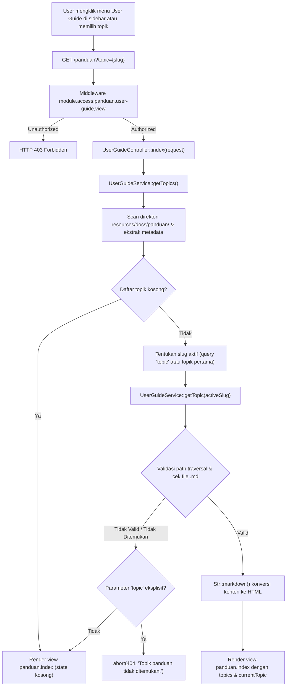

# Dokumentasi Modul Panduan — User Guide

## Ringkasan Modul

Modul **Panduan — User Guide** digunakan untuk:

1. Menyediakan dokumentasi operasional dan petunjuk penggunaan aplikasi Siakurat secara terpadu langsung di dalam antarmuka aplikasi,
2. Menampilkan daftar topik panduan (sidebar sub-navigasi internal) yang tersimpan dalam format berkas Markdown di `resources/docs/panduan/`,
3. Melakukan render konten Markdown menjadi HTML responsif siap baca lengkap dengan navigasi antar-topik, penyaringan topik sisi klien (*quick search filter*), dan tampilan artikel aktif.

Implementasi utama modul ini berada di:

- `routes/web.php`
- `app/Http/Controllers/Panduan/UserGuideController.php`
- `app/Services/Panduan/UserGuideService.php`
- `resources/views/panduan/index.blade.php`
- `resources/docs/panduan/*.md`
- `resources/views/partials/sidebar.blade.php`

## Entry Point / API

Endpoint dilindungi middleware otorisasi `module.access:panduan.user-guide,<aksi>`.

| Method | Path | Route Name | Controller Method | Izin Diperlukan |
| --- | --- | --- | --- | --- |
| `GET` | `/panduan` | `panduan.index` | `UserGuideController::index()` | `panduan.user-guide,view` |

### Parameter Query

| Parameter | Tipe | Keterangan |
| --- | --- | --- |
| `topic` | `string` | *(Opsional)* Slug topik dokumen markdown (contoh: `?topic=02-kasbank-penerimaan`). Jika tidak diberikan, default menampilkan topik pertama yang tersedia berdasarkan urutan numerik file. |

---

## Alur 1: Menampilkan Halaman User Guide dan Konten Panduan

### Flowchart

### Algoritma

1. Request diterima oleh `UserGuideController::index()`.
2. Middleware `EnsureModuleAccess` memverifikasi otorisasi user untuk aksi `view` pada modul `panduan.user-guide`. Jika user tidak memiliki hak akses, sistem melempar `HttpException` 403 Forbidden.
3. Controller memanggil `UserGuideService::getTopics()`:
   - Memeriksa keberadaan direktori `resources/docs/panduan/`.
   - Mengambil seluruh berkas dengan ekstensi `.md`.
   - Mengekstrak judul utama (`# Judul`) dari berkas markdown; jika tidak ditemukan, menggunakan nama file yang diubah menjadi judul baca (*headline*).
   - Mengekstrak prefiks angka untuk penentuan urutan (`order`), lalu mengurutkan topik secara ascending.
   - Mengembalikan `Collection` yang berisi array `['slug', 'title', 'order']`.
4. Jika koleksi topik kosong, controller langsung merender view `panduan.index` dengan `$currentTopic = null`.
5. Jika koleksi topik tersedia:
   - Mengambil slug dari query parameter `request('topic')`.
   - Bila query parameter tidak diberikan, memilih slug dari topik urutan pertama sebagai topik aktif.
   - Memanggil `UserGuideService::getTopic($activeSlug)`.
6. Di dalam `UserGuideService::getTopic($slug)`:
   - Melakukan validasi sanitasi nama berkas: memastikan `$slug !== ''`, `basename($slug) === $slug`, serta tidak mengandung `..`, `/`, atau `\`.
   - Memeriksa keberadaan fisik berkas `$docsPath . '/' . $safeSlug . '.md'`.
   - Jika berkas tidak valid atau tidak ditemukan, mengembalikan `null`.
   - Jika berkas valid, membaca konten, mengekstrak judul, dan mengonversi markdown ke HTML menggunakan helper `Str::markdown()`.
   - Mengembalikan array data `['slug' => $safeSlug, 'title' => $title, 'html' => $html]`.
7. Jika pengguna meminta topik tertentu via parameter `?topic=...` namun `getTopic()` menghasilkan `null`, controller menghentikan eksekusi dengan `abort(404, 'Topik panduan tidak ditemukan.')`.
8. Controller mengembalikan view `panduan.index` membawa data `$topics` dan `$currentTopic`.
9. Antarmuka menampilkan:
   - Panel navigasi kiri: daftar seluruh topik dengan highlight pada topik aktif, serta fitur penyaringan cepat berbasis Javascript (*live search*).
   - Panel konten kanan: judul dan badan panduan dalam format HTML yang sudah distilisasi.

### Fungsi yang Dipanggil

- `UserGuideController::index(Request $request): View`
- `UserGuideService::getTopics(): Collection`
- `UserGuideService::getTopic(string $slug): ?array`
- `UserGuideService::extractTitle(string $content, string $fallback): string`
- `Illuminate\Support\Str::markdown(string $string): HtmlString`

---

## Catatan Penting Bisnis

1. **Penyimpanan Berkas Berbasis Markdown (Tahap 1)**:
   - Berkas panduan disimpan secara lokal di direktori `resources/docs/panduan/` dengan ekstensi `.md`.
   - Penamaan berkas mengikuti pola numerik dua digit (misal: `01-ringkasan-umum.md`, `02-kasbank-penerimaan.md`, `03-bukubesar-jurnal-umum.md`) agar urutan bab tersusun secara sistematis.
   - Keuntungan arsitektur ini adalah dokumentasi tersimpan dalam kontrol versi Git dan tidak membebani transaksi database.
2. **Keamanan & Pencegahan Path Traversal**:
   - Parameter `topic` yang berasal dari user tidak pernah dioperasikan langsung ke fungsi pembaca berkas sistem tanpa sanitasi ketat.
   - Karakter traversal seperti `..`, `/`, dan `\` ditolak sepenuhnya untuk mencegah pembacaan berkas di luar folder panduan.
3. **Integrasi Otorisasi & Navigasi**:
   - Modul didaftarkan pada `AccessModuleRegistry` dengan kode `panduan.user-guide`, nama `User Guide`, grup `Panduan`, dan urutan `250`.
   - Migrasi otomatis memberikan izin akses penuh kepada role sistem (`roles.is_system = 1`).
   - Tautan menu pada `resources/views/partials/sidebar.blade.php` dilindungi pengecekan `$can('panduan.user-guide')`.
4. **Rencana Peningkatan ke CMS (Tahap 2)**:
   - Pendekatan berkas statis Markdown pada Tahap 1 dapat ditingkatkan ke manajemen konten dinamis berbasis basis data (CMS) di Tahap 2 apabila dibutuhkan fitur penyuntingan langsung oleh staf operasional rumah sakit tanpa melalui proses deployment kode.
