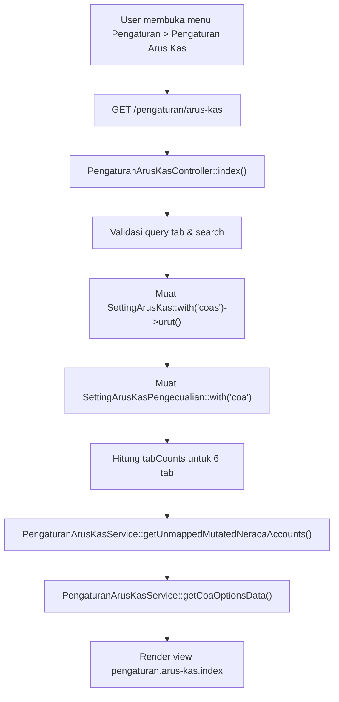
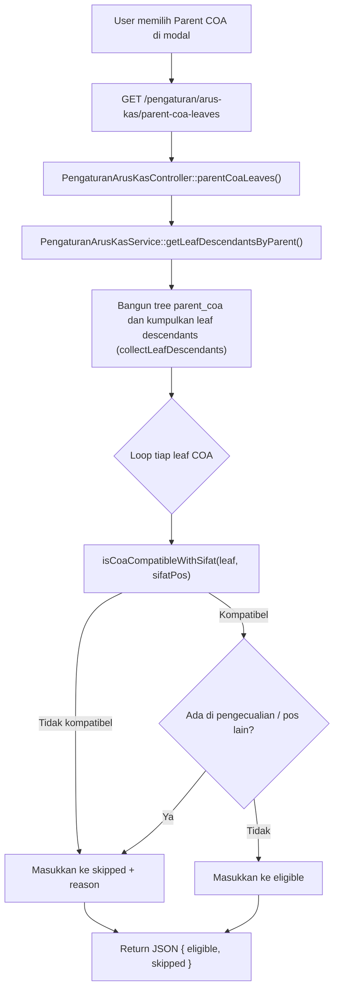
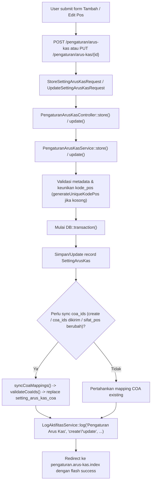
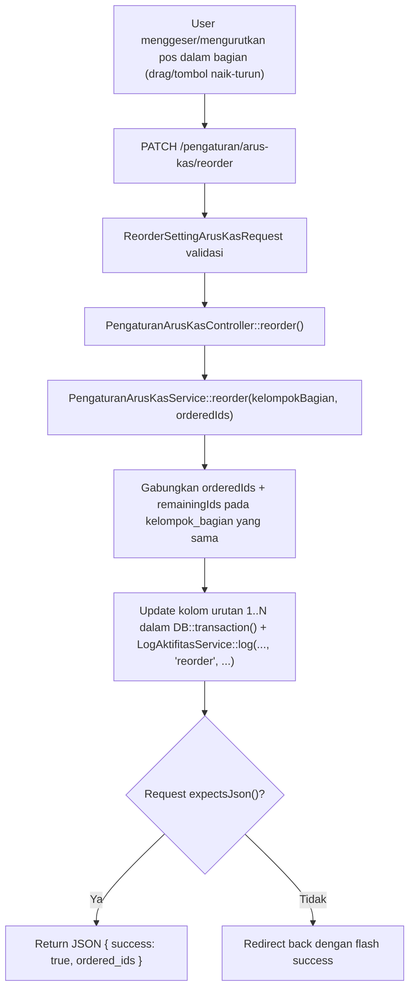
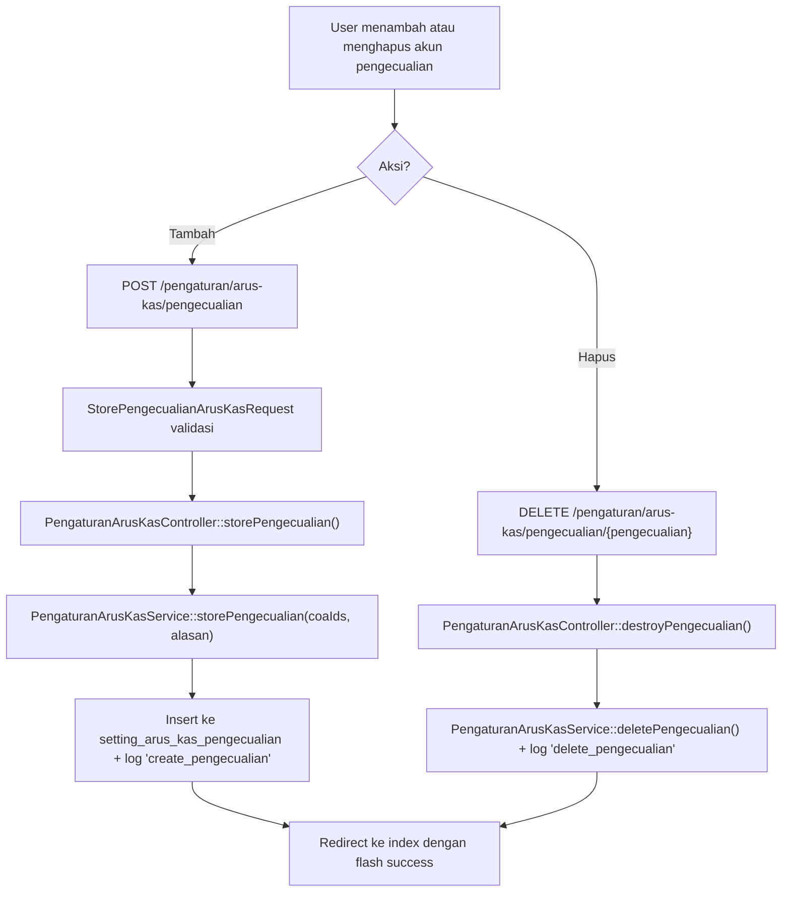

```mermaid
flowchart TD
    A["User klik Toggle Status atau Hapus Pos"] --> B{"Aksi?"}
    B -- Toggle --> C["PATCH /pengaturan/arus-kas/{id}/toggle"]
    C --> D["PengaturanArusKasController::toggleStatus()"]
    D --> E["PengaturanArusKasService::toggleStatus() dalam DB::transaction()"]
    E --> F["Invert is_active, save(), LogAktifitasService::log(..., 'toggle', ...)"]
    F --> G["Redirect back dengan flash status baru"]
    B -- Hapus --> H["DELETE /pengaturan/arus-kas/{id}"]
    H --> I["PengaturanArusKasController::destroy()"]
    I --> J["PengaturanArusKasService::delete() dalam DB::transaction()"]
    J --> K["Hapus mappingCoa(), hapus pos, LogAktifitasService::log(..., 'delete', ...)"]
    K --> L["Redirect ke pengaturan.arus-kas.index dengan flash success"]
```

# Dokumentasi Modul Pengaturan — Pengaturan Arus Kas

## Ringkasan Modul

Modul **Pengaturan — Pengaturan Arus Kas** digunakan untuk:

1. Mengelola konfigurasi dinamis pos-pos **Laporan Arus Kas (Metode Tidak Langsung)** pada 4 kelompok bagian (`penyesuaian_laba`, `modal_kerja`, `investasi`, `pendanaan`),
2. Memetakan akun leaf COA (*Chart of Accounts*) ke masing-masing pos arus kas dengan jaminan eksklusivitas satu akun per pos (`UNIQUE(coa_id)`), termasuk fitur ekspansi otomatis turunan akun induk (*parent COA*),
3. Mengatur urutan tampilan pos di dalam setiap bagian laporan (*reorder*) dan status aktif/nonaktif pos tanpa merusak data historis,
4. Mengelola daftar pengecualian akun Neraca (`setting_arus_kas_pengecualian`) seperti akun kontra akumulasi penyusutan dan penyisihan piutang agar tidak muncul sebagai akun belum dipetakan,
5. Mendeteksi akun Neraca non-Kasbank yang bermutasi pada tahun berjalan tetapi belum dipetakan ke pos aktif maupun dimasukkan ke daftar pengecualian.

Implementasi utama modul ini berada di:

- `routes/web.php`
- `app/Http/Controllers/Pengaturan/PengaturanArusKasController.php`
- `app/Http/Requests/Pengaturan/StoreSettingArusKasRequest.php`
- `app/Http/Requests/Pengaturan/UpdateSettingArusKasRequest.php`
- `app/Http/Requests/Pengaturan/ReorderSettingArusKasRequest.php`
- `app/Http/Requests/Pengaturan/StorePengecualianArusKasRequest.php`
- `app/Services/Pengaturan/PengaturanArusKasService.php`
- `app/Models/SettingArusKas.php`
- `app/Models/SettingArusKasCoa.php`
- `app/Models/SettingArusKasPengecualian.php`
- `database/migrations/2026_11_25_000001_create_setting_arus_kas_tables.php`
- `database/migrations/2026_11_25_000002_add_pengaturan_arus_kas_access_module.php`
- `database/seeders/SettingArusKasSeeder.php`
- `app/Services/Laporan/LaporanKeuanganService.php` (konsumsi konfigurasi dinamis pada metode tidak langsung)
- `resources/views/pengaturan/arus-kas/index.blade.php`

---

## Entry Point / API

Semua endpoint dilindungi oleh middleware otorisasi `module.access:pengaturan.arus-kas,<aksi>`.

| Method | Path | Route Name | Controller Method | Izin Diperlukan |
| --- | --- | --- | --- | --- |
| `GET` | `/pengaturan/arus-kas` | `pengaturan.arus-kas.index` | `index()` | `pengaturan.arus-kas,view` |
| `GET` | `/pengaturan/arus-kas/parent-coa-leaves` | `pengaturan.arus-kas.parent-coa-leaves` | `parentCoaLeaves()` | `pengaturan.arus-kas,view` |
| `POST` | `/pengaturan/arus-kas` | `pengaturan.arus-kas.store` | `store()` | `pengaturan.arus-kas,create` |
| `PUT` | `/pengaturan/arus-kas/{settingArusKas}` | `pengaturan.arus-kas.update` | `update()` | `pengaturan.arus-kas,update` |
| `PATCH` | `/pengaturan/arus-kas/{settingArusKas}/toggle` | `pengaturan.arus-kas.toggle` | `toggleStatus()` | `pengaturan.arus-kas,update` |
| `PATCH` | `/pengaturan/arus-kas/reorder` | `pengaturan.arus-kas.reorder` | `reorder()` | `pengaturan.arus-kas,update` |
| `DELETE` | `/pengaturan/arus-kas/{settingArusKas}` | `pengaturan.arus-kas.destroy` | `destroy()` | `pengaturan.arus-kas,delete` |
| `POST` | `/pengaturan/arus-kas/pengecualian` | `pengaturan.arus-kas.pengecualian.store` | `storePengecualian()` | `pengaturan.arus-kas,create` |
| `DELETE` | `/pengaturan/arus-kas/pengecualian/{pengecualian}` | `pengaturan.arus-kas.pengecualian.destroy` | `destroyPengecualian()` | `pengaturan.arus-kas,delete` |

---

## Alur 1: Menampilkan Daftar Pos, Pengecualian & Deteksi Akun Belum Dipetakan

Halaman utama menampilkan ringkasan pos laporan arus kas tidak langsung, daftar akun pengecualian, serta banner peringatan apabila ada akun Neraca non-Kasbank yang bermutasi di buku besar tahun berjalan tetapi belum dipetakan atau dikecualikan. Antarmuka mendukung dua mode tampilan: **Mode Tab** (tab `Semua Pos`, `Penyesuaian Laba`, `Modal Kerja`, `Investasi`, `Pendanaan`, `Akun Dikecualikan`) dan **Mode Struktur Laporan**.

Fitur UI/UX utama antarmuka:
- **Pencarian Terpadu (Mode Tab)**: Kolom pencarian di `#filterToolbar` mengisi seluruh ruang kosong horizontal (`flex-grow-1`). Pengguna cukup menekan tombol `Enter` untuk melakukan filter, dan tombol reset disediakan melalui ikon silang (`x`) di dalam kotak pencarian.
- **Tampilan Ringkas COA**: Kolom terpisah "Akun COA Terpetakan" ditiadakan untuk menghemat ruang tabel. Sebagai gantinya, pada kolom "Pos Arus Kas" terdapat badge interaktif jumlah akun (`[X Akun COA]`) yang dapat diklik untuk membuka modal detail daftar COA terpetakan (`modalDetailCoaPos`) lengkap dengan fitur pencarian instan. Pos tanpa akun ditandai dengan badge peringatan `0 Akun`.
- **Badge Status Pos**: Kolom status menggunakan badge statis `Aktif` / `Nonaktif`. Pengubahan status pos dilakukan melalui form modal Edit Pos.
- **Accordion / Collapsible (Mode Struktur Laporan)**: Setiap kelompok bagian (`Penyesuaian Laba`, `Modal Kerja`, `Investasi`, `Pendanaan`, dan `Akun Dikecualikan`) dapat dilipat/dibuka (*collapse/show*) secara mandiri dengan indikator chevron berputar halus, serta disediakan tombol global *Buka Semua* dan *Tutup Semua*.

### Flowchart

### Algoritma

1. `PengaturanArusKasController::index()` membaca query parameter `tab` (valid: `semua`, `penyesuaian_laba`, `modal_kerja`, `investasi`, `pendanaan`, `pengecualian`; default `'semua'`) dan `search`.
2. Controller mengambil seluruh `SettingArusKas` terurut (`urut()` -> terurut per kelompok bagian laporan `penyesuaian_laba` -> `modal_kerja` -> `investasi` -> `pendanaan`, lalu `orderBy('urutan')->orderBy('id')`) beserta relasi `coas` (terurut `kode`), dan seluruh `SettingArusKasPengecualian` beserta relasi `coa`.
3. Controller menghitung `tabCounts` untuk keenam tab.
4. Controller memanggil `PengaturanArusKasService::getUnmappedMutatedNeracaAccounts()` (default periode awal sampai akhir tahun berjalan) yang:
   - Mengambil `coa_id` yang sudah dipetakan ke pos **aktif** (`setting_arus_kas.is_active = true`) dan `coa_id` di tabel `setting_arus_kas_pengecualian`.
   - Mengagregasi mutasi `bukubesar` pada periode tersebut untuk akun Neraca non-Kasbank (bukan `Kasbank` dan bukan `SettingArusKas::TIPE_LABA_RUGI`, termasuk akun berstatus nonaktif) yang tidak termasuk dalam daftar terabaikan.
   - Menyaring akun dengan nilai `abs(debit) >= 0.005 || abs(kredit) >= 0.005` dan menghitung `dampak_kas = kredit - debit`.
5. Controller memanggil `PengaturanArusKasService::getCoaOptionsData()` untuk menyiapkan `leafCoas` (non-Kasbank, non-parent), `parentCoas`, `mappedByPos`, dan `excludedCoaIds` bagi modal tambah/edit/pengecualian.
6. View `pengaturan.arus-kas.index` memfilter daftar berdasarkan `activeTab` dan `search` serta merender banner tindakan cepat (Petakan / Kecualikan) bila `unmappedAccounts` tidak kosong.

### Fungsi yang Dipanggil

- `PengaturanArusKasController::index(Request $request)`
- `SettingArusKas::query()->with(...)->urut()->get()`
- `SettingArusKasPengecualian::query()->with('coa')->orderBy('id')->get()`
- `PengaturanArusKasService::getUnmappedMutatedNeracaAccounts(?string $startDate = null, ?string $endDate = null)`
- `PengaturanArusKasService::getCoaOptionsData()`

---

## Alur 2: Ekspansi Akun Induk (Parent COA) ke Leaf COA

Ketika pengguna memilih satu akun induk (*parent COA*) di modal Tambah/Edit Pos atau modal Tambah Pengecualian, frontend memanggil endpoint AJAX untuk mengekspansi seluruh akun daun (*leaf descendants*) di bawah parent tersebut dan mengklasifikasikannya menjadi `eligible` (siap dipilih) atau `skipped` (dilewati beserta alasannya).

### Validasi Request

`PengaturanArusKasController::parentCoaLeaves()` memvalidasi query parameter secara langsung:

- `parent_id`: wajib (`required`), integer, minimal `1`.
- `sifat_pos`: opsional (`nullable`), string, bernilai salah satu dari `SettingArusKas::SIFAT_POS` (`aset`, `liabilitas`, `ekuitas`, `penambah_laba`, `pengurang_laba`) atau `'pengecualian'`.
- `ignore_pos_id`: opsional (`nullable`), integer, minimal `1` (digunakan saat mode edit agar COA milik pos yang sedang diedit tidak dianggap bentrok).

### Flowchart

### Algoritma

1. Request diterima `PengaturanArusKasController::parentCoaLeaves()` dan divalidasi.
2. `PengaturanArusKasService::getLeafDescendantsByParent()` memuat seluruh COA dan menyusun peta `parent_coa -> children`.
3. Method rekursif `collectLeafDescendants()` menelusuri seluruh turunan dengan guard `$visited` untuk mencegah siklus tak hingga hingga menemukan seluruh node tanpa anak (*leaf*).
4. Daftar leaf diurutkan berdasarkan `kode`, lalu untuk setiap leaf diperiksa berurutan:
   - **Kompatibilitas `sifat_pos`** melalui `isCoaCompatibleWithSifat()`: menolak `Kasbank`, memastikan `penambah_laba`/`pengurang_laba` hanya menerima akun Laba Rugi (`TIPE_LABA_RUGI`) yang berstatus aktif (`status_aktif = 1`), serta memastikan `aset`/`liabilitas`/`ekuitas`/`pengecualian` hanya menerima akun Neraca non-Kasbank.
   - **Daftar pengecualian** melalui `loadExcludedCoaIdSet()`: jika sudah ada di `setting_arus_kas_pengecualian`, masuk `skipped`.
   - **Pemetaan existing** melalui `loadMappedByPosMap()`: jika sudah dipetakan ke pos lain (selain `ignoreSettingArusKasId`), masuk `skipped` dengan keterangan nama pos pemegang (dan penanda `(Nonaktif)` bila pos pemegangnya tidak aktif).
5. Leaf yang lolos seluruh pengecekan masuk ke `eligible`, lalu controller mengembalikan respons JSON `{ eligible, skipped }`.

### Fungsi yang Dipanggil

- `PengaturanArusKasController::parentCoaLeaves(Request $request)`
- `PengaturanArusKasService::getLeafDescendantsByParent(int $parentId, ?string $sifatPos = null, ?int $ignoreSettingArusKasId = null)`
- `PengaturanArusKasService::collectLeafDescendants(...)`
- `PengaturanArusKasService::isCoaCompatibleWithSifat(Coa $coa, ?string $sifatPos)`
- `PengaturanArusKasService::loadMappedByPosMap(?array $filterCoaIds = null)`
- `PengaturanArusKasService::loadExcludedCoaIdSet(?array $filterCoaIds = null)`

---

## Alur 3: Menambah & Mengubah Pos Arus Kas serta Sinkronisasi COA

### Validasi Request

`StoreSettingArusKasRequest` memvalidasi pembuatan pos baru (dan diwarisi oleh `UpdateSettingArusKasRequest` untuk pembaruan):

- **Sanitasi Pra-Validasi (`prepareForValidation`)**:
  - `nama_pos`: trim dan mereduksi spasi berulang menjadi spasi tunggal.
  - `kode_pos`: trim; jika kosong diubah menjadi `null`.
  - `pakai_prefix_perubahan` dan `is_active`: dinormalisasi ke boolean bila dikirim.
- **Aturan (`rules`)**:
  - `kode_pos`: opsional (`nullable`), string, maksimal `80` karakter, unik pada `setting_arus_kas.kode_pos` (`UpdateSettingArusKasRequest` mengabaikan ID pos yang sedang diubah via `settingArusKasId()`).
  - `nama_pos`: wajib (`required`), string, maksimal `150` karakter.
  - `kelompok_bagian`: wajib (`required`), string, salah satu dari `SettingArusKas::KELOMPOK_BAGIAN` (`penyesuaian_laba`, `modal_kerja`, `investasi`, `pendanaan`).
  - `sifat_pos`: wajib (`required`), string, salah satu dari `SettingArusKas::SIFAT_POS` (`aset`, `liabilitas`, `ekuitas`, `penambah_laba`, `pengurang_laba`).
  - `pakai_prefix_perubahan`: opsional (`nullable`), boolean.
  - `urutan`: wajib (`required`), integer, minimal `1`.
  - `is_active`: opsional (`nullable`), boolean.
  - `coa_ids`: opsional (`nullable`), array.
  - `coa_ids.*`: integer, `distinct`, `exists:coa,id`.
- **Validasi Kustom (`after`)**: Memanggil `PengaturanArusKasService::validateCoaIdsForValidator()` untuk memvalidasi setiap elemen `coa_ids` (harus leaf COA, kompatibel dengan `sifat_pos`, tidak berada di `setting_arus_kas_pengecualian`, dan belum dipetakan ke pos lain) dengan pesan error per indeks `coa_ids.{index}`.

### Flowchart

### Algoritma

1. Pada `store()`:
   - Request divalidasi oleh `StoreSettingArusKasRequest`.
   - `PengaturanArusKasService::store()` membersihkan `nama_pos` dengan `sanitizeName()`, memvalidasi metadata (`assertValidPosMetadata()`), dan membentuk `kode_pos` otomatis via `generateUniqueKodePos()` (prefiks `PL_`, `MK_`, `INV_`, `PEND_`) jika `kode_pos` dikosongkan.
   - Jika `urutan` tidak numerik, urutan diisi `max(urutan) + 1` pada bagian terkait.
   - Di dalam `DB::transaction()`, record `SettingArusKas` dibuat, lalu `syncCoaMappings()` memvalidasi dan menyisipkan baris ke `setting_arus_kas_coa`, diakhiri pencatatan audit log melalui `LogAktifitasService::log(self::LOG_MODUL, 'create', null, snapshot)`.
2. Pada `update()`:
   - Request divalidasi oleh `UpdateSettingArusKasRequest` (mengecualikan `settingArusKas` saat cek unik `kode_pos`).
   - Di dalam `DB::transaction()`, service menyimpan snapshot lama, memvalidasi metadata dan keunikan `kode_pos`, lalu memperbarui `SettingArusKas`.
   - Jika `coa_ids` dikirim pada payload, `syncCoaMappings()` mengganti mapping pos tersebut; jika `coa_ids` tidak dikirim tetapi `sifat_pos` berubah, service memvalidasi ulang `coa_ids` existing terhadap `sifat_pos` baru (mencegah akun Laba Rugi tertinggal pada pos Neraca atau sebaliknya).
   - Mencatat audit log `update` dengan snapshot lama dan baru.
3. Jika service melempar `DomainException`, controller menangkapnya dan mengembalikan redirect `back()->withInput()->with('error', ...)`.

### Fungsi yang Dipanggil

- `StoreSettingArusKasRequest::prepareForValidation()`, `rules()`, `after()`
- `UpdateSettingArusKasRequest::settingArusKasId()`
- `PengaturanArusKasController::store(StoreSettingArusKasRequest $request)`
- `PengaturanArusKasController::update(UpdateSettingArusKasRequest $request, SettingArusKas $settingArusKas)`
- `PengaturanArusKasService::store(array $data)`
- `PengaturanArusKasService::update(SettingArusKas $settingArusKas, array $data)`
- `PengaturanArusKasService::generateUniqueKodePos(string $kelompokBagian, string $namaPos, ?int $ignoreId = null)`
- `PengaturanArusKasService::syncCoaMappings(SettingArusKas $pos, array $coaIds, string $sifatPos)`
- `PengaturanArusKasService::validateCoaIds(array $coaIds, string $modeOrSifatPos, ?int $ignoreSettingArusKasId = null)`
- `LogAktifitasService::log(...)`

---

## Alur 4: Mengubah Status Aktif / Nonaktif & Menghapus Pos Arus Kas

### Flowchart

### Algoritma

1. **Toggle Status (`toggleStatus()`)**:
   - Controller memanggil `PengaturanArusKasService::toggleStatus($settingArusKas)`.
   - Dalam `DB::transaction()`, service membalik nilai `$settingArusKas->is_active = !$oldStatus`, menyimpannya, dan mencatat audit log bertipe `'toggle'`.
   - Pos berstatus nonaktif tidak dimasukkan dalam kalkulasi laporan dinamis dan tidak dianggap sebagai pemetaan aktif saat deteksi akun belum dipetakan, namun ikatan COA di `setting_arus_kas_coa` tetap dipertahankan.
2. **Hapus Pos (`destroy()`)**:
   - Controller memanggil `PengaturanArusKasService::delete($settingArusKas)`.
   - Dalam `DB::transaction()`, service memuat snapshot lama untuk audit log, menghapus seluruh mapping di `setting_arus_kas_coa` (`$settingArusKas->mappingCoa()->delete()`), menghapus record `SettingArusKas`, dan mencatat log bertipe `'delete'`.

### Fungsi yang Dipanggil

- `PengaturanArusKasController::toggleStatus(SettingArusKas $settingArusKas)`
- `PengaturanArusKasController::destroy(SettingArusKas $settingArusKas)`
- `PengaturanArusKasService::toggleStatus(SettingArusKas $settingArusKas)`
- `PengaturanArusKasService::delete(SettingArusKas $settingArusKas)`
- `LogAktifitasService::log(...)`

---

## Alur 5: Mengubah Urutan Pos dalam Satu Bagian (Reorder)

### Validasi Request

`ReorderSettingArusKasRequest` memvalidasi:

- `kelompok_bagian`: wajib (`required`), string, harus salah satu dari `SettingArusKas::KELOMPOK_BAGIAN`.
- `ordered_ids`: wajib (`required`), array, minimal 1 item.
- `ordered_ids.*`: wajib (`required`), integer, `distinct`, `exists:setting_arus_kas,id`.
- **Validasi Kustom (`after`)**: Memastikan tidak ada ID pada `ordered_ids` yang memiliki `kelompok_bagian` berbeda dari parameter `kelompok_bagian` yang dikirim.

### Flowchart

### Algoritma

1. `ReorderSettingArusKasRequest` memvalidasi `kelompok_bagian` dan `ordered_ids`.
2. `PengaturanArusKasService::reorder()` memvalidasi ulang tidak ada ID duplikat, semua ID ada di DB, dan semuanya berasal dari `$kelompokBagian` yang sama (melempar `DomainException` bila tidak memenuhi).
3. Dalam `DB::transaction()`, service menggabungkan `$ids` dengan pos tersisa di `$kelompokBagian` yang belum tercantum (`remainingIds`, tetap terurut `urut()`), lalu memperbarui `urutan` menjadi `1..N`.
4. Mencatat log aktivitas bertipe `'reorder'`.
5. Controller merespons JSON (`200` / `422` pada `DomainException`) bila `$request->expectsJson()`, atau redirect `back()` pada form submit standar.

### Fungsi yang Dipanggil

- `ReorderSettingArusKasRequest::rules()`, `after()`
- `PengaturanArusKasController::reorder(ReorderSettingArusKasRequest $request)`
- `PengaturanArusKasService::reorder(string $kelompokBagian, array $orderedIds)`
- `LogAktifitasService::log(...)`

---

## Alur 6: Mengelola Daftar Pengecualian Akun COA

### Validasi Request

`StorePengecualianArusKasRequest` memvalidasi:

- **Sanitasi Pra-Validasi (`prepareForValidation`)**: `alasan` di-trim; jika kosong diubah menjadi `null`.
- `coa_ids`: wajib (`required`), array, minimal `1` akun.
- `coa_ids.*`: wajib (`required`), integer, `distinct`, `exists:coa,id`.
- `alasan`: opsional (`nullable`), string, maksimal `255` karakter.
- **Validasi Kustom (`after`)**: Memanggil `PengaturanArusKasService::validateCoaIdsForValidator($validator, $this->input('coa_ids'), 'pengecualian')` guna memastikan hanya leaf COA Neraca non-Kasbank yang belum dipetakan dan belum dikecualikan yang dapat masuk.

### Flowchart

### Algoritma

1. **Tambah Pengecualian (`storePengecualian()`)**:
   - `StorePengecualianArusKasRequest` memvalidasi input dan kelayakan setiap `coa_id` dengan mode `'pengecualian'`.
   - Service menormalisasi ID, memvalidasi ulang via `validateCoaIds(..., 'pengecualian')`, dan menyisipkan baris ke `setting_arus_kas_pengecualian` dalam `DB::transaction()`.
   - Service mencatat log aktivitas bertipe `'create_pengecualian'`.
2. **Hapus Pengecualian (`destroyPengecualian()`)**:
   - Service menyimpan snapshot data lama, menghapus record `SettingArusKasPengecualian` dalam `DB::transaction()`, dan mencatat log aktivitas bertipe `'delete_pengecualian'`.

### Fungsi yang Dipanggil

- `StorePengecualianArusKasRequest::prepareForValidation()`, `rules()`, `after()`
- `PengaturanArusKasController::storePengecualian(StorePengecualianArusKasRequest $request)`
- `PengaturanArusKasController::destroyPengecualian(SettingArusKasPengecualian $pengecualian)`
- `PengaturanArusKasService::storePengecualian(array $coaIds, ?string $alasan = null)`
- `PengaturanArusKasService::deletePengecualian(SettingArusKasPengecualian $pengecualian)`
- `SettingArusKasSeeder::run()` (menyemai pos default, pengecualian awal akun kontra `142`–`147` serta `112.09`/`112.08.09`, dan pemetaan COA awal secara idempoten)
- `LogAktifitasService::log(...)`

---

## Catatan Penting Bisnis

1. **Batasan Unik `UNIQUE(coa_id)` & Eksklusivitas Lintas Tabel (*Cross-Table Exclusivity*)**:
   - Baik tabel `setting_arus_kas_coa` maupun `setting_arus_kas_pengecualian` menerapkan constraint `UNIQUE(coa_id)`.
   - Satu akun COA hanya dapat dipetakan ke **maksimal satu** pos arus kas, dan tidak boleh berada di `setting_arus_kas_coa` sekaligus `setting_arus_kas_pengecualian`.
   - Akun induk (*parent COA*) dan akun bertipe `Kasbank` tidak pernah diizinkan masuk ke pemetaan maupun pengecualian.
2. **Aturan `sifat_pos` dan `pakai_prefix_perubahan`**:
   - Nilai `sifat_pos` terbagi dua kategori:
     - **Sifat Laba Rugi** (`penambah_laba`, `pengurang_laba`): hanya kompatibel dengan akun bertipe `SettingArusKas::TIPE_LABA_RUGI` (`Pendapatan`, `Pendapatan lain`, `Beban`, `Beban lain`, `Beban Pokok Penjualan`) yang berstatus **aktif** (`status_aktif = 1`).
     - **Sifat Neraca** (`aset`, `liabilitas`, `ekuitas`) dan mode `pengecualian`: hanya kompatibel dengan akun Neraca non-Kasbank.
   - `SettingArusKas::formatLabelPos(float $perubahan)` menambahkan prefix dinamis sesuai arah perubahan apabila `pakai_prefix_perubahan = true` dan `sifat_pos` bukan sifat Laba Rugi:
     - `aset`: `(Kenaikan) ` bila `perubahan > 0.005`, `Penurunan ` bila `< -0.005`, dan `Penurunan (kenaikan) ` bila mendekati nol.
     - `liabilitas` / `ekuitas`: `Kenaikan ` bila `perubahan > 0.005`, `(Penurunan) ` bila `< -0.005`, dan `Kenaikan (penurunan) ` bila mendekati nol.
3. **Penanganan Akun Neraca Nonaktif Historis**:
   - Berbeda dengan akun Laba Rugi nonaktif (yang ditolak), akun **Neraca nonaktif** (`status_aktif != 1`) **tetap diizinkan** untuk dipetakan ke pos Neraca maupun dimasukkan ke daftar pengecualian, serta tetap dipindai oleh `getUnmappedMutatedNeracaAccounts()`. Hal ini memastikan akun Neraca historis yang sudah dinonaktifkan tetapi masih memiliki mutasi pada periode laporan lampau tetap dapat dipetakan agar rekonsiliasi saldo kas akurat.
4. **Deteksi Akun Belum Dipetakan Saat Pos Dinonaktifkan**:
   - Ketika sebuah pos diubah menjadi nonaktif (`is_active = false`), baris pada `setting_arus_kas_coa` tidak dihapus sehingga histori pemetaannya terjaga (dan pos lain tetap tidak dapat mengklaim COA tersebut kecuali dilepas terlebih dahulu).
   - Namun, pada `getUnmappedMutatedNeracaAccounts()` maupun laporan dinamis (`LaporanKeuanganService`), hanya COA milik pos **aktif** (`is_active = true`) yang dianggap sudah terpetakan. Oleh karena itu, jika pos Neraca dinonaktifkan dan akun-akunnya memiliki mutasi, akun tersebut otomatis terdeteksi sebagai **belum dipetakan** agar mutasinya tidak hilang dari rekonsiliasi kas.
5. **Audit Trail & Idempotensi Seeder**:
   - Seluruh operasi tulis (`create`, `update`, `toggle`, `reorder`, `delete`, `create_pengecualian`, `delete_pengecualian`) dicatat ke `LogAktifitasService` dengan nama modul `'Pengaturan Arus Kas'`.
   - `SettingArusKasSeeder` bersifat idempoten: ia hanya mengisi `setting_arus_kas_pengecualian` awal bila tabel pengecualian masih kosong dan hanya mengisi mapping COA awal apabila tabel pivot masih kosong atau pos terkait baru dibuat, sehingga perubahan manual pengguna tidak tertimpa saat seeder dijalankan ulang.
