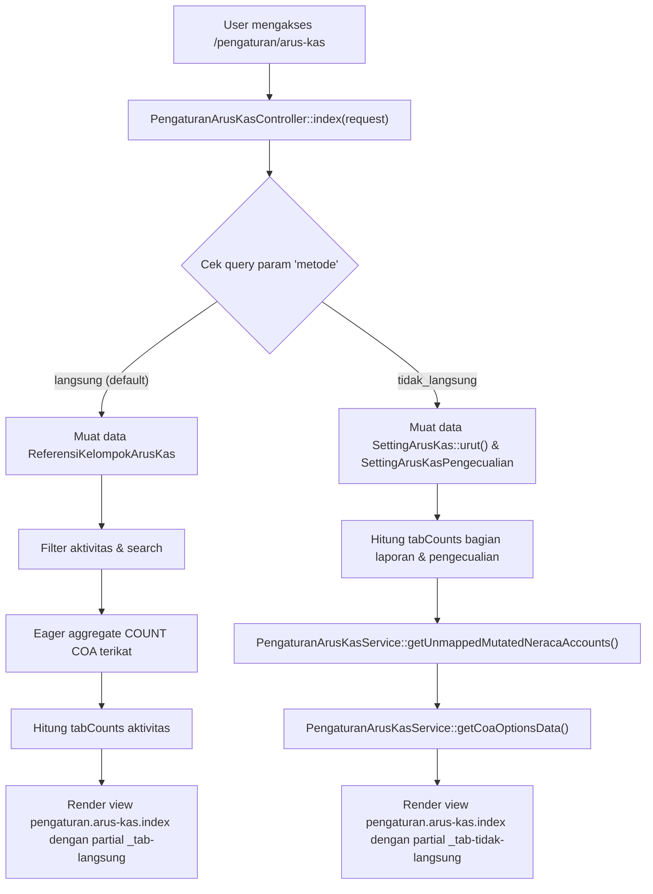
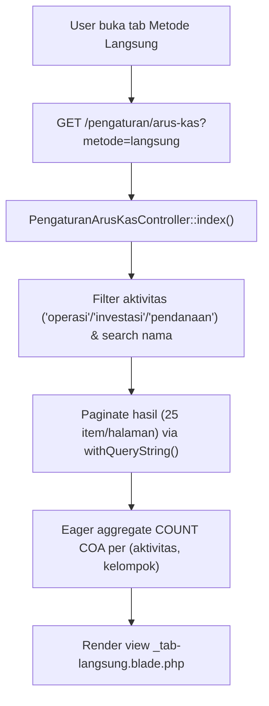
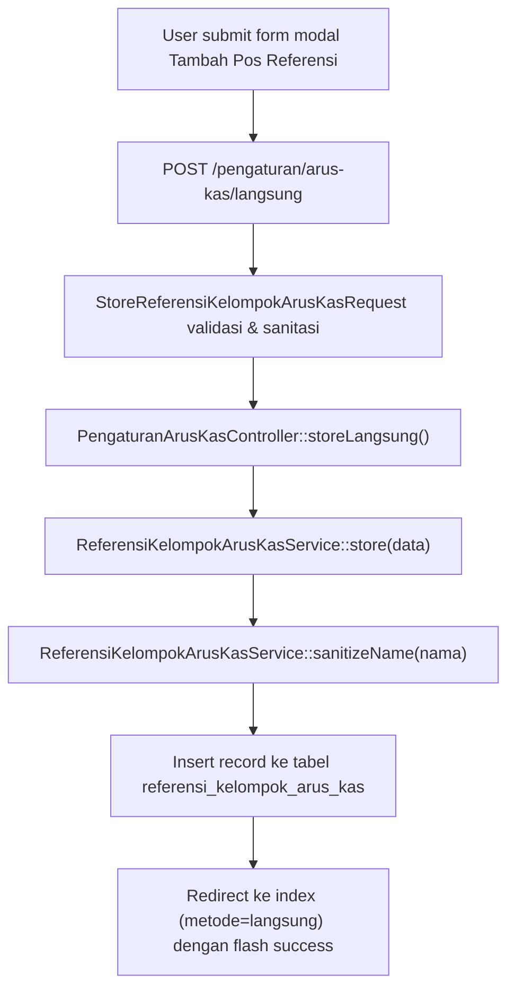
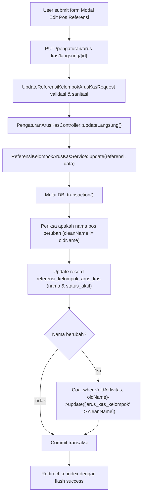
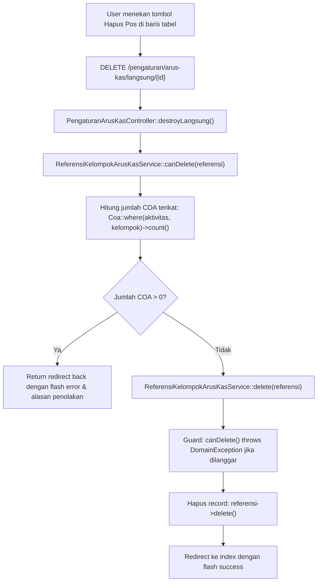
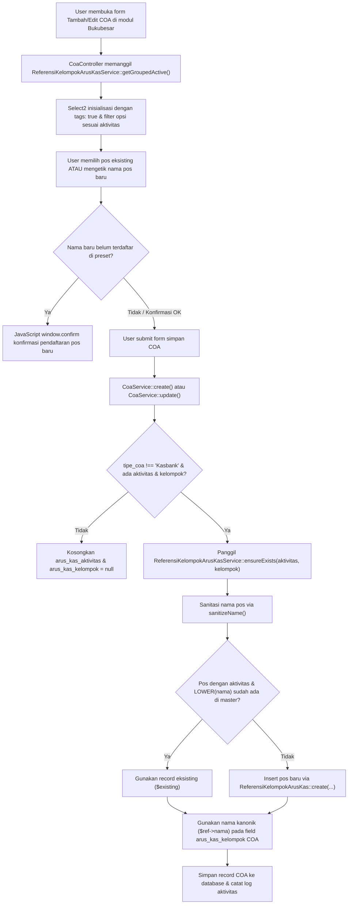
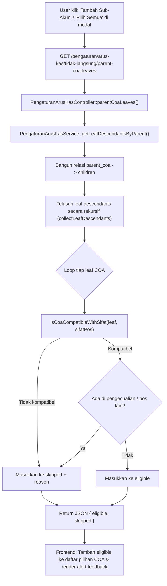
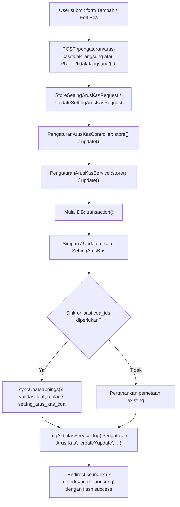
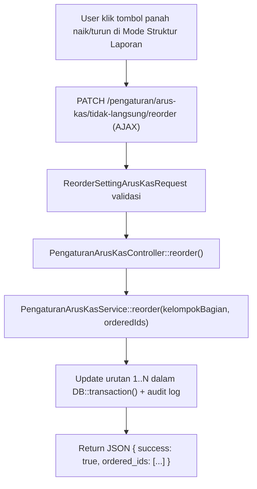

# Dokumentasi Modul Pengaturan — Pengaturan Arus Kas

## Ringkasan Modul

Modul **Pengaturan — Pengaturan Arus Kas** merupakan pusat konfigurasi pelaporan arus kas terpadu di SiAkurat yang menyatukan pengaturan untuk dua metode standar akuntansi keuangan:

1. **Metode Langsung (*Direct Cash Flow*)**:
   - Mengelola master pos referensi kelompok arus kas terstandarisasi untuk 3 pilar aktivitas (`operasi`, `investasi`, dan `pendanaan`) yang terikat langsung pada bagan akun COA (*Chart of Accounts*) melalui kolom `arus_kas_aktivitas` dan `arus_kas_kelompok`.
   - Mengeliminasi inkonsistensi pengetikan manual (typo, spasi berlebih, inkonsistensi kapitalisasi) melalui sanitasi nama dan validasi keunikan *case-insensitive*.
   - Melakukan pembaruan massal berantai (*cascade update*) otomatis ke akun-akun COA terkait ketika nama kelompok arus kas diperbarui di dalam satu transaksi database atomik.
   - Melindungi integritas data keuangan dengan memblokir penghapusan (*restricted delete*) apabila suatu pos referensi masih terikat pada satu atau lebih akun COA.
   - Menyediakan sinkronisasi otomatis (*auto-insert* / *auto-tagging*) dengan konfirmasi pengguna saat menginput nama kelompok baru langsung melalui form master COA (`CoaService::create` / `update`).
   - Menyediakan data preset kelompok aktif terkelompok per aktivitas (`getGroupedActive()`) untuk dropdown Select2 interaktif pada form master COA.
2. **Metode Tidak Langsung (*Indirect Cash Flow*)**:
   - Mengelola konfigurasi dinamis pos laporan arus kas tidak langsung yang dikelompokkan ke dalam 4 bagian laporan:
     - Penyesuaian Laba (`penyesuaian_laba`),
     - Modal Kerja Operasi (`modal_kerja`),
     - Aktivitas Investasi (`investasi`), dan
     - Aktivitas Pendanaan (`pendanaan`).
   - Pemetaan akun buku besar detail (*leaf-only mapping*) ke pos arus kas dengan jaminan keunikan eksklusif satu akun per pos (`UNIQUE(coa_id)`).
   - Fitur **Pilih Cepat Akun Induk (*Parent COA Expansion*)** untuk mengekspansi seluruh turunan daun (*leaf descendants*) secara rekursif otomatis dengan pemisahan akun yang memenuhi syarat (*eligible*) dan yang dilewati (*skipped*).
   - Penyusunan dan penataan urutan pos (*reordering*) di setiap kelompok bagian laporan secara instan melalui tombol kontrol naik/turun dan API AJAX.
   - Pengelolaan daftar akun Neraca non-Kasbank yang dikecualikan (*exclusion list*) pada tabel `setting_arus_kas_pengecualian` (seperti akumulasi penyusutan atau penyisihan piutang) agar tidak memicu peringatan selisih pemetaan.
   - Pemindaian otomatis akun Neraca bermutasi yang belum dipetakan (*unmapped mutated Neraca accounts scanner*) lengkap dengan pintasan **Tindakan Cepat (Petakan / Kecualikan)**.
3. **Antarmuka Terpadu Dua Tab & Pengendalian Hak Akses Tunggal**:
   - Seluruh pengelolaan disajikan dalam satu halaman indeks terpadu dengan navigasi tab utama:
     - Tab **Metode Langsung** (`?metode=langsung` / default)
     - Tab **Metode Tidak Langsung** (`?metode=tidak_langsung`)
   - Masing-masing tab memiliki toolbar filter tersendiri (filter dropdown `aktivitas` untuk metode langsung, filter dropdown `bagian` untuk metode tidak langsung, dan input pencarian teks fleksibel).
   - Seluruh endpoint diamankan menggunakan **satu modul otorisasi tunggal** di RBAC: `pengaturan.arus-kas` (dengan aksi `view`, `create`, `update`, `delete`).

Implementasi utama modul ini berada di:

- `routes/web.php`
- `app/Http/Controllers/Pengaturan/PengaturanArusKasController.php`
- `app/Http/Requests/Pengaturan/StoreReferensiKelompokArusKasRequest.php`
- `app/Http/Requests/Pengaturan/UpdateReferensiKelompokArusKasRequest.php`
- `app/Http/Requests/Pengaturan/StoreSettingArusKasRequest.php`
- `app/Http/Requests/Pengaturan/UpdateSettingArusKasRequest.php`
- `app/Http/Requests/Pengaturan/ReorderSettingArusKasRequest.php`
- `app/Http/Requests/Pengaturan/StorePengecualianArusKasRequest.php`
- `app/Services/Pengaturan/ReferensiKelompokArusKasService.php`
- `app/Services/Pengaturan/PengaturanArusKasService.php`
- `app/Models/ReferensiKelompokArusKas.php`
- `app/Models/SettingArusKas.php`
- `app/Models/SettingArusKasCoa.php`
- `app/Models/SettingArusKasPengecualian.php`
- `app/Support/AccessModuleRegistry.php` (kode: `pengaturan.arus-kas`, urutan: 206)
- `database/migrations/2026_11_24_000001_create_referensi_kelompok_arus_kas_table.php`
- `database/migrations/2026_11_24_000002_add_referensi_kelompok_arus_kas_access_module.php`
- `database/migrations/2026_11_25_000001_create_setting_arus_kas_tables.php`
- `database/migrations/2026_11_25_000002_add_pengaturan_arus_kas_access_module.php`
- `database/migrations/2026_11_26_000001_merge_referensi_kelompok_arus_kas_into_pengaturan_arus_kas_module.php`
- `database/seeders/ReferensiKelompokArusKasSeeder.php`
- `database/seeders/SettingArusKasSeeder.php`
- `resources/views/pengaturan/arus-kas/index.blade.php`
- `resources/views/pengaturan/arus-kas/partials/_tab-langsung.blade.php`
- `resources/views/pengaturan/arus-kas/partials/_tab-tidak-langsung.blade.php`
- `resources/views/pengaturan/arus-kas/partials/_modal-panduan.blade.php`
- `resources/views/pengaturan/arus-kas/partials/_modals.blade.php`
- `resources/views/pengaturan/arus-kas/partials/_scripts.blade.php`

Komponen terkait di modul lain:
- `app/Http/Controllers/Bukubesar/CoaController.php` (injeksi preset referensi aktif ke form create & edit COA)
- `app/Services/Bukubesar/CoaService.php` (konsumsi auto-insert `ensureExists()` dan proteksi akun Kasbank)
- `resources/views/bukubesar/coa/_form.blade.php` & `_scripts.blade.php` (antarmuka Select2 tagging dengan konfirmasi penambahan pos baru)
- `app/Services/Laporan/LaporanKeuanganService.php` (penyusunan Laporan Arus Kas Metode Langsung via COA tags & Metode Tidak Langsung dinamis via `SettingArusKas`)
- `resources/views/laporan/keuangan/arus-kas-tidak-langsung.blade.php` (warning banner deteksi unmapped accounts dengan tautan langsung ke `?metode=tidak_langsung`)

---

## Entry Point / API

Seluruh 13 endpoint dilindungi oleh middleware otorisasi berbasis modul `module.access:pengaturan.arus-kas,<aksi>`.

| Method | Path | Route Name | Controller Method | Izin Diperlukan | Keterangan |
| --- | --- | --- | --- | --- | --- |
| `GET` | `/pengaturan/arus-kas` | `pengaturan.arus-kas.index` | `index()` | `pengaturan.arus-kas,view` | Halaman utama (tab Langsung / Tidak Langsung) |
| `POST` | `/pengaturan/arus-kas/langsung` | `pengaturan.arus-kas.langsung.store` | `storeLangsung()` | `pengaturan.arus-kas,create` | Tambah pos referensi kelompok baru (Langsung) |
| `PUT` | `/pengaturan/arus-kas/langsung/{referensi}` | `pengaturan.arus-kas.langsung.update` | `updateLangsung()` | `pengaturan.arus-kas,update` | Edit pos referensi kelompok & cascade COA (Langsung) |
| `DELETE` | `/pengaturan/arus-kas/langsung/{referensi}` | `pengaturan.arus-kas.langsung.destroy` | `destroyLangsung()` | `pengaturan.arus-kas,delete` | Hapus pos referensi kelompok (Restricted Delete) |
| `PATCH` | `/pengaturan/arus-kas/langsung/{referensi}/toggle` | `pengaturan.arus-kas.langsung.toggle` | `toggleStatusLangsung()` | `pengaturan.arus-kas,update` | Toggle status aktif/nonaktif pos referensi |
| `GET` | `/pengaturan/arus-kas/tidak-langsung/parent-coa-leaves` | `pengaturan.arus-kas.tidak-langsung.parent-coa-leaves` | `parentCoaLeaves()` | `pengaturan.arus-kas,view` | AJAX ekspansi child COA daun dari parent |
| `POST` | `/pengaturan/arus-kas/tidak-langsung` | `pengaturan.arus-kas.tidak-langsung.store` | `store()` | `pengaturan.arus-kas,create` | Tambah pos arus kas baru (Tidak Langsung) |
| `PUT` | `/pengaturan/arus-kas/tidak-langsung/{settingArusKas}` | `pengaturan.arus-kas.tidak-langsung.update` | `update()` | `pengaturan.arus-kas,update` | Edit pos arus kas & sync COA (Tidak Langsung) |
| `DELETE` | `/pengaturan/arus-kas/tidak-langsung/{settingArusKas}` | `pengaturan.arus-kas.tidak-langsung.destroy` | `destroy()` | `pengaturan.arus-kas,delete` | Hapus pos arus kas dinamis (Tidak Langsung) |
| `PATCH` | `/pengaturan/arus-kas/tidak-langsung/{settingArusKas}/toggle` | `pengaturan.arus-kas.tidak-langsung.toggle` | `toggleStatus()` | `pengaturan.arus-kas,update` | Toggle status aktif pos arus kas (Tidak Langsung) |
| `PATCH` | `/pengaturan/arus-kas/tidak-langsung/reorder` | `pengaturan.arus-kas.tidak-langsung.reorder` | `reorder()` | `pengaturan.arus-kas,update` | AJAX reordering urutan pos per bagian laporan |
| `POST` | `/pengaturan/arus-kas/tidak-langsung/pengecualian` | `pengaturan.arus-kas.tidak-langsung.pengecualian.store` | `storePengecualian()` | `pengaturan.arus-kas,create` | Tambah akun Neraca ke daftar pengecualian |
| `DELETE` | `/pengaturan/arus-kas/tidak-langsung/pengecualian/{pengecualian}` | `pengaturan.arus-kas.tidak-langsung.pengecualian.destroy` | `destroyPengecualian()` | `pengaturan.arus-kas,delete` | Hapus akun dari daftar pengecualian |

---

## Struktur Antarmuka & Alur Navigasi Utama

Halaman utama menyajikan antarmuka terpadu yang memadukan Header Card, tab navigasi metode pelaporan, filter toolbar dinamis, serta modal interaktif.

### Fitur Antarmuka & UX

1. **Header Card Terpadu**:
   - Tombol kembali melingkar (`rounded-circle`) yang mengarah ke dashboard (`route('home')`).
   - Judul modul: **Pengaturan Arus Kas**, dilengkapi badge status `Master & Pemetaan` dan ringkasan fungsi modul.
   - Tautan kontekstual **Laporan Arus Kas** (tampil bila pengguna memiliki izin `laporan.keuangan,view`): mengarah ke `/laporan/keuangan/arus-kas` (`route('laporan.keuangan.arus-kas')`) saat tab Metode Langsung aktif, atau ke `/laporan/keuangan/arus-kas-tidak-langsung` (`route('laporan.keuangan.arus-kas-tidak-langsung')`) saat tab Metode Tidak Langsung aktif.
   - Dropdown **Bantuan & Panduan** (`#btnBantuanDropdown`) dengan opsi:
     - **Mulai Tur Panduan** (`#btnStartTour`): menampilkan alert placeholder `#tourPlaceholderAlert`.
     - **Panduan & Glosarium** (`#btnOpenModalPanduan`): membuka modal `#modalPanduanArusKas` (`partials/_modal-panduan.blade.php`) yang saat ini menampilkan placeholder `"Panduan & Glosarium belum tersedia."`.
2. **Tab Navigasi Utama (`#mainArusKasTabs`)**:
   - **Pengaturan Arus Kas Metode Langsung** (`route('pengaturan.arus-kas.index', ['metode' => 'langsung'])`): Menampilkan master referensi kelompok arus kas 3 pilar aktivitas beserta badge counter `$referensiTabCounts['semua']`.
   - **Pengaturan Arus Kas Metode Tidak Langsung** (`route('pengaturan.arus-kas.index', ['metode' => 'tidak_langsung'])`): Menampilkan konfigurasi dinamis pos arus kas 4 bagian laporan, pengecualian, serta banner deteksi unmapped accounts.
   - Navigasi tab didukung query parameter URL `metode`, sehingga tautan langsung maupun refresh browser tetap mempertahankan tab yang aktif.
3. **Filter Toolbar Spesifik Tab**:
   - **Pada Tab Metode Langsung**: Memuat dropdown filter klasifikasi aktivitas (`Semua Aktivitas`, `Aktivitas Operasi`, `Aktivitas Investasi`, `Aktivitas Pendanaan`) lengkap dengan counter, input teks pencarian fleksibel, tombol reset pencarian, dan tombol `+ Tambah Pos Referensi`.
   - **Pada Tab Metode Tidak Langsung**: Memuat dropdown filter bagian laporan (`Semua Pos`, `Penyesuaian Laba`, `Modal Kerja Operasi`, `Aktivitas Investasi`, `Aktivitas Pendanaan`, `Akun Dikecualikan`) lengkap dengan counter, input teks pencarian fleksibel, tombol reset pencarian, tombol tambah pos/pengecualian, serta view switcher Mode Tab vs Mode Struktur Laporan.

### Flowchart Navigasi Utama

### Algoritma `index()`

1. `PengaturanArusKasController::index()` membaca query parameter `metode` (default: `'langsung'`), serta query filter pencarian `search`, dan selalu menghitung `$referensiTabCounts` (`semua`, `operasi`, `investasi`, `pendanaan`).
2. Jika `metode === 'langsung'`:
   - Membaca parameter `aktivitas` (default `'semua'`).
   - Mengambil data `ReferensiKelompokArusKas` berpaginasi (25 baris/halaman) terfilter `aktivitas` dan `search`.
   - Menghitung agregasi eager `COUNT(*)` akun COA yang terikat ke setiap pasangan `(LOWER(arus_kas_aktivitas), LOWER(arus_kas_kelompok))` via `Coa::query()`.
   - Menghitung ringkasan `$tidakLangsungTabCounts` untuk badge tab sebelah, dan menyiapkan `$referensiTabCounts` serta `$referensiList`.
3. Jika `metode === 'tidak_langsung'`:
   - Membaca parameter `bagian` (atau alias legacy `tab`, valid: `semua`, `penyesuaian_laba`, `modal_kerja`, `investasi`, `pendanaan`, `pengecualian`; default `'semua'`).
   - Mengambil seluruh data `SettingArusKas` terurut (`urut()`) beserta relasi `coas`, serta seluruh record `SettingArusKasPengecualian` beserta relasi `coa`.
   - Menghitung `$tidakLangsungTabCounts` (dan alias `$tabCounts`) untuk keenam kategori bagian laporan.
   - Memanggil `PengaturanArusKasService::getUnmappedMutatedNeracaAccounts()` untuk memindai akun Neraca non-Kasbank bermutasi pada tahun berjalan yang belum dipetakan.
   - Memanggil `PengaturanArusKasService::getCoaOptionsData()` untuk menyiapkan metadata COA leaf, parent, akun terpetakan, dan akun pengecualian.
4. Mengembalikan view `pengaturan.arus-kas.index` yang merender header card terpadu, `_modal-panduan.blade.php`, `_modals.blade.php`, dan menyertakan partial yang sesuai (`_tab-langsung.blade.php` atau `_tab-tidak-langsung.blade.php`).

---

## Bagian A: Alur-Alur Metode Langsung

### Alur L1: Menampilkan Daftar Pos Referensi Kelompok Arus Kas

Pengguna dapat melihat daftar master pos referensi kelompok arus kas untuk metode langsung dengan format tabel modern:
- Penomoran berurutan lintas halaman paginasi.
- Badge pilar aktivitas: `Operasi` (`primary-subtle`), `Investasi` (`success-subtle`), dan `Pendanaan` (`info-subtle`).
- Badge status statis: `Aktif` (hijau subtle) / `Nonaktif` (abu-abu subtle).
- Badge jumlah akun COA terkait (`[X Akun]` dengan ikon diagram, atau `0 Akun` netral jika belum ada akun terkait).
- Tombol aksi: Edit (membuka modal edit) dan Hapus (dilengkapi konfirmasi cerdas yang menolak jika pos sedang digunakan COA).

#### Flowchart

#### Fungsi yang Dipanggil
- `PengaturanArusKasController::index(Request $request)`
- `ReferensiKelompokArusKas::query()`
- `Coa::query()->whereNotNull('arus_kas_kelompok')->selectRaw(...)->groupBy(...)->get()`

---

### Alur L2: Menambah Pos Referensi Kelompok Baru

#### Validasi Request
`StoreReferensiKelompokArusKasRequest` memvalidasi penambahan pos referensi baru:
- **Sanitasi Pra-Validasi (`prepareForValidation`)**:
  - Membersihkan spasi di awal/akhir dan mereduksi spasi beruntun menjadi spasi tunggal (`trim(preg_replace('/\s+/', ' ', $nama))`).
  - Mengonversi `status_aktif` ke boolean via `$this->boolean('status_aktif')`.
- `aktivitas`: Wajib (`required`), string, bernilai salah satu dari: `operasi`, `investasi`, `pendanaan`.
- `nama`: Wajib (`required`), string, maksimal 150 karakter.
- `status_aktif`: Opsional (`nullable`), bernilai boolean.
- **Validasi Kustom (`after`)**: Memastikan kombinasi `aktivitas` dan `LOWER(nama)` unik secara *case-insensitive* di tabel `referensi_kelompok_arus_kas`.

#### Flowchart

#### Algoritma
1. Data form dikirim via modal Tambah Pos Referensi.
2. `StoreReferensiKelompokArusKasRequest` membersihkan spasi redundan dan memvalidasi keunikan nama pos dalam aktivitas yang sama.
3. Controller memanggil `ReferensiKelompokArusKasService::store($request->validated())`.
4. Service membersihkan nama dengan `sanitizeName()`, lalu mengeksekusi `ReferensiKelompokArusKas::create(...)` dengan status aktif default true.
5. Controller mengembalikan response redirect ke halaman index dengan flash sukses: `"Pos referensi kelompok arus kas berhasil ditambahkan."`

#### Fungsi yang Dipanggil
- `StoreReferensiKelompokArusKasRequest::prepareForValidation()`, `rules()`, `after()`
- `PengaturanArusKasController::storeLangsung(StoreReferensiKelompokArusKasRequest $request)`
- `ReferensiKelompokArusKasService::store(array $data)`
- `ReferensiKelompokArusKasService::sanitizeName(string $name)`

---

### Alur L3: Mengubah Pos Referensi Kelompok & Cascade Update ke COA

Mengubah nama pos master akan secara otomatis memperbarui seluruh akun COA yang saat ini ditandai dengan nama lama pos tersebut di dalam satu transaksi database atomik (*atomic transaction*).

#### Validasi Request
`UpdateReferensiKelompokArusKasRequest` memvalidasi:
- **Sanitasi Pra-Validasi (`prepareForValidation`)**: Mereduksi whitespace ganda dan trimming pada field `nama`.
- `nama`: Wajib (`required`), string, maksimal 150 karakter.
- `status_aktif`: Wajib (`required`), boolean.
- **Validasi Kustom (`after`)**:
  - Mengambil aktivitas pos dari model referensi yang sedang diedit (aktivitas bersifat *immutable* / tidak dapat diubah).
  - Memastikan nama baru unik secara *case-insensitive* terhadap aktivitas pos tersebut, mengabaikan record pos yang sedang diedit (`id != $currentId`).

#### Flowchart

#### Algoritma
1. Request diterima dengan data perubahan nama dan status aktif (`PUT /pengaturan/arus-kas/langsung/{referensi}`).
2. `UpdateReferensiKelompokArusKasRequest` memvalidasi input.
3. Controller memanggil `ReferensiKelompokArusKasService::update($referensi, $request->validated())`.
4. Service menjalankan blok `DB::transaction()`:
   - Mencatat `$oldName = $ref->nama` dan `$oldAktivitas = $ref->aktivitas`.
   - Membersihkan `$cleanName = isset($data['nama']) ? $this->sanitizeName($data['nama']) : $oldName`.
   - Memperbarui model `$ref->update($updateData)`.
   - Jika `$cleanName !== $oldName`, jalankan query mass-update ke tabel `coa`:
     `Coa::where('arus_kas_aktivitas', $oldAktivitas)->where('arus_kas_kelompok', $oldName)->update(['arus_kas_kelompok' => $cleanName]);`
5. Mengembalikan model yang diperbarui dan melakukan redirect ke index dengan notifikasi sukses.

#### Fungsi yang Dipanggil
- `UpdateReferensiKelompokArusKasRequest::prepareForValidation()`, `after()`
- `PengaturanArusKasController::updateLangsung(UpdateReferensiKelompokArusKasRequest $request, ReferensiKelompokArusKas $referensi)`
- `ReferensiKelompokArusKasService::update(ReferensiKelompokArusKas $ref, array $data)`
- `DB::transaction(Closure $callback)`
- `Coa::where(...)->update(...)`

---

### Alur L4: Menghapus Pos Referensi Kelompok (Restricted Delete)

Pos referensi yang masih digunakan oleh akun COA **tidak boleh dihapus** untuk menjaga integritas pemetaan laporan keuangan.

#### Flowchart

#### Algoritma
1. User mengonfirmasi penghapusan pos pada tombol hapus tabel (didukung konfirmasi JavaScript cerdas).
2. Controller memanggil `ReferensiKelompokArusKasService::canDelete($referensi)`.
3. Method `canDelete()` menghitung jumlah akun COA yang memakai `arus_kas_kelompok = $referensi->nama` pada aktivitas terkait:
   - Jika `$count > 0`: `allowed = false`, dengan pesan alasan `"Pos ini sedang digunakan oleh {$count} akun COA."`.
   - Jika `$count === 0`: `allowed = true`.
4. Di controller, jika `allowed === false`, batalkan proses dan kembalikan redirect `back()` dengan flash message error.
5. Jika `allowed === true`, panggil `ReferensiKelompokArusKasService::delete($referensi)` yang menghapus record pos dari database via `$ref->delete()`.
6. Redirect ke halaman index dengan pesan sukses: `"Pos referensi kelompok arus kas berhasil dihapus."`

#### Fungsi yang Dipanggil
- `PengaturanArusKasController::destroyLangsung(ReferensiKelompokArusKas $referensi)`
- `ReferensiKelompokArusKasService::canDelete(ReferensiKelompokArusKas $ref)`
- `ReferensiKelompokArusKasService::delete(ReferensiKelompokArusKas $ref)`

---

### Alur L5: Status Pos Referensi (Pembaruan via Modal Edit & Endpoint Toggle Backend)

Pos yang berstatus **Nonaktif** tidak akan muncul pada daftar dropdown pilihan cepat (*presets*) saat pengguna membuat atau mengedit COA, namun data historis pada akun COA yang sudah menggunakannya tetap terjaga secara utuh.

1. **Antarmuka Pengguna (Modal Edit)**: Dilakukan melalui Modal Edit dengan memilih dropdown `Status Aktif` (`1: Aktif` atau `0: Nonaktif`), mengeksekusi alur update standar (`PUT`).
2. **Endpoint Aksi Cepat Backend (`PATCH .../toggle`)**: Endpoint `PATCH /pengaturan/arus-kas/langsung/{referensi}/toggle` disediakan untuk membalik nilai boolean `status_aktif` secara instan (`!status_aktif`) untuk pengujian dan otomasi.

#### Algoritma Endpoint Toggle
1. Request `PATCH` diterima oleh controller `toggleStatusLangsung()`.
2. Controller mengeksekusi `ReferensiKelompokArusKasService::toggleStatus($referensi)`.
3. Service membalik nilai `$ref->status_aktif = ! $ref->status_aktif` dan menyimpan record via `$ref->save()`.
4. Controller memeriksa nilai kembalian boolean dan mengembalikan redirect `back()` dengan pesan sukses aktivasi/deaktivasi.

#### Fungsi yang Dipanggil
- `PengaturanArusKasController::toggleStatusLangsung(ReferensiKelompokArusKas $referensi)`
- `ReferensiKelompokArusKasService::toggleStatus(ReferensiKelompokArusKas $ref)`

---

### Alur L6: Integrasi Master COA (Dropdown Presets & Sinkronisasi Auto-Insert)

Modul Pengaturan Arus Kas (Metode Langsung) terintegrasi erat dengan modul Bagan Akun (COA):

1. **Pilihan Dropdown Terkelompok (*Grouped Presets*)**:
   - Controller COA (`CoaController::create` & `CoaController::edit`) memanggil `ReferensiKelompokArusKasService::getGroupedActive()`.
   - Data kelompok yang aktif dikirimkan ke view COA dan dipetakan ke atribut `data-referensi` pada elemen select `arus_kas_kelompok`.
   - Komponen Select2 dengan fitur tagging (`tags: true`) menyaring daftar pos sesuai nilai `arus_kas_aktivitas` yang dipilih pengguna.
2. **Konfirmasi & Auto-Insert Pos Baru**:
   - Bila pengguna mengetikkan nama kelompok baru yang belum terdaftar pada master referensi, JavaScript menampilkan dialog konfirmasi penambahan pos baru.
   - Saat form COA disimpan, `CoaService` memanggil `ReferensiKelompokArusKasService::ensureExists($aktivitas, $kelompok)`.
   - Sistem secara otomatis mendaftarkan pos baru tersebut ke master referensi dengan `status_aktif = true` tanpa memutus alur kerja pengguna, dan mengadopsi nama kanoniknya ke record COA.

#### Flowchart

#### Fungsi yang Dipanggil
- `CoaController::create()`, `edit(Coa $coa)`
- `ReferensiKelompokArusKasService::getGroupedActive()`
- `CoaService::create(array $data)`, `update(Coa $coa, array $data)`
- `ReferensiKelompokArusKasService::ensureExists(string $aktivitas, string $nama)`
- `ReferensiKelompokArusKasService::sanitizeName(string $name)`

---

### Alur L7: Seeder Data Awal & Migrasi Legacy

Modul dilengkapi dengan seeder `ReferensiKelompokArusKasSeeder` yang menjalankan dua tugas:
1. **Populasi Pos Standar Awal**: Mendaftarkan 14 pos standar industri rumah sakit / klinik:
   - **Aktivitas Operasi (10 pos)**: Penerimaan pasien non BPJS, klaim BPJS, penerimaan lainnya, pembayaran gaji & jasa medis dokter, pembayaran obat & BHP, pembayaran utilitas (listrik/air/internet), pembayaran marketing & PKRS, dana dakwah, pajak, serta beban umum & administrasi lainnya.
   - **Aktivitas Investasi (2 pos)**: Pembelian/pembayaran hutang aset tetap, penerimaan penjualan aset tetap bekas.
   - **Aktivitas Pendanaan (2 pos)**: Penerimaan pinjaman/pembiayaan bank, pembayaran angsuran pokok & bunga pinjaman.
2. **Migrasi Data Legacy COA Eksisting**: Memindai seluruh akun COA yang telah memiliki `arus_kas_aktivitas` dan `arus_kas_kelompok` unik, kemudian secara otomatis mendaftarkannya ke tabel master referensi menggunakan `updateOrCreate` agar tidak terjadi duplikasi.

---

## Bagian B: Alur-Alur Metode Tidak Langsung

### Alur TL1: Menampilkan Pos Arus Kas, Pengecualian & Deteksi Akun Belum Dipetakan

Menampilkan daftar konfigurasi pos arus kas tidak langsung, daftar akun pengecualian, dan banner peringatan akun Neraca bermutasi yang belum terpetakan.

#### Fitur Antarmuka & UX

1. **Dual-Mode View Switcher (Mode Tab vs Mode Struktur Laporan)**:
   - Pengguna dapat beralih antara **Mode Tab** (`#viewModeTab`) dan **Mode Struktur Laporan** (`#viewModeStruktur`).
   - Pilihan mode disimpan di `localStorage` peramban pengguna (`siakurat.pengaturan_arus_kas.view_mode`).
   - Jika pengguna memuat URL dengan query parameter `bagian` atau `search`, antarmuka secara otomatis memprioritaskan **Mode Tab**.
2. **Mode Tab**:
   - Filter dropdown bagian laporan mencakup: `Semua Pos`, `Penyesuaian Laba`, `Modal Kerja Operasi`, `Aktivitas Investasi`, `Aktivitas Pendanaan`, dan `Akun Dikecualikan` beserta badge jumlah data di masing-masing kategori.
   - Kolom pencarian fleksibel di `#filterToolbarTidakLangsung` mencocokkan kata kunci terhadap `nama_pos`, `kode_pos`, kode COA terpetakan, dan nama COA terpetakan (serta kode/nama COA dan alasan pada tab pengecualian).
3. **Tampilan Ringkas COA & Modal Detail**:
   - Kolom tabel pos menampilkan nama pos, kode pos berformat monospace, badge `Prefix Perubahan` (jika aktif), serta badge interaktif jumlah akun (`[X Akun COA]`). Pos tanpa akun ditandai dengan badge peringatan kuning `0 Akun`.
   - Mengklik badge `[X Akun COA]` membuka modal interaktif `#modalDetailCoaPos` yang menampilkan judul & kode pos (`#modalDetailPosSubtitle`), daftar akun (`#modalDetailCoaList`), serta status aktif/nonaktif akun.
4. **Banner Akun Neraca Belum Dipetakan**:
   - Jika ada akun Neraca non-Kasbank yang memiliki mutasi saldo pada buku besar periode tahun berjalan namun belum masuk pos aktif maupun pengecualian, sistem menampilkan banner peringatan kuning `#unmappedAccountsCollapse`.
   - Tabel menampilkan daftar akun, tipe COA, total debit, total kredit, dan dampak kas (`kredit - debit`).
   - Disediakan tombol **Tindakan Cepat**:
     - **Petakan** (`.btn-quick-map-unmapped`): Membuka modal Tambah Pos dengan inferensi otomatis sifat pos dan akun COA bersangkutan langsung terpilih.
     - **Kecualikan** (`.btn-quick-exclude-unmapped`): Membuka modal Tambah Pengecualian dengan akun COA bersangkutan langsung terpilih.
5. **Mode Struktur Laporan**:
   - Menampilkan susunan pos per kelompok bagian (`Penyesuaian Laba`, `Modal Kerja`, `Investasi`, `Pendanaan`) dan accordion `Akun Dikecualikan` dalam bentuk kartu collapsible bersarang dengan chevron berputar.
   - Dilengkapi tombol global **Buka Semua** (`#btnExpandAllSections`) dan **Tutup Semua** (`#btnCollapseAllSections`).
   - Setiap baris pos di Mode Struktur Laporan dilengkapi tombol kontrol urutan naik (↑) dan turun (↓) yang mengirim pembaruan urutan secara AJAX ke server.

#### Algoritma Deteksi Akun Neraca Belum Dipetakan
1. `PengaturanArusKasService::getUnmappedMutatedNeracaAccounts()` memuat mutasi buku besar tahun berjalan:
   - Mengambil daftar `coa_id` yang terpetakan ke pos **aktif** (`setting_arus_kas.is_active = true`) dan `coa_id` pada tabel `setting_arus_kas_pengecualian`.
   - Mengagregasi mutasi debit dan kredit pada tabel `bukubesar` untuk akun Neraca non-Kasbank (`tipe_coa != 'kasbank'` dan bukan `SettingArusKas::TIPE_LABA_RUGI`, termasuk akun Neraca berstatus nonaktif) yang tidak berada dalam daftar yang diabaikan.
   - Menyaring akun yang nilai mutasinya memenuhi `abs(debit) >= 0.005 || abs(kredit) >= 0.005` dan menghitung `dampak_kas = kredit - debit`.

---

### Alur TL2: Ekspansi Akun Induk (Parent COA) ke Leaf COA

Ketika pengguna memilih akun induk (*parent COA*) pada modal Tambah/Edit Pos (`#parentCoaSelect`) atau modal Tambah Pengecualian (`#pengecualianParentCoaSelect`) dan menekan tombol **Tambah Sub-Akun** (`#btnAddParentLeaves`) atau **Pilih Semua** (`#btnAddPengecualianParentLeaves`), skrip klien memanggil endpoint AJAX untuk mengekspansi seluruh akun daun turunan (*leaf descendants*) di bawah parent tersebut dan mengklasifikasikannya ke dalam kelompok `eligible` atau `skipped`.

#### Validasi Request
`PengaturanArusKasController::parentCoaLeaves()` memvalidasi query parameter secara langsung:
- `parent_id`: wajib (`required`), integer, minimal `1`.
- `sifat_pos`: opsional (`nullable`), string, salah satu dari `SettingArusKas::SIFAT_POS` atau `'pengecualian'`.
- `ignore_pos_id`: opsional (`nullable`), integer, minimal `1`.

#### Flowchart

#### Algoritma
1. `PengaturanArusKasService::getLeafDescendantsByParent()` memuat seluruh akun COA dan membentuk peta `parent_coa -> children`.
2. Prosedur rekursif `collectLeafDescendants()` menelusuri seluruh turunan dengan guard `$visited` untuk mencegah loop hierarki hingga menemukan node daun (*leaf*).
3. Untuk setiap leaf COA, service melakukan evaluasi:
   - **Kompatibilitas Tipe & Status Akun (`isCoaCompatibleWithSifat`)**:
     - Menolak akun `Kasbank`.
     - Sifat Laba Rugi (`penambah_laba`, `pengurang_laba`) hanya menerima akun `TIPE_LABA_RUGI` yang berstatus **aktif** (`status_aktif = 1`).
     - Sifat Neraca (`aset`, `liabilitas`, `ekuitas`) dan mode `pengecualian` menolak akun Laba Rugi, namun mengizinkan akun Neraca non-Kasbank berstatus nonaktif.
   - **Daftar Pengecualian (`loadExcludedCoaIdSet`)**: Jika akun tercantum dalam tabel `setting_arus_kas_pengecualian`, akun dimasukkan ke `skipped` dengan alasan pengecualian.
   - **Pemetaan Existing (`loadMappedByPosMap`)**: Jika akun sudah dipetakan ke pos lain (di luar `ignoreSettingArusKasId`), akun dimasukkan ke `skipped`.
4. Mengembalikan respons JSON `{ eligible: [...], skipped: [...] }`.

---

### Alur TL3: Menambah & Mengubah Pos Arus Kas Tidak Langsung serta Sinkronisasi COA

Form modal `#modalPosArusKas` digunakan untuk menambah (*create*) maupun menyunting (*edit*) pos arus kas tidak langsung.

#### Validasi Request
`StoreSettingArusKasRequest` memvalidasi penambahan pos baru (dan diwarisi oleh `UpdateSettingArusKasRequest`):
- **Sanitasi Pra-Validasi (`prepareForValidation`)**:
  - `nama_pos`: Menghapus spasi di awal/akhir dan mereduksi spasi ganda menjadi spasi tunggal.
  - `kode_pos`: Melakukan trim; bila bernilai string kosong diubah menjadi `null` agar otomatis dibuatkan kode oleh service.
  - `pakai_prefix_perubahan` dan `is_active`: Dinormalisasi menjadi boolean.
- **Aturan Validasi (`rules`)**:
  - `kode_pos`: opsional (`nullable`), string, maksimal `80` karakter, unik pada tabel `setting_arus_kas,kode_pos`. Pada update, ID pos yang sedang diubah diabaikan.
  - `nama_pos`: wajib (`required`), string, maksimal `150` karakter.
  - `kelompok_bagian`: wajib (`required`), string, salah satu dari: `penyesuaian_laba`, `modal_kerja`, `investasi`, `pendanaan`.
  - `sifat_pos`: wajib (`required`), string, salah satu dari: `aset`, `liabilitas`, `ekuitas`, `penambah_laba`, `pengurang_laba`.
  - `pakai_prefix_perubahan`: opsional (`nullable`), boolean.
  - `urutan`: wajib (`required`), integer, minimal `1`.
  - `is_active`: opsional (`nullable`), boolean.
  - `coa_ids`: opsional (`nullable`), array.
  - `coa_ids.*`: integer, `distinct`, `exists:coa,id`.
- **Validasi Kustom (`after`)**: Memanggil `PengaturanArusKasService::validateCoaIdsForValidator()` untuk menjamin seluruh akun berstatus *leaf*, kompatibel dengan `sifat_pos`, tidak terdaftar di pengecualian, dan belum dipetakan ke pos lain.

#### Flowchart

#### Fungsi yang Dipanggil
- `StoreSettingArusKasRequest`, `UpdateSettingArusKasRequest`
- `PengaturanArusKasController::store()`, `update()`
- `PengaturanArusKasService::store()`, `update()`, `syncCoaMappings()`, `validateCoaIds()`
- `LogAktifitasService::log(...)`

---

### Alur TL4: Mengubah Status Aktif & Menghapus Pos Arus Kas Tidak Langsung

1. **Toggle Status Pos (`toggleStatus`)**:
   - `PATCH /pengaturan/arus-kas/tidak-langsung/{settingArusKas}/toggle`
   - Memanggil `PengaturanArusKasService::toggleStatus($settingArusKas)`.
   - Di dalam `DB::transaction()`, membalik status boolean `$pos->is_active = !$pos->is_active`, menyimpan, dan mencatat audit log.
   - Redirect `back()` dengan pesan flash sukses.
2. **Hapus Pos Arus Kas (`destroy`)**:
   - `DELETE /pengaturan/arus-kas/tidak-langsung/{settingArusKas}`
   - Di dalam `DB::transaction()`, menghapus seluruh pemetaan anak di `setting_arus_kas_coa`, menghapus record `SettingArusKas`, dan mencatat log audit.
   - Redirect ke `pengaturan.arus-kas.index` (`metode=tidak_langsung`) dengan pesan sukses.

---

### Alur TL5: Mengubah Urutan Pos Arus Kas (Reorder) via Mode Struktur Laporan

Pengurutan pos di dalam satu kelompok bagian laporan dilakukan melalui antarmuka Mode Struktur Laporan menggunakan tombol panah naik (↑) dan turun (↓) yang mengirim AJAX ke server.

#### Validasi Request
`ReorderSettingArusKasRequest` memvalidasi:
- `kelompok_bagian`: wajib (`required`), string, salah satu dari `SettingArusKas::KELOMPOK_BAGIAN`.
- `ordered_ids`: wajib (`required`), array, minimal 1 item.
- `ordered_ids.*`: wajib (`required`), integer, `distinct`, `exists:setting_arus_kas,id`.
- **Validasi Kustom (`after`)**: Memastikan seluruh ID pos di dalam `ordered_ids` memiliki nilai `kelompok_bagian` yang konsisten.

#### Flowchart

---

### Alur TL6: Mengelola Daftar Pengecualian Akun COA

Akun pengecualian digunakan untuk menandai akun Neraca non-Kasbank (seperti akumulasi penyusutan aset tetap atau penyisihan piutang) agar tidak dimasukkan ke pos arus kas dan tidak muncul pada banner peringatan unmapped accounts.

#### Validasi Request
`StorePengecualianArusKasRequest` memvalidasi:
- `coa_ids`: wajib (`required`), array, minimal 1 akun.
- `coa_ids.*`: integer, `distinct`, `exists:coa,id`.
- `alasan`: opsional (`nullable`), string, maksimal `255` karakter.
- **Validasi Kustom (`after`)**: Memanggil `PengaturanArusKasService::validateCoaIdsForValidator($validator, $coaIds, 'pengecualian')` guna menjamin seluruh akun berstatus *leaf*, bertipe Neraca non-Kasbank, belum berada di daftar pengecualian, dan belum dipetakan ke pos arus kas mana pun.

#### Operasi Tambah & Hapus
- **Tambah (`storePengecualian`)**: Menyisipkan record ke tabel `setting_arus_kas_pengecualian` di dalam `DB::transaction()` dan mencatat audit log `'create_pengecualian'`.
- **Hapus (`destroyPengecualian`)**: Menghapus record `SettingArusKasPengecualian` di dalam `DB::transaction()` dan mencatat audit log `'delete_pengecualian'`.

---

## Catatan Penting Bisnis

1. **Pengendalian Akses Modul Tunggal (Unified RBAC)**:
   - Seluruh endpoint konfigurasi arus kas (baik Metode Langsung maupun Metode Tidak Langsung) dikendalikan secara terpusat oleh satu modul hak akses: `pengaturan.arus-kas` (urutan registry: 206).
   - Hak akses default diberikan penuh (`view`, `create`, `update`, `delete`) kepada peran sistem (`roles.is_system = 1`, mis. Administrator/Superadmin).
   - Migrasi `2026_11_24_000002_add_referensi_kelompok_arus_kas_access_module.php` (legacy) dan migrasi penggabungan `2026_11_26_000001_merge_referensi_kelompok_arus_kas_into_pengaturan_arus_kas_module.php` menyatukan izin ke `pengaturan.arus-kas` serta membersihkan modul referensi kelompok lama dari tabel `role_permissions` dan `access_modules` secara aman.
2. **Karakteristik Metode Langsung vs Metode Tidak Langsung**:
   - **Metode Langsung** (*Direct Cash Flow*): Menggunakan penandaan kolom `arus_kas_aktivitas` dan `arus_kas_kelompok` pada master akun `coa`. Setiap jurnal kas/bank akan diklasifikasikan berdasarkan akun lawannya. Menghasilkan laporan di `/laporan/keuangan/arus-kas`.
   - **Metode Tidak Langsung** (*Indirect Cash Flow*): Menggunakan pemetaan tabel dinamis `setting_arus_kas`, `setting_arus_kas_coa`, dan `setting_arus_kas_pengecualian`. Menghasilkan laporan di `/laporan/keuangan/arus-kas-tidak-langsung`.
3. **Aturan Khusus Akun Kasbank vs Non-Kasbank**:
   - Akun COA bertipe `Kasbank` bertindak sebagai kas/setara kas itu sendiri, sehingga **tidak boleh** memiliki kelompok arus kas pada master COA (`arus_kas_kelompok = null`), dan **tidak boleh** dipetakan ke pos arus kas tidak langsung maupun dimasukkan ke daftar pengecualian.
4. **Immutabilitas Aktivitas & Cascade Update pada Metode Langsung**:
   - Kategori pilar aktivitas (`operasi`, `investasi`, `pendanaan`) pada pos referensi metode langsung bersifat *immutable* (tidak dapat diubah setelah dibuat) demi mencegah pergeseran klasifikasi fundamental pada akun COA terkait.
   - Pengubahan nama pos referensi dijalankan dalam `DB::transaction()` dan otomatis memicu *cascade update* ke seluruh record `coa` yang menggunakan nama lama.
5. **Proteksi Penghapusan (*Restricted Delete*) pada Pos Metode Langsung**:
   - Pos referensi metode langsung yang sedang terikat pada satu atau lebih akun COA (`coa_count > 0`) diblokir dari penghapusan. Pengguna dapat menonaktifkan statusnya (`status_aktif = false`) agar tidak muncul di pilihan form COA baru tanpa mengganggu riwayat akun yang sudah ada.
6. **Batasan Eksklusivitas & Keunikan pada Metode Tidak Langsung**:
   - Satu akun COA hanya dapat dipetakan ke **maksimal satu** pos arus kas aktif/nonaktif (`UNIQUE(coa_id)` pada `setting_arus_kas_coa`) dan tidak boleh berada di daftar pengecualian sekaligus (`UNIQUE(coa_id)` pada `setting_arus_kas_pengecualian`).
   - Sifat Laba Rugi (`penambah_laba`, `pengurang_laba`) hanya menerima akun Laba Rugi yang aktif (`status_aktif = 1`).
   - Sifat Neraca (`aset`, `liabilitas`, `ekuitas`) menerima akun Neraca non-Kasbank, termasuk akun Neraca nonaktif yang memiliki mutasi historis.
7. **Perilaku Pos Nonaktif pada Rekonsiliasi Kas**:
   - Ketika pos arus kas tidak langsung dinonaktifkan (`is_active = false`), data pemetaannya tetap dipertahankan di database.
   - Namun, scanner `getUnmappedMutatedNeracaAccounts()` dan Laporan Keuangan dinamis hanya memperhitungkan pos **aktif**. Akun-akun pada pos nonaktif yang memiliki mutasi tahun berjalan akan otomatis muncul di banner peringatan **belum dipetakan** agar pengguna menyadari adanya aliran kas yang belum terefleksi pada laporan aktif.
8. **Konsumsi pada Laporan Keuangan & Tautan Lintas Modul**:
   - Pada halaman Laporan Arus Kas Tidak Langsung (`/laporan/keuangan/arus-kas-tidak-langsung`), banner peringatan akun belum dipetakan menyediakan tombol pintasan yang mengarahkan pengguna langsung ke tab Metode Tidak Langsung:
     `route('pengaturan.arus-kas.index', ['metode' => 'tidak_langsung'])` (hanya tampil jika pengguna memiliki izin `pengaturan.arus-kas,view`).
9. **Jejak Audit & Idempotensi Seeder**:
   - Seluruh mutasi konfigurasi pos arus kas dicatat ke dalam audit log `LogAktifitasService` dengan nama modul `'Pengaturan Arus Kas'`.
   - Baik `ReferensiKelompokArusKasSeeder` maupun `SettingArusKasSeeder` bersifat idempoten: keduanya menyemai data standar awal tanpa menimpa perubahan kustom yang telah dilakukan oleh pengguna.
