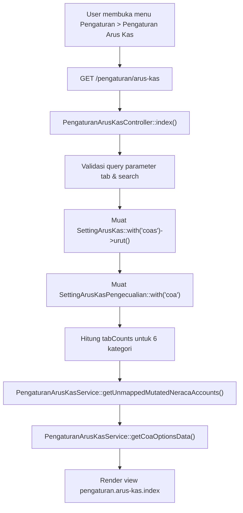
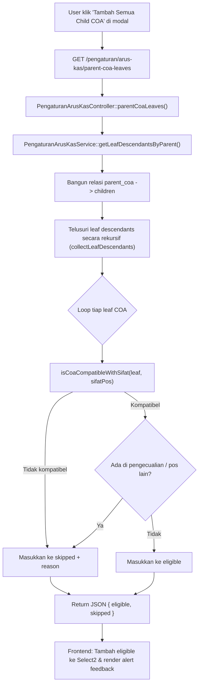
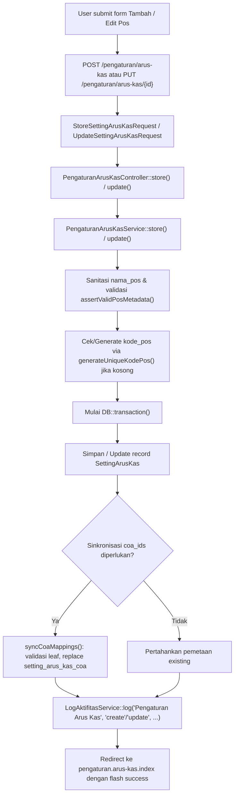
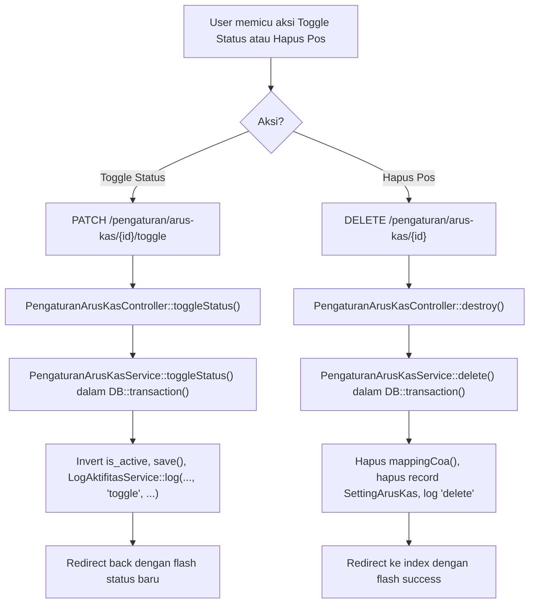
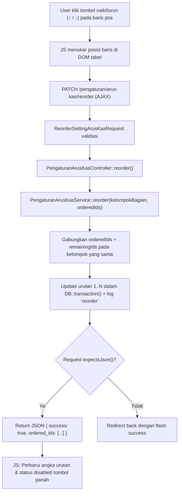
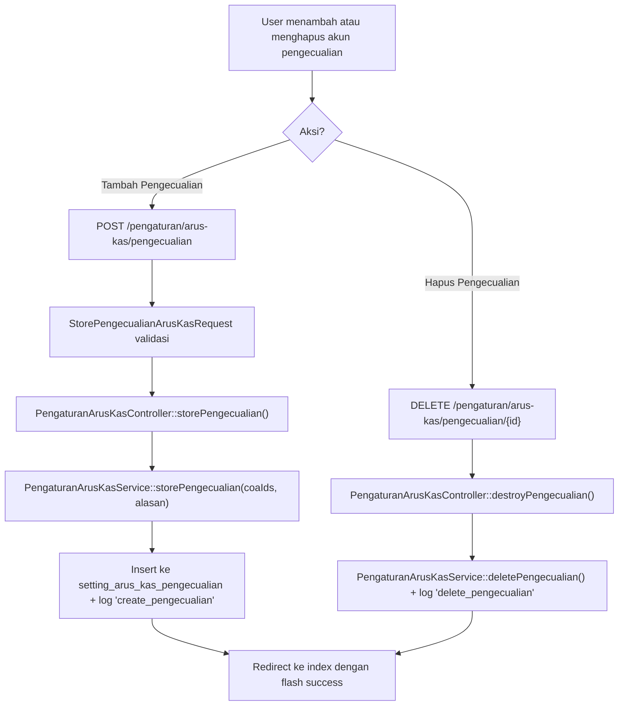

# Dokumentasi Modul Pengaturan — Pengaturan Arus Kas

## Ringkasan Modul

Modul **Pengaturan — Pengaturan Arus Kas** digunakan untuk mengelola konfigurasi dinamis pos laporan arus kas metode tidak langsung (*Indirect Cash Flow Statement*), pemetaan akun buku besar (COA), serta daftar pengecualian akun kontra Neraca.

Fitur dan tanggung jawab utama modul ini meliputi:

1. **Konfigurasi Pos Arus Kas Dinamis**: Mengelola pos laporan arus kas tidak langsung yang dikelompokkan ke dalam 4 bagian laporan:
   - Penyesuaian Laba (`penyesuaian_laba`),
   - Modal Kerja Operasi (`modal_kerja`),
   - Aktivitas Investasi (`investasi`), dan
   - Aktivitas Pendanaan (`pendanaan`).
2. **Pemetaan Akun COA (*Leaf-Only Mapping*)**: Memetakan akun detail (*leaf COA*) ke pos arus kas dengan jaminan eksklusivitas satu akun per pos (`UNIQUE(coa_id)`), termasuk fitur **Pilih Cepat Akun Induk (*Parent COA Expansion*)** untuk mengekspansi seluruh turunan daun (*leaf descendants*) secara otomatis.
3. **Penyusunan & Pengurutan Pos (*Reordering*)**: Mengatur urutan tampilan pos di setiap kelompok bagian laporan (*reorder*) secara instan (dukungan tombol naik/turun dan API AJAX), serta pengubahan status pos (`aktif` / `nonaktif`) tanpa merusak relasi data historis.
4. **Pengelolaan Akun Dikecualikan (*Exclusion List*)**: Mengelola daftar akun Neraca non-Kasbank (`setting_arus_kas_pengecualian`) seperti akun kontra akumulasi penyusutan aset tetap atau penyisihan piutang agar tidak memicu peringatan selisih pemetaan.
5. **Deteksi Akun Neraca Belum Dipetakan (*Unmapped Mutated Neraca Accounts Detection*)**: Memindai akun Neraca non-Kasbank yang memiliki mutasi saldo pada buku besar tahun berjalan namun belum dipetakan ke pos aktif maupun dimasukkan ke daftar pengecualian, lengkap dengan pintasan **Tindakan Cepat (Petakan / Kecualikan)**.
6. **Integrasi & Navigasi Silang Metode Langsung**: Menyediakan tautan langsung ke modul **Referensi Kelompok Arus Kas** (`pengaturan.referensi-kelompok-arus-kas`) yang mengatur tagging akun untuk Laporan Arus Kas Metode Langsung.

Implementasi utama modul ini berada di:

- `routes/web.php`
- `app/Http/Controllers/Pengaturan/PengaturanArusKasController.php`
- `app/Http/Requests/Pengaturan/StoreSettingArusKasRequest.php`
- `app/Http/Requests/Pengaturan/UpdateSettingArusKasRequest.php`
- `app/Http/Requests/Pengaturan/ReorderSettingArusKasRequest.php`
- `app/Http/Requests/Pengaturan/StorePengecualianArusKasRequest.php`
- `app/Services/Pengaturan/PengaturanArusKasService.php`
- `app/Models/SettingArusKas.php`
- `app/Models/SettingArusKasCoa.php`
- `app/Models/SettingArusKasPengecualian.php`
- `database/migrations/2026_11_25_000001_create_setting_arus_kas_tables.php`
- `database/migrations/2026_11_25_000002_add_pengaturan_arus_kas_access_module.php`
- `database/seeders/SettingArusKasSeeder.php`
- `app/Services/Laporan/LaporanKeuanganService.php` (konsumsi konfigurasi dinamis pada Laporan Arus Kas Tidak Langsung)
- `resources/views/pengaturan/arus-kas/index.blade.php`
- `resources/views/pengaturan/arus-kas/partials/_modals.blade.php`
- `resources/views/pengaturan/arus-kas/partials/_scripts.blade.php`

---

## Entry Point / API

Seluruh endpoint dilindungi oleh middleware autentikasi dan otorisasi berbasis modul `module.access:pengaturan.arus-kas,<aksi>`.

| Method | Path | Route Name | Controller Method | Izin Diperlukan |
| --- | --- | --- | --- | --- |
| `GET` | `/pengaturan/arus-kas` | `pengaturan.arus-kas.index` | `index()` | `pengaturan.arus-kas,view` |
| `GET` | `/pengaturan/arus-kas/parent-coa-leaves` | `pengaturan.arus-kas.parent-coa-leaves` | `parentCoaLeaves()` | `pengaturan.arus-kas,view` |
| `POST` | `/pengaturan/arus-kas` | `pengaturan.arus-kas.store` | `store()` | `pengaturan.arus-kas,create` |
| `PUT` | `/pengaturan/arus-kas/{settingArusKas}` | `pengaturan.arus-kas.update` | `update()` | `pengaturan.arus-kas,update` |
| `PATCH` | `/pengaturan/arus-kas/{settingArusKas}/toggle` | `pengaturan.arus-kas.toggle` | `toggleStatus()` | `pengaturan.arus-kas,update` |
| `PATCH` | `/pengaturan/arus-kas/reorder` | `pengaturan.arus-kas.reorder` | `reorder()` | `pengaturan.arus-kas,update` |
| `DELETE` | `/pengaturan/arus-kas/{settingArusKas}` | `pengaturan.arus-kas.destroy` | `destroy()` | `pengaturan.arus-kas,delete` |
| `POST` | `/pengaturan/arus-kas/pengecualian` | `pengaturan.arus-kas.pengecualian.store` | `storePengecualian()` | `pengaturan.arus-kas,create` |
| `DELETE` | `/pengaturan/arus-kas/pengecualian/{pengecualian}` | `pengaturan.arus-kas.pengecualian.destroy` | `destroyPengecualian()` | `pengaturan.arus-kas,delete` |

---

## Alur 1: Menampilkan Daftar Pos, Pengecualian & Deteksi Akun Belum Dipetakan

Halaman utama menyajikan daftar konfigurasi pos arus kas tidak langsung, daftar akun pengecualian, dan banner deteksi akun Neraca bermutasi yang belum terpetakan.

### Fitur Antarmuka & UX

1. **Dual-Mode View Switcher (Mode Tab vs Mode Struktur Laporan)**:
   - Pengguna dapat beralih antara **Mode Tab** (`#viewModeTab`) dan **Mode Struktur Laporan** (`#viewModeStruktur`).
   - Pilihan mode disimpan di `localStorage` peramban pengguna (`siakurat.pengaturan_arus_kas.view_mode`).
   - Jika pengguna memuat URL dengan query parameter `tab` atau `search`, antarmuka secara otomatis memprioritaskan **Mode Tab**.
2. **Mode Tab**:
   - Tab navigasi mencakup: `Semua Pos`, `Penyesuaian Laba`, `Modal Kerja`, `Investasi`, `Pendanaan`, dan `Akun Dikecualikan` beserta badge jumlah data di masing-masing tab.
   - Kolom pencarian terpadu di `#filterToolbar` mengisi seluruh ruang kosong horizontal (`flex-grow-1`). Pencarian dijalankan saat menekan tombol `Enter`, dan tombol reset bertanda silang (`x`) disediakan untuk mengembalikan pencarian tanpa menghilangkan tab aktif.
   - Kolom pencarian mencocokkan kata kunci terhadap `nama_pos`, `kode_pos`, kode COA terpetakan, dan nama COA terpetakan (serta kode/nama COA dan alasan pada tab pengecualian).
3. **Tampilan Ringkas COA & Modal Detail**:
   - Kolom tabel pos menampilkan nama pos, kode pos berformat monospace, badge `Prefix Perubahan` (jika aktif), serta badge interaktif jumlah akun (`[X Akun COA]`).
   - Pos tanpa akun ditandai dengan badge peringatan kuning `0 Akun`.
   - Mengklik badge `[X Akun COA]` membuka modal interaktif `#modalDetailCoaPos` yang menampilkan judul & kode pos, kolom pencarian instan klien `#inputSearchDetailCoa`, daftar akun (kode, nama, dan penanda `[Nonaktif]` bila COA berstatus nonaktif), serta total akun terpetakan.
4. **Status Pos**:
   - Kolom status menyajikan badge statis `Aktif` (hijau) atau `Nonaktif` (abu-abu). Pengubahan status aktif pos dilakukan di form Edit Pos atau via endpoint toggle status.
5. **Banner Akun Neraca Belum Dipetakan**:
   - Jika ada akun Neraca non-Kasbank yang memiliki mutasi saldo pada buku besar periode tahun berjalan namun belum masuk pos aktif maupun pengecualian, sistem menampilkan banner peringatan kuning `#unmappedAccountsCollapse`.
   - Tabel menampilkan daftar akun, tipe COA, total debit, total kredit, dan dampak kas (`kredit - debit`).
   - Disediakan tombol **Tindakan Cepat**:
     - **Petakan** (`.btn-quick-map-unmapped`): Membuka modal Tambah Pos dengan inferensi otomatis sifat pos (`ekuitas` diarahkan ke pendanaan, lainnya ke modal kerja) dan akun COA bersangkutan langsung terpilih.
     - **Kecualikan** (`.btn-quick-exclude-unmapped`): Membuka modal Tambah Pengecualian dengan akun COA bersangkutan langsung terpilih.
6. **Mode Struktur Laporan**:
   - Menampilkan susunan pos per kelompok bagian (`Penyesuaian Laba`, `Modal Kerja`, `Investasi`, `Pendanaan`) dan accordion `Akun Dikecualikan` dalam bentuk kartu collapsible bersarang dengan chevron berputar.
   - Dilengkapi tombol global **Buka Semua** (`#btnExpandAllSections`) dan **Tutup Semua** (`#btnCollapseAllSections`).
   - Setiap baris pos di Mode Struktur Laporan dilengkapi tombol kontrol urutan naik (↑) dan turun (↓) yang mengirim pembaruan urutan secara AJAX ke server.
7. **Pintasan Navigasi Laporan Langsung**:
   - Header menyediakan tombol tautan ke **Referensi Kelompok Arus Kas (Langsung)** (`route('pengaturan.referensi-kelompok-arus-kas.index')`) bagi pengguna yang memiliki hak akses `view`.

### Flowchart

### Algoritma

1. `PengaturanArusKasController::index()` membaca query parameter `tab` (valid: `semua`, `penyesuaian_laba`, `modal_kerja`, `investasi`, `pendanaan`, `pengecualian`; default `'semua'`) dan `search`.
2. Controller mengambil seluruh data `SettingArusKas` terurut (`urut()`, mengelompokkan berdasarkan urutan bagian laporan `penyesuaian_laba` -> `modal_kerja` -> `investasi` -> `pendanaan`, lalu `urutan`, lalu `id`) beserta relasi `coas` (diurutkan berdasarkan `kode`), serta seluruh record `SettingArusKasPengecualian` beserta relasi `coa`.
3. Controller menghitung `tabCounts` untuk keenam tab.
4. Controller memanggil `PengaturanArusKasService::getUnmappedMutatedNeracaAccounts()` (periode default: awal tahun s/d akhir tahun berjalan):
   - Memastikan keberadaan tabel `bukubesar` dan `coa`.
   - Mengambil daftar `coa_id` yang terpetakan ke pos **aktif** (`setting_arus_kas.is_active = true`) dan `coa_id` pada tabel `setting_arus_kas_pengecualian`.
   - Mengagregasi mutasi debit dan kredit pada tabel `bukubesar` untuk akun Neraca non-Kasbank (`tipe_coa != 'kasbank'` dan bukan `SettingArusKas::TIPE_LABA_RUGI`, termasuk akun Neraca berstatus nonaktif) yang tidak berada dalam daftar yang diabaikan.
   - Menyaring akun yang nilai mutasinya memenuhi `abs(debit) >= 0.005 || abs(kredit) >= 0.005` dan menghitung `dampak_kas = kredit - debit`.
5. Controller memanggil `PengaturanArusKasService::getCoaOptionsData()` untuk menyiapkan metadata COA modal UI:
   - `leafCoas`: Akun COA yang tidak memiliki anak (*non-parent*) dan bukan tipe `Kasbank`.
   - `parentCoas`: Akun COA yang menjadi induk (*parent*) akun lain.
   - `mappedByPos`: Peta akun yang sudah dipetakan (`coa_id => ['pos_id', 'nama_pos', 'is_active']`).
   - `excludedCoaIds`: Kumpulan ID akun yang berada di daftar pengecualian.
6. View `pengaturan.arus-kas.index` merender antarmuka, memfilter daftar pos sesuai tab aktif dan kata kunci pencarian, serta menampilkan banner peringatan bila akun belum dipetakan tidak kosong.

### Fungsi yang Dipanggil

- `PengaturanArusKasController::index(Request $request)`
- `SettingArusKas::query()->with(['coas' => fn ($q) => $q->orderBy('kode')])->urut()->get()`
- `SettingArusKasPengecualian::query()->with('coa')->orderBy('id')->get()`
- `PengaturanArusKasService::getUnmappedMutatedNeracaAccounts(?string $startDate = null, ?string $endDate = null)`
- `PengaturanArusKasService::getCoaOptionsData()`

---

## Alur 2: Ekspansi Akun Induk (Parent COA) ke Leaf COA

Ketika pengguna memilih akun induk (*parent COA*) pada modal Tambah/Edit Pos atau modal Tambah Pengecualian dan menekan tombol **Tambah Semua Child COA**, skrip klien memanggil endpoint AJAX untuk mengekspansi seluruh akun daun turunan (*leaf descendants*) di bawah parent tersebut dan mengklasifikasikannya ke dalam kelompok `eligible` (dapat dipilih) atau `skipped` (dilewati beserta keterangannya).

### Validasi Request

`PengaturanArusKasController::parentCoaLeaves()` memvalidasi query parameter secara langsung:

- `parent_id`: wajib (`required`), integer, minimal `1`.
- `sifat_pos`: opsional (`nullable`), string, salah satu dari `SettingArusKas::SIFAT_POS` (`aset`, `liabilitas`, `ekuitas`, `penambah_laba`, `pengurang_laba`) atau `'pengecualian'`.
- `ignore_pos_id`: opsional (`nullable`), integer, minimal `1` (digunakan saat edit pos agar COA milik pos yang sedang diedit tidak dianggap bentrok).

### Flowchart

### Algoritma

1. Request diterima `PengaturanArusKasController::parentCoaLeaves()` dan divalidasi.
2. `PengaturanArusKasService::getLeafDescendantsByParent()` memuat seluruh akun COA dan membentuk peta `parent_coa -> children`.
3. Prosedur rekursif `collectLeafDescendants()` menelusuri seluruh turunan dengan guard `$visited` untuk mencegah loop tak hingga akibat siklus data hierarki hingga menemukan node tanpa anak (*leaf*).
4. Daftar leaf COA diurutkan berdasarkan `kode` kemudian `id`.
5. Untuk setiap leaf COA, service melakukan evaluasi:
   - **Kompatibilitas Tipe & Status Akun (`isCoaCompatibleWithSifat`)**:
     - Menolak akun `Kasbank`.
     - Sifat Laba Rugi (`penambah_laba`, `pengurang_laba`) hanya menerima akun `SettingArusKas::TIPE_LABA_RUGI` yang berstatus **aktif** (`status_aktif = 1`). Akun Laba Rugi nonaktif ditolak.
     - Sifat Neraca (`aset`, `liabilitas`, `ekuitas`) dan mode `pengecualian` menolak akun Laba Rugi, namun mengizinkan akun Neraca non-Kasbank berstatus nonaktif.
   - **Daftar Pengecualian (`loadExcludedCoaIdSet`)**: Jika akun tercantum dalam tabel `setting_arus_kas_pengecualian`, akun dimasukkan ke `skipped` dengan alasan "Akun berada dalam daftar pengecualian.".
   - **Pemetaan Existing (`loadMappedByPosMap`)**: Jika akun sudah dipetakan ke pos lain (di luar `ignoreSettingArusKasId`), akun dimasukkan ke `skipped` dengan alasan "Sudah dipetakan ke pos '[nama_pos]' [ (Nonaktif) ].".
6. Akun yang lolos dimasukkan ke daftar `eligible`. Controller mengembalikan JSON `{ eligible: [...], skipped: [...] }`.
7. Di sisi klien, JavaScript menambahkan seluruh akun `eligible` ke pilihan Select2, dan menampilkan kotak pesan informasi jumlah akun yang berhasil ditambahkan serta rincian akun yang dilewati (maksimal 6 sampel rincian + catatan jumlah sisa).

### Fungsi yang Dipanggil

- `PengaturanArusKasController::parentCoaLeaves(Request $request)`
- `PengaturanArusKasService::getLeafDescendantsByParent(int $parentId, ?string $sifatPos = null, ?int $ignoreSettingArusKasId = null)`
- `PengaturanArusKasService::collectLeafDescendants(int $currentParentId, array $childrenByParent, array &$visited, array &$leafNodes)`
- `PengaturanArusKasService::isCoaCompatibleWithSifat(Coa $coa, ?string $sifatPos)`
- `PengaturanArusKasService::loadMappedByPosMap(?array $filterCoaIds = null)`
- `PengaturanArusKasService::loadExcludedCoaIdSet(?array $filterCoaIds = null)`

---

## Alur 3: Menambah & Mengubah Pos Arus Kas serta Sinkronisasi COA

Form modal `#modalPosArusKas` digunakan secara bersama untuk menambah (*create*) maupun menyunting (*edit*) pos arus kas.

### Validasi Request

`StoreSettingArusKasRequest` memvalidasi penambahan pos baru (dan diwarisi oleh `UpdateSettingArusKasRequest` untuk pembaruan pos):

- **Sanitasi Pra-Validasi (`prepareForValidation`)**:
  - `nama_pos`: Menghapus spasi di awal/akhir dan mereduksi spasi ganda menjadi spasi tunggal (`preg_replace('/\s+/', ' ', ...)`).
  - `kode_pos`: Melakukan trim; bila bernilai string kosong diubah menjadi `null` agar otomatis dibuatkan kode oleh service.
  - `pakai_prefix_perubahan` dan `is_active`: Dinormalisasi menjadi boolean melalui `$this->boolean(...)`.
- **Aturan Validasi (`rules`)**:
  - `kode_pos`: opsional (`nullable`), string, maksimal `80` karakter, unik pada tabel `setting_arus_kas,kode_pos`. Pada `UpdateSettingArusKasRequest`, ID pos yang sedang diubah diabaikan (`ignore($posId)`).
  - `nama_pos`: wajib (`required`), string, maksimal `150` karakter.
  - `kelompok_bagian`: wajib (`required`), string, salah satu dari `SettingArusKas::KELOMPOK_BAGIAN` (`penyesuaian_laba`, `modal_kerja`, `investasi`, `pendanaan`).
  - `sifat_pos`: wajib (`required`), string, salah satu dari `SettingArusKas::SIFAT_POS` (`aset`, `liabilitas`, `ekuitas`, `penambah_laba`, `pengurang_laba`).
  - `pakai_prefix_perubahan`: opsional (`nullable`), boolean.
  - `urutan`: wajib (`required`), integer, minimal `1`.
  - `is_active`: opsional (`nullable`), boolean.
  - `coa_ids`: opsional (`nullable`), array.
  - `coa_ids.*`: integer, `distinct`, `exists:coa,id`.
- **Validasi Kustom (`after`)**:
  - Memanggil `PengaturanArusKasService::validateCoaIdsForValidator()` untuk memvalidasi setiap elemen array `coa_ids`: memastikan akun berstatus daun (*leaf*), kompatibel dengan `sifat_pos`, tidak terdaftar di `setting_arus_kas_pengecualian`, dan belum dipetakan ke pos lain (kecuali pos yang sedang diedit). Pesan kesalahan ditempelkan per indeks `coa_ids.{index}`.

### Flowchart

### Algoritma

1. **Pada Penambahan Pos (`store`)**:
   - Request divalidasi oleh `StoreSettingArusKasRequest`.
   - `PengaturanArusKasService::store()` membersihkan `nama_pos` dengan `sanitizeName()`, memvalidasi metadata (`assertValidPosMetadata()`), dan membuat kode unik otomatis via `generateUniqueKodePos()` (menggunakan awalan `PL_`, `MK_`, `INV_`, `PEND_` diikuti slug nama pos) bila `kode_pos` tidak diisi pengguna.
   - Menentukan `urutan`: jika `urutan` kosong/non-numerik, diisi nilai `max(urutan) + 1` pada kelompok bagian yang sama.
   - Di dalam `DB::transaction()`:
     - Menyimpan data ke tabel `setting_arus_kas`.
     - Memanggil `syncCoaMappings()` untuk memvalidasi dan menyisipkan baris pemetaan baru ke tabel `setting_arus_kas_coa`.
     - Mencatat audit trail via `LogAktifitasService::log('Pengaturan Arus Kas', 'create', null, $newSnapshot)`.
2. **Pada Pembaruan Pos (`update`)**:
   - Request divalidasi oleh `UpdateSettingArusKasRequest`.
   - Di dalam `DB::transaction()`:
     - Mengambil snapshot lama untuk kebutuhan audit log.
     - Memvalidasi metadata dan keunikan `kode_pos` terhadap record lain.
     - Memperbarui data record `SettingArusKas`.
     - Jika payload memuat `coa_ids`, pemetaan disinkronkan via `syncCoaMappings()`. Jika payload tidak memuat `coa_ids` namun `sifat_pos` berubah, service memvalidasi ulang pemetaan existing terhadap `sifat_pos` yang baru.
     - Mencatat audit trail via `LogAktifitasService::log('Pengaturan Arus Kas', 'update', $oldSnapshot, $newSnapshot)`.
3. **Penanganan Kesalahan & Pemulihan Modal**:
   - Jika service melempar `DomainException`, controller menangkapnya dan mengembalikan redirect `back()->withInput()->with('error', $e->getMessage())`.
   - Di antarmuka, bila terjadi error validasi Laravel (`$errors->any()`) dengan target `_modal_target === 'modalPosArusKas'`, JavaScript secara otomatis membuka kembali modal pos arus kas dan mengembalikan status pilihan COA sebelumnya.

### Fungsi yang Dipanggil

- `StoreSettingArusKasRequest::prepareForValidation()`, `rules()`, `after()`
- `UpdateSettingArusKasRequest::settingArusKasId()`
- `PengaturanArusKasController::store(StoreSettingArusKasRequest $request)`
- `PengaturanArusKasController::update(UpdateSettingArusKasRequest $request, SettingArusKas $settingArusKas)`
- `PengaturanArusKasService::store(array $data)`
- `PengaturanArusKasService::update(SettingArusKas $settingArusKas, array $data)`
- `PengaturanArusKasService::generateUniqueKodePos(string $kelompokBagian, string $namaPos, ?int $ignoreId = null)`
- `PengaturanArusKasService::syncCoaMappings(SettingArusKas $pos, array $coaIds, string $sifatPos)`
- `PengaturanArusKasService::validateCoaIds(array $coaIds, string $modeOrSifatPos, ?int $ignoreSettingArusKasId = null)`
- `LogAktifitasService::log(string $modul, string $tipe, ?array $old, ?array $new)`

---

## Alur 4: Mengubah Status Aktif / Nonaktif & Menghapus Pos Arus Kas

### Flowchart

### Algoritma

1. **Toggle Status Pos (`toggleStatus()`)**:
   - Controller memanggil `PengaturanArusKasService::toggleStatus($settingArusKas)`.
   - Di dalam `DB::transaction()`, service membalik nilai boolean status `$settingArusKas->is_active = !$oldStatus`, menyimpannya, dan mencatat log audit bertipe `'toggle'`.
   - Mengembalikan boolean status terbaru. Controller melakukan redirect `back()` disertai pesan flash sukses aktivasi/nonaktivasi pos.
2. **Hapus Pos Arus Kas (`destroy()`)**:
   - Controller memanggil `PengaturanArusKasService::delete($settingArusKas)`.
   - Di dalam `DB::transaction()`:
     - Service menyusun snapshot data pos dan COA yang terpetakan untuk audit log.
     - Menghapus seluruh baris relasi pada `setting_arus_kas_coa` (`$settingArusKas->mappingCoa()->delete()`).
     - Menghapus record `SettingArusKas`.
     - Mencatat log audit bertipe `'delete'`.
   - Controller melakukan redirect ke `pengaturan.arus-kas.index` disertai pesan flash sukses.

### Fungsi yang Dipanggil

- `PengaturanArusKasController::toggleStatus(SettingArusKas $settingArusKas)`
- `PengaturanArusKasController::destroy(SettingArusKas $settingArusKas)`
- `PengaturanArusKasService::toggleStatus(SettingArusKas $settingArusKas)`
- `PengaturanArusKasService::delete(SettingArusKas $settingArusKas)`
- `LogAktifitasService::log(...)`

---

## Alur 5: Mengubah Urutan Pos dalam Satu Bagian (Reorder)

Pengurutan pos di dalam satu kelompok bagian laporan dapat dilakukan melalui antarmuka Mode Struktur Laporan menggunakan tombol panah naik (↑) dan turun (↓) yang mengirim permintaan AJAX ke server.

### Validasi Request

`ReorderSettingArusKasRequest` memvalidasi:

- `kelompok_bagian`: wajib (`required`), string, salah satu dari `SettingArusKas::KELOMPOK_BAGIAN`.
- `ordered_ids`: wajib (`required`), array, minimal 1 item.
- `ordered_ids.*`: wajib (`required`), integer, `distinct`, `exists:setting_arus_kas,id`.
- **Validasi Kustom (`after`)**: Memastikan seluruh ID pos di dalam `ordered_ids` memiliki nilai `kelompok_bagian` yang sama dengan parameter `kelompok_bagian` yang dikirim.

### Flowchart

### Algoritma

1. Skrip antarmuka menukar posisi elemen baris `<tr>` di DOM tabel, mengumpulkan susunan ID terbaru, dan mengirimkan permintaan AJAX PATCH ke endpoint `/pengaturan/arus-kas/reorder`.
2. `ReorderSettingArusKasRequest` memvalidasi kelayakan input.
3. `PengaturanArusKasService::reorder()` memverifikasi keunikan ID dan memastikan tidak ada pos yang berasal dari bagian laporan berbeda (melempar `DomainException` jika tidak valid).
4. Di dalam `DB::transaction()`:
   - Service mengambil snapshot urutan lama.
   - Mengambil ID pos lain di bagian yang sama yang tidak tercantum dalam `orderedIds` (`remainingIds`), lalu menggabungkannya di akhir.
   - Melakukan update kolom `urutan = index + 1` untuk setiap record.
   - Mencatat log audit bertipe `'reorder'`.
5. Jika request meminta JSON (`expectsJson()`), controller mengembalikan respons JSON `200` `{ success: true, message: ..., ordered_ids: [...] }` (atau `422` jika terjadi `DomainException`).
6. Jika AJAX sukses, antarmuka memperbarui angka urutan pada kolom pertama dan menyetel atribut `disabled` pada tombol paling atas dan paling bawah. Jika gagal, antarmuka mengembalikan posisi baris ke urutan semula dan menampilkan pesan kesalahan.

### Fungsi yang Dipanggil

- `ReorderSettingArusKasRequest::rules()`, `after()`
- `PengaturanArusKasController::reorder(ReorderSettingArusKasRequest $request)`
- `PengaturanArusKasService::reorder(string $kelompokBagian, array $orderedIds)`
- `LogAktifitasService::log(...)`

---

## Alur 6: Mengelola Daftar Pengecualian Akun COA

Akun pengecualian digunakan untuk menandai akun Neraca non-Kasbank (seperti akun kontra akumulasi penyusutan aset tetap atau penyisihan piutang) agar tidak dimasukkan ke pos arus kas dan tidak muncul pada banner peringatan akun belum dipetakan.

### Validasi Request

`StorePengecualianArusKasRequest` memvalidasi penambahan akun pengecualian:

- **Sanitasi Pra-Validasi (`prepareForValidation`)**: Melakukan trim pada kolom `alasan`; jika string kosong dinormalisasi menjadi `null`.
- **Aturan Validasi (`rules`)**:
  - `coa_ids`: wajib (`required`), array, minimal 1 akun.
  - `coa_ids.*`: wajib (`required`), integer, `distinct`, `exists:coa,id`.
  - `alasan`: opsional (`nullable`), string, maksimal `255` karakter.
- **Validasi Kustom (`after`)**: Memanggil `PengaturanArusKasService::validateCoaIdsForValidator($validator, $this->input('coa_ids'), 'pengecualian')` guna menjamin seluruh akun berstatus *leaf*, bertipe Neraca non-Kasbank, belum berada di daftar pengecualian, dan belum dipetakan ke pos arus kas mana pun.

### Flowchart

### Algoritma

1. **Tambah Pengecualian (`storePengecualian`)**:
   - Input divalidasi oleh `StorePengecualianArusKasRequest`.
   - `PengaturanArusKasService::storePengecualian()` menormalisasi array ID, memvalidasi ulang via `validateCoaIds(..., 'pengecualian')`, dan menyisipkan baris record ke tabel `setting_arus_kas_pengecualian` di dalam `DB::transaction()`.
   - Service mencatat log audit bertipe `'create_pengecualian'`.
   - Controller melakukan redirect ke `pengaturan.arus-kas.index` disertai pesan flash sukses.
2. **Hapus Pengecualian (`destroyPengecualian`)**:
   - Di dalam `DB::transaction()`, service mengambil snapshot record lama, menghapus data record `SettingArusKasPengecualian`, dan mencatat log audit bertipe `'delete_pengecualian'`.
   - Controller melakukan redirect ke `pengaturan.arus-kas.index` disertai pesan flash sukses.

### Fungsi yang Dipanggil

- `StorePengecualianArusKasRequest::prepareForValidation()`, `rules()`, `after()`
- `PengaturanArusKasController::storePengecualian(StorePengecualianArusKasRequest $request)`
- `PengaturanArusKasController::destroyPengecualian(SettingArusKasPengecualian $pengecualian)`
- `PengaturanArusKasService::storePengecualian(array $coaIds, ?string $alasan = null)`
- `PengaturanArusKasService::deletePengecualian(SettingArusKasPengecualian $pengecualian)`
- `LogAktifitasService::log(...)`

---

## Catatan Penting Bisnis

1. **Batasan Keunikan `UNIQUE(coa_id)` & Eksklusivitas Lintas Tabel**:
   - Tabel `setting_arus_kas_coa` dan `setting_arus_kas_pengecualian` sama-sama memiliki constraint `UNIQUE(coa_id)`.
   - Satu akun COA hanya dapat dipetakan ke **maksimal satu** pos arus kas dan tidak boleh berada di daftar pengecualian sekaligus.
   - Akun induk (*parent COA*) dan akun bertipe `Kasbank` secara ketat tidak diizinkan untuk dipetakan ke pos maupun dimasukkan ke daftar pengecualian.
   - Hubungan foreign key ke tabel `coa` dan `setting_arus_kas` dilengkapi `cascadeOnDelete()`, sehingga bila akun COA atau pos arus kas dihapus, relasi pemetaan terhapus secara otomatis.
2. **Aturan Sifat Pos (`sifat_pos`) & Format Label Otomatis**:
   - Nilai `sifat_pos` diklasifikasikan menjadi dua:
     - **Sifat Laba Rugi** (`penambah_laba`, `pengurang_laba`): Hanya dapat memetakan akun yang bertipe `SettingArusKas::TIPE_LABA_RUGI` (`Pendapatan`, `Pendapatan lain`, `Beban`, `Beban lain`, `Beban Pokok Penjualan`) dan berstatus **aktif** (`status_aktif = 1`). Switch `pakai_prefix_perubahan` dinonaktifkan otomatis untuk kelompok ini.
     - **Sifat Neraca** (`aset`, `liabilitas`, `ekuitas`): Hanya dapat memetakan akun Neraca non-Kasbank.
   - Method `SettingArusKas::formatLabelPos(float $perubahan)` menambahkan awalan dinamis apabila `pakai_prefix_perubahan = true`:
     - Sifat `aset`: `(Kenaikan) ` jika perubahan > 0.005, `Penurunan ` jika perubahan < -0.005, atau `Penurunan (kenaikan) ` bila perubahan mendekati nol.
     - Sifat `liabilitas` / `ekuitas`: `Kenaikan ` jika perubahan > 0.005, `(Penurunan) ` jika perubahan < -0.005, atau `Kenaikan (penurunan) ` bila perubahan mendekati nol.
3. **Penanganan Akun Neraca Nonaktif Historis**:
   - Berbeda dengan akun Laba Rugi nonaktif yang ditolak, akun **Neraca nonaktif** (`status_aktif != 1`) **tetap diizinkan** untuk dipetakan ke pos Neraca maupun didaftarkan ke daftar pengecualian.
   - Scanner `getUnmappedMutatedNeracaAccounts()` tetap menyertakan akun Neraca nonaktif bila memiliki mutasi buku besar pada periode berjalan. Hal ini memastikan akun historis yang telah dinonaktifkan tetapi masih memiliki mutasi pembukuan lampau tetap dapat dipetakan sehingga laporan arus kas tidak kehilangan mutasi kas.
4. **Perilaku Pos Nonaktif pada Rekonsiliasi Kas**:
   - Ketika pos diubah statusnya menjadi nonaktif (`is_active = false`), data pemetaannya di `setting_arus_kas_coa` tetap dipertahankan.
   - Namun, baik fungsi scanner `getUnmappedMutatedNeracaAccounts()` maupun penyusunan laporan dinamis di `LaporanKeuanganService::susunArusKasTidakLangsungDinamis()` hanya memperhitungkan pemetaan milik pos **aktif** (`is_active = true`).
   - Dampaknya: Jika pos dinonaktifkan dan akun-akun di dalamnya bermutasi pada tahun berjalan, akun-akun tersebut akan otomatis terdeteksi sebagai **belum dipetakan** pada banner peringatan agar pengguna menyadari ada mutasi kas yang belum terefleksi pada laporan aktif.
5. **Konsumsi pada Laporan Keuangan (`LaporanKeuanganService`)**:
   - Jika tabel `setting_arus_kas` tersedia dan berisi data konfigurasi, `LaporanKeuanganService` menyusun laporan menggunakan metode dinamis `susunArusKasTidakLangsungDinamis()`.
   - Jika konfigurasi belum ada atau tabel kosong, sistem secara otomatis melakukan fallback ke metode statis warisan `susunArusKasTidakLangsungLegacy()`.
   - Laporan dinamis menyusun 4 bagian: Laba Bersih Tahun Berjalan -> Penyesuaian Laba Bersih -> Kas dari Aktivitas Operasi (Modal Kerja) -> Kas dari Aktivitas Investasi -> Kas dari Aktivitas Pendanaan -> Kenaikan/Penurunan Kas Bersih -> Kas Awal & Kas Akhir -> Rekonsiliasi Akun Belum Dipetakan.
6. **Hubungan Arus Kas Metode Tidak Langsung vs Metode Langsung**:
   - **Metode Tidak Langsung** (modul ini): Menggunakan pemetaan tabel dinamis `setting_arus_kas`, `setting_arus_kas_coa`, dan `setting_arus_kas_pengecualian` untuk menghasilkan laporan di `/keuangan/arus-kas-tidak-langsung`.
   - **Metode Langsung**: Menggunakan penandaan langsung kolom `arus_kas_aktivitas` dan `arus_kas_kelompok` pada master akun `coa` yang dikelola melalui menu **Referensi Kelompok Arus Kas** (`/pengaturan/referensi-kelompok-arus-kas`) untuk menghasilkan laporan di `/keuangan/arus-kas`.
7. **Jejak Audit & Idempotensi Seeder**:
   - Seluruh mutasi konfigurasi dicatat ke dalam audit log `LogAktifitasService` dengan nama modul `'Pengaturan Arus Kas'` untuk aksi: `create`, `update`, `toggle`, `reorder`, `delete`, `create_pengecualian`, dan `delete_pengecualian`.
   - `SettingArusKasSeeder` dirancang secara aman dan idempoten: seeder hanya menyemai data awal saat tabel masih kosong atau membuat pos baru yang belum ada tanpa menimpa perubahan manual yang sudah dilakukan oleh pengguna.
