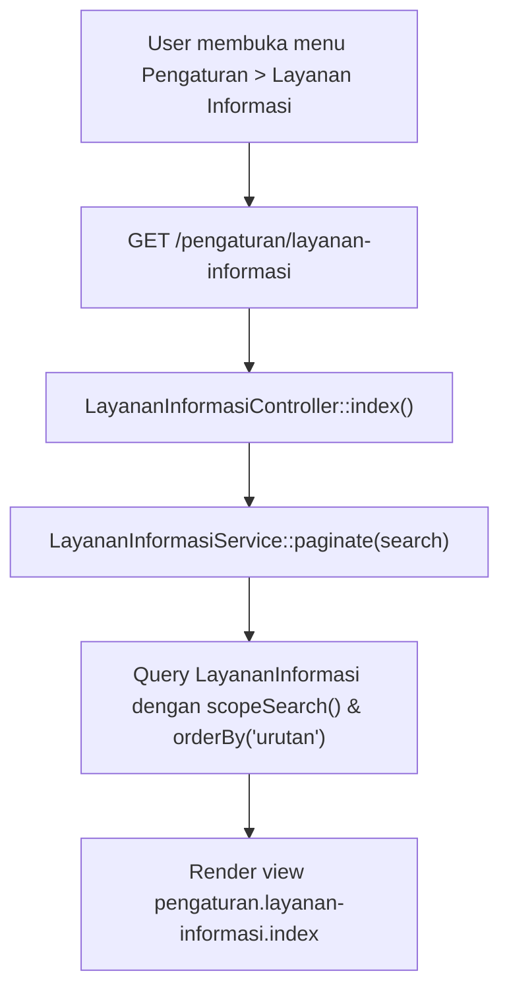
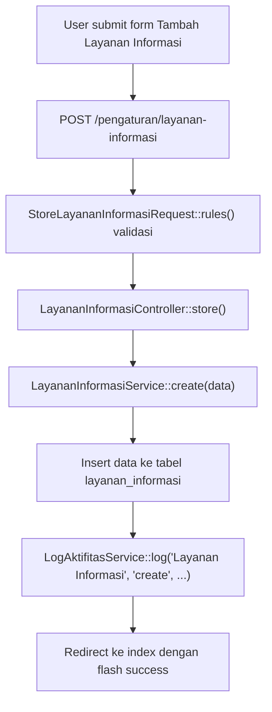
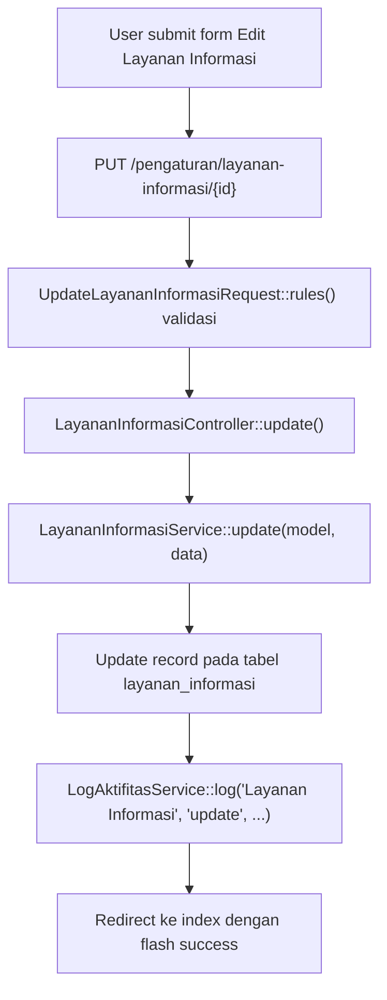
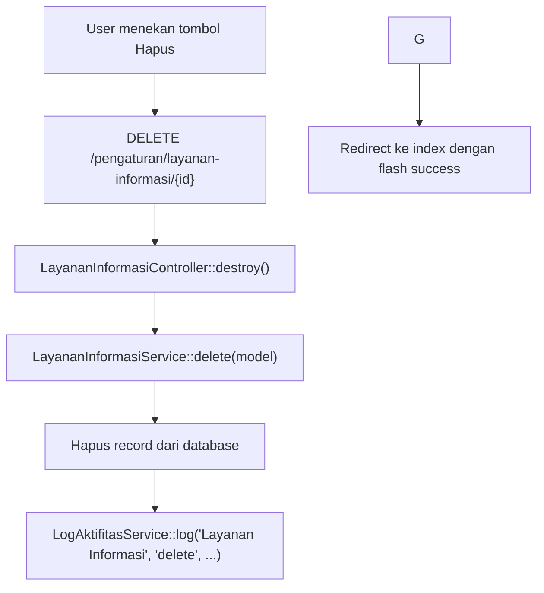
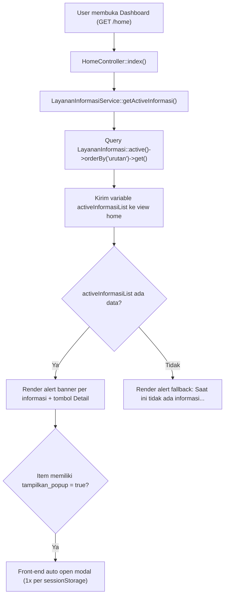

# Dokumentasi Modul Pengaturan — Layanan Informasi

## Ringkasan Modul

Modul **Pengaturan — Layanan Informasi** digunakan untuk:

1. Mengelola pesan pengumuman/informasi yang ditampilkan di halaman utama (Home / Dashboard),
2. Mengatur tipe notifikasi (info, success, warning, danger), periode tayang, dan urutan prioritas,
3. Mengatur apakah pesan langsung muncul sebagai dialog pop-up otomatis (modal dialog) saat pengguna login/membuka dashboard.

Implementasi utama modul ini berada di:

- `routes/web.php`
- `app/Http/Controllers/Pengaturan/LayananInformasiController.php`
- `app/Http/Requests/Pengaturan/StoreLayananInformasiRequest.php`
- `app/Http/Requests/Pengaturan/UpdateLayananInformasiRequest.php`
- `app/Services/Pengaturan/LayananInformasiService.php`
- `app/Models/LayananInformasi.php`

## Entry Point / API

Semua endpoint dilindungi middleware otorisasi `module.access:pengaturan.layanan-informasi,<aksi>`.

| Method | Path | Route Name | Controller Method | Izin Diperlukan |
| --- | --- | --- | --- | --- |
| `GET` | `/pengaturan/layanan-informasi` | `pengaturan.layanan-informasi.index` | `index()` | `pengaturan.layanan-informasi,view` |
| `GET` | `/pengaturan/layanan-informasi/create` | `pengaturan.layanan-informasi.create` | `create()` | `pengaturan.layanan-informasi,create` |
| `POST` | `/pengaturan/layanan-informasi` | `pengaturan.layanan-informasi.store` | `store()` | `pengaturan.layanan-informasi,create` |
| `GET` | `/pengaturan/layanan-informasi/{layananInformasi}/edit` | `pengaturan.layanan-informasi.edit` | `edit()` | `pengaturan.layanan-informasi,update` |
| `PUT` | `/pengaturan/layanan-informasi/{layananInformasi}` | `pengaturan.layanan-informasi.update` | `update()` | `pengaturan.layanan-informasi,update` |
| `DELETE` | `/pengaturan/layanan-informasi/{layananInformasi}` | `pengaturan.layanan-informasi.destroy` | `destroy()` | `pengaturan.layanan-informasi,delete` |

## Alur 1: Menampilkan Daftar Layanan Informasi

### Flowchart

### Algoritma

1. Request diterima oleh `LayananInformasiController::index()`.
2. Controller mengambil query parameter `search`.
3. Memanggil `LayananInformasiService::paginate($search)` yang menerapkan `scopeSearch()`, diurutkan berdasarkan `urutan` ASC dan `created_at` DESC.
4. Menampilkan view dengan daftar informasi beserta status, periode, tipe, dan aksi.

---

## Alur 2: Menambah Layanan Informasi Baru

### Validasi Request

`StoreLayananInformasiRequest` memvalidasi:

- `judul`: Wajib, string, maksimal 255 karakter.
- `isi`: Wajib, string.
- `tipe`: Wajib, pilihan dari `info`, `success`, `warning`, `danger`.
- `tanggal_mulai`: Opsional, format tanggal.
- `tanggal_selesai`: Opsional, format tanggal, harus sama atau setelah `tanggal_mulai`.
- `tampilkan_popup`: Opsional, boolean.
- `status_aktif`: Opsional, boolean.
- `urutan`: Opsional, integer minimal 0.

### Flowchart

### Algoritma

1. User mengisi form di `/pengaturan/layanan-informasi/create`.
2. Form Request memvalidasi kelengkapan dan format input.
3. `LayananInformasiService::create()` mengisi `created_by` dari ID user yang login, lalu menyimpan record ke tabel `layanan_informasi`.
4. Mencatat aktivitas penambahan ke tabel `log_aktifitas`.
5. Mengembalikan redirect ke index dengan notifikasi flash sukses.

---

## Alur 3: Mengubah Layanan Informasi

### Validasi Request

`UpdateLayananInformasiRequest` memvalidasi field yang sama dengan `StoreLayananInformasiRequest`.

### Flowchart

### Algoritma

1. User mengakses halaman edit dan mengirim form perubahan.
2. Form Request memvalidasi input yang diperbarui.
3. `LayananInformasiService::update()` memperbarui field yang diizinkan dan mencatat perbandingan perubahan ke `log_aktifitas`.
4. Mengembalikan redirect ke halaman index dengan pesan sukses.

---

## Alur 4: Menghapus Layanan Informasi

### Flowchart

---

## Alur 5: Integrasi Penayangan di Home / Dashboard

### Flowchart

## Catatan Penting Bisnis

- **Penyaringan Waktu Aktif**: `scopeActive()` memfilter informasi dengan ketentuan `status_aktif = true`, `tanggal_mulai <= hari ini` (atau null), dan `tanggal_selesai >= hari ini` (atau null).
- **Auto Popup Non-Intrusif**: Jika `tampilkan_popup` bernilai true, JavaScript di dashboard membuka modal secara otomatis saat halaman dimuat, namun menggunakan kunci `sessionStorage` (`dismissed_info_modalInformasi{id}`) agar popup tidak mengganggu terus-menerus setiap kali pengguna me-refresh halaman dalam satu sesi tab.
- **Toleransi Database / Fallback**: `LayananInformasiService::getActiveInformasi()` menangani `QueryException` secara aman sehingga halaman dashboard tidak akan gagal memuat jika tabel belum dimigrasi.
- **Audit Trail**: Setiap aktivitas penambahan, pengubahan, dan penghapusan informasi tercatat di `log_aktifitas`.
