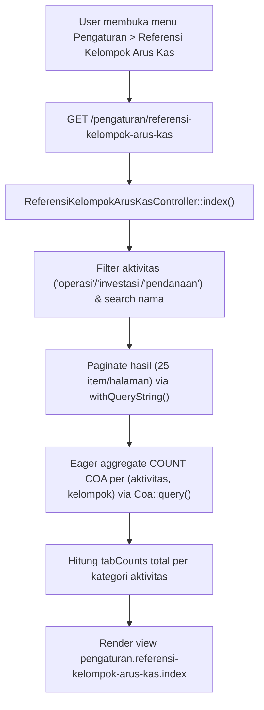
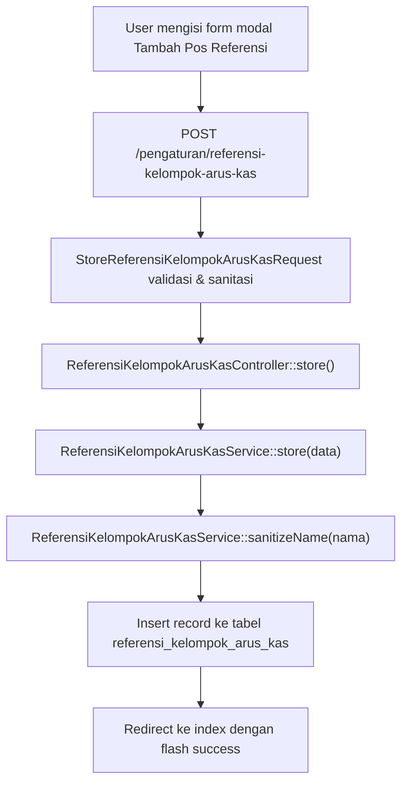
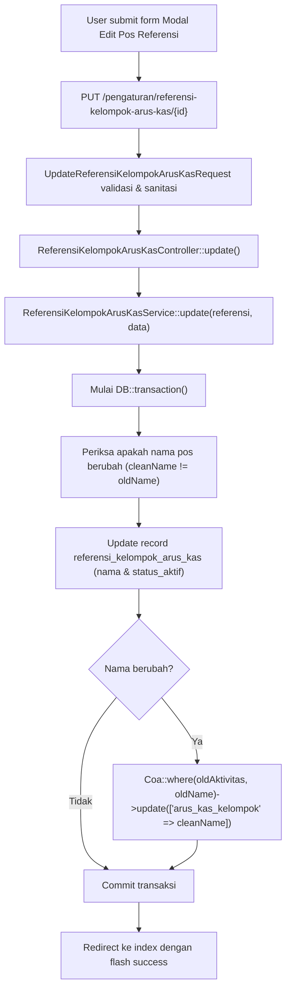
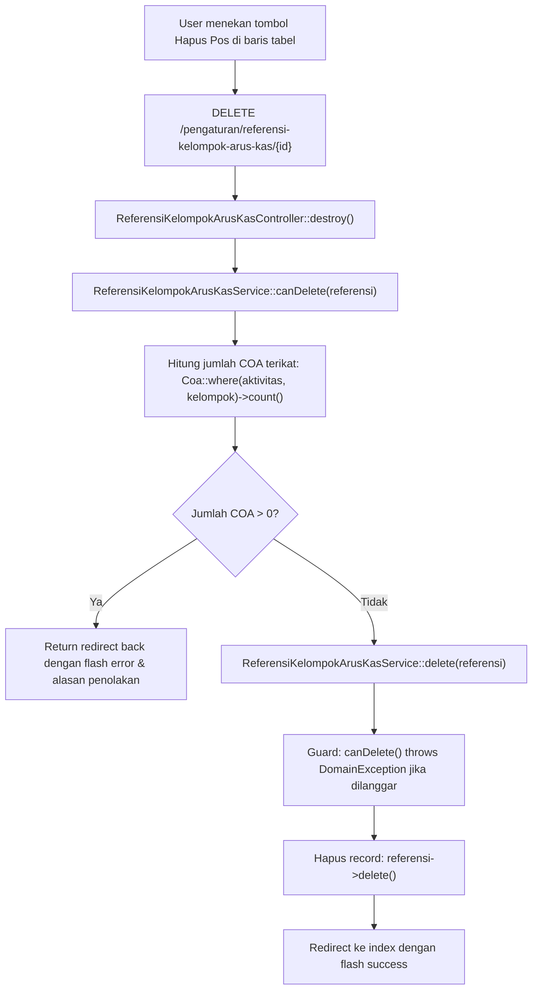
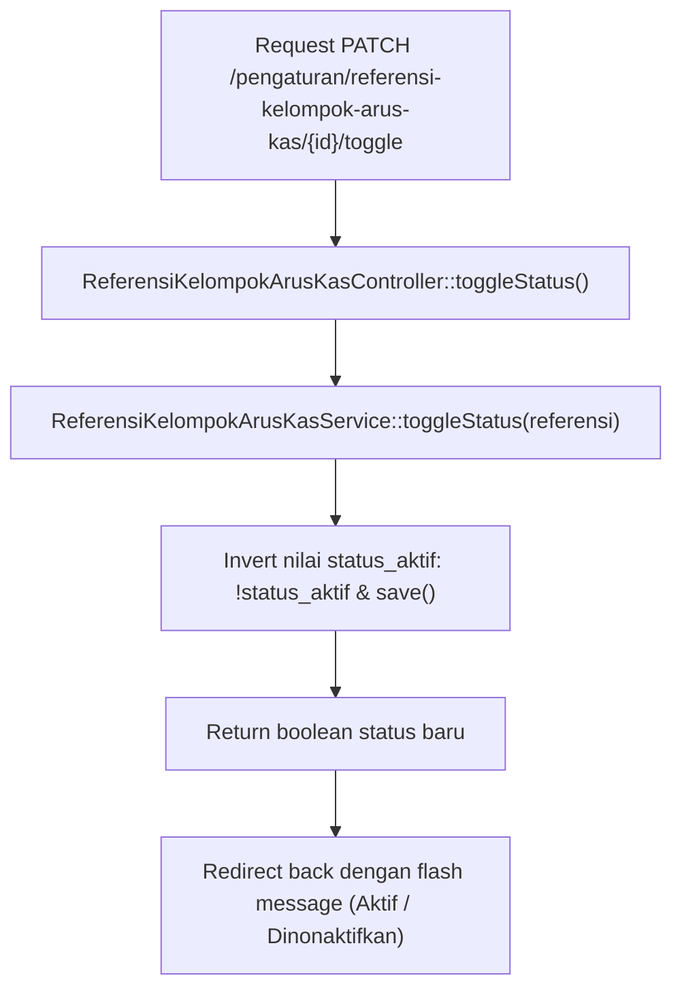
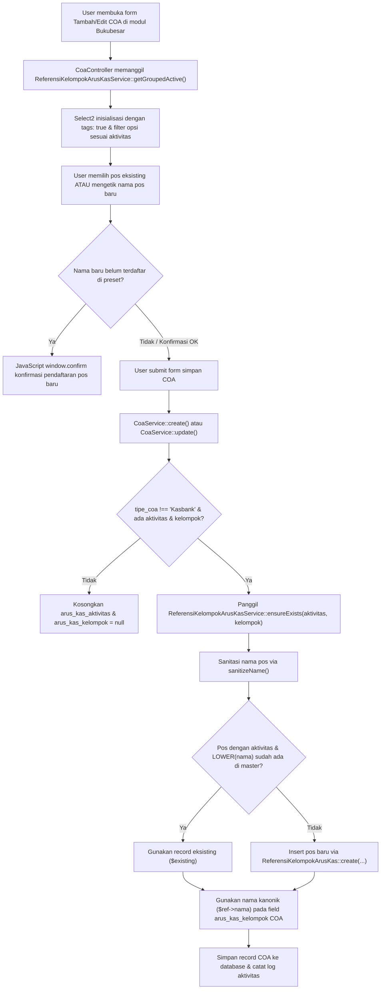

# Dokumentasi Modul Pengaturan — Referensi Kelompok Arus Kas

## Ringkasan Modul

Modul **Pengaturan — Referensi Kelompok Arus Kas** digunakan untuk:

1. Mengelola master data penamaan pos kelompok arus kas terstandarisasi untuk 3 pilar aktivitas arus kas (`operasi`, `investasi`, dan `pendanaan`) yang digunakan pada **Laporan Arus Kas Metode Langsung** (penandaan kolom `arus_kas_aktivitas` dan `arus_kas_kelompok` pada bagan akun COA),
2. Menghilangkan inkonsistensi penamaan akibat kesalahan pengetikan manual (typo, spasi berlebih, kapitalisasi tidak seragam) pada pemetaan COA (*Chart of Accounts*),
3. Melakukan pembaruan berantai (*cascade update*) otomatis ke akun-akun COA terkait ketika nama pos kelompok arus kas diubah,
4. Melindungi integritas data dengan memblokir penghapusan (*restricted delete*) apabila suatu pos referensi masih digunakan oleh satu atau lebih akun COA,
5. Menyediakan mekanisme sinkronisasi otomatis (*auto-insert* / *auto-tagging*) dengan konfirmasi pengguna saat menginput nama kelompok baru langsung melalui form master COA,
6. Menyediakan data pilihan preset kelompok arus kas terkelompok per aktivitas (`getGroupedActive()`) untuk dropdown Select2 interaktif pada form master COA.

Implementasi utama modul ini berada di:

- `routes/web.php`
- `app/Http/Controllers/Pengaturan/ReferensiKelompokArusKasController.php`
- `app/Http/Requests/Pengaturan/StoreReferensiKelompokArusKasRequest.php`
- `app/Http/Requests/Pengaturan/UpdateReferensiKelompokArusKasRequest.php`
- `app/Services/Pengaturan/ReferensiKelompokArusKasService.php`
- `app/Models/ReferensiKelompokArusKas.php`
- `app/Support/AccessModuleRegistry.php` (kode: `pengaturan.referensi-kelompok-arus-kas`)
- `resources/views/pengaturan/referensi-kelompok-arus-kas/index.blade.php`
- `database/migrations/2026_11_24_000001_create_referensi_kelompok_arus_kas_table.php`
- `database/migrations/2026_11_24_000002_add_referensi_kelompok_arus_kas_access_module.php`
- `database/seeders/ReferensiKelompokArusKasSeeder.php`

Komponen terkait di modul lain:
- `app/Http/Controllers/Bukubesar/CoaController.php` (injeksi data preset referensi aktif ke form create & edit COA)
- `app/Services/Bukubesar/CoaService.php` (konsumsi auto-insert dan pembersihan kelompok arus kas untuk akun Kasbank)
- `resources/views/bukubesar/coa/_form.blade.php` & `_scripts.blade.php` (antarmuka Select2 tagging dengan konfirmasi penambahan pos baru)
- `resources/views/pengaturan/arus-kas/index.blade.php` (tombol navigasi silang menuju modul referensi kelompok arus kas)

---

## Entry Point / API

Semua endpoint dilindungi oleh middleware otorisasi `module.access:pengaturan.referensi-kelompok-arus-kas,<aksi>`.

| Method | Path | Route Name | Controller Method | Izin Diperlukan |
| --- | --- | --- | --- | --- |
| `GET` | `/pengaturan/referensi-kelompok-arus-kas` | `pengaturan.referensi-kelompok-arus-kas.index` | `index()` | `pengaturan.referensi-kelompok-arus-kas,view` |
| `POST` | `/pengaturan/referensi-kelompok-arus-kas` | `pengaturan.referensi-kelompok-arus-kas.store` | `store()` | `pengaturan.referensi-kelompok-arus-kas,create` |
| `PUT` | `/pengaturan/referensi-kelompok-arus-kas/{referensi}` | `pengaturan.referensi-kelompok-arus-kas.update` | `update()` | `pengaturan.referensi-kelompok-arus-kas,update` |
| `DELETE` | `/pengaturan/referensi-kelompok-arus-kas/{referensi}` | `pengaturan.referensi-kelompok-arus-kas.destroy` | `destroy()` | `pengaturan.referensi-kelompok-arus-kas,delete` |
| `PATCH` | `/pengaturan/referensi-kelompok-arus-kas/{referensi}/toggle` | `pengaturan.referensi-kelompok-arus-kas.toggle` | `toggleStatus()` | `pengaturan.referensi-kelompok-arus-kas,update` |

> [!NOTE]
> Pengubahan status aktif/nonaktif pada antarmuka web (UI) dilakukan secara terpadu melalui **Modal Edit** (`PUT /pengaturan/referensi-kelompok-arus-kas/{referensi}`) untuk menjaga kerapian tabel. Endpoint `PATCH .../toggle` tetap aktif pada level backend dan routing sebagai endpoint aksi langsung (mis. untuk integrasi API / otomasi).

---

## Alur 1: Menampilkan Daftar Referensi Kelompok Arus Kas

Pengguna dapat melihat seluruh master referensi dengan tata letak modern yang mengadopsi standar antarmuka Setting Indikator Kinerja:
- **Header Card**: Tombol kembali melingkar (`rounded-circle`) yang mengarah ke dashboard (`route('home')`), judul modul ("Referensi Kelompok Arus Kas"), badge status `Master Data`, dan ringkasan fungsi modul.
- **Card Header Tabs (`card-header-tabs`)**: Tab klasifikasi aktivitas (`Semua Pos`, `Aktivitas Operasi`, `Aktivitas Investasi`, `Aktivitas Pendanaan`) lengkap dengan badge counter jumlah pos. Filter pencarian kata kunci (`search`) tetap dipertahankan saat pengguna berpindah tab.
- **Filter Toolbar**: Wadah abu-abu lembut (`bg-light border rounded-3`) yang memuat:
  - Input teks pencarian fleksibel (`flex-grow-1`) dengan placeholder `"Cari nama kelompok arus kas... (Tekan Enter)"`. Pencarian langsung dieksekusi saat pengguna menekan tombol `Enter` via JavaScript keydown listener.
  - Ikon silang reset (`bi bi-x-circle-fill`) yang muncul otomatis di dalam kotak input saat terdapat query pencarian aktif (`search !== ''`), untuk mereset pencarian dengan mempertahankan tab aktivitas yang aktif.
  - Tombol aksi `+ Tambah Pos Referensi` (ditampilkan jika pengguna memiliki izin `create`) di sisi kanan toolbar.
- **Tabel Modern**: Tabel responsif dengan format:
  - Penomoran berurutan lintas halaman paginasi (`{{ $loop->iteration + ($referensiList->currentPage() - 1) * $referensiList->perPage() }}`).
  - Badge pilar aktivitas: `Operasi` (`primary-subtle`), `Investasi` (`success-subtle`), dan `Pendanaan` (`info-subtle`).
  - Badge status statis yang bersih (`Aktif` berwarna hijau subtle / `Nonaktif` berwarna abu-abu subtle).
  - Badge jumlah akun COA terkait (`{{ $item->coa_count }} Akun` dengan ikon diagram, atau `0 Akun` netral jika belum ada akun terkait).
  - Tombol aksi ringkas: Edit (membuka modal edit) dan Hapus (dilengkapi konfirmasi JavaScript cerdas yang memberi peringatan jika pos sedang dipakai COA).

### Flowchart



### Algoritma

1. Request diterima oleh `ReferensiKelompokArusKasController::index()`.
2. Controller mengambil query parameter `aktivitas` (default `'semua'`) dan `search` (dibersihkan via `trim`).
3. Membangun query builder `ReferensiKelompokArusKas`:
   - Jika `aktivitas` valid (`operasi`, `investasi`, atau `pendanaan`), tambahkan klausa `where('aktivitas', $aktivitas)`.
   - Jika `search` tidak kosong, tambahkan klausa `where('nama', 'like', "%{$search}%")`.
   - Lakukan pengurutan `orderBy('nama', 'asc')` dan paginasi 25 baris per halaman dengan mempertahankan query string (`paginate(25)->withQueryString()`).
4. Menjalankan agregasi eager count dari model `Coa` yang memiliki `arus_kas_kelompok` tidak null, dikelompokkan berdasarkan `(LOWER(arus_kas_aktivitas), LOWER(arus_kas_kelompok))` untuk mencegah masalah performa N+1 query:
   ```php
   $coaCounts = Coa::query()
       ->whereNotNull('arus_kas_kelompok')
       ->selectRaw('LOWER(arus_kas_aktivitas) as act, LOWER(arus_kas_kelompok) as grp, COUNT(*) as aggregate_count')
       ->groupBy(DB::raw('LOWER(arus_kas_aktivitas)'), DB::raw('LOWER(arus_kas_kelompok)'))
       ->get()
       ->keyBy(fn ($item) => $item->act.'||'.$item->grp);
   ```
5. Memetakan hasil agregat `aggregate_count` ke properti dinamis `coa_count` pada masing-masing item referensi.
6. Menghitung total data per kategori tab (`semua`, `operasi`, `investasi`, `pendanaan`) untuk badge counter pada antarmuka.
7. Mengembalikan view `pengaturan.referensi-kelompok-arus-kas.index` dengan membawa variabel `referensiList`, `aktivitas`, `search`, dan `tabCounts`.

### Fungsi yang Dipanggil

- `ReferensiKelompokArusKasController::index(Request $request)`
- `ReferensiKelompokArusKas::query()`
- `Coa::query()->whereNotNull('arus_kas_kelompok')->selectRaw(...)->groupBy(...)->get()`

---

## Alur 2: Menambah Pos Referensi Kelompok Baru

### Validasi Request

`StoreReferensiKelompokArusKasRequest` memvalidasi:

- **Sanitasi Pra-Validasi (`prepareForValidation`)**:
  - Menghapus spasi di awal/akhir dan mereduksi spasi beruntun menjadi spasi tunggal (`trim(preg_replace('/\s+/', ' ', $nama))`).
  - Mengonversi input `status_aktif` ke boolean menggunakan `$this->boolean('status_aktif')`.
- `aktivitas`: Wajib (`required`), string, bernilai salah satu dari: `operasi`, `investasi`, `pendanaan`.
- `nama`: Wajib (`required`), string, maksimal 150 karakter.
- `status_aktif`: Opsional (`nullable`), bernilai boolean.
- **Validasi Kustom (`after`)**: Memastikan kombinasi `aktivitas` dan `LOWER(nama)` unik secara *case-insensitive* di tabel `referensi_kelompok_arus_kas`.

### Flowchart



### Algoritma

1. Form data dikirim pengguna via modal Tambah Pos Referensi (memuat input aktivitas, nama kelompok, dan switch checkbox status aktif).
2. `StoreReferensiKelompokArusKasRequest` membersihkan spasi redundan dan memvalidasi keunikan nama pos dalam aktivitas yang sama.
3. Controller memanggil `ReferensiKelompokArusKasService::store($request->validated())`.
4. Service memastikan nama dibersihkan dengan `sanitizeName()`, lalu mengeksekusi `ReferensiKelompokArusKas::create(...)` dengan `status_aktif = (bool) ($data['status_aktif'] ?? true)`.
5. Controller mengembalikan response redirect ke halaman index dengan flash message: `"Pos referensi kelompok arus kas berhasil ditambahkan."`

### Fungsi yang Dipanggil

- `StoreReferensiKelompokArusKasRequest::prepareForValidation()`
- `StoreReferensiKelompokArusKasRequest::after()`
- `ReferensiKelompokArusKasController::store(StoreReferensiKelompokArusKasRequest $request)`
- `ReferensiKelompokArusKasService::store(array $data)`
- `ReferensiKelompokArusKasService::sanitizeName(string $name)`
- `ReferensiKelompokArusKas::create(array $attributes)`

---

## Alur 3: Mengubah Pos Referensi Kelompok & Cascade Update ke COA

Mengubah nama pos master akan secara otomatis memperbarui seluruh akun COA yang saat ini ditandai dengan nama lama pos tersebut di dalam satu transaksi database atomik (*atomic transaction*). Pada form modal edit, pengguna juga dapat mengubah status aktif/nonaktif pos referensi.

### Validasi Request

`UpdateReferensiKelompokArusKasRequest` memvalidasi:

- **Sanitasi Pra-Validasi (`prepareForValidation`)**: Mereduksi whitespace ganda dan trimming pada field `nama`.
- `nama`: Wajib (`required`), string, maksimal 150 karakter.
- `status_aktif`: Wajib (`required`), boolean.
- **Validasi Kustom (`after`)**:
  - Mengambil aktivitas pos dari model referensi yang sedang diedit (aktivitas bersifat *immutable* / tidak dapat diubah).
  - Memastikan nama baru unik secara *case-insensitive* terhadap aktivitas pos tersebut, mengabaikan record pos yang sedang diedit (`id != $currentId`).

### Flowchart



### Algoritma

1. Request diterima dengan data perubahan nama dan status aktif (`PUT /pengaturan/referensi-kelompok-arus-kas/{referensi}`).
2. `UpdateReferensiKelompokArusKasRequest` memvalidasi input.
3. Controller memanggil `ReferensiKelompokArusKasService::update($referensi, $request->validated())`.
4. Service menjalankan blok `DB::transaction()`:
   - Mencatat `$oldName = $ref->nama` dan `$oldAktivitas = $ref->aktivitas`.
   - Membersihkan `$cleanName = isset($data['nama']) ? $this->sanitizeName($data['nama']) : $oldName`.
   - Menyiapkan array perubahan hanya untuk field `nama` dan `status_aktif` (mempertahankan immutabilitas kategori `aktivitas`).
   - Mengupdate model `$ref->update($updateData)`.
   - Jika `$cleanName !== $oldName`, jalankan query mass-update ke tabel `coa`:
     ```php
     Coa::where('arus_kas_aktivitas', $oldAktivitas)
         ->where('arus_kas_kelompok', $oldName)
         ->update(['arus_kas_kelompok' => $cleanName]);
     ```
5. Mengembalikan model yang telah diperbarui dan melakukan redirect ke index dengan notifikasi sukses: `"Pos referensi kelompok arus kas berhasil diperbarui."`

### Fungsi yang Dipanggil

- `UpdateReferensiKelompokArusKasRequest::prepareForValidation()`
- `UpdateReferensiKelompokArusKasRequest::after()`
- `ReferensiKelompokArusKasController::update(UpdateReferensiKelompokArusKasRequest $request, ReferensiKelompokArusKas $referensi)`
- `ReferensiKelompokArusKasService::update(ReferensiKelompokArusKas $ref, array $data)`
- `DB::transaction(Closure $callback)`
- `Coa::where(...)->update(...)`

---

## Alur 4: Menghapus Pos Referensi Kelompok (Restricted Delete)

Pos referensi yang masih digunakan oleh akun COA **tidak boleh dihapus** untuk menjaga integritas pemetaan laporan keuangan.

### Flowchart



### Algoritma

1. User mengonfirmasi penghapusan pos pada tombol hapus tabel (didukung konfirmasi JavaScript cerdas).
2. Controller memanggil `ReferensiKelompokArusKasService::canDelete($referensi)`.
3. Method `canDelete()` menghitung jumlah akun COA yang memakai `arus_kas_kelompok = $referensi->nama` pada aktivitas terkait:
   - Jika `$count > 0`: `allowed = false`, dengan pesan alasan `"Pos ini sedang digunakan oleh {$count} akun COA."`.
   - Jika `$count === 0`: `allowed = true`.
4. Di controller, jika `allowed === false`, batalkan proses dan kembalikan redirect `back()` dengan flash message error.
5. Jika `allowed === true`, panggil `ReferensiKelompokArusKasService::delete($referensi)`:
   - Memiliki guardrail ganda dengan mengecek kembali `canDelete()`, melempar `DomainException` jika dilanggar.
   - Menghapus record pos dari database via `$ref->delete()`.
6. Redirect ke halaman index dengan pesan sukses: `"Pos referensi kelompok arus kas berhasil dihapus."`

### Fungsi yang Dipanggil

- `ReferensiKelompokArusKasController::destroy(ReferensiKelompokArusKas $referensi)`
- `ReferensiKelompokArusKasService::canDelete(ReferensiKelompokArusKas $ref)`
- `ReferensiKelompokArusKasService::delete(ReferensiKelompokArusKas $ref)`
- `ReferensiKelompokArusKas::delete()`

---

## Alur 5: Status Pos Referensi (Pembaruan via Modal Edit & Endpoint Toggle Backend)

Pos yang berstatus **Nonaktif** tidak akan muncul pada daftar dropdown pilihan cepat (*presets*) saat pengguna membuat atau mengedit COA, namun data historis pada akun COA yang sudah menggunakannya tetap terjaga secara utuh.

Modul ini mendukung dua cara pengubahan status aktif:

### 1. Antarmuka Pengguna (Modal Edit)
- Pada tampilan tabel antarmuka, status disajikan sebagai badge statis (`Aktif` / `Nonaktif`) demi menjaga kebersihan visual tabel.
- Pengguna yang memiliki izin `update` mengubah status pos melalui **Modal Edit** dengan memilih dropdown `Status Aktif` (`1: Aktif` atau `0: Nonaktif`), kemudian menekan tombol "Perbarui Pos Referensi" yang mengeksekusi alur update standar (`PUT`).

### 2. Endpoint Aksi Cepat Backend (`PATCH .../toggle`)
- Endpoint khusus `PATCH /pengaturan/referensi-kelompok-arus-kas/{referensi}/toggle` disediakan untuk membalik nilai boolean `status_aktif` secara instan (`!status_aktif`).
- Endpoint ini digunakan untuk pengujian, otomasi, maupun aksi cepat tanpa form modal.

### Flowchart Endpoint Toggle



### Algoritma Endpoint Toggle

1. Request `PATCH` diterima oleh controller.
2. Controller mengeksekusi `ReferensiKelompokArusKasService::toggleStatus($referensi)`.
3. Service membalik nilai `$ref->status_aktif = ! $ref->status_aktif` dan menyimpan record via `$ref->save()`.
4. Controller memeriksa nilai kembalian boolean dan mengembalikan redirect `back()` dengan pesan sukses:
   - Jika aktif: `"Pos referensi berhasil diaktifkan."`
   - Jika nonaktif: `"Pos referensi berhasil dinonaktifkan."`

### Fungsi yang Dipanggil

- `ReferensiKelompokArusKasController::toggleStatus(ReferensiKelompokArusKas $referensi)`
- `ReferensiKelompokArusKasService::toggleStatus(ReferensiKelompokArusKas $ref)`
- `ReferensiKelompokArusKas::save()`

---

## Alur 6: Integrasi Master COA (Dropdown Presets & Sinkronisasi Auto-Insert)

Modul Referensi Kelompok Arus Kas terintegrasi erat dengan modul Bagan Akun (COA):

1. **Pilihan Dropdown Terkelompok (*Grouped Presets*)**:
   - Controller COA (`CoaController::create` & `CoaController::edit`) memanggil `ReferensiKelompokArusKasService::getGroupedActive()`.
   - Data kelompok yang aktif dikirimkan ke view COA dan dipetakan ke atribut `data-referensi` pada elemen select `arus_kas_kelompok`.
   - Komponen Select2 dengan fitur tagging (`tags: true`) menyaring daftar pos sesuai nilai `arus_kas_aktivitas` yang dipilih pengguna.

2. **Konfirmasi & Auto-Insert Pos Baru**:
   - Bila pengguna mengetikkan nama kelompok baru yang belum terdaftar pada master referensi, JavaScript menampilkan dialog konfirmasi:
     `"Pos kelompok arus kas ini belum terdaftar di master referensi. Apakah Anda yakin ingin menambahkan pos baru ini?"`
   - Saat form COA disimpan, `CoaService` memanggil `ReferensiKelompokArusKasService::ensureExists($aktivitas, $kelompok)`.
   - Sistem secara otomatis mendaftarkan pos baru tersebut ke master referensi dengan `status_aktif = true` tanpa memutus alur kerja pengguna, dan mengadopsi nama kanoniknya ke record COA.

### Flowchart



### Algoritma

1. Saat memuat halaman form COA:
   - `CoaController` memanggil `$this->referensiKelompokService->getGroupedActive()` yang mengeksekusi `ReferensiKelompokArusKas::aktif()->orderBy('nama', 'asc')->get()->groupBy('aktivitas')`.
   - Data diteruskan ke view form sebagai struktur map JSON per aktivitas (`operasi`, `investasi`, `pendanaan`).
2. Di sisi klien (browser):
   - JavaScript memperbarui opsi select `arus_kas_kelompok` setiap kali pilihan `arus_kas_aktivitas` berganti.
   - Jika pengguna memilih/mengetik pos di luar preset, event `select2:selecting` memicu dialog konfirmasi.
3. Saat penyimpanan COA (`CoaService::create` atau `CoaService::update`):
   - Jika `tipe_coa` adalah `'kasbank'`, maka `arus_kas_aktivitas` dan `arus_kas_kelompok` dipaksa bernilai `null` (aturan integritas kas/bank).
   - Jika bukan kasbank dan kedua field terisi, service memanggil `ReferensiKelompokArusKasService::ensureExists($aktivitas, $kelompok)`.
4. Di dalam `ensureExists()`:
   - Nama dibersihkan via `sanitizeName($nama)`.
   - Melakukan pengecekan skema tabel database (`Schema::hasTable`) untuk keamanan *graceful fallback*.
   - Mencari record dengan pencocokan *case-insensitive*:
     `ReferensiKelompokArusKas::where('aktivitas', $aktivitas)->whereRaw('LOWER(nama) = ?', [mb_strtolower($cleanName)])->first()`.
   - Jika ada, kembalikan record eksisting.
   - Jika belum ada, buat record baru:
     `ReferensiKelompokArusKas::create(['aktivitas' => $aktivitas, 'nama' => $cleanName, 'status_aktif' => true])`.
5. Nilai `arus_kas_kelompok` pada COA diisi dengan nama kanonik dari referensi (`$ref->nama`) agar kapitalisasinya konsisten.

### Fungsi yang Dipanggil

- `CoaController::create()` / `CoaController::edit(Coa $coa)`
- `ReferensiKelompokArusKasService::getGroupedActive()`
- `CoaService::create(array $data)` / `CoaService::update(Coa $coa, array $data)`
- `ReferensiKelompokArusKasService::ensureExists(string $aktivitas, string $nama)`
- `ReferensiKelompokArusKasService::sanitizeName(string $name)`
- `ReferensiKelompokArusKas::create(array $attributes)`

---

## Alur 7: Seeder Data Awal & Migrasi Legacy

Modul dilengkapi dengan seeder `ReferensiKelompokArusKasSeeder` yang menjalankan dua tugas:

1. **Populasi Pos Standar Awal**:
   Mendaftarkan 14 pos standar industri rumah sakit / klinik:
   - **Aktivitas Operasi (10 pos)**:
     - Penerimaan kas dari pasien non BPJS Kesehatan
     - Penerimaan klaim BPJS Kesehatan
     - Penerimaan lainnya
     - Pembayaran gaji karyawan & jasa medis dokter
     - Pembayaran pemasok obat, alat kesehatan & BHP
     - Pembayaran listrik, air, internet
     - Pembayaran marketing & PKRS
     - Pembayaran dana dakwah
     - Pembayaran pajak
     - Pembayaran beban administrasi, umum & operasional lainnya
   - **Aktivitas Investasi (2 pos)**:
     - Pembelian & pembayaran hutang aset tetap
     - Penerimaan penjualan aset tetap bekas
   - **Aktivitas Pendanaan (2 pos)**:
     - Penerimaan pinjaman/pembiayaan bank
     - Pembayaran angsuran pokok & bunga pinjaman
2. **Migrasi Data Legacy COA Eksisting**:
   Memindai seluruh akun COA yang telah memiliki `arus_kas_aktivitas` dan `arus_kas_kelompok` unik, kemudian secara otomatis mendaftarkannya ke tabel master referensi menggunakan `updateOrCreate` agar tidak terjadi duplikasi.

---

## Catatan Penting Bisnis

1. **Peran dalam Laporan Arus Kas Metode Langsung vs Tidak Langsung**:
   - Pos-pos referensi kelompok arus kas ini digunakan khusus untuk **Metode Langsung** (*Direct Cash Flow*). Setiap transaksi jurnal yang melibatkan akun kasbank dengan lawan akun non-kasbank akan dikelompokkan berdasarkan field `arus_kas_aktivitas` dan `arus_kas_kelompok` akun COA tersebut.
   - Untuk **Metode Tidak Langsung** (*Indirect Cash Flow*), konfigurasi pemetaan akun dikelola secara terpisah melalui modul **Pengaturan Arus Kas** (`SettingArusKas`). Di antarmuka Pengaturan Arus Kas, disediakan tombol shortcut menuju modul ini.
2. **Aturan Khusus Akun Kasbank vs Non-Kasbank**:
   - Akun COA dengan `tipe_coa = 'Kasbank'` bertindak sebagai akun kas/setara kas itu sendiri, sehingga **tidak boleh** memiliki kelompok arus kas (`arus_kas_kelompok` dan `arus_kas_aktivitas` selalu dipaksa bernilai `null` oleh `CoaService`).
   - Akun non-Kasbank (seperti Pendapatan, Beban, Aset Tetap, Liabilitas, Ekuitas) dapat dikaitkan dengan salah satu dari 3 aktivitas beserta kelompok arus kasnya.
3. **Immutabilitas Kategori Aktivitas (*Activity Immutability*)**:
   - Pilar aktivitas (`operasi`, `investasi`, `pendanaan`) pada pos referensi yang sudah dibuat **tidak dapat diubah** melalui form Edit (field ditampilkan dalam status *readonly / disabled*).
   - Hal ini bertujuan mencegah pergeseran klasifikasi fundamental aktivitas arus kas pada puluhan hingga ratusan akun COA yang telah terhubung.
4. **Pembersihan Whitespace Spasi & Keunikan Case-Insensitive**:
   - Input nama kelompok selalu dibersihkan dengan menghapus spasi di awal/akhir dan mengubah spasi ganda menjadi spasi tunggal (`trim(preg_replace('/\s+/', ' ', $name))`).
   - Pengecekan keunikan nama pos dalam suatu aktivitas selalu menggunakan perbandingan *case-insensitive* (`LOWER(nama)` / `mb_strtolower()`), sehingga variasi seperti `"Beban Gaji"` dan `"beban gaji"` tidak dapat diduplikasi.
5. **Cascade Update Transaksional ke COA**:
   - Pembaruan nama pos referensi dijalankan di dalam `DB::transaction()`. Jika nama pos diubah, seluruh akun COA yang menggunakan nama lama pada aktivitas terkait akan diperbarui secara otomatis dalam satu operasi atomik.
6. **Proteksi Penghapusan (*Restricted Delete*) & Peran Status Nonaktif**:
   - Pos referensi yang sedang terikat dengan satu atau lebih akun COA (`coa_count > 0`) diblokir dari penghapusan demi integritas data laporan keuangan.
   - Jika pengguna ingin menghentikan penggunaan pos tersebut untuk pembuatan COA baru, pengguna cukup mengubah statusnya menjadi **Nonaktif** melalui Modal Edit pos. Pos nonaktif tidak akan muncul di dropdown form COA, tetapi riwayat pada COA yang sudah ada tetap aman.
7. **Pencegahan Masalah N+1 Query (Eager Aggregation)**:
   - Penghitungan jumlah COA terikat pada halaman daftar referensi dihitung dalam satu query agregasi massal (`selectRaw` + `groupBy(LOWER(arus_kas_aktivitas), LOWER(arus_kas_kelompok))`) lalu dipetakan di memori, menjamin waktu muat halaman tetap cepat dan efisien.
8. **Pengendalian Akses Modul (RBAC)**:
   - Terdaftar di `App\Support\AccessModuleRegistry` dengan kode `pengaturan.referensi-kelompok-arus-kas` (urutan: 205).
   - Hak akses default diberikan penuh (`view`, `create`, `update`, `delete`) kepada peran sistem (`is_system = 1`, mis. Administrator).
