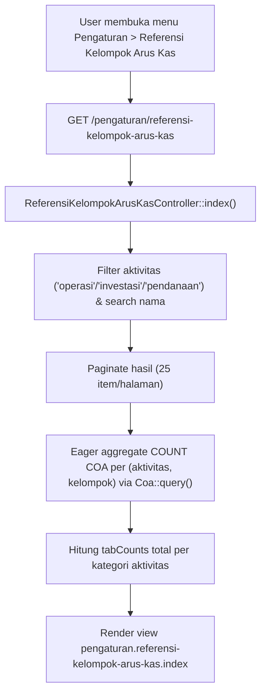
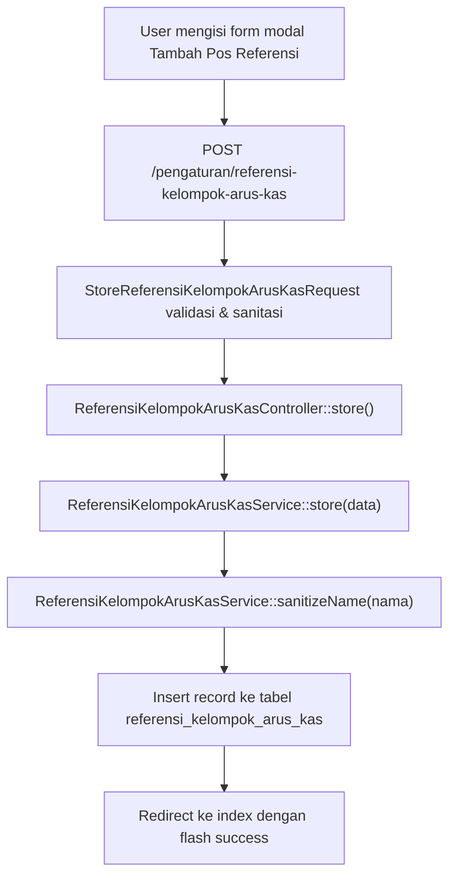
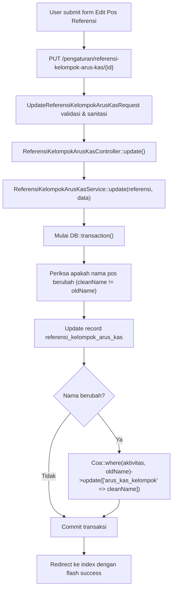
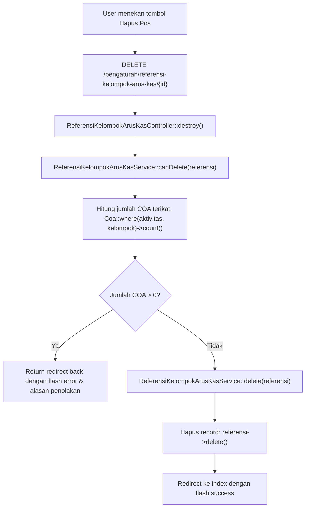
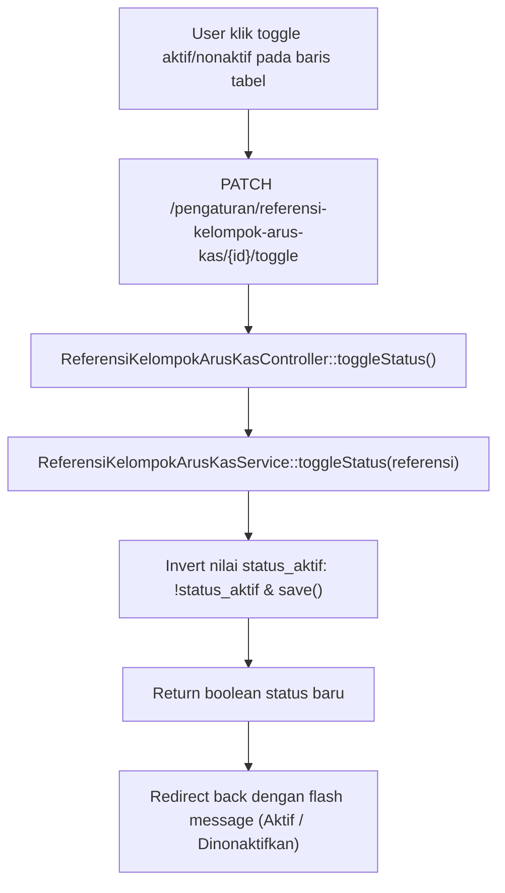
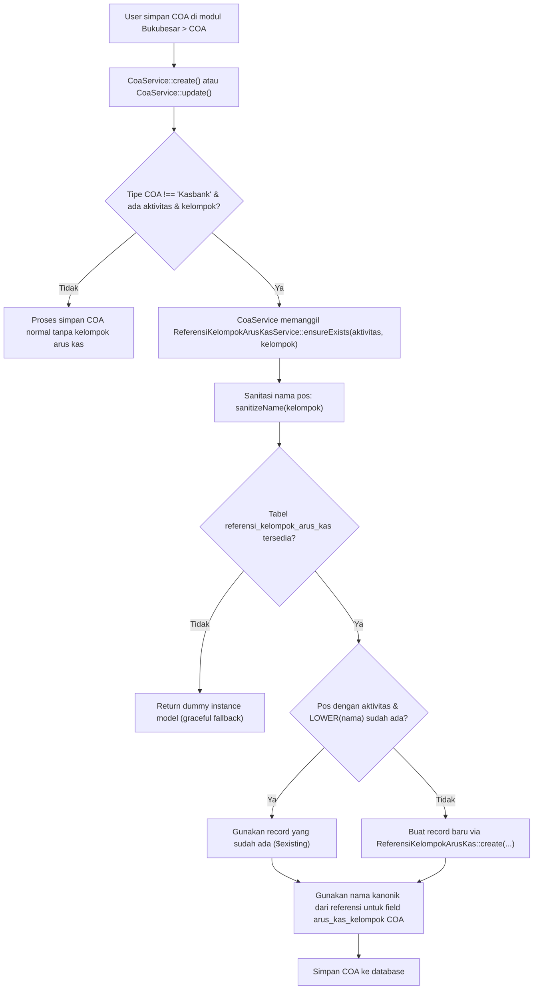

# Dokumentasi Modul Pengaturan — Referensi Kelompok Arus Kas

## Ringkasan Modul

Modul **Pengaturan — Referensi Kelompok Arus Kas** digunakan untuk:

1. Mengelola master data penamaan pos kelompok arus kas terstandarisasi untuk 3 pilar aktivitas arus kas (`operasi`, `investasi`, dan `pendanaan`),
2. Menghilangkan inkonsistensi penamaan akibat kesalahan pengetikan manual (typo, spasi berlebih, kapitalisasi tidak seragam) pada pemetaan COA (*Chart of Accounts*),
3. Melakukan pembaruan berantai (*cascade update*) otomatis ke akun-akun COA terkait ketika nama pos kelompok arus kas diubah,
4. Melindungi integritas data dengan memblokir penghapusan (*restricted delete*) apabila suatu pos referensi masih digunakan oleh satu atau lebih akun COA,
5. Menyediakan mekanisme sinkronisasi otomatis (*auto-insert* / *auto-tagging*) saat pengguna menginput nama kelompok baru langsung melalui form master COA.

Implementasi utama modul ini berada di:

- `routes/web.php`
- `app/Http/Controllers/Pengaturan/ReferensiKelompokArusKasController.php`
- `app/Http/Requests/Pengaturan/StoreReferensiKelompokArusKasRequest.php`
- `app/Http/Requests/Pengaturan/UpdateReferensiKelompokArusKasRequest.php`
- `app/Services/Pengaturan/ReferensiKelompokArusKasService.php`
- `app/Models/ReferensiKelompokArusKas.php`
- `app/Services/Bukubesar/CoaService.php` (konsumsi auto-insert dan dropdown grouping)
- `resources/views/pengaturan/referensi-kelompok-arus-kas/index.blade.php`

---

## Entry Point / API

Semua endpoint dilindungi oleh middleware otorisasi `module.access:pengaturan.referensi-kelompok-arus-kas,<aksi>`.

| Method | Path | Route Name | Controller Method | Izin Diperlukan |
| --- | --- | --- | --- | --- |
| `GET` | `/pengaturan/referensi-kelompok-arus-kas` | `pengaturan.referensi-kelompok-arus-kas.index` | `index()` | `pengaturan.referensi-kelompok-arus-kas,view` |
| `POST` | `/pengaturan/referensi-kelompok-arus-kas` | `pengaturan.referensi-kelompok-arus-kas.store` | `store()` | `pengaturan.referensi-kelompok-arus-kas,create` |
| `PUT` | `/pengaturan/referensi-kelompok-arus-kas/{referensi}` | `pengaturan.referensi-kelompok-arus-kas.update` | `update()` | `pengaturan.referensi-kelompok-arus-kas,update` |
| `DELETE` | `/pengaturan/referensi-kelompok-arus-kas/{referensi}` | `pengaturan.referensi-kelompok-arus-kas.destroy` | `destroy()` | `pengaturan.referensi-kelompok-arus-kas,delete` |
| `PATCH` | `/pengaturan/referensi-kelompok-arus-kas/{referensi}/toggle` | `pengaturan.referensi-kelompok-arus-kas.toggle` | `toggleStatus()` | `pengaturan.referensi-kelompok-arus-kas,update` |

---

## Alur 1: Menampilkan Daftar Referensi Kelompok Arus Kas

Pengguna dapat melihat seluruh master referensi dengan tata letak modern yang mengadopsi standar antarmuka Setting Indikator Kinerja:
- **Header Card**: Tombol kembali melingkar (`rounded-circle`), judul modul, badge `Master Data`, dan ringkasan fungsi modul.
- **Card Header Tabs (`card-header-tabs`)**: Tab klasifikasi aktivitas (`Semua Pos`, `Aktivitas Operasi`, `Aktivitas Investasi`, `Aktivitas Pendanaan`) lengkap dengan badge counter jumlah pos.
- **Filter Toolbar**: Wadah abu-abu lembut (`bg-light border rounded-3`) di mana input pencarian mengisi seluruh ruang kosong yang ada (`flex-grow-1`), eksekusi pencarian dilakukan dengan menekan tombol `Enter`, dan reset dilakukan melalui ikon silang (`x`) di dalam kotak input, berdampingan dengan tombol aksi `+ Tambah Pos Referensi`.
- **Tabel Modern**: Tabel responsif dengan badge status statis (`Aktif` / `Nonaktif`), badge pill jumlah akun COA terkait, dan tombol aksi outline ringkas (pengubahan status dilakukan melalui modal Edit).

### Flowchart



### Algoritma

1. Request diterima oleh `ReferensiKelompokArusKasController::index()`.
2. Controller mengambil query parameter `aktivitas` (default `'semua'`) dan `search`.
3. Membangun query builder `ReferensiKelompokArusKas`:
   - Jika `aktivitas` valid (`operasi`, `investasi`, atau `pendanaan`), tambahkan klausa `where('aktivitas', $aktivitas)`.
   - Jika `search` tidak kosong, tambahkan klausa `where('nama', 'like', "%{$search}%")`.
   - Lakukan pengurutan `orderBy('nama', 'asc')` dan paginasi 25 baris per halaman.
4. Menjalankan agregasi eager count dari model `Coa` yang memiliki `arus_kas_kelompok` tidak null, dikelompokkan berdasarkan `(LOWER(arus_kas_aktivitas), LOWER(arus_kas_kelompok))` untuk mencegah masalah performa N+1 query.
5. Memetakan hasil agregat `aggregate_count` ke properti dinamis `coa_count` pada masing-masing item referensi.
6. Menghitung total data per kategori tab (`semua`, `operasi`, `investasi`, `pendanaan`) untuk badge counter pada antarmuka.
7. Mengembalikan view `pengaturan.referensi-kelompok-arus-kas.index` dengan membawa variabel `referensiList`, `aktivitas`, `search`, dan `tabCounts`.

### Fungsi yang Dipanggil

- `ReferensiKelompokArusKasController::index(Request $request)`
- `ReferensiKelompokArusKas::query()`
- `Coa::query()->whereNotNull('arus_kas_kelompok')->selectRaw(...)->groupBy(...)->get()`

---

## Alur 2: Menambah Pos Referensi Kelompok Baru

### Validasi Request

`StoreReferensiKelompokArusKasRequest` memvalidasi:

- **Sanitasi Pra-Validasi (`prepareForValidation`)**: Menghapus spasi di awal/akhir dan mereduksi spasi beruntun menjadi spasi tunggal (`trim(preg_replace('/\s+/', ' ', $nama))`).
- `aktivitas`: Wajib (`required`), string, bernilai salah satu dari: `operasi`, `investasi`, `pendanaan`.
- `nama`: Wajib (`required`), string, maksimal 150 karakter.
- `status_aktif`: Opsional (`nullable`), bernilai boolean.
- **Validasi Kustom (`after`)**: Memastikan kombinasi `aktivitas` dan `LOWER(nama)` unik secara *case-insensitive* di tabel `referensi_kelompok_arus_kas`.

### Flowchart



### Algoritma

1. Form data dikirim pengguna via modal Tambah Pos.
2. `StoreReferensiKelompokArusKasRequest` membersihkan spasi redundan dan memvalidasi keunikan nama pos dalam aktivitas yang sama.
3. Controller memanggil `ReferensiKelompokArusKasService::store($request->validated())`.
4. Service memastikan nama dibersihkan dengan `sanitizeName()`, lalu mengeksekusi `ReferensiKelompokArusKas::create(...)` dengan default `status_aktif = true`.
5. Controller mengembalikan response redirect ke halaman index dengan pesan sukses "Pos referensi kelompok arus kas berhasil ditambahkan."

### Fungsi yang Dipanggil

- `StoreReferensiKelompokArusKasRequest::prepareForValidation()`
- `StoreReferensiKelompokArusKasRequest::after()`
- `ReferensiKelompokArusKasController::store(StoreReferensiKelompokArusKasRequest $request)`
- `ReferensiKelompokArusKasService::store(array $data)`
- `ReferensiKelompokArusKasService::sanitizeName(string $name)`
- `ReferensiKelompokArusKas::create(array $attributes)`

---

## Alur 3: Mengubah Pos Referensi Kelompok & Cascade Update ke COA

Mengubah nama pos master akan secara otomatis memperbarui seluruh akun COA yang saat ini ditandai dengan nama lama pos tersebut di dalam satu transaksi database atomik (*atomic transaction*).

### Validasi Request

`UpdateReferensiKelompokArusKasRequest` memvalidasi:

- **Sanitasi Pra-Validasi (`prepareForValidation`)**: Mereduksi whitespace ganda dan trimming.
- `nama`: Wajib (`required`), string, maksimal 150 karakter.
- `status_aktif`: Wajib (`required`), boolean.
- **Validasi Kustom (`after`)**: Memastikan nama baru unik secara *case-insensitive* terhadap aktivitas pos tersebut, mengabaikan record pos yang sedang diedit (`id != $currentId`).

### Flowchart



### Algoritma

1. Request diterima dengan data perubahan nama atau status aktif.
2. `UpdateReferensiKelompokArusKasRequest` memvalidasi input.
3. Controller memanggil `ReferensiKelompokArusKasService::update($referensi, $data)`.
4. Service menjalankan blok `DB::transaction()`:
   - Mencatat `$oldName = $ref->nama`.
   - Membersihkan `$cleanName = sanitizeName($data['nama'])`.
   - Mengupdate data model `$ref->update(...)`.
   - Jika `$cleanName !== $oldName`, jalankan query mass-update ke tabel `coa`:
     ```php
     Coa::where('arus_kas_aktivitas', $ref->aktivitas)
         ->where('arus_kas_kelompok', $oldName)
         ->update(['arus_kas_kelompok' => $cleanName]);
     ```
5. Mengembalikan model yang telah diperbarui dan melakukan redirect ke index dengan notifikasi sukses.

### Fungsi yang Dipanggil

- `UpdateReferensiKelompokArusKasRequest::after()`
- `ReferensiKelompokArusKasController::update(UpdateReferensiKelompokArusKasRequest $request, ReferensiKelompokArusKas $referensi)`
- `ReferensiKelompokArusKasService::update(ReferensiKelompokArusKas $ref, array $data)`
- `DB::transaction(Closure $callback)`
- `Coa::where(...)->update(...)`

---

## Alur 4: Menghapus Pos Referensi Kelompok (Restricted Delete)

Pos referensi yang masih digunakan oleh akun COA **tidak boleh dihapus** untuk menjaga konsistensi laporan keuangan.

### Flowchart



### Algoritma

1. User mengonfirmasi penghapusan pos pada dialog antarmuka.
2. Controller memanggil `ReferensiKelompokArusKasService::canDelete($referensi)`.
3. Method `canDelete()` menghitung jumlah akun COA yang memakai `arus_kas_kelompok = $referensi->nama` pada aktivitas terkait:
   - Jika `$count > 0`: `allowed = false`, dengan pesan alasan `"Pos ini sedang digunakan oleh {$count} akun COA."`.
   - Jika `$count === 0`: `allowed = true`.
4. Di controller, jika `allowed === false`, batalkan proses dan kembalikan redirect `back()` dengan flash message error.
5. Jika `allowed === true`, panggil `ReferensiKelompokArusKasService::delete($referensi)` yang menghapus record dari database.
6. Redirect ke halaman index dengan pesan sukses "Pos referensi kelompok arus kas berhasil dihapus."

### Fungsi yang Dipanggil

- `ReferensiKelompokArusKasController::destroy(ReferensiKelompokArusKas $referensi)`
- `ReferensiKelompokArusKasService::canDelete(ReferensiKelompokArusKas $ref)`
- `ReferensiKelompokArusKasService::delete(ReferensiKelompokArusKas $ref)`
- `ReferensiKelompokArusKas::delete()`

---

## Alur 5: Mengubah Status Aktif / Nonaktif (Toggle Status)

Pos yang dinonaktifkan tidak akan muncul pada daftar dropdown/pilihan cepat saat membuat atau mengedit COA, namun data historis pada COA tetap terjaga.

### Flowchart



### Algoritma

1. Request `PATCH` dikirim ke endpoint toggle.
2. Controller mengeksekusi `ReferensiKelompokArusKasService::toggleStatus($referensi)`.
3. Service membalik nilai `$ref->status_aktif = ! $ref->status_aktif` dan menyimpan perubahan.
4. Controller memberikan pesan feedback sesuai status baru ("Pos referensi berhasil diaktifkan" atau "Pos referensi berhasil dinonaktifkan") dan redirect kembali ke halaman pemanggil.

### Fungsi yang Dipanggil

- `ReferensiKelompokArusKasController::toggleStatus(ReferensiKelompokArusKas $referensi)`
- `ReferensiKelompokArusKasService::toggleStatus(ReferensiKelompokArusKas $ref)`
- `ReferensiKelompokArusKas::save()`

---

## Alur 6: Auto-Insert / Sinkronisasi Otomatis dari Form COA

Saat pengguna membuat atau mengedit akun COA (non-Kasbank) dan memasukkan nama kelompok arus kas yang belum terdaftar di master referensi, sistem secara otomatis mendaftarkan pos baru tersebut tanpa menimbulkan error validasi atau memutus alur kerja pengguna.

### Flowchart



### Algoritma

1. Pada saat `CoaService::create($data)` atau `CoaService::update($coa, $data)` dieksekusi:
2. Jika `tipe_coa` bukan `'Kasbank'`, dan kedua nilai `arus_kas_aktivitas` serta `arus_kas_kelompok` diisi:
3. Memanggil `ReferensiKelompokArusKasService::ensureExists($aktivitas, $kelompok)`.
4. Method `ensureExists()`:
   - Membersihkan format teks via `sanitizeName()`.
   - Memeriksa ketersediaan tabel di skema database (graceful fallback jika migration belum dijalankan).
   - Mencari apakah kombinasi `aktivitas` dan `LOWER(nama)` sudah ada di database.
   - Bila sudah ada, mengembalikan record eksisting tersebut.
   - Bila belum ada, otomatis membuat record baru dengan `status_aktif = true` dan mengembalikan instance baru tersebut.
5. `CoaService` mengadopsi nama kanonik yang tersimpan di master (`$ref->nama`) agar konsisten huruf besar/kecilnya, lalu menyimpan record COA.

### Fungsi yang Dipanggil

- `CoaService::create(array $data)`
- `CoaService::update(Coa $coa, array $data)`
- `ReferensiKelompokArusKasService::ensureExists(string $aktivitas, string $nama)`
- `ReferensiKelompokArusKasService::sanitizeName(string $name)`
- `ReferensiKelompokArusKas::where(...)->whereRaw('LOWER(nama) = ?', ...)->first()`
- `ReferensiKelompokArusKas::create(...)`

---

## Catatan Penting Bisnis

1. **Aturan Akun Kasbank vs Non-Kasbank**:
   - Akun COA dengan `tipe_coa = 'Kasbank'` bertindak sebagai akun kas/setara kas itu sendiri, sehingga **tidak boleh** memiliki kelompok arus kas (`arus_kas_kelompok` dan `arus_kas_aktivitas` selalu diset `null`).
   - Akun non-Kasbank (seperti Pendapatan, Beban, Aset Tetap, Liabilitas, Ekuitas) dapat dikaitkan dengan 3 pilar aktivitas arus kas beserta pos kelompoknya.
2. **Pembersihan Whitespace Spasi**:
   - Sistem menerapkan sanitasi ketat terhadap input nama kelompok: menghapus spasi awal/akhir (*trim*) dan mengubah spasi berulang menjadi spasi tunggal. Hal ini mencegah terciptanya variasi duplikasi palsu seperti `"Penerimaan Operasional"` dan `"Penerimaan  Operasional"`.
3. **Pencocokan Huruf Besar / Kecil (*Case-Insensitive*)**:
   - Pengecekan keunikan nama pos dalam suatu aktivitas selalu menggunakan fungsi SQL `LOWER(nama)` / `mb_strtolower()`, sehingga mencegah redundansi pos seperti `"Beban Gaji"` dan `"beban gaji"`.
4. **Keamanan Penghapusan (*Restricted Delete*)**:
   - Pos referensi yang sedang terikat dengan satu atau lebih akun COA tidak dapat dihapus melalui antarmuka maupun service (`DomainException`). Jika pengguna ingin menghentikan penggunaan pos tersebut untuk COA baru tanpa menghapus data historis, pengguna dapat mengubah statusnya menjadi **Nonaktif** via fitur *Toggle Status*.
5. **Eager Aggregation untuk Menghindari Query N+1**:
   - Penghitungan jumlah akun COA pada halaman daftar referensi dihitung dalam satu kueri agregasi massal (`selectRaw` + `groupBy`) lalu dipetakan ke koleksi referensi di memori, menjaga waktu pemuatan halaman tetap cepat dan efisien.
