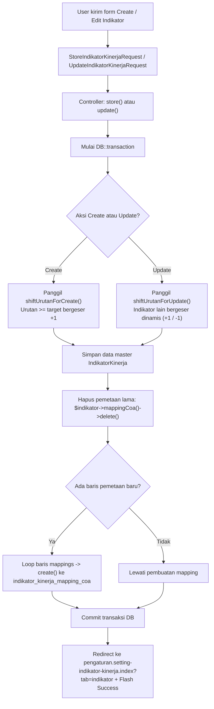
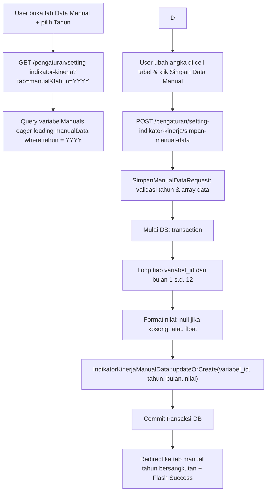
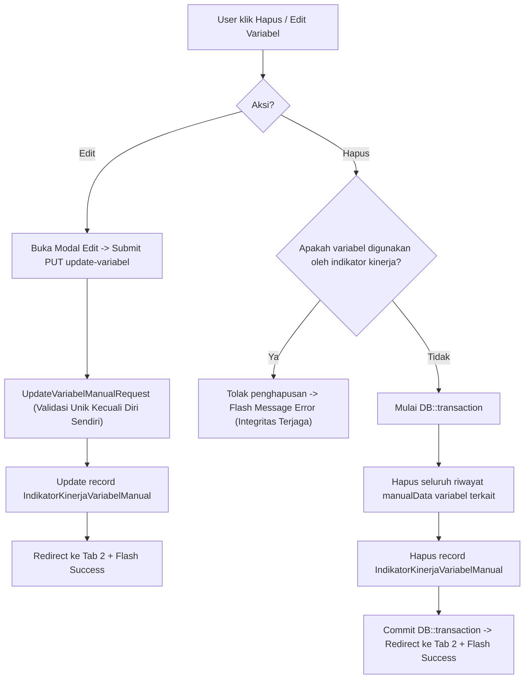
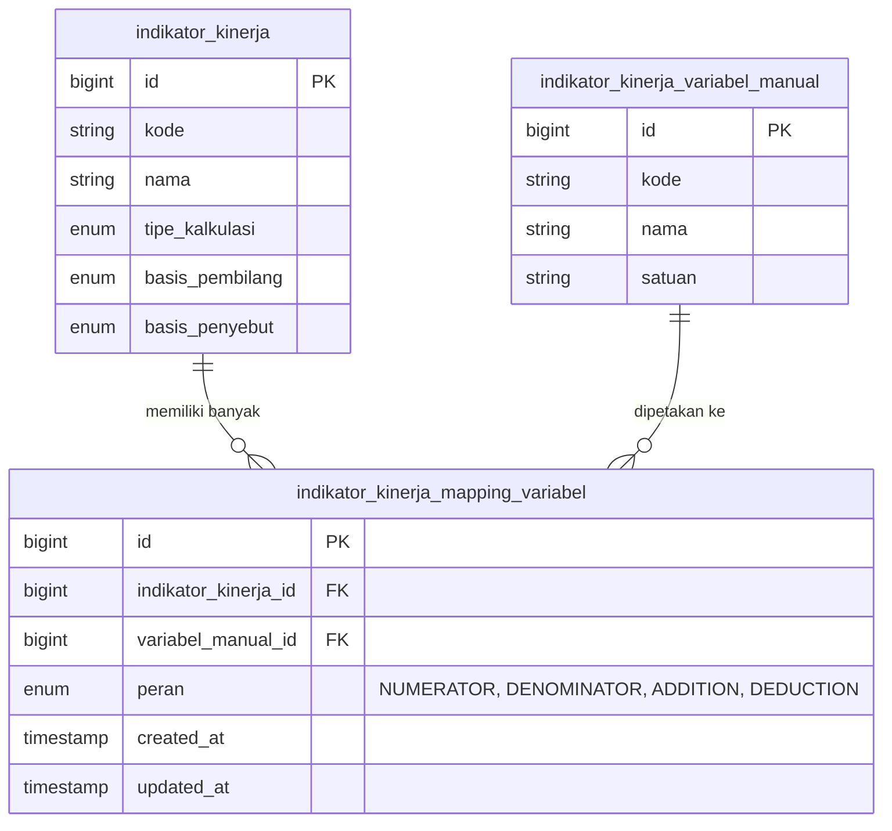
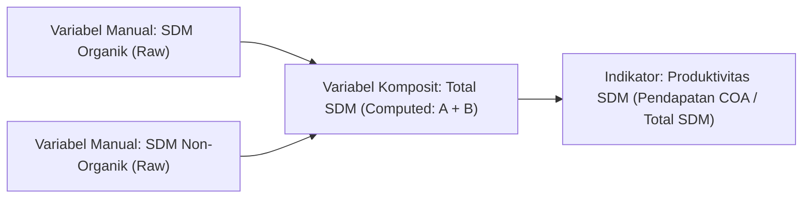
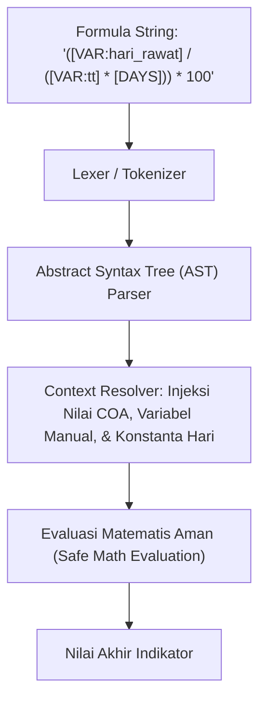

# Dokumentasi Modul Pengaturan — Setting Indikator Kinerja

## Ringkasan Modul

Modul **Setting Indikator Kinerja** digunakan oleh bagian akuntansi dan manajemen untuk mengelola konfigurasi seluruh parameter indikator kinerja (KPI) rumah sakit serta menginput data operasional manual yang dibutuhkan oleh formula indikator.

Fitur utama meliputi:
1. Kartu ringkasan master konfigurasi: Total Indikator, Indikator Aktif, Indikator Nonaktif, dan Total Variabel Manual.
2. Pengaturan master indikator kinerja: kode, nama, satuan, formula/tipe kalkulasi, basis pembilang, basis penyebut, dan rentang ambang batas target evaluasi (Hijau / Kuning / Merah).
3. Pemetaan akun COA dinamis dengan berbagai peran (*Numerator*, *Denominator*, *Addition*, *Deduction*, serta opsi *Exclusion* / akun pengecualian).
4. Pengelolaan master variabel manual operasional (misalnya: Persentase Lolos BAHV Pertama JKN, Jumlah SDM Non Organik).
5. Matriks input dan update data bulanan (Januari s.d. Desember) untuk seluruh variabel manual per tahun anggaran.

Implementasi utama modul ini berada di:
- `routes/web.php`
- `app/Http/Controllers/Pengaturan/SettingIndikatorKinerjaController.php`
- `app/Http/Requests/Pengaturan/StoreIndikatorKinerjaRequest.php`
- `app/Http/Requests/Pengaturan/UpdateIndikatorKinerjaRequest.php`
- `app/Http/Requests/Pengaturan/StoreVariabelManualRequest.php`
- `app/Http/Requests/Pengaturan/SimpanManualDataRequest.php`
- `app/Models/IndikatorKinerja.php`
- `app/Models/IndikatorKinerjaMappingCoa.php`
- `app/Models/IndikatorKinerjaVariabelManual.php`
- `app/Models/IndikatorKinerjaManualData.php`
- `resources/views/pengaturan/setting-indikator-kinerja/index.blade.php`
- `resources/views/pengaturan/setting-indikator-kinerja/create.blade.php`
- `resources/views/pengaturan/setting-indikator-kinerja/edit.blade.php`

---

## Entry Point / API

Modul ini dikendalikan oleh middleware `module.access:pengaturan.setting-indikator-kinerja,[action]`.

| Method | Path | Route Name | Controller Method | Izin |
| --- | --- | --- | --- | --- |
| `GET` | `/pengaturan/setting-indikator-kinerja` | `pengaturan.setting-indikator-kinerja.index` | `index(Request $request)` | view |
| `GET` | `/pengaturan/setting-indikator-kinerja/create` | `pengaturan.setting-indikator-kinerja.create` | `create()` | create |
| `POST` | `/pengaturan/setting-indikator-kinerja` | `pengaturan.setting-indikator-kinerja.store` | `store(StoreIndikatorKinerjaRequest $request)` | create |
| `POST` | `/pengaturan/setting-indikator-kinerja/variabel` | `pengaturan.setting-indikator-kinerja.store-variabel` | `storeVariabel(StoreVariabelManualRequest $request)` | create |
| `GET` | `/pengaturan/setting-indikator-kinerja/{indikator}/edit` | `pengaturan.setting-indikator-kinerja.edit` | `edit(IndikatorKinerja $indikator)` | update |
| `PUT` | `/pengaturan/setting-indikator-kinerja/{indikator}` | `pengaturan.setting-indikator-kinerja.update` | `update(UpdateIndikatorKinerjaRequest $request, IndikatorKinerja $indikator)` | update |
| `POST` | `/pengaturan/setting-indikator-kinerja/simpan-manual-data` | `pengaturan.setting-indikator-kinerja.simpan-manual-data` | `simpanManualData(SimpanManualDataRequest $request)` | update |
| `PUT` | `/pengaturan/setting-indikator-kinerja/variabel/{variabelManual}` | `pengaturan.setting-indikator-kinerja.update-variabel` | `updateVariabel(UpdateVariabelManualRequest $request, IndikatorKinerjaVariabelManual $variabelManual)` | update |
| `DELETE` | `/pengaturan/setting-indikator-kinerja/{indikator}` | `pengaturan.setting-indikator-kinerja.destroy` | `destroy(IndikatorKinerja $indikator)` | delete |
| `DELETE` | `/pengaturan/setting-indikator-kinerja/variabel/{variabelManual}` | `pengaturan.setting-indikator-kinerja.destroy-variabel` | `destroyVariabel(Request $request, IndikatorKinerjaVariabelManual $variabelManual)` | delete |

---

## Parameter Query (Halaman Index)

Endpoint `GET /pengaturan/setting-indikator-kinerja` menerima parameter query berikut:
- `tab`: Pilihan tab antarmuka (`indikator` untuk Manajemen Indikator & Target RAG, `manual` untuk Entri Data Manual Bulanan, default: `indikator`).
- `tahun`: Tahun anggaran untuk matriks entri data manual (integer 2000–2100, default: tahun berjalan).
- `q`: Kata kunci pencarian kode, nama, atau formula indikator pada Tab 1 (opsional).
- `focus_var`: ID variabel manual untuk penyorotan otomatis (*deep-linking*) dan scroll langsung ke baris matriks terkait pada Tab 2 (opsional).

---

## Validasi Request

### 1. `StoreIndikatorKinerjaRequest` & `UpdateIndikatorKinerjaRequest`
Memvalidasi formulir tambah dan edit indikator kinerja:
- `kode`: Wajib, string, maksimal 50 karakter, unik pada tabel `indikator_kinerja` (dikecualikan untuk ID indikator saat update).
- `nama`: Wajib, string, maksimal 100 karakter.
- `satuan`: Wajib, nilai valid dari enum `SatuanIndikator` (`%`, `Kali`, `Poin`, `Hari`, `Jam`, `Menit`, `Rp`, `Juta Rp`, `Orang`, `Pasien`, `TT`, `Dokumen`, `Juta/org/bln`).
- `tipe_kalkulasi`: Wajib, nilai valid dari enum `TipeKalkulasi` (`RASIO`, `TURNOVER`, `MANUAL`).
- `basis_pembilang`: Opsional, enum `BasisPembilang` (`COA`, `SURPLUS`, `NONE`).
- `basis_penyebut`: Opsional, enum `BasisPenyebut` (`COA`, `RBA`, `MANUAL`, `NONE`).
- `variabel_manual_id`: Opsional, integer, harus ada di tabel `indikator_kinerja_variabel_manual,id`.
- `definisi_operasional`: Opsional, teks bebas.
- `urutan`: Opsional, integer $\ge 1$ (urutan prioritas tampilan kartu indikator di dashboard).
- `status_aktif`: Boolean (otomatis dinormalisasi di `prepareForValidation`).
- `pola_evaluasi`: Wajib, enum `PolaEvaluasi` (`HIGHER_IS_BETTER`, `LOWER_IS_BETTER`, `TARGET_BAND`).
- `target_hijau_min`, `target_hijau_max`, `target_kuning_min`, `target_kuning_max`, `target_merah_min`, `target_merah_max`: Opsional, nilai numerik ambang batas.
- `mappings`: Opsional, array pemetaan COA:
  - `mappings.*.coa_id`: Wajib jika mappings diisi, integer, harus ada di tabel `coa,id`.
  - `mappings.*.peran`: Wajib, enum `PeranCoa` (`NUMERATOR`, `DENOMINATOR`, `ADDITION`, `DEDUCTION`).
  - `mappings.*.is_excluded`: Opsional, boolean.

### 2. `StoreVariabelManualRequest`
Memvalidasi penambahan master variabel manual:
- `kode`: Wajib, string, maksimal 50 karakter, unik pada tabel `indikator_kinerja_variabel_manual`.
- `nama`: Wajib, string, maksimal 100 karakter.
- `satuan`: Wajib, nilai valid dari enum `SatuanIndikator`.
- `deskripsi`: Opsional, string maksimal 1000 karakter.

### 3. `UpdateVariabelManualRequest`
Memvalidasi pembaruan master variabel manual:
- `kode`: Wajib, string, maksimal 50 karakter, unik pada tabel `indikator_kinerja_variabel_manual` dengan pengecualian ID variabel manual yang sedang diedit (`Rule::unique()->ignore($variabelId)`).
- `nama`: Wajib, string, maksimal 100 karakter.
- `satuan`: Wajib, nilai valid dari enum `SatuanIndikator`.
- `deskripsi`: Opsional, string maksimal 1000 karakter.

### 4. `SimpanManualDataRequest`
Memvalidasi simpan matriks nilai bulanan variabel manual:
- `tahun`: Wajib, integer antara 2000 s.d. 2100.
- `data`: Wajib, array terindeks ID variabel `[variabel_id => [bulan => nilai]]`.
- `data.*`: Array per bulan.
- `data.*.*`: Nilai numerik atau kosong/null.

---

## Alur 1: Create / Edit Indikator Kinerja & Sinkronisasi COA

Alur ini memproses pembuatan indikator baru atau pembaruan konfigurasi indikator yang sudah ada beserta relasi pemetaan akun COA-nya dan manajemen urutan prioritas otomatis.

### Flowchart

### Algoritma

1. Form create secara otomatis menghitung dan menampilkan nilai default `urutan` prioritas berdasarkan urutan indikator terakhir (`max('urutan') + 1`, atau `1` bila belum ada indikator).
2. Request diterima dan divalidasi oleh `StoreIndikatorKinerjaRequest` atau `UpdateIndikatorKinerjaRequest`.
3. Controller membungkus seluruh operasi dalam `DB::transaction`.
4. Memisahkan data indikator utama dari payload pemetaan COA (`$request->safe()->except('mappings')`).
5. **Pergeseran Urutan Prioritas**:
   - **Pada Create (`store`)**: Jika `urutan` tidak diisi, otomatis diset ke `max('urutan') + 1`. Metode privat `shiftUrutanForCreate()` dipanggil: seluruh indikator yang memiliki `urutan >= target` digeser ke bawah (+1) untuk memberi ruang dan mencegah urutan ganda.
   - **Pada Edit (`update`)**: Metode privat `shiftUrutanForUpdate()` dipanggil:
     - Jika dipindahkan ke urutan lebih kecil (`newUrutan < oldUrutan`), indikator antara `newUrutan` dan `oldUrutan - 1` bergeser ke bawah (+1).
     - Jika dipindahkan ke urutan lebih besar (`newUrutan > oldUrutan`), indikator antara `oldUrutan + 1` dan `newUrutan` bergeser ke atas (-1).
     - Jika urutan sama namun terdapat duplikasi dengan record lain, indikator lain bergeser (+1).
   - **Pada Hapus (`destroy`)**: Setelah indikator dihapus, indikator dengan `urutan > target` digeser ke atas (-1) agar urutan tetap berkesinambungan tanpa celah (*gap*).
6. Record `IndikatorKinerja` dibuat atau diperbarui.
7. Metode privat `syncMappings()` dipanggil:
   - Menghapus semua relasi COA lama via `$indikator->mappingCoa()->delete()`.
   - Melakukan iterasi pada array `$mappings`, menyaring baris yang memiliki `coa_id`, dan menyimpannya sebagai record baru dengan atribut `coa_id`, `peran`, dan `is_excluded`.
8. Transaksi database di-commit.
9. Pengguna dialihkan kembali ke daftar indikator dengan flash pesan notifikasi sukses.

### Fungsi yang Dipanggil

- `SettingIndikatorKinerjaController::create()`
- `SettingIndikatorKinerjaController::store()`
- `SettingIndikatorKinerjaController::edit()`
- `SettingIndikatorKinerjaController::update()`
- `SettingIndikatorKinerjaController::shiftUrutanForCreate()`
- `SettingIndikatorKinerjaController::shiftUrutanForUpdate()`
- `SettingIndikatorKinerjaController::syncMappings()`
- `SettingIndikatorKinerjaController::destroy()`

---

## Alur 2: Matriks Input Data Bulanan Variabel Manual

Alur ini mengelola pengisian matriks data numerik untuk variabel manual bulanan (Januari s.d. Desember) pada tahun tertentu.

### Flowchart

### Algoritma

1. Pada tampilan index dengan query string `?tab=manual&tahun=YYYY`, controller memuat seluruh `IndikatorKinerjaVariabelManual` beserta relasi `manualData` yang difilter khusus pada tahun tersebut.
2. Pengguna mengisi atau mengosongkan nilai pada sel input bulan 1 s.d. 12.
3. Form disubmit via method `POST` ke endpoint `pengaturan.setting-indikator-kinerja.simpan-manual-data`.
4. `SimpanManualDataRequest` memastikan `tahun` valid (2000-2100) dan struktur `data` berupa array.
5. Controller menjalankan `DB::transaction`:
   - Melakukan loop ganda: `foreach ($data as $variabelId => $months)` lalu `foreach ($months as $bulan => $nilai)`.
   - Memvalidasi rentang bulan ($1 \le \text{bulan} \le 12$).
   - Mengubah nilai string kosong atau null menjadi nilai database `NULL`, atau mem-parsing string angka menjadi `float`.
   - Menjalankan `IndikatorKinerjaManualData::updateOrCreate()` dengan kunci komposit `['variabel_id', 'tahun', 'bulan']`.
6. Transaksi database di-commit.
7. Pengguna diarahkan kembali ke tab data manual pada tahun yang sama dengan flash message sukses.

### Fungsi yang Dipanggil

- `SettingIndikatorKinerjaController::index()`
- `SettingIndikatorKinerjaController::storeVariabel()`
- `SettingIndikatorKinerjaController::simpanManualData()`
- `IndikatorKinerjaManualData::updateOrCreate()`

---

## Alur 3: Siklus CRUD Master Variabel Manual & Proteksi Integritas

Alur ini mengelola pembaruan master variabel manual dan penghapusan variabel manual dengan proteksi integritas relasi foreign key.

### Flowchart

### Algoritma

1. **Pembaruan Variabel**:
   - Pengguna menekan tombol Edit pada baris variabel di Tab 2, membuka modal edit `#modalEditVariabel`.
   - Mengubah `kode`, `nama`, `satuan`, atau `deskripsi`, lalu submit ke endpoint `update-variabel`.
   - `UpdateVariabelManualRequest` memvalidasi atribut termasuk validasi unik `kode` dengan mengabaikan ID variabel bersangkutan.
   - Variabel diperbarui dan sistem redirect ke Tab 2 dengan flash message notifikasi sukses.
2. **Penghapusan Variabel & Proteksi Integritas**:
   - Pengguna menekan tombol Hapus pada baris variabel.
   - Pada view Blade, jika variabel terikat pada indikator (`indikatorKinerja()->exists()`), tombol berstatus disabled dengan tooltip nama-nama indikator yang menggunakannya.
   - Controller melakukan verifikasi defensif `$variabelManual->indikatorKinerja()->exists()`. Jika ya, request langsung ditolak dengan pesan error.
   - Jika aman, controller menjalankan `DB::transaction` untuk menghapus seluruh relasi riwayat bulanan di `indikator_kinerja_manual_data`, lalu menghapus record variabel manual.
   - Sistem redirect ke Tab 2 dengan flash message notifikasi sukses.

### Fungsi yang Dipanggil

- `SettingIndikatorKinerjaController::updateVariabel()`
- `SettingIndikatorKinerjaController::destroyVariabel()`

---

## Catatan Penting Bisnis

1. **Integritas Referensial**:
   - Penghapusan data master `IndikatorKinerja` melalui `destroy()` secara otomatis menghapus pemetaan akun terkait di tabel `indikator_kinerja_mapping_coa` melalui aturan *Foreign Key CASCADE*.
2. **Pola Evaluasi Target Fleksibel**:
   - `HIGHER_IS_BETTER`: Kinerja dikatakan prima (Hijau) jika nilai aktual $\ge$ target hijau minimum (misal: Capaian Pendapatan, EBITDA Margin, Profitabilitas / NPM, Kualitas Klaim JKN, Beban Dana Sosial, Produktifitas Karyawan).
   - `LOWER_IS_BETTER`: Kinerja dikatakan prima (Hijau) jika nilai aktual $\le$ target hijau maksimum (misal: Beban Farmasi, Beban Operasional, Collection Period, Perputaran Persediaan).
   - `TARGET_BAND`: Kinerja prima jika nilai aktual berada dalam rentang target optimal tertentu (misal: Beban Pegawai 20% - 25%). Ambang batas dibuat berkesinambungan (contiguous) dengan target kuning untuk mencegah celah nilai pecahan (fractional gap).
3. **Penyimpanan Nilai Kosong pada Matriks Manual**:
   - Jika pengguna menghapus isi sel pada matriks bulanan, nilai disimpan sebagai `NULL` di database, bukan `0`. Hal ini penting agar sistem evaluasi KPI dapat membedakan antara nilai riil nol dengan data bulan yang memang belum diinput.
4. **Indikator Baseline Rumah Sakit**:
   - Sistem secara bawaan menyediakan 11 indikator kinerja rumah sakit (Capaian Pendapatan, EBITDA, Profitabilitas, Beban Pegawai, Beban Farmasi, Beban Operasional, Collection Period, Kualitas Klaim JKN, Perputaran Persediaan, Beban Dana Sosial, dan Produktifitas Karyawan) serta 2 variabel manual (`lolos_bahv_pertama_jkn` dan `sdm_non_organik`) melalui seeder.
5. **Ketersediaan Opsi Akun COA pada Form Create & Edit**:
   - Query opsi akun COA memuat seluruh akun aktif (`status_aktif = 1` maupun `status_aktif IS NULL` untuk kompatibilitas data warisan), baik akun header/induk maupun akun leaf/detail karena formula indikator mendukung agregasi hierarki akun.
   - Pada form edit, seluruh akun yang sudah terpetakan pada indikator terkait dipastikan selalu diikutsertakan dalam dropdown (`orWhereIn('id', $existingCoaIds)`) agar status pilihan akun tetap terpilih secara konsisten meskipun akun tersebut berstatus nonaktif. Akun nonaktif diberi penanda `(Nonaktif)` pada label opsi.
6. **Ergonomi Layout Form & Visualisasi Formula Dinamis**:
   - Form `create` dan `edit` menerapkan arsitektur 2 kolom responsif: kolom kiri memuat pengaturan utama (Identitas Dasar, Sumber Data Formula kontekstual, Matriks Ambang Batas RAG 3 kolom tanpa kartu bersarang, dan Tabel Pemetaan Akun COA), sedangkan kolom kanan memuat panel sticky *Live Preview Kartu KPI*, pengaturan keaktifan, urutan prioritas, dan tombol aksi publikasi cepat.
   - **Pemisahan Peran Form vs Live Preview**:
     - **Form Kiri**: Badge `#formulaVisualBadge` berfokus pada konteks **Basis Data** yang dipilih pengguna secara real-time (misal: `Basis: Buku Besar ÷ Target RBA`, `Basis: Buku Besar ÷ Buku Besar`, atau `Basis: Variabel Manual Bulanan`).
     - **Live Preview Kanan**: Memuat visualisasi formula matematis yang dinamis dan representatif sesuai pilihan dropdown:
       - **Rasio**: `[ {Pembilang} ] ÷ [ {Penyebut} ] × 100%` (bila satuan `%`; jika satuan rasio non-persen seperti *Kali*, formula menampilkan pembagian langsung tanpa pengali)
       - **Turnover**: `[ {Pembilang} ] ÷ [ {Penyebut} ] × 365 Hari`
       - **Manual**: `[ Manual: {Nama Variabel} ]`
     - Perubahan pilihan dropdown `tipe_kalkulasi`, `basis_pembilang`, `basis_penyebut`, `variabel_manual_id`, dan `satuan` secara reaktif langsung memperbarui badge basis dan formula Live Preview tanpa reload.
   - Tipe kalkulasi `MANUAL` secara otomatis menyederhanakan alur dengan menyembunyikan input pembilang/penyebut serta pemetaan akun COA dan menampilkan pilihan variabel manual yang relevan.
   - Jika tipe `RASIO` atau `TURNOVER` memilih basis penyebut `MANUAL` (Variabel Manual Non-Akuntansi), input variabel manual otomatis muncul untuk melengkapi denominator formula.
7. **Proteksi Integritas Variabel Manual**: Tombol hapus variabel berstatus disabled pada antarmuka jika variabel digunakan oleh indikator kinerja, dan controller secara defensif menolak request penghapusan via `indikatorKinerja()->exists()`.
8. **Ergonomi Spreadsheet Tab 2 (Contained Scrollable Viewport & 2D Sticky Panes)**: Kontainer tabel matriks memiliki tinggi fleksibel yang dapat diubah ukurannya (*resizable drag handle*) dengan toleransi 220px s.d. 80vh dan tersimpan otomatis di `localStorage`. Header kolom dan kolom No, Kode, Nama Variabel bersifat sticky.
9. **Navigasi Keyboard ala Excel**: Pengguna dapat berpindah sel menggunakan tombol panah (*Arrow keys*) dan *Enter* tanpa mengubah nilai numerik sel, dilengkapi *crosshair highlight* baris dan kolom aktif.
10. **Transparansi Visual RAG & COA Popover (Tab 1)**: Ambang batas target ditampilkan via horizontal segmented range bar yang ramping, dan rincian pemetaan akun COA (`[+ Num]`, `[Denom]`, `[- Excl]`) dapat diinspeksi langsung melalui popover interaktif tanpa berpindah halaman.
11. **Cross-Tab Synergy & Deep Linking**: Mengklik badge variabel manual di Tab 1 mengarahkan pengguna langsung ke baris variabel terkait di Tab 2 dengan animasi flash highlight, dan baris variabel di Tab 2 menampilkan impact badges indikator yang mengonsumsinya.
12. **Resolusi Cerdas Akun COA (Saldo Neraca Kumulatif vs Mutasi Laba Rugi)**:
    - Sistem secara otomatis mengidentifikasi sifat akuntansi dari tiap akun COA yang dipetakan berdasarkan `tipe_coa`:
      - **Akun Neraca** (*Aktiva*, *Pasiva/Kewajiban*, *Ekuitas*): Diambil sebagai **Saldo Kumulatif per tanggal akhir periode (`endDate`)**, dengan normalisasi saldo kredit untuk Pasiva dan Ekuitas sehingga menghasilkan nilai rasio positif. Kontra-aset (seperti Akumulasi Penyusutan) secara alami mengurangi nilai total aset.
      - **Akun Laba Rugi** (*Pendapatan*, *Beban*): Diambil sebagai **Mutasi Transaksi periode berjalan (`startDate` s.d. `endDate`)**.
    - Hal ini memungkinkan konfigurasi indikator rasio likuiditas, solvabilitas, dan profitabilitas eksekutif (*Current Ratio*, *Cash Ratio*, *ROE*, *TMSTA*, *ROI*, *TATO*) langsung melalui pemetaan COA standar tanpa perlu perubahan skema atau variabel manual.

---

## Pembahasan Arsitektur: Dukungan Multi-Variabel Manual (>1 Variabel)

### 1. Refleksi Kondisi Saat Ini vs Kebutuhan Riil Rumah Sakit

#### Kondisi Arsitektur Saat Ini
Saat ini, model `IndikatorKinerja` dirancang dengan asumsi **paling banyak 1 variabel manual** per indikator:
1. **Skema Database**: Kolom tunggal `variabel_manual_id` bertipe *Foreign Key* opsional (`1-to-1 / belongsTo`).
2. **Keterbatasan Peran**:
   - `BasisPembilang` hanya mengenal `COA`, `SURPLUS`, dan `NONE` (belum ada opsi `MANUAL`).
   - `BasisPenyebut` memiliki opsi `MANUAL`, namun hanya menampung 1 ID variabel (seperti pada *Produktifitas Karyawan* = Pendapatan COA / `sdm_non_organik`).
   - `TipeKalkulasi::MANUAL` mengambil nilai mentah langsung dari 1 variabel (seperti pada *Kualitas Klaim JKN* = `bahv_jkn`).

#### Mengapa Kebutuhan >1 Variabel Manual Pasti Akan Terjadi?
Di rumah sakit (standar Kemenkes / SPM / KARS), banyak KPI standar yang membutuhkan **kombinasi variabel non-akuntansi**:
1. **Rasio Manual vs Manual**:
   - **BOR (*Bed Occupancy Rate*)**: $\frac{\text{Hari Perawatan (Manual A)}}{\text{Jumlah TT (Manual B)} \times \text{Hari Periode}} \times 100\%$
   - **BTO (*Bed Turn Over*)**: $\frac{\text{Jumlah Pasien Keluar (Manual A)}}{\text{Jumlah Tempat Tidur (Manual B)}}$
   - **Rasio Perawat per Tempat Tidur**: $\frac{\text{Jumlah Perawat (Manual A)}}{\text{Jumlah Tempat Tidur (Manual B)}}$
2. **Agregasi / Penjumlahan Beberapa Variabel Manual**:
   - **Produktivitas SDM Menyeluruh**: $\frac{\text{Total Pendapatan (COA)}}{\text{SDM Organik (Manual A)} + \text{SDM Non-Organik (Manual B)}}$
   - **Total Kapasitas Layanan**: Penjumlahan manual dari beberapa unit (misal: TT ICU + TT Isolasi + TT Reguler).

---

### 2. Tiga Pilihan Pendekatan Solusi (Architectural Options)

Berikut adalah spektrum solusi arsitektural yang dapat dipertimbangkan:

| Aspek | Opsi A: Tabel Mapping Variabel (`indikator_kinerja_mapping_variabel`) | Opsi B: Variabel Komposit / Turunan (*Computed Variable*) | Opsi C: Dynamic Expression Engine (*Formula String*) |
| :--- | :--- | :--- | :--- |
| **Konsep Utama** | Meniru pola `IndikatorKinerjaMappingCoa` dengan tabel perantara relasi *many-to-many*. | Variabel manual baru yang nilainya dihitung dari penjumlahan/operasi variabel manual lain. | Kolom teks formula matematika bebas, misal: `([VAR:A] + [VAR:B]) / [VAR:C]`. |
| **Kelebihan** | • **Konsistensi arsitektur 100%** dengan modul pemetaan COA yang sudah terbukti solid di SiAkurat. • UI ramah pengguna (dropdown peran tanpa perlu ketik rumus). • Bebas risiko *code injection*. | • Variabel gabungan (misal `total_sdm`) bersifat *reusable* untuk berbagai indikator. • Skema `indikator_kinerja` tidak perlu diubah drastis. | • Fleksibilitas matematika tak terbatas (bisa perkalian kurung, pembagian bertingkat, dll). |
| **Keterbatasan** | Terbatas pada operasi linier ($+$, $-$, rasio $/$) antar pembilang dan penyebut. | Kurang fleksibel jika indikator butuh operasi manual di pembilang dan penyebut sekaligus (Manual / Manual). | • Kompleksitas tinggi (butuh parser string / AST matematika). • Rawan kesalahan ketik oleh staf akuntansi RS. |
| **Kompleksitas Implementasi** | **Rendah – Menengah** (Pola sudah ada di repo) | **Menengah** | **Tinggi** |

---

### 3. Analisis Mendalam Tiap Pendekatan

#### Opsi A: Tabel Mapping Variabel (`indikator_kinerja_mapping_variabel`)

Pendekatan ini memigrasikan relasi `1-to-1` menjadi relasi `many-to-many` melalui tabel pivot eksplisit, analog dengan implementasi pemetaan COA yang sudah berjalan stabil di SiAkurat.

- **Mekanisme Kerja**:
  - `BasisPembilang` ditambahkan enum `MANUAL`.
  - Pembilang mengambil agregasi $\sum$ seluruh variabel dengan peran `NUMERATOR` (atau `ADDITION` / `DEDUCTION`).
  - Penyebut mengambil agregasi $\sum$ seluruh variabel dengan peran `DENOMINATOR`.
  - Pada formulir UI, ditambahkan tabel repeater dinamis kedua: **Pemetaan Variabel Manual** (serupa dengan tabel pemetaan COA yang sudah ada).
- **Kesesuaian dengan SiAkurat**: Sangat tinggi, karena pengembang dan pengguna sudah familiar dengan pola pemetaan multi-item dengan dropdown peran.

#### Opsi B: Variabel Komposit / Turunan (*Computed Variable*)

Pendekatan ini mempertahankan tabel `indikator_kinerja` tetap memiliki 1 foreign key `variabel_manual_id`, namun memperluas entitas `indikator_kinerja_variabel_manual` agar dapat bertipe *Computed* (turunan dari variabel manual lain).

- **Mekanisme Kerja**:
  - Master variabel manual memiliki kolom `tipe` (`RAW` vs `COMPUTED`).
  - Disediakan tabel relasi komposisi `variabel_manual_komposisi` (`parent_id`, `child_id`, `operator`).
  - Saat `ambilNilaiManualTerakhir()` dipanggil, jika bertipe *Computed*, service menghitung penjumlahan rekursif dari variabel anak.
- **Kesesuaian**: Bagus untuk kasus agregasi SDM atau kapasitas TT, namun tidak menyelesaikan masalah indikator dengan rasio Manual di pembilang dan Manual di penyebut (seperti BOR atau BTO) kecuali kolom `basis_pembilang` dan skema pembilang ikut dirombak.

#### Opsi C: Dynamic Expression Engine (*Formula String*)

Pendekatan ini menyimpan ekspresi formula matematika dalam bentuk string bebas pada kolom `formula_expression` di tabel `indikator_kinerja`, dievaluasi secara dinamis saat runtime.

- **Mekanisme Kerja**:
  - Menghapus ketergantungan enum `basis_pembilang` dan `basis_penyebut`.
  - Menggunakan library parsing formula (misal: Symfony ExpressionLanguage atau MathExecutor).
- **Kesesuaian**: Fleksibilitas maksimal, namun memiliki kompleksitas tinggi dan rawan kesalahan operasional (human error) saat staf akuntansi menyusun string rumus.

---

### 4. Rekomendasi & Strategi Transisi Bertahap

Berdasarkan keselarasan arsitektur SiAkurat dan kemudahan operasional rumah sakit:
1. **Opsi Terpilih**: **Opsi A (`indikator_kinerja_mapping_variabel`)** direkomendasikan sebagai arsitektur target utama karena konsistensi 100% dengan modul pemetaan COA yang sudah terbukti andal.
2. **Strategi Backward Compatibility**:
   - Kolom `variabel_manual_id` pada `indikator_kinerja` tetap dipertahankan sebagai fallback warisan (*legacy fallback*).
   - Migrasi data awal (*data migration*) dapat menyalin seluruh data `variabel_manual_id` yang aktif ke tabel baru `indikator_kinerja_mapping_variabel` dengan peran `DENOMINATOR` (atau `NUMERATOR` untuk tipe `MANUAL`).
   - Mesin kalkulasi `IndikatorKinerjaService` memprioritaskan relasi `mappingVariabel`; bila kosong, sistem otomatis mundur (*fallback*) ke `variabel_manual_id` eksisting.
