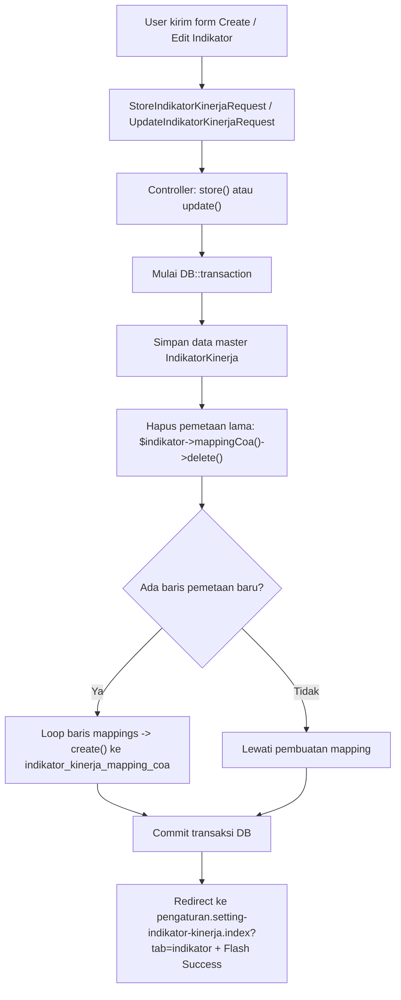
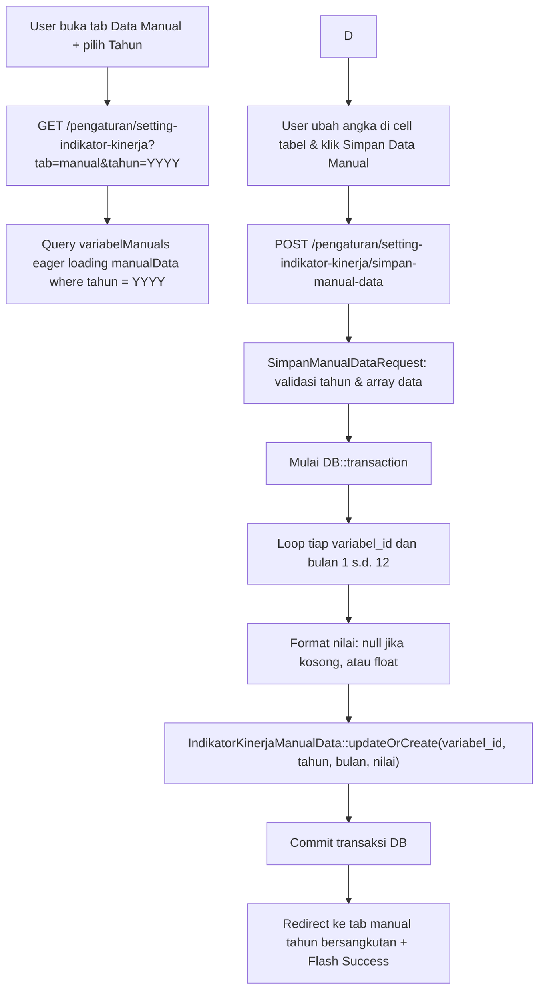

# Dokumentasi Modul Pengaturan — Setting Indikator Kinerja

## Ringkasan Modul

Modul **Setting Indikator Kinerja** digunakan oleh bagian akuntansi dan manajemen untuk mengelola konfigurasi seluruh parameter indikator kinerja (KPI) rumah sakit serta menginput data operasional manual yang dibutuhkan oleh formula indikator.

Fitur utama meliputi:
1. Kartu ringkasan master konfigurasi: Total Indikator, Indikator Aktif, Indikator Nonaktif, dan Total Variabel Manual.
2. Pengaturan master indikator kinerja: kode, nama, satuan, formula/tipe kalkulasi, basis pembilang, basis penyebut, dan rentang ambang batas target evaluasi (Hijau / Kuning / Merah).
3. Pemetaan akun COA dinamis dengan berbagai peran (*Numerator*, *Denominator*, *Addition*, *Deduction*, serta opsi *Exclusion* / akun pengecualian).
4. Pengelolaan master variabel manual operasional (misalnya: Persentase Lolos BAHV Pertama JKN, Jumlah SDM Non Organik).
5. Matriks input dan update data bulanan (Januari s.d. Desember) untuk seluruh variabel manual per tahun anggaran.

Implementasi utama modul ini berada di:
- `routes/web.php`
- `app/Http/Controllers/Pengaturan/SettingIndikatorKinerjaController.php`
- `app/Http/Requests/Pengaturan/StoreIndikatorKinerjaRequest.php`
- `app/Http/Requests/Pengaturan/UpdateIndikatorKinerjaRequest.php`
- `app/Http/Requests/Pengaturan/StoreVariabelManualRequest.php`
- `app/Http/Requests/Pengaturan/SimpanManualDataRequest.php`
- `app/Models/IndikatorKinerja.php`
- `app/Models/IndikatorKinerjaMappingCoa.php`
- `app/Models/IndikatorKinerjaVariabelManual.php`
- `app/Models/IndikatorKinerjaManualData.php`
- `resources/views/pengaturan/setting-indikator-kinerja/index.blade.php`
- `resources/views/pengaturan/setting-indikator-kinerja/create.blade.php`
- `resources/views/pengaturan/setting-indikator-kinerja/edit.blade.php`

---

## Entry Point / API

Modul ini dikendalikan oleh middleware `module.access:pengaturan.setting-indikator-kinerja,[action]`.

| Method | Path | Route Name | Controller Method | Izin |
| --- | --- | --- | --- | --- |
| `GET` | `/pengaturan/setting-indikator-kinerja` | `pengaturan.setting-indikator-kinerja.index` | `index(Request $request)` | view |
| `GET` | `/pengaturan/setting-indikator-kinerja/create` | `pengaturan.setting-indikator-kinerja.create` | `create()` | create |
| `POST` | `/pengaturan/setting-indikator-kinerja` | `pengaturan.setting-indikator-kinerja.store` | `store(StoreIndikatorKinerjaRequest $request)` | create |
| `POST` | `/pengaturan/setting-indikator-kinerja/variabel` | `pengaturan.setting-indikator-kinerja.store-variabel` | `storeVariabel(StoreVariabelManualRequest $request)` | create |
| `GET` | `/pengaturan/setting-indikator-kinerja/{indikator}/edit` | `pengaturan.setting-indikator-kinerja.edit` | `edit(IndikatorKinerja $indikator)` | update |
| `PUT` | `/pengaturan/setting-indikator-kinerja/{indikator}` | `pengaturan.setting-indikator-kinerja.update` | `update(UpdateIndikatorKinerjaRequest $request, IndikatorKinerja $indikator)` | update |
| `POST` | `/pengaturan/setting-indikator-kinerja/simpan-manual-data` | `pengaturan.setting-indikator-kinerja.simpan-manual-data` | `simpanManualData(SimpanManualDataRequest $request)` | update |
| `DELETE` | `/pengaturan/setting-indikator-kinerja/{indikator}` | `pengaturan.setting-indikator-kinerja.destroy` | `destroy(IndikatorKinerja $indikator)` | delete |

---

## Parameter Query (Halaman Index)

Endpoint `GET /pengaturan/setting-indikator-kinerja` menerima parameter query berikut:
- `tab`: Pilihan tab antarmuka (`indikator` untuk Manajemen Indikator & Target RAG, `manual` untuk Entri Data Manual Bulanan, default: `indikator`).
- `tahun`: Tahun anggaran untuk matriks entri data manual (integer 2000–2100, default: tahun berjalan).
- `q`: Kata kunci pencarian kode, nama, atau formula indikator pada Tab 1 (opsional).
- `pola`: Filter pola evaluasi target (`ALL`, `HIGHER_IS_BETTER`, `LOWER_IS_BETTER`, `TARGET_BAND`, default: `ALL`).

---

## Validasi Request

### 1. `StoreIndikatorKinerjaRequest` & `UpdateIndikatorKinerjaRequest`
Memvalidasi formulir tambah dan edit indikator kinerja:
- `kode`: Wajib, string, maksimal 50 karakter, unik pada tabel `indikator_kinerja` (dikecualikan untuk ID indikator saat update).
- `nama`: Wajib, string, maksimal 100 karakter.
- `satuan`: Wajib, nilai valid dari enum `SatuanIndikator` (`%`, `Kali`, `Poin`, `Hari`, `Jam`, `Menit`, `Rp`, `Juta Rp`, `Orang`, `Pasien`, `TT`, `Dokumen`, `Juta/org/bln`).
- `tipe_kalkulasi`: Wajib, nilai valid dari enum `TipeKalkulasi` (`RASIO`, `TURNOVER`, `MANUAL`).
- `basis_pembilang`: Opsional, enum `BasisPembilang` (`COA`, `SURPLUS`, `NONE`).
- `basis_penyebut`: Opsional, enum `BasisPenyebut` (`COA`, `RBA`, `MANUAL`, `NONE`).
- `variabel_manual_id`: Opsional, integer, harus ada di tabel `indikator_kinerja_variabel_manual,id`.
- `definisi_operasional`: Opsional, teks bebas.
- `urutan`: Opsional, integer $\ge 0$.
- `status_aktif`: Boolean (otomatis dinormalisasi di `prepareForValidation`).
- `pola_evaluasi`: Wajib, enum `PolaEvaluasi` (`HIGHER_IS_BETTER`, `LOWER_IS_BETTER`, `TARGET_BAND`).
- `target_hijau_min`, `target_hijau_max`, `target_kuning_min`, `target_kuning_max`, `target_merah_min`, `target_merah_max`: Opsional, nilai numerik ambang batas.
- `mappings`: Opsional, array pemetaan COA:
  - `mappings.*.coa_id`: Wajib jika mappings diisi, integer, harus ada di tabel `coa,id`.
  - `mappings.*.peran`: Wajib, enum `PeranCoa` (`NUMERATOR`, `DENOMINATOR`, `ADDITION`, `DEDUCTION`).
  - `mappings.*.is_excluded`: Opsional, boolean.

### 2. `StoreVariabelManualRequest`
Memvalidasi penambahan master variabel manual:
- `kode`: Wajib, string, maksimal 50 karakter, unik pada tabel `indikator_kinerja_variabel_manual`.
- `nama`: Wajib, string, maksimal 100 karakter.
- `satuan`: Wajib, nilai valid dari enum `SatuanIndikator`.
- `deskripsi`: Opsional, string maksimal 1000 karakter.

### 3. `SimpanManualDataRequest`
Memvalidasi simpan matriks nilai bulanan variabel manual:
- `tahun`: Wajib, integer antara 2000 s.d. 2100.
- `data`: Wajib, array terindeks ID variabel `[variabel_id => [bulan => nilai]]`.
- `data.*`: Array per bulan.
- `data.*.*`: Nilai numerik atau kosong/null.

---

## Alur 1: Create / Edit Indikator Kinerja & Sinkronisasi COA

Alur ini memproses pembuatan indikator baru atau pembaruan konfigurasi indikator yang sudah ada beserta relasi pemetaan akun COA-nya.

### Flowchart

### Algoritma

1. Request diterima dan divalidasi oleh `StoreIndikatorKinerjaRequest` atau `UpdateIndikatorKinerjaRequest`.
2. Controller membungkus seluruh operasi dalam `DB::transaction`.
3. Memisahkan data indikator utama dari payload pemetaan COA (`$request->safe()->except('mappings')`).
4. Jika `urutan` tidak diisi pada aksi create, sistem otomatis menetapkan `urutan` tertinggi + 1.
5. Record `IndikatorKinerja` dibuat atau diperbarui.
6. Metode privat `syncMappings()` dipanggil:
   - Menghapus semua relasi COA lama via `$indikator->mappingCoa()->delete()`.
   - Melakukan iterasi pada array `$mappings`, menyaring baris yang memiliki `coa_id`, dan menyimpannya sebagai record baru dengan atribut `coa_id`, `peran`, dan `is_excluded`.
7. Transaksi database di-commit.
8. Pengguna dialihkan kembali ke daftar indikator dengan flash pesan notifikasi sukses.

### Fungsi yang Dipanggil

- `SettingIndikatorKinerjaController::create()`
- `SettingIndikatorKinerjaController::store()`
- `SettingIndikatorKinerjaController::edit()`
- `SettingIndikatorKinerjaController::update()`
- `SettingIndikatorKinerjaController::syncMappings()`
- `SettingIndikatorKinerjaController::destroy()`

---

## Alur 2: Matriks Input Data Bulanan Variabel Manual

Alur ini mengelola pengisian matriks data numerik untuk variabel manual bulanan (Januari s.d. Desember) pada tahun tertentu.

### Flowchart

### Algoritma

1. Pada tampilan index dengan query string `?tab=manual&tahun=YYYY`, controller memuat seluruh `IndikatorKinerjaVariabelManual` beserta relasi `manualData` yang difilter khusus pada tahun tersebut.
2. Pengguna mengisi atau mengosongkan nilai pada sel input bulan 1 s.d. 12.
3. Form disubmit via method `POST` ke endpoint `pengaturan.setting-indikator-kinerja.simpan-manual-data`.
4. `SimpanManualDataRequest` memastikan `tahun` valid (2000-2100) dan struktur `data` berupa array.
5. Controller menjalankan `DB::transaction`:
   - Melakukan loop ganda: `foreach ($data as $variabelId => $months)` lalu `foreach ($months as $bulan => $nilai)`.
   - Memvalidasi rentang bulan ($1 \le \text{bulan} \le 12$).
   - Mengubah nilai string kosong atau null menjadi nilai database `NULL`, atau mem-parsing string angka menjadi `float`.
   - Menjalankan `IndikatorKinerjaManualData::updateOrCreate()` dengan kunci komposit `['variabel_id', 'tahun', 'bulan']`.
6. Transaksi database di-commit.
7. Pengguna diarahkan kembali ke tab data manual pada tahun yang sama dengan flash message sukses.

### Fungsi yang Dipanggil

- `SettingIndikatorKinerjaController::index()`
- `SettingIndikatorKinerjaController::storeVariabel()`
- `SettingIndikatorKinerjaController::simpanManualData()`
- `IndikatorKinerjaManualData::updateOrCreate()`

---

## Catatan Penting Bisnis

1. **Integritas Referensial**:
   - Penghapusan data master `IndikatorKinerja` melalui `destroy()` secara otomatis menghapus pemetaan akun terkait di tabel `indikator_kinerja_mapping_coa` melalui aturan *Foreign Key CASCADE*.
2. **Pola Evaluasi Target Fleksibel**:
   - `HIGHER_IS_BETTER`: Kinerja dikatakan prima (Hijau) jika nilai aktual $\ge$ target hijau minimum (misal: Capaian Pendapatan, EBITDA Margin, Profitabilitas / NPM, Kualitas Klaim JKN, Beban Dana Sosial, Produktifitas Karyawan).
   - `LOWER_IS_BETTER`: Kinerja dikatakan prima (Hijau) jika nilai aktual $\le$ target hijau maksimum (misal: Beban Farmasi, Beban Operasional, Collection Period, Perputaran Persediaan).
   - `TARGET_BAND`: Kinerja prima jika nilai aktual berada dalam rentang target optimal tertentu (misal: Beban Pegawai 20% - 25%). Ambang batas dibuat berkesinambungan (contiguous) dengan target kuning untuk mencegah celah nilai pecahan (fractional gap).
3. **Penyimpanan Nilai Kosong pada Matriks Manual**:
   - Jika pengguna menghapus isi sel pada matriks bulanan, nilai disimpan sebagai `NULL` di database, bukan `0`. Hal ini penting agar sistem evaluasi KPI dapat membedakan antara nilai riil nol dengan data bulan yang memang belum diinput.
4. **Indikator Baseline Rumah Sakit**:
   - Sistem secara bawaan menyediakan 11 indikator kinerja rumah sakit (Capaian Pendapatan, EBITDA, Profitabilitas, Beban Pegawai, Beban Farmasi, Beban Operasional, Collection Period, Kualitas Klaim JKN, Perputaran Persediaan, Beban Dana Sosial, dan Produktifitas Karyawan) serta 2 variabel manual (`lolos_bahv_pertama_jkn` dan `sdm_non_organik`) melalui seeder.
