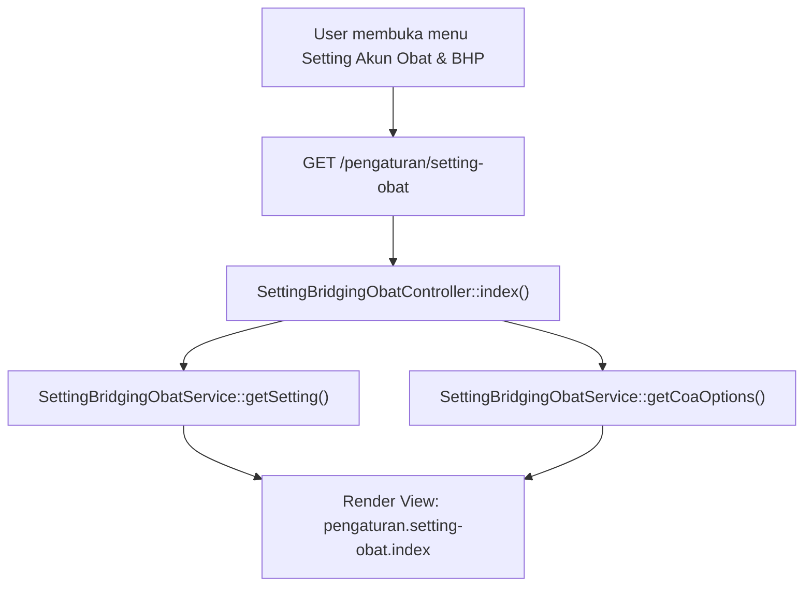
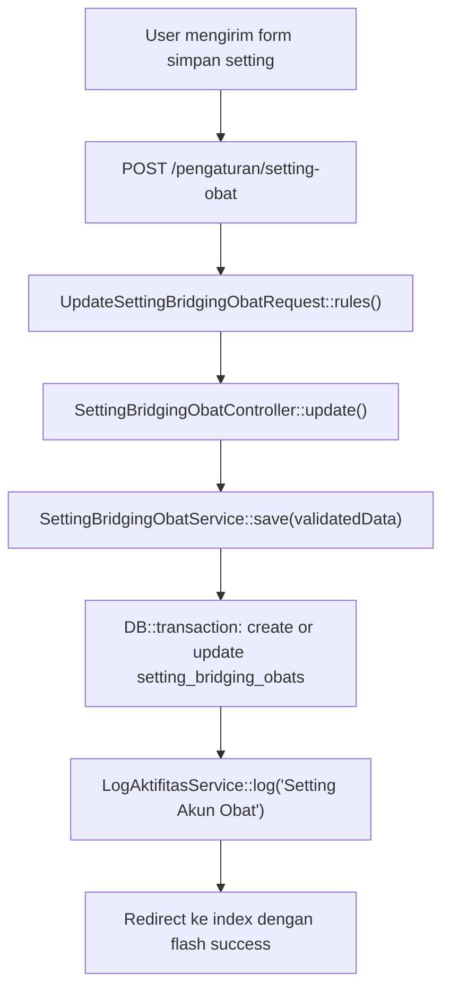

# Dokumentasi Modul Pengaturan Setting Akun Obat & BHP

## Ringkasan Modul

Modul **Setting Akun Obat & BHP** digunakan untuk mengelola konfigurasi akun COA tetap yang menjadi landasan integrasi modul Bridging Pendapatan Obat (Tarik Tagihan Obat & BHP dan Tarik Piutang Obat & BHP) tanpa membaca tabel jurnal SIMRS:

1. Menentukan akun kredit **Pendapatan Penjualan Obat & BHP**.
2. Menentukan akun debit **Harga Pokok Penjualan (HPP) Obat & BHP**.
3. Menentukan akun kredit **Persediaan Obat & BHP**.
4. Menentukan akun debit **Piutang Obat & BHP**.
5. Menentukan akun debit **Kas / Uang Muka Piutang Obat**.

Implementasi utama modul ini berada di:

- `routes/web.php`
- `app/Http/Controllers/Pengaturan/SettingBridgingObatController.php`
- `app/Http/Requests/Pengaturan/UpdateSettingBridgingObatRequest.php`
- `app/Services/Pengaturan/SettingBridgingObatService.php`
- `app/Models/SettingBridgingObat.php`
- `resources/views/pengaturan/setting-obat/index.blade.php`

## Entry Point / API

| Method | Path | Route Name | Controller Method | Permission |
| --- | --- | --- | --- | --- |
| `GET` | `/pengaturan/setting-obat` | `pengaturan.setting-obat.index` | `SettingBridgingObatController::index()` | `pengaturan.setting-obat:view` |
| `POST` | `/pengaturan/setting-obat` | `pengaturan.setting-obat.update` | `SettingBridgingObatController::update()` | `pengaturan.setting-obat:update` |

## Alur 1: Melihat Pengaturan Akun Obat & BHP

### Flowchart

### Algoritma

1. Controller meminta record konfigurasi tunggal via `SettingBridgingObatService::getSetting()`. Jika belum ada baris di database, instansiasi model baru dikembalikan.
2. Controller mengambil daftar opsi COA aktif yang `is_postable = true` via `SettingBridgingObatService::getCoaOptions()`.
3. Menampilkan halaman view pengaturan dengan pre-selected nilai COA yang tersimpan.

### Fungsi yang Dipanggil

- `SettingBridgingObatController::index()`
- `SettingBridgingObatService::getSetting()`
- `SettingBridgingObatService::getCoaOptions()`

---

## Alur 2: Memperbarui Pengaturan Akun Obat & BHP

### Validasi Request

`UpdateSettingBridgingObatRequest` memvalidasi:

- `pendapatan_obat_coa_id`: `required`, `integer`, `exists:coa,id`.
- `hpp_obat_coa_id`: `required`, `integer`, `exists:coa,id`.
- `persediaan_obat_coa_id`: `required`, `integer`, `exists:coa,id`.
- `piutang_obat_coa_id`: `required`, `integer`, `exists:coa,id`.
- `kas_uang_muka_coa_id`: `required`, `integer`, `exists:coa,id`.

### Flowchart

### Algoritma

1. Request divalidasi memastikan kelima ID COA wajib diisi dan eksis pada tabel `coa`.
2. `SettingBridgingObatService::save()` berjalan dalam transaksi database.
3. Memeriksa baris pertama tabel `setting_bridging_obats`:
   - Jika belum ada, buat record baru dan catat log aktivitas tipe `create`.
   - Jika sudah ada, perbarui baris yang ada dan catat log aktivitas tipe `update` dengan diff perubahan.
4. Redirect kembali ke halaman setting dengan pesan sukses.

### Fungsi yang Dipanggil

- `UpdateSettingBridgingObatRequest::rules()`
- `SettingBridgingObatController::update()`
- `SettingBridgingObatService::save()`
- `LogAktifitasService::log()`

## Catatan Penting Bisnis

- Tabel `setting_bridging_obats` dirancang sebagai konfigurasi baris tunggal (*single row configuration*).
- Jika pengaturan 5 akun ini belum diisi secara lengkap, proses import pada modul **Bridging Pendapatan Obat** (baik Tarik Obat & BHP maupun Tarik Piutang Obat & BHP) akan langsung ditolak dan meminta pengguna mengonfigurasi pengaturan akun terlebih dahulu.
- Semua aksi perubahan dicatat ke audit log via `LogAktifitasService`.
