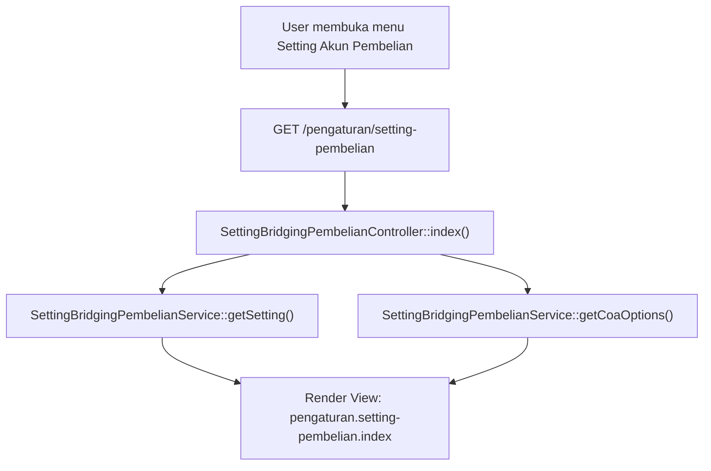
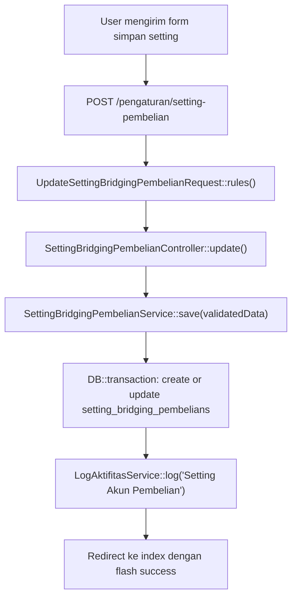

# Dokumentasi Modul Pengaturan Setting Akun Pembelian

## Ringkasan Modul

Modul **Setting Akun Pembelian** digunakan untuk mengelola konfigurasi akun COA tetap yang menjadi landasan integrasi modul Bridging Pembelian (Pemesanan Obat & BHP serta Barang Non Medis) tanpa membaca tabel jurnal SIMRS:

1. Menentukan akun debit **Persediaan Obat & BHP**.
2. Menentukan akun debit **PPN Masukan (Bersama)**.
3. Menentukan akun kredit **Hutang Pembelian Obat & BHP**.
4. Menentukan akun debit **Persediaan / Beban Non Medis**.
5. Menentukan akun kredit **Hutang Pembelian Non Medis**.

Implementasi utama modul ini berada di:

- `routes/web.php`
- `app/Http/Controllers/Pengaturan/SettingBridgingPembelianController.php`
- `app/Http/Requests/Pengaturan/UpdateSettingBridgingPembelianRequest.php`
- `app/Services/Pengaturan/SettingBridgingPembelianService.php`
- `app/Models/SettingBridgingPembelian.php`
- `resources/views/pengaturan/setting-pembelian/index.blade.php`

## Entry Point / API

| Method | Path | Route Name | Controller Method | Permission |
| --- | --- | --- | --- | --- |
| `GET` | `/pengaturan/setting-pembelian` | `pengaturan.setting-pembelian.index` | `SettingBridgingPembelianController::index()` | `pengaturan.setting-pembelian:view` |
| `POST` | `/pengaturan/setting-pembelian` | `pengaturan.setting-pembelian.update` | `SettingBridgingPembelianController::update()` | `pengaturan.setting-pembelian:update` |

## Alur 1: Melihat Pengaturan Akun Pembelian

### Flowchart

### Algoritma

1. Controller meminta record konfigurasi tunggal via `SettingBridgingPembelianService::getSetting()`. Jika belum ada baris di database, instansiasi model baru dikembalikan.
2. Controller mengambil daftar opsi COA aktif via `SettingBridgingPembelianService::getCoaOptions()`.
3. Menampilkan halaman view pengaturan dengan pre-selected nilai COA yang tersimpan.

### Fungsi yang Dipanggil

- `SettingBridgingPembelianController::index()`
- `SettingBridgingPembelianService::getSetting()`
- `SettingBridgingPembelianService::getCoaOptions()`

---

## Alur 2: Memperbarui Pengaturan Akun Pembelian

### Validasi Request

`UpdateSettingBridgingPembelianRequest` memvalidasi:

- `persediaan_obat_coa_id`: `required`, `integer`, `exists:coa,id`.
- `ppn_masukan_coa_id`: `required`, `integer`, `exists:coa,id`.
- `hutang_obat_coa_id`: `required`, `integer`, `exists:coa,id`.
- `persediaan_non_medis_coa_id`: `required`, `integer`, `exists:coa,id`.
- `hutang_non_medis_coa_id`: `required`, `integer`, `exists:coa,id`.

### Flowchart

### Algoritma

1. Request divalidasi memastikan kelima ID COA wajib diisi dan eksis pada tabel `coa`.
2. `SettingBridgingPembelianService::save()` berjalan dalam transaksi database.
3. Memeriksa baris pertama tabel `setting_bridging_pembelians`:
   - Jika belum ada, buat record baru dan catat log aktivitas tipe `create`.
   - Jika sudah ada, perbarui baris yang ada dan catat log aktivitas tipe `update` dengan diff perubahan.
4. Redirect kembali ke halaman setting dengan pesan sukses.

### Fungsi yang Dipanggil

- `UpdateSettingBridgingPembelianRequest::rules()`
- `SettingBridgingPembelianController::update()`
- `SettingBridgingPembelianService::save()`
- `LogAktifitasService::log()`

## Catatan Penting Bisnis

- Tabel `setting_bridging_pembelians` dirancang sebagai konfigurasi baris tunggal (*single row configuration*).
- Jika pengaturan ini belum lengkap atau belum disimpan, penarikan faktur pada modul Bridging Pembelian akan ditolak dengan validasi strict.
- Seluruh mutasi persediaan, PPN, dan hutang faktur pembelian di modul Bridging Pembelian otomatis merujuk ke kelima akun COA ini.
